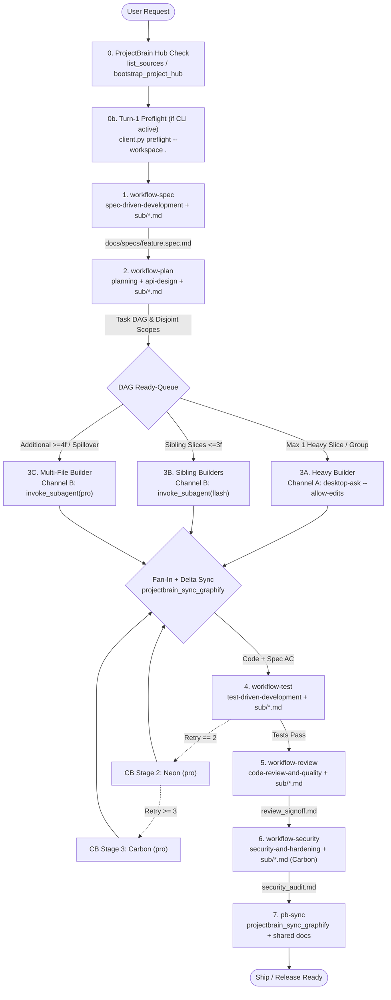

# End-to-End Multi-Agent Pipeline Workflow

## 0. Mandatory ProjectBrain Hub & Skill Override Gate
Before starting Stage 1:
1. Call `projectbrain_list_sources(project_id="<project_id>")`. If empty, call `projectbrain_bootstrap_project_hub(project_id="<project_id>", workspace_root=".", auto_discover=True, sync_graphs=True, auto_link=True)`.
2. For every stage below, inject the stage's `.agents/skills/<skill>/SKILL.md` **AND** all `.agents/skills/<skill>/sub/*.md` (excluding `README.md`) as project-specific overrides, alongside scoped ProjectBrain context (`proj@source:branch`, `include_shared_docs=True`).
3. After any code edits in a sub-source, run `projectbrain_sync_graphify(project_id="<project_id>", source_id="<source_id>", upgrade_mode="delta", auto_link_sources=True)`.

## 1. Pipeline Overview & Handoff Graph



## 2. Stage-by-Stage Contract Summary

| Stage | Workflow File | Skill (`+ sub/*.md`) | Multi-Agent / Dual-Channel Routing | Input Pointer | Output Artifact |
| :---: | :--- | :--- | :--- | :--- | :--- |
| **0** | [`pb-bootstrap.md`](./pb-bootstrap.md) | `multi-agent-orchestrator` | Hub check + `preflight --workspace .` | Workspace root | Registered sources + `EXECUTION_MODE` |
| **1** | [`workflow-spec.md`](./workflow-spec.md) | `spec-driven-development` | Ch-A `desktop-ask` *(non-sec)* / Ch-B `pro` | Request + ProjectBrain hits | `docs/specs/{feature_id}.spec.md` |
| **2** | [`workflow-plan.md`](./workflow-plan.md) | `planning-and-task-breakdown`, `api-and-interface-design` | Ch-A `desktop-ask` / Ch-B `pro` | `docs/specs/{feature_id}.spec.md` | `docs/plans/{feature_id}.plan.md` |
| **3** | [`workflow-build.md`](./workflow-build.md) | `incremental-implementation` / `frontend-ui-engineering` | Ch-A *(max 1/group)* + Ch-B `flash` / `pro` | Task slice from `.plan.md` | Disjoint edits + `sync_graphify` |
| **4** | [`workflow-test.md`](./workflow-test.md) | `test-driven-development` | Ch-B `invoke_subagent(Model="flash")` | Code + Spec AC | `docs/reports/test_report.json` |
| **5** | [`workflow-review.md`](./workflow-review.md) | `code-review-and-quality` | Ch-A `desktop-ask` *(non-sec)* / Ch-B `pro` | Diff + `.plan.md` + tests | `docs/reviews/review_signoff.md` |
| **6** | [`workflow-security.md`](./workflow-security.md) | `security-and-hardening` | Ch-B `invoke_subagent(Model="pro")` *(Carbon locked)* | Diff + `review_signoff.md` | `docs/security/security_audit.md` |
| **7** | [`pb-sync.md`](./pb-sync.md) | `documentation-and-adrs` | Direct MCP sync | Modified sources + docs | Updated ProjectBrain Hub |

## 3. Dispatch Protocol & Fallbacks
1. **Multi-Agent IDEs**: Follow [`pb-create-agent.md`](./pb-create-agent.md) to spawn role-based subagents (`invoke_subagent`, `Task`, or `Agent`) injected with `<skill>/SKILL.md`, `<skill>/sub/*.md` overrides, and scoped ProjectBrain context (`proj@source:branch`).
2. **Dual-Channel CLI (`HYBRID_60_DESKTOP`)**: When `client.py preflight --workspace .` reports `desktop_ready == true`, route read-only synthesis (`spec-engineer`, `task-planner`, `code-reviewer`) and at most 1 heavy `builder` per `parallel_group` (`--allow-edits`) to `desktop-ask`, running sibling `<=3`-file builders and `test-engineer` concurrently on Channel B (`Model="flash"`).
3. **Single-Agent IDEs**: Execute stages 1–7 sequentially, adopting each role persona with its `SKILL.md` + `sub/*.md` overrides and running `projectbrain_sync_graphify` after edits.
4. **3-Stage Circuit Breaker (Channel B API Only)**: `retry == 1` Hydrogen (`flash`, `xhigh`) -> `retry == 2` Neon (`pro`, `high`) -> `retry >= 3` or security impact -> Carbon (`pro`, `high`).
5. **Post-Mission Audit Export** *(if orchestrator CLI is active)*:
   ```bash
   python3 ~/.gemini/tools/orchestrator/client.py export --format markdown --out docs/reports/mission_audit_report.md
   ```
