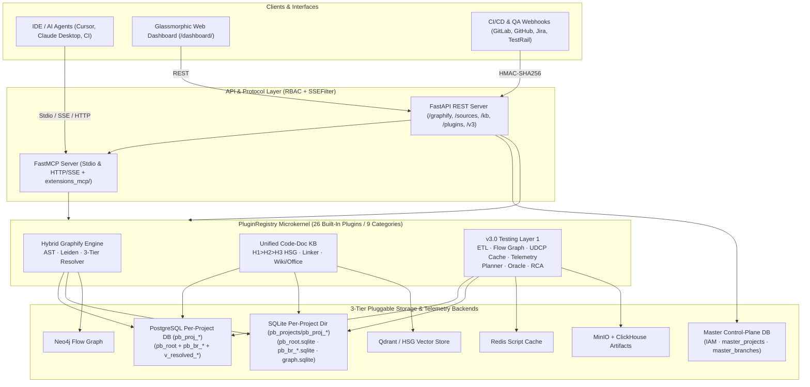

# ProjectBrain v3.0

[](pyproject.toml)
[](src/projectbrain/server/api.py)
[](src/projectbrain/ai/mcp.py)
[](docs/kb/PLUGIN_ARCHITECTURE_GUIDE.md)

**Plugin-Driven Hybrid Graphify Cognitive Engine, Multi-Schema Knowledge Base & AI Testing Layer 1.**

ProjectBrain v3.0 unifies zero-token AST code graphs, multi-branch PostgreSQL/SQLite overlays, multimodal document intelligence, and a 100% plugin-driven microkernel serving as **Layer 1 (Knowledge Base, Verified UDCP Script Cache & Synchronized Telemetry Evidence Store)** for AI software engineering and multi-device / embedded test automation.

## Key Capabilities

- **Hybrid Graphify Memory Core**: Replaces legacy codegraph workflows with zero-token Tree-sitter AST extraction across 22+ languages (`GraphifyExtractor`), Leiden community clustering, SHA256 incremental caching, and a **3-Tier Hybrid Resolver** merging `Local Partial (.projectbrain/local_graph/) -> Server Branch Overlay -> Server Root` while preserving legacy Vis.js Web UI graph compatibility.
- **3-Tier Multi-DB & Per-Branch Schema Isolation (`Master DB -> Project DB -> Branch Schema`)**: Global Master Control-Plane DB (`master_projects`, `master_branches`, IAM/auth) routes each project to a dedicated physical Project Database (`pb_proj_<slug>_<hash8>` in PostgreSQL via `CREATE DATABASE` or `<master_dir>/pb_projects/<db_name>/` in SQLite), and isolates every branch into its own schema (`pb_root` for `main` / `PB_ROOT_BRANCH`, `pb_br_<slug>_<hash8>` for feature branches) across **both Graphify code/doc graphs and HSG Documents/Memories** with virtual SQL resolution views (`v_resolved_*`) and `O(Delta)` diffing.
- **Multimodal Document Push & Tight Code–Doc Unified KB**: Local parsing for PDF, DOCX, XLSX, PPTX, CSV, Markdown, and offline **PaddleOCR / RapidOCR / Local AI Vision** (`pip install -e ".[ocr-cpu]"` / `".[ocr-gpu]"` / `".[ocr-onnx]"` / `".[ocr-onnx-gpu]"`) pushed to MCP/REST with unit-level versioning and pre-OCR delta reuse; deterministic Wiki, DOCX, XLSX, and PPTX synthesis; `H1 > H2 > H3` hierarchical chunking into HSG cognitive memory + waypoints; bidirectional `Code <-> Doc <-> Endpoint <-> Test` linking and drift detection.
- **100% Plugin-Driven Microkernel & v3.0 Multi-Device / Embedded Testing Layer 1**: `PluginRegistry` coordinates **26 built-in plugins across 9 categories** (`graph_backend`, `vector_backend`, `etl_parser`, `knowledge_linker`, `doc_exporter`, `script_cache`, `artifact_store`, `brain_consumer`, `webhook`):
  - **Storage & Search**: SQLite Overlay, PostgreSQL Multi-Schema, Neo4j Flow Graph, HSG Memory, and Qdrant hybrid vector backends.
  - **Canonical ETL & Flow Graph**: Graphify AST, Multimodal Doc, Legacy Testcase (CSV/XLSX/TestRail), Hardware Datasheet (UART/AT/HardFault CFSR/electrical limits), OpenAPI 3.1, C++ Embedded (Qt UI, signals/slots, GNU `.ld`/`.map`), and version-tagged `STATE_NODE` / `SCREEN_NODE` / `TRANSITION_EDGE` flow graphs (`version_tag`).
  - **Testing Layer 1 & Brain Consumers**: Verified UDCP Script Cache (`cache.sqlite_pg`, `cache.redis`) with auto-invalidation (`fallback_rate > 0.25`, `min_samples=4`), NTP-synchronized Telemetry Evidence Store (`artifacts.local_sqlite`, `artifacts.minio_clickhouse`, 8 stream types, 30–90d TTL), Impact Test DAG Planner (`brain.planner`), AI Test Oracle Judge (`brain.oracle`), RCA Stacktrace Triage (`brain.rca`), and HMAC-signed CI/CD webhooks (`webhook.event_ingest`).
- **Multi-Tenant RBAC & Security**: Token-scoped `admin`, `collaborator`, and `reader` roles; tool-level `SSEFilter` and read-only enforcement (`PB_READ_ONLY`, `PB_REQUIRE_REST_AUTH`); strict path-traversal guards (`_validate_safe_path`); secret redaction on plugin config responses; and HMAC-SHA256 webhook verification.

## Architecture Overview



### 3-Tier Storage Topology (`Master DB -> Project DB -> Branch Schema`)

1. **Tier 1 — Master Control-Plane DB**: Stores global IAM/RBAC, migrations, and the `master_projects` / `master_branches` topology catalog (inspectable via `GET /master/topology` and FastMCP `projectbrain_database_topology`).
2. **Tier 2 — 1 Project = 1 Physical Database (`pb_proj_<slug>_<hash8>`)**: Provisioned on demand via `POST /master/projects` or `POST /codegraph/projects` (`CREATE DATABASE` on PostgreSQL; `<master_db_dir>/pb_projects/<db_name>/` on SQLite with `graph.sqlite` + branch `.sqlite` files).
3. **Tier 3 — 1 Branch = 1 Schema (`pb_root` / `pb_br_<slug>_<hash8>`)**: Each branch isolates **both Graphify AST/Doc graphs and HSG Documents/Memories** (`POST /master/projects/{id}/branches`, `DELETE /master/projects/{id}/branches/{branch}`), while preserving cross-schema delta reuse (`reused_units`) and `O(Delta)` branch resolution (`v_resolved_*`).

## Installation & Quick Start

### 1. Install Dependencies

```bash
# Standard installation (Graphify AST, FastAPI, FastMCP, Office parsers/exporters)
pip install -e .

# Optional local offline OCR extras (CPU, GPU, or lightweight ONNX / RapidOCR):
pip install -e ".[ocr-cpu]"       # PaddleOCR (CPU) + PyMuPDF (alias: ".[ocr]")
pip install -e ".[ocr-gpu]"       # PaddleOCR (CUDA GPU) + PyMuPDF
pip install -e ".[ocr-onnx]"      # RapidOCR (ONNX Runtime CPU — lightweight & fast)
pip install -e ".[ocr-onnx-gpu]"  # RapidOCR (ONNX Runtime GPU/CUDA)

# Optional Graphify GPU/MPS/CUDA & Semantic Embedding extras:
pip install -e ".[graphify-gpu]"   # PyTorch (CUDA/Apple MPS) + sentence-transformers + igraph + scipy
pip install -e ".[graphify-cuda]"  # Full graphify-gpu + NVIDIA RAPIDS cuGraph/cuDF (Linux x86_64)
```

### 2. Configure Environment (`.env` or `projectbrain.toml`)

```dotenv
# Storage backend: "sqlite" (default local) or "postgres" (multi-schema overlay)
OM_METADATA_BACKEND=sqlite
PB_DB_PATH=projectbrain.db
PB_ROOT_BRANCH=main
PB_PORT=8080

# PostgreSQL Multi-Schema (when OM_METADATA_BACKEND=postgres)
# OM_PG_HOST=localhost
# OM_PG_PORT=5432
# OM_PG_USER=postgres
# OM_PG_PASSWORD=secret
# OM_PG_DB=projectbrain

# Security & RBAC
# PB_REQUIRE_REST_AUTH=true
# PB_READ_ONLY=false
# PB_WEBHOOK_SECRET=your_hmac_secret

# Optional LLM / Embedding & Plugin Overrides
# GEMINI_API_KEY=your_key
# PB_PLUGINS_DIR=./plugins
# PB_PLUGINS_CONFIG_PATH=./projectbrain.toml
# PB_ENABLED_PLUGINS=cache.redis,vector.qdrant
# PB_DISABLED_PLUGINS=graph.neo4j

# Graphify GPU/MPS/CUDA & Multi-Worker Acceleration
# PB_GRAPHIFY_DEVICE=auto          # auto | gpu | cuda:0 | mps | cpu
# PB_GRAPHIFY_WORKERS=4            # Parallel Tree-sitter AST & document worker threads
# PB_GRAPHIFY_SEMANTIC_ENGINE=auto # auto | st | ollama | openai | tfidf
# PB_EMBED_DEVICE=auto             # auto | gpu | cuda:0 | mps | cpu (HSG / local embeddings)

# GPU vs CPU OCR Runtime Configuration
# PB_OCR_DEVICE=auto               # auto | gpu | cuda:0 | mps | cpu
# PB_OCR_GPU_MEM_MB=2000           # GPU memory cap (MB) for PaddleOCR / ONNX
# PB_OCR_USE_TENSORRT=false        # Enable TensorRT acceleration on NVIDIA GPUs
# PB_OCR_PRECISION=fp32            # fp32 | fp16 (half-precision on supported GPUs)
# PB_OCR_CPU_THREADS=4             # Intra-op CPU threads for Paddle/ONNX
# PB_OCR_ENABLE_MKLDNN=auto        # auto | true | false (Intel oneDNN/MKL-DNN on x86 CPU)
# PB_OCR_FALLBACK_TO_CPU=true      # Auto-fallback to CPU if GPU init/OOM fails
# PB_OCR_BATCH_SIZE=4              # Concurrent page/image OCR batch size

# Local AI Document Parsing Backends
# PB_OCR_ENGINE=auto               # auto | paddle | rapidocr | tesseract | ollama | vllm | lmstudio | llamacpp | hybrid_local
# OLLAMA_URL=http://localhost:11434
# PB_OLLAMA_VISION_MODEL=qwen2.5vl:7b
# PB_LOCAL_AI_URL=http://localhost:8000/v1
# PB_LOCAL_AI_MODEL=Qwen/Qwen2.5-VL-7B-Instruct
# OCR_PADDLE_LANG=en
```

### 3. Run Server & Web Dashboard

```bash
# Start REST API, Web Dashboard, and mounted HTTP/SSE MCP server
python3 -m projectbrain.main serve
```

Open the Web Dashboard at **[http://localhost:8080/dashboard/](http://localhost:8080/dashboard/)**.

### 4. Connect MCP (Local Stdio vs. Remote SSE/HTTP)

- **Local Stdio** (Cursor / Claude Desktop local workspace):
  ```json
  {
    "mcpServers": {
      "projectbrain": {
        "command": "python3",
        "args": ["-m", "projectbrain.main", "mcp"],
        "env": {
          "PB_DEFAULT_USER_ID": "my-app:main"
        }
      }
    }
  }
  ```
- **Remote HTTP/SSE** (shared server with token-scoped RBAC):
  - SSE Endpoint: `http://<host>:8080/mcp/sse?project_id=my-app:main` with header `Authorization: Bearer <PB_API_KEY>`.
  - Or run local Stdio in remote proxy mode with `PB_MODE=remote`, `PB_URL=http://<host>:8080`, and `PB_API_KEY=<token>`.

## Essential CLI Commands

All commands run via `python3 -m projectbrain.main <command>`:

| Command | Syntax | Purpose |
| :--- | :--- | :--- |
| `serve` | `serve` | Start FastAPI REST server, Web Dashboard, and mounted HTTP/SSE MCP. |
| `mcp` | `mcp` | Start the local Stdio FastMCP server (core + v3.0 + `extensions_mcp/`). |
| `hardware-status` | `hardware-status [--device auto\|gpu\|cuda\|mps\|cpu] [--ocr-device D] [--semantic-engine E]` | Print unified JSON readiness for OCR, Graphify GPU/MPS/CUDA/CPU backends, and Local AI servers. |
| `graphify-sync` | `graphify-sync <project_id> [path] [--branch B] [--base-branch BASE] [--scoped P1,P2] [--dirty] [--local-only] [--device D] [--workers N] [--semantic-engine E] [--url URL]` | Extract zero-token Tree-sitter AST + Leiden clusters, cache locally, and sync branch delta. |
| `graphify-diff` | `graphify-diff <project_id> [--base main] [--target B] [--local] [--path .] [--url URL]` | Compute `O(Delta)` structural diff between branches or local vs. remote overlay. |
| `upload-doc` | `upload-doc <project_id> <file_path> [--branch main] [--base-branch BASE] [--doc-key K] [--doc-version V] [--base-version BV] [--ocr-engine E] [--ocr-device D] [--local-ai-model M] [--local-ai-url U] [--url URL]` | Parse multimodal docs/OCR locally and push versioned chunks + graph delta to server. |
| `build-kb` | `build-kb [project_id] [path] [--branch B] [--no-memory] [--no-office] [--output DIR] [--db-path DB] [--device D] [--workers N] [--semantic-engine E] [--ocr-engine OE] [--ocr-device OD]` | Synthesize Wiki/DOCX/XLSX/PPTX, chunk into HSG memory, and cross-link Code–Doc–Test. |
| `kb-trace` | `kb-trace <project_id> <target> [--branch B] [--path PATH] [--db-path DB]` | Trace unified AST symbols, doc chunks, callers/callees, tests, and drift status. |
| `kb-coverage` | `kb-coverage <project_id> [--branch B] [--path PATH] [--db-path DB]` | Report repository-wide doc/API/MCP coverage ratios and drift alerts. |
| `plugins` | `plugins [list\|enable\|disable\|reload] [target] [--project P] [--category C]` | List, toggle (globally or per project), or hot-reload microkernel plugins. |
| `v3-etl` | `v3-etl <project_id> <file_path> [--branch B] [--version-tag V] [--format F] [--db-path DB]` | Ingest testcases, datasheets, OpenAPI 3.1, or C++/Qt/LD specs via ETL plugins. |
| `v3-plan` | `v3-plan <project_id> [--branch B] [--version-tag V] [--files f1,f2] [--artifacts a1,a2] [--srs-diff TEXT] [--db-path DB]` | Build blast-radius topological Test DAG with preconditions and UDCP cache bindings. |
| `v3-cache` | `v3-cache <lookup\|store> <project_id> --intent-id I --platform P --build-version V [--screen-hash H] [--commands JSON] [--db-path DB]` | Query or store verified UDCP scripts in the Layer 1 script cache. |
| `v3-artifacts` | `v3-artifacts <window\|purge> [--run-id R] [--center-ts T] [--window-ms W] [--db-path DB]` | Query NTP-aligned telemetry evidence windows or purge expired TTL artifacts. |
| `v3-oracle` | `v3-oracle <project_id> [--intent-id I] [--version-tag V] [--uart-log L] [--branch B] [--screen-id S] [--db-path DB]` | Evaluate telemetry against SRS criteria, state transitions, UART errors, and power budgets. |
| `v3-rca` | `v3-rca <project_id> <log_text_or_file> [--run-id R] [--cache-id C] [--db-path DB]` | Normalize stacktraces, deduplicate RCA incidents, and apply `FlakyScript` cache feedback. |

## FastMCP Tool Ecosystem

| Group | FastMCP Tools |
| :--- | :--- |
| **HSG Memory** | `projectbrain_query`, `projectbrain_store`, `projectbrain_get`, `projectbrain_list`, `projectbrain_delete`, `projectbrain_delete_all`, `projectbrain_reinforce`, `projectbrain_stats`, `projectbrain_ingest`, `projectbrain_register_mcp`, `projectbrain_register_external_mcp` |
| **Graphify & Hybrid KB** | `projectbrain_hardware_status`, `projectbrain_sync_graphify`, `projectbrain_query_graphify` (`query\|trace\|impact\|callers\|callees\|node\|god_nodes\|community`), `projectbrain_local_graphify_diff`, `projectbrain_hybrid_query`, `projectbrain_promote_branch_graph`, `projectbrain_diff_project_versions`, `projectbrain_query_codegraph` |
| **Multi-Source Hub & Auto-Bootstrap** | `projectbrain_get_agent_setup_playbook`, `projectbrain_discover_workspace_sources`, `projectbrain_bootstrap_project_hub`, `projectbrain_register_source`, `projectbrain_list_sources`, `projectbrain_link_sources`, `projectbrain_auto_link_sources`, `projectbrain_cross_source_impact`, `projectbrain_bind_shared_doc` |
| **Multimodal Docs & Unified KB** | `projectbrain_upload_document`, `projectbrain_push_processed_document`, `projectbrain_list_document_versions`, `projectbrain_diff_document_versions`, `projectbrain_build_complete_kb`, `projectbrain_trace_code_and_docs`, `projectbrain_kb_coverage_report`, `projectbrain_generate_project_docs` |
| **v3.0 Plugin & Testing Layer 1** | `projectbrain_list_plugins`, `projectbrain_toggle_plugin`, `projectbrain_v3_ingest_etl`, `projectbrain_v3_script_cache_lookup`, `projectbrain_v3_script_cache_store`, `projectbrain_v3_index_artifact`, `projectbrain_v3_query_evidence_window`, `projectbrain_v3_plan_test_dag`, `projectbrain_v3_oracle_context`, `projectbrain_v3_rca_triage` |
| **Document / OCR / Migration Extensions** | `pdf_convert_to_markdown`, `docx_extract_text`, `excel_list_sheets`, `excel_convert_to_markdown`, `pptx_to_markdown`, `img2md_extract_folder`, `ocr_engine_status`, `ocr_image_to_markdown`, `ocr_pdf_to_markdown`, `migration_translate_code_comments`, `migration_recommend_refactor`, `migration_batch_scan_logic`, `migration_plan_execution_phases` |

## Graphify GPU/MPS/CUDA Acceleration & Local OCR / Local AI

ProjectBrain accelerates both **Graphify AST/clustering/semantic linking** (`projectbrain.graphify_engine.gpu_accelerator.GraphGPUAccelerator`) and **offline OCR / Local AI document parsing** (`projectbrain.ocr_runtime.UnifiedOCREngine`) across NVIDIA CUDA/cuGraph, Apple Silicon MPS, ONNX Runtime, and multi-worker CPU execution.

### Graphify GPU/MPS/CUDA & Multi-Worker Variables

| Environment Variable | Values / Default | Purpose |
| :--- | :--- | :--- |
| `PB_GRAPHIFY_DEVICE` | `auto` \| `gpu` \| `cuda:0` \| `mps` \| `cpu` (default: `auto`) | Selects compute backend (`cugraph_cuda` -> `torch_cuda` -> `torch_mps` -> `numpy_blas_cpu`). |
| `PB_GRAPHIFY_WORKERS` | Integer (default: `min(8, cpu_count)`) | Worker pool size for parallel Tree-sitter AST and document extraction. |
| `PB_GRAPHIFY_SEMANTIC_ENGINE` | `auto` \| `st` \| `ollama` \| `openai` \| `tfidf` (default: `auto`) | Selects batch embedding engine for semantic cross-linking and similarity. |
| `PB_EMBED_DEVICE` | `auto` \| `gpu` \| `cuda:0` \| `mps` \| `cpu` (default: `auto`) | Selects accelerator for local sentence-transformers / HSG embeddings. |

Inspect combined Graphify + OCR + Local AI readiness at any time via REST (`GET /graphify/hardware`), MCP (`projectbrain_hardware_status`), or CLI (`python3 -m projectbrain.main hardware-status`).

### GPU vs CPU OCR Configuration Variables

| Environment Variable | Values / Default | Purpose |
| :--- | :--- | :--- |
| `PB_OCR_DEVICE` | `auto` \| `gpu` \| `cuda:0` \| `mps` \| `cpu` (default: `auto`) | Selects target accelerator; `auto` probes CUDA/MPS and falls back to CPU. |
| `PB_OCR_GPU_MEM_MB` | Integer MB (default: `2000`, e.g., `4096`) | Caps VRAM allocation for PaddleOCR / ONNX GPU providers. |
| `PB_OCR_USE_TENSORRT` | `true` \| `false` (default: `false`) | Enables TensorRT FP16/INT8 acceleration on compatible NVIDIA GPUs. |
| `PB_OCR_PRECISION` | `fp32` \| `fp16` (default: `fp32`) | Inference precision for supported GPU OCR engines. |
| `PB_OCR_CPU_THREADS` | Integer (default: `min(8, cpu_count)`) | Number of CPU inference threads when running on CPU. |
| `PB_OCR_ENABLE_MKLDNN` | `auto` \| `true` \| `false` (default: `auto`) | Enables oneDNN/MKL-DNN acceleration on x86 CPUs (`auto` enables on x86_64/AMD64). |
| `PB_OCR_FALLBACK_TO_CPU` | `true` \| `false` (default: `true`) | Automatically falls back to CPU if GPU initialization or inference fails (e.g., OOM). |
| `PB_OCR_BATCH_SIZE` | Integer (default: `4`) | Batch size for multi-page PDF / folder OCR inference. |

### Local AI Document Parsing Backends

Set `PB_OCR_ENGINE` (`auto|paddle|rapidocr|tesseract|ollama|vllm|lmstudio|llamacpp|hybrid_local`) to choose between classical offline OCR engines and OpenAI-compatible / Ollama local Vision-Language Models (VLMs):

| `PB_OCR_ENGINE` Value | Backend & Required Variables |
| :--- | :--- |
| `auto` | Smart cascade: `paddle` -> `rapidocr` -> reachable Local VLM -> cloud vision. |
| `paddle` | Offline PaddleOCR (`pip install -e ".[ocr-cpu]"` or `".[ocr-gpu]"`). |
| `rapidocr` | Lightweight RapidOCR via ONNX Runtime (`pip install -e ".[ocr-onnx]"` or `".[ocr-onnx-gpu]"`). |
| `tesseract` | Offline Tesseract OCR (`pytesseract` + `tesseract` binary). |
| `ollama` | Local Ollama vision server via `OLLAMA_URL` (default `http://localhost:11434`) and `PB_OLLAMA_VISION_MODEL=qwen2.5vl:7b`. |
| `vllm` | Local vLLM OpenAI-compatible server via `PB_LOCAL_AI_URL` (e.g., `http://localhost:8000/v1`) and `PB_LOCAL_AI_MODEL`. |
| `lmstudio` | LM Studio local server via `PB_LOCAL_AI_URL` (e.g., `http://localhost:1234/v1`) and `PB_LOCAL_AI_MODEL`. |
| `llamacpp` | `llama.cpp` server (`llama-server`) via `PB_LOCAL_AI_URL` (e.g., `http://localhost:8081/v1`) and `PB_LOCAL_AI_MODEL`. |
| `hybrid_local` | Fast local OCR (`paddle`/`rapidocr`) for plain text pages + local VLM (`ollama`/`vllm`/`lmstudio`/`llamacpp`) for complex tables, diagrams, and equations. |

### MCP Examples: GPU/CPU OCR & Local AI Document Parsing

```json
// 1. Inspect detected GPU/CPU devices, installed extras, and Local AI backend health
// Tool: ocr_engine_status
{}
```

```json
// 2. Convert a scanned PDF to Markdown using GPU or Local AI (Ollama / vLLM / hybrid_local)
// Tool: ocr_pdf_to_markdown
{
  "pdf_path": "/path/to/Hardware_Datasheet_Scanned.pdf",
  "dpi": 200,
  "force_ocr": false,
  "engine": "hybrid_local",
  "device": "gpu",
  "local_ai_model": "qwen2.5vl:7b",
  "local_ai_url": "http://localhost:11434",
  "batch_size": 4,
  "output_path": "/path/to/Hardware_Datasheet_Scanned.md"
}
```

```json
// 3. Extract Markdown from a single image / schematic diagram via Local AI or GPU/CPU OCR
// Tool: img2md_extract_image
{
  "image_path": "/path/to/ble_state_diagram.png",
  "engine": "ollama",
  "device": "cuda:0",
  "local_ai_model": "qwen2.5vl:7b",
  "output_path": "/path/to/ble_state_diagram.md"
}
```

```json
// 4. Upload & ingest a scanned PDF/image into ProjectBrain KB (honors PB_OCR_ENGINE / PB_OCR_DEVICE / PB_LOCAL_AI_*)
// Tool: projectbrain_upload_document
{
  "file_path": "/path/to/Hardware_Datasheet_Scanned.pdf",
  "project_id": "smartlock",
  "branch": "feature/ble-v2",
  "doc_key": "hw-datasheet",
  "doc_version": "v1.2",
  "tags": ["datasheet", "ocr", "hardware"]
}
```

### Built-In Plugin Categories (26 Plugins / 9 Categories)

| Category | Built-In Plugin IDs |
| :--- | :--- |
| `graph_backend` | `graph.sqlite_overlay`, `graph.postgres_schema`, `graph.neo4j` |
| `vector_backend` | `vector.hsg_memory`, `vector.qdrant` |
| `etl_parser` | `etl.graphify_ast`, `etl.legacy_testcase`, `etl.hardware_datasheet`, `etl.openapi31`, `etl.cpp_embedded`, `etl.multimodal_doc`, `etl.local_ai_ocr` |
| `knowledge_linker` | `linker.code_doc`, `linker.state_flow` |
| `doc_exporter` | `exporter.wiki`, `exporter.docx`, `exporter.xlsx`, `exporter.pptx` |
| `script_cache` | `cache.sqlite_pg`, `cache.redis` |
| `artifact_store` | `artifacts.local_sqlite`, `artifacts.minio_clickhouse` |
| `brain_consumer` | `brain.planner`, `brain.oracle`, `brain.rca` |
| `webhook` | `webhook.event_ingest` |

### Quick Custom Plugin & MCP Extension Example

**1. Microkernel Plugin** (`./plugins/my_etl/plugin.py` — hot-reloaded via `plugins reload ./plugins` or packaged via `[project.entry-points."projectbrain.plugins"]`):

```python
from projectbrain.plugins.base import ETLParserPlugin, PluginCategory, PluginMetadata

class CustomLogETL(ETLParserPlugin):
    metadata = PluginMetadata(
        plugin_id="etl.custom_log",
        name="Custom Log ETL",
        version="1.0.0",
        category=PluginCategory.ETL_PARSER,
        priority=90,
    )

    def can_parse(self, source_name: str, format_hint=None, content_preview=None) -> bool:
        return source_name.endswith(".clog")

    async def parse(self, source, source_name, project_id, branch="main", version_tag=None):
        return {"plugin_id": self.metadata.plugin_id, "error_rules": [], "canonical_intents": []}
```

**2. Custom MCP Extension** (`extensions_mcp/my_ext/server.py` + `extension.json` — auto-mounted into FastMCP at startup):

```python
from mcp.server.fastmcp import FastMCP

mcp = FastMCP("my-ext")

@mcp.tool(name="my_ext_ping")
async def my_ext_ping(message: str) -> str:
    """Echo a message through the custom MCP extension."""
    return f"pong: {message}"
```

## Multi-Source Project Hub & Zero-Touch Agent Setup

ProjectBrain supports **Multi-Source Project Hubs** (`1 Project = 1 Project DB` with `pb_root` as the `__shared__` Hub and isolated `pb_src_*` schemas per sub-source using the `project_id@source_id:branch` coordinate). External AI agents (Claude Code, Cursor, Antigravity, Codex, Windsurf) can auto-discover repositories, bootstrap the hub, ingest shared specs, and detect cross-source contract drift without manual UI setup:

- **Zero-Touch Auto-Bootstrap Tools:** `projectbrain_get_agent_setup_playbook` (or resource `projectbrain://guides/agent-multi-source-setup`), `projectbrain_discover_workspace_sources`, `projectbrain_bootstrap_project_hub` (REST equivalents: `POST /master/hub/discover`, `POST /master/hub/bootstrap`).
- **Sub-Source Lifecycle & Cross-Source Contracts:** `projectbrain_register_source`, `projectbrain_list_sources`, `projectbrain_link_sources`, `projectbrain_auto_link_sources`, `projectbrain_cross_source_impact`, `projectbrain_bind_shared_doc`, plus `/app/workspace/sources` in the Web UI.

See the complete guide with copy-paste `AGENTS.md` / `CLAUDE.md` / `.cursorrules` templates in [Multi-Source Project Hub & Agent Auto-Setup Guide](docs/kb/HUONG_DAN_MULTI_SOURCE_VA_AGENT_AUTO_SETUP.md).

## Documentation

- **[Comprehensive End-to-End Vietnamese User Manual v3.0 (Hướng Dẫn Sử Dụng Toàn Diện)](docs/kb/HUONG_DAN_SU_DUNG_TOAN_DIEN_V3.md)** — Full visual guide from 1-click Server & Client Kit installation, 16-route Web UI walkthrough (18 screenshots), Multi-Source Hub, OCR/AI Settings, to AI Agent Skills (`SKILL.md` + `sub/*.md`) & `/pb-*` commands.
- [Multi-Source Project Hub & Agent Auto-Setup Guide](docs/kb/HUONG_DAN_MULTI_SOURCE_VA_AGENT_AUTO_SETUP.md) — Zero-touch setup for external AI agents (`AGENTS.md` / `CLAUDE.md` / `.cursorrules`), `project_id@source_id:branch` isolation, `__shared__` docs, independent sub-source delta upgrades, and cross-source drift detection.
- [Web UI & Multi-Tenant RBAC Guide](docs/kb/HUONG_DAN_WEB_UI_VA_PHAN_QUYEN_RBAC.md) — Dashboard workflows, project/branch isolation, and `admin` / `collaborator` / `reader` permissions.
- [MCP, Branch Overlay, Document Versioning & Plugins Guide](docs/kb/HUONG_DAN_MCP_BRANCH_VERSION_VA_PLUGINS.md) — End-to-end MCP setup, multi-schema branch overlays, versioned document deltas, and plugin operations.
- [Plugin Microkernel Architecture Guide](docs/kb/PLUGIN_ARCHITECTURE_GUIDE.md) — Complete 26-plugin catalog, Layer 1 architecture, custom plugin authoring, REST/FastMCP/CLI contracts, and configuration precedence.
