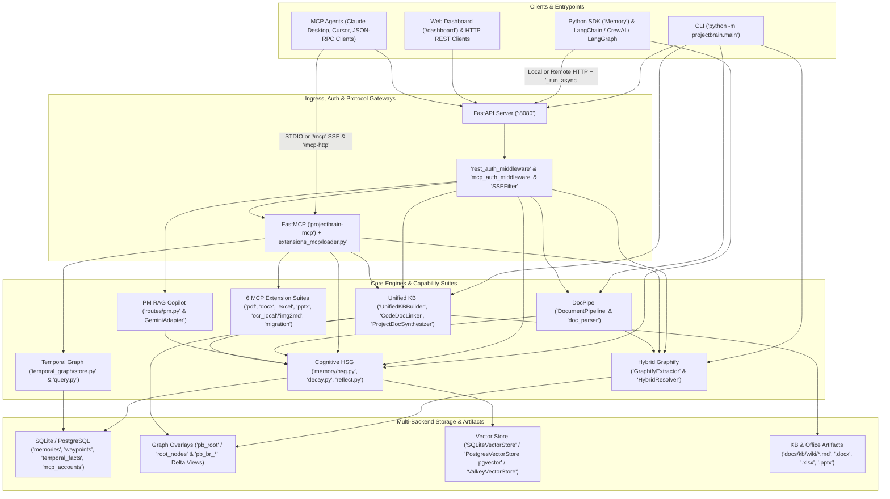
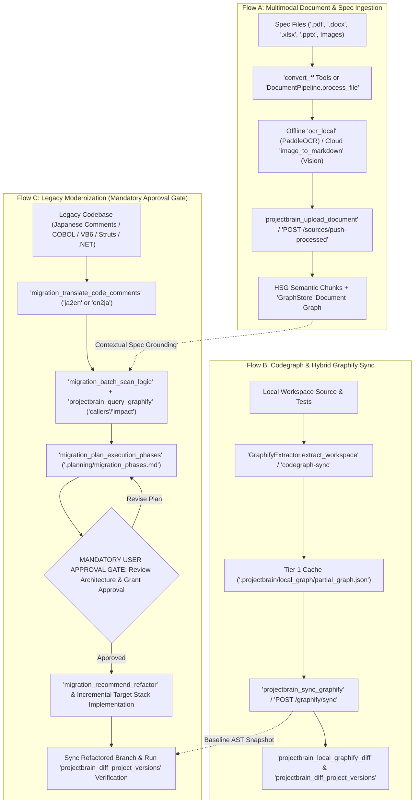
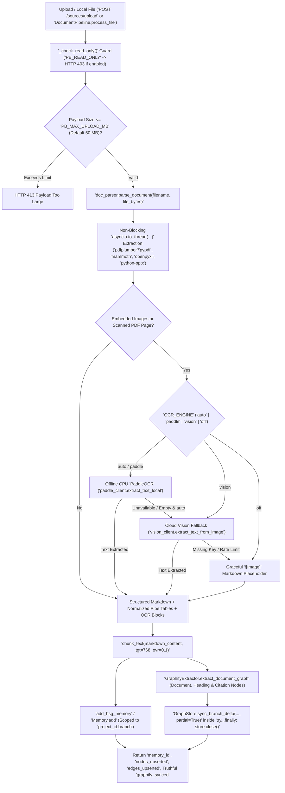
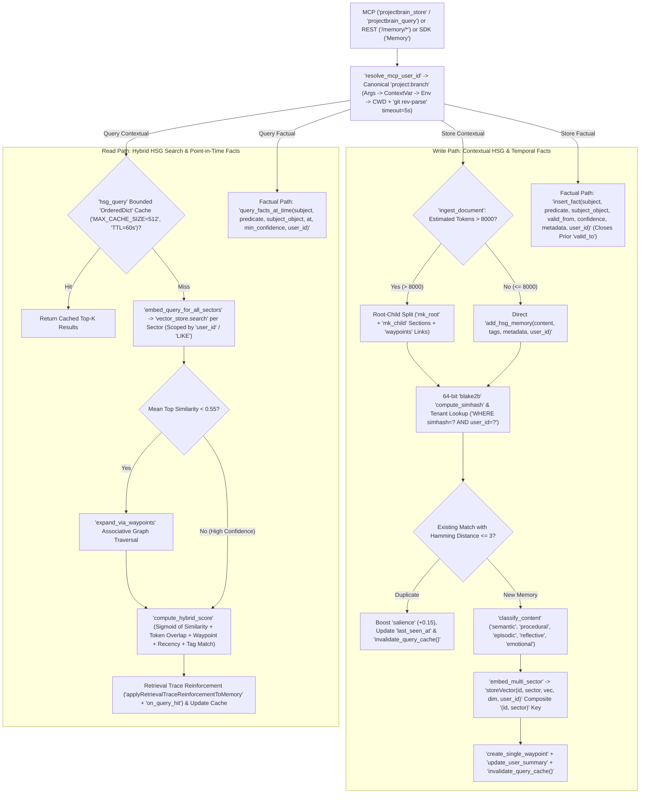
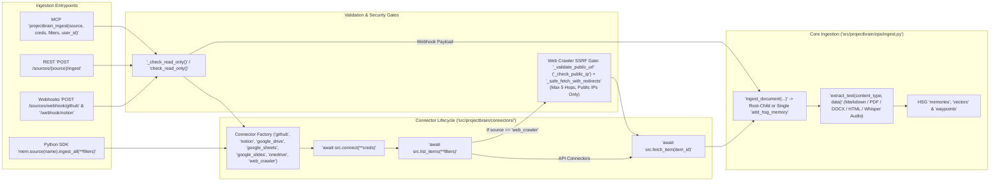
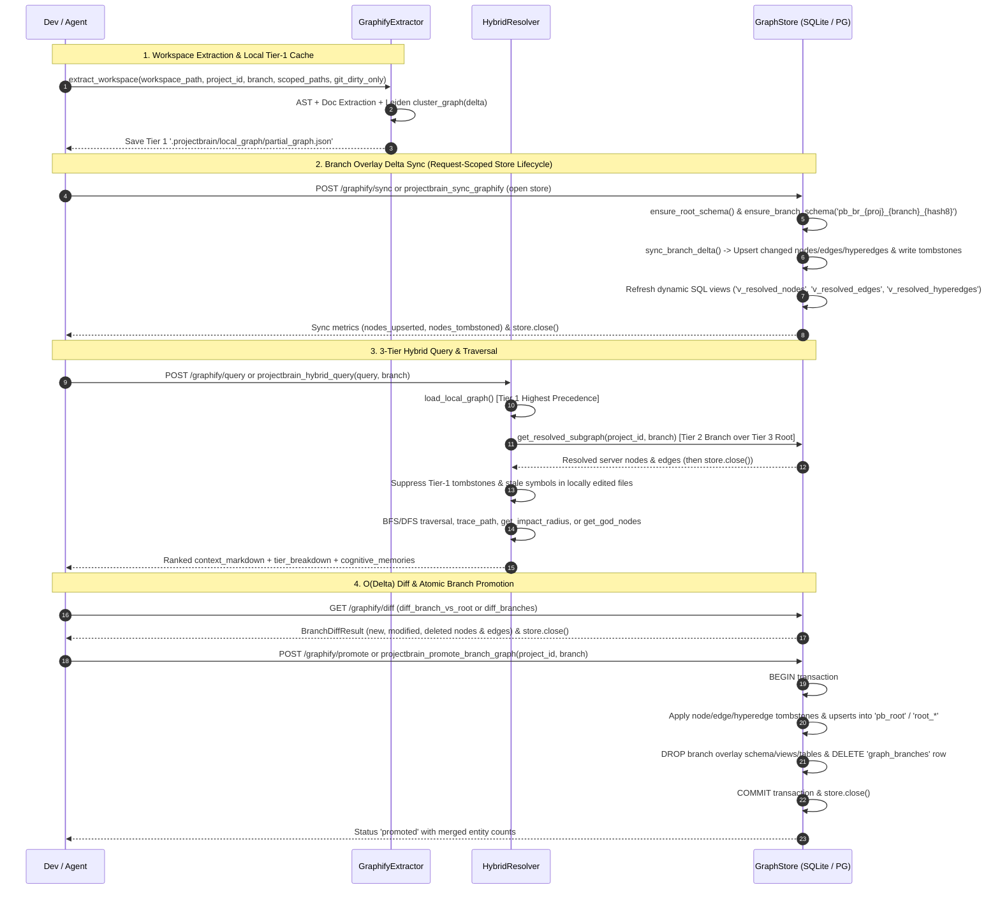
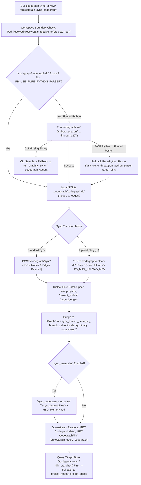
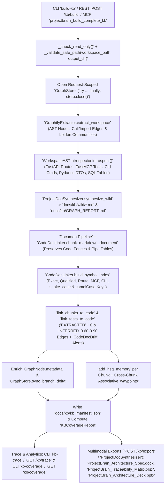
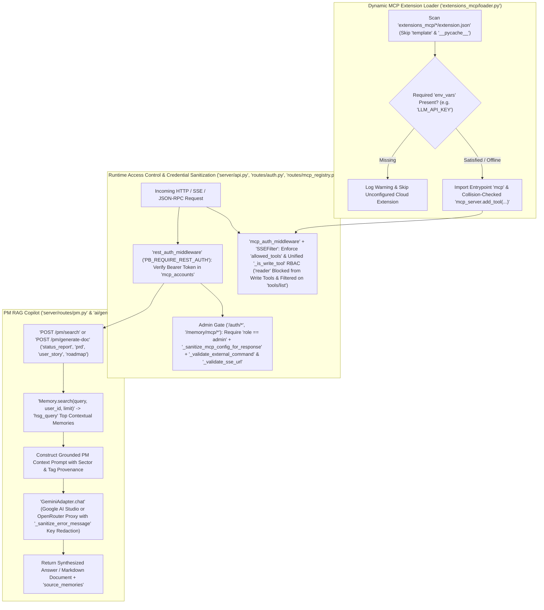

# ProjectBrain Workflows & System Architecture Reference

> **Authoritative Post-Remediation Architecture & Runtime Workflow Guide**  
> Verified against the live codebase (`src/projectbrain/**` and `extensions_mcp/**`) on branch `fix/audit-remediation`. All runtime contracts, security boundaries, multi-sector vector persistence layers, and database connection lifecycles documented below reflect healthy, verified production behavior.

---

## Table of Contents

1. [System Architecture Overview](#1-system-architecture-overview)
2. [Audit Remediation Summary (Waves 1–3)](#2-audit-remediation-summary-waves-13)
   - [Wave 1: Runtime Contracts, Imports & Sync/Async Bridges](#21-wave-1--runtime-contracts-imports--syncasync-bridges)
   - [Wave 2: Security Hardening, Auth & Boundary Controls](#22-wave-2--security-hardening-auth--boundary-controls)
   - [Wave 3: Tenant Isolation, Multi-Sector Persistence & Resource Lifecycle](#23-wave-3--tenant-isolation-multi-sector-persistence--resource-lifecycle)
3. [End-to-End Runtime & Workflow Diagrams](#3-end-to-end-runtime--workflow-diagrams)
   - [Diagram 1 — System Overview](#diagram-1--system-overview)
   - [Diagram 2 — Workflow 1: Unified Agent Workflows (A / B / C)](#diagram-2--workflow-1-unified-agent-workflows-a--b--c)
   - [Diagram 3 — Workflow 2: Multimodal Document & OCR Ingestion](#diagram-3--workflow-2-multimodal-document--ocr-ingestion)
   - [Diagram 4 — Workflow 3: HSG & Temporal Memory Lifecycle](#diagram-4--workflow-3-hsg--temporal-memory-lifecycle)
   - [Diagram 5 — Workflow 4: External Connectors & Webhooks](#diagram-5--workflow-4-external-connectors--webhooks)
   - [Diagram 6 — Workflow 5: Hybrid 3-Tier Graphify Sync, Diff & Atomic Promotion](#diagram-6--workflow-5-hybrid-3-tier-graphify-sync-diff--atomic-promotion)
   - [Diagram 7 — Workflow 6: Legacy Codegraph Bridge](#diagram-7--workflow-6-legacy-codegraph-bridge)
   - [Diagram 8 — Workflow 7: Unified Knowledge Base & Office Export](#diagram-8--workflow-7-unified-knowledge-base--office-export)
   - [Diagram 9 — Workflow 8: PM RAG Copilot, Dynamic Extensions Loader & MCP Security Gate](#diagram-9--workflow-8-pm-rag-copilot-dynamic-extensions-loader--mcp-security-gate)
4. [Module & Interface Quick-Reference Matrix](#4-module--interface-quick-reference-matrix)

---

## 1. System Architecture Overview

ProjectBrain is an extensible cognitive memory, structural code-graph, and unified knowledge-base platform engineered for AI agents, IDE workflows, and legacy software modernization. It unifies four architectural planes behind a single Python package (`src/projectbrain`) and dynamic Model Context Protocol (MCP) plugin directory (`extensions_mcp`):

1. **Unified Ingress & Access-Control Gateways (`server/api.py`, `ai/mcp.py`, `main.py`)**
   - **FastAPI Server (`:8080`)**: Serves REST routers (`/health`, `/auth`, `/memory`, `/memory/mcp`, `/sources`, `/codegraph`, `/graphify`, `/kb`, `/pm`), the static Web Control Panel (`/dashboard`), MCP Server-Sent Events (`/mcp`), and MCP Streamable HTTP (`/mcp-http`).
   - **Dual Transport FastMCP (`projectbrain-mcp`)**: Supports local STDIO (`python -m projectbrain.main mcp`) and remote HTTP/SSE JSON-RPC execution with dynamic tool mounting via `extensions_mcp/loader.py`.
   - **Defense-in-Depth Middleware**: Enforces `rest_auth_middleware` (when `PB_REQUIRE_REST_AUTH=true`), `mcp_auth_middleware`, real-time `SSEFilter` tool-list redaction, `_is_write_tool` RBAC enforcement for `reader` accounts, and `_check_read_only()` (`PB_READ_ONLY`) protection across mutating routes and tools.

2. **Cognitive Memory & Temporal Fact Plane (`memory/`, `temporal_graph/`, `ops/`)**
   - **Hierarchical Semantic Graph (`memory/hsg.py`)**: Classifies content across five cognitive sectors (`semantic`, `procedural`, `episodic`, `reflective`, `emotional`), deduplicates per tenant (`user_id`) via 64-bit `blake2b` SimHash, generates multi-sector embeddings (`memory/embed.py`), builds associative `waypoints`, and ranks recall via sigmoid-fused hybrid scoring (`similarity`, `overlap`, `waypoint`, `recency`, `tag_match`) backed by a bounded LRU cache (`OrderedDict`, `MAX_CACHE_SIZE = 512`).
   - **Maintenance & Salience Dynamics (`memory/decay.py`, `memory/reflect.py`, `ops/dynamics.py`)**: Applies hot/warm/cold tier salience decay, vector dimensionality compression/regeneration on query hits, associative trace reinforcement, and periodic reflective cluster consolidation.
   - **Point-in-Time Temporal Graph (`temporal_graph/store.py`, `temporal_graph/query.py`)**: Tracks `(subject, predicate, object)` triples with `[valid_from, valid_to)` validity windows, automatic historical superseding on conflict, and point-in-time queries via `query_facts_at_time`.

3. **3-Tier Hybrid Graphify & Unified Knowledge Base Plane (`graphify_engine/`)**
   - **Zero-Token AST & Document Graph Extraction (`extractor.py`, `doc_pipeline.py`)**: Extracts code symbols, call/import/inheritance relations, Leiden communities, and document rationale/citation graphs.
   - **Overlay Graph Storage (`store.py`)**: Implements `SqliteOverlayGraphStore` (`root_nodes`/`root_edges` + `pb_br_*` tables/views) and `PostgresSchemaGraphStore` (`pb_root` + isolated `pb_br_{proj}_{branch}_{hash8}` schemas and `v_resolved_*` SQL views) for $O(\Delta)$ branch diffs and atomic `BEGIN..COMMIT` branch-to-root promotion.
   - **3-Tier Hybrid Resolution (`hybrid_resolver.py`)**: Merges Tier 1 local uncommitted `.projectbrain/local_graph/partial_graph.json`, Tier 2 server branch overlay, and Tier 3 canonical root graph with tombstone and stale-symbol suppression.
   - **Deterministic KB & Office Synthesis (`kb_linker.py`, `doc_synthesizer.py`)**: Links AST code symbols, routes, MCP tools, CLI commands, and tests to structure-aware Markdown chunks (`EXTRACTED` and `INFERRED` edges), detects `CodeDocDrift`, and exports zero-hallucination Markdown wikis plus `.docx`, `.xlsx`, and `.pptx` artifacts.

4. **Multimodal Extensions, Connectors & Agent Bridges (`extensions_mcp/`, `connectors/`, `integrations/`)**
   - **Dynamic MCP Extensions (`extensions_mcp/`)**: Suites covering document conversion (`convert_pdf`, `convert_docx`, `convert_excel`, `convert_pptx`), offline CPU OCR (`ocr_local` via PaddleOCR), cloud Vision OCR (`image_to_markdown`), and legacy modernization (`codebase_migration_helper`).
   - **External Connectors (`connectors/`)**: Pluggable `base_connector` implementations for `github`, `notion`, `google_drive`, `google_sheets`, `google_slides`, `onedrive`, and SSRF-hardened `web_crawler`.
   - **Framework Bridges (`integrations/`, `connectors/agents.py`)**: Synchronous/asynchronous adapters for LangChain (`ProjectBrainChatMessageHistory`, `ProjectBrainRetriever`), CrewAI (`CrewAIMemory`), and LangGraph (`memory_node`).

---

## 2. Audit Remediation Summary (Waves 1–3)

All previously identified runtime breaks, contract mismatches, security exposures, multi-tenant collisions, and connection leaks across Waves 1–3 have been **remediated and verified** in the live codebase.

### 2.1 Wave 1 — Runtime Contracts, Imports & Sync/Async Bridges

| Subsystem / File | Remediated Issue | Verified Implementation |
| :--- | :--- | :--- |
| `src/projectbrain/ai/mcp.py` | `projectbrain_query` passed mismatched keyword arguments to `query_facts_at_time` | Calls `query_facts_at_time(subject=..., predicate=..., subject_object=pattern.get("object"), at=at_ts, min_confidence=0.0, user_id=uid)` matching `temporal_graph/query.py`. |
| `src/projectbrain/server/routes/sources.py` | Broken relative imports in source/webhook handlers and misleading `graphify_synced` flag | Fixed `from ...connectors import ...` and `from ...ops.ingest import ingest_document`; `upload_document` initializes `graphify_synced = False` and sets `True` only after `store.sync_branch_delta(...)` succeeds. |
| `src/projectbrain/core/db.py` & `core/config.py` | Missing `log_maint_op` helper and missing reflection/decay attributes on `EnvConfig` for `memory/reflect.py` | Added `log_maint_op(op_type, count)` persisting JSON metrics to `stats`, plus `auto_reflect`, `reflect_interval`, `reflect_min`, embedding model fields, and `active_project` in `EnvConfig`. |
| `src/projectbrain/memory/decay.py` | `apply_decay()` queried nonexistent `summary` column on `memories` table | Updated segment query to `SELECT id,content,salience,decay_lambda,last_seen_at,updated_at,primary_sector,feedback_score as coactivations FROM memories WHERE segment=?`. |
| `src/projectbrain/ops/extract.py` | `extract_audio()` referenced undefined config attribute for OpenAI Whisper key | Fixed credential resolution via `api_key = env.openai_key or os.getenv("OPENAI_API_KEY")`. |
| `src/projectbrain/integrations/{agents,langchain}.py` & `connectors/agents.py` | Calling async `Memory.add` / `Memory.search` from synchronous CrewAI, LangGraph, or LangChain hooks failed inside active event loops | Added `_run_async(coro)` helper using `asyncio.get_running_loop()` detection with isolated `ThreadPoolExecutor(max_workers=1)` fallback. |
| `extensions_mcp/codebase_migration_helper/server.py` | `migration_translate_code_comments` ignored `direction="en2ja"` and always prompted `ja2en` | Added explicit `if direction == "en2ja":` branch instructing English-to-Japanese comment/docstring translation while preserving code logic verbatim. |
| `src/projectbrain/server/routes/memory.py` | Broad `except Exception` swallowed `HTTPException(404)` into HTTP `500` | Added explicit `except HTTPException: raise` before generic error handlers across `get_single_memory`, `reinforce_memory`, and sibling endpoints. |
| `extensions_mcp/convert_pdf/server_stdio.py` & `convert_pptx/server_stdio.py` | PDF conversion options were not passed through and `src` import path was missing in STDIO mode | Wired `include_tables`, `include_images`, and `images_dir` into `_pdf_to_markdown(...)` (validating `images_dir` when `include_images=True`) and injected repo `src/` into `sys.path` for `pptx_to_markdown`. |
| `src/projectbrain/core/vector_store.py`, `core/vector/{postgres,valkey}.py`, `main.py` | Missing `getVectorsBySector` method on vector stores and CLI positional arg misparsing when flags carried values | Implemented `getVectorsBySector(sector)` across `VectorStore`, `SQLiteVectorStore`, `PostgresVectorStore`, and `ValkeyVectorStore`; added `_CLI_VALUE_FLAGS` and `_get_positional_args()` in `main.py`. |

### 2.2 Wave 2 — Security Hardening, Auth & Boundary Controls

| Subsystem / File | Remediated Issue | Verified Implementation |
| :--- | :--- | :--- |
| `src/projectbrain/ai/gemini.py` | Raw `GEMINI_API_KEY` debug stderr output, key leakage in HTTP error traces, and deprecated default embedding model | Removed stderr key logging, added `_sanitize_error_message(msg, api_key)` redacting `?key=` and raw tokens across chat/embed exceptions, and updated default Google embedding model to `models/gemini-embedding-001`. |
| `src/projectbrain/server/api.py` & `server/routes/auth.py` | Unprotected REST endpoints, inconsistent write-tool detection across SSE/HTTP MCP, and plaintext DB URLs in startup logs | Added opt-in `rest_auth_middleware` (`PB_REQUIRE_REST_AUTH`), unified `_is_write_tool` (`readOnlyHint`, `_EXPLICIT_WRITE_TOOLS`, `_WRITE_TOOL_KEYWORDS`) across `mcp_auth_middleware` and `SSEFilter`, masked non-admin tokens via `_mask_token`, and redacted DB URLs via `_redact_database_url`. |
| `src/projectbrain/server/routes/{memory,sources,mcp_registry,graphify,kb}.py` | Mutating REST endpoints bypassed server read-only mode | Enforced `_check_read_only()` (`PB_READ_ONLY` / `OM_READ_ONLY` -> HTTP `403`) across all write/delete/register/sync/build/export endpoints. |
| `src/projectbrain/server/routes/mcp_registry.py` | `/memory/mcp/*` leaked env secrets in responses and accepted unvalidated shell commands or malformed SSE URLs | Added recursive `_sanitize_mcp_config_for_response` & `_mask_url_credentials`, restricted STDIO env forwarding to `_SAFE_STDIO_ENV_KEYS`, and enforced `_validate_external_command` (blocking shell metacharacters and `..`) and `_validate_sse_url`. |
| `src/projectbrain/ai/mcp.py` & `server/routes/{graphify,kb}.py` | Prefix string checks allowed sibling-directory path traversal | Hardened boundary checks using `Path(resolved_project_path).resolve().is_relative_to(Path(projects_root).resolve())` in `mcp.py` and `Path.resolve().relative_to(Path.cwd().resolve())` in `graphify.py` & `kb.py`. |
| `src/projectbrain/connectors/web_crawler.py` | Web crawler allowed requests and redirects to loopback, link-local, or private internal IPs (SSRF) | Added `_validate_public_url` + `_check_public_ip` (blocking private, loopback, link-local, multicast, reserved, and IPv4-mapped IPv6 addresses unless `PB_ALLOW_PRIVATE_CRAWL=true`) and `_safe_fetch_with_redirects` validating every HTTP redirect hop with `follow_redirects=False`. |

### 2.3 Wave 3 — Tenant Isolation, Multi-Sector Persistence & Resource Lifecycle

| Subsystem / File | Remediated Issue | Verified Implementation |
| :--- | :--- | :--- |
| `src/projectbrain/memory/hsg.py` | Cross-tenant SimHash collisions, 32-bit modulo folding in `compute_simhash`, and unbounded query cache | Scoped SimHash lookup by `WHERE simhash=? AND user_id=?`, upgraded `compute_simhash` to full 64-bit `hashlib.blake2b(..., digest_size=8)` without `% 32` folding, and bounded `cache` (`OrderedDict`, `MAX_CACHE_SIZE = 512`, `TTL = 60000`) with `invalidate_query_cache()`. |
| `src/projectbrain/core/vector/{postgres,valkey}.py` | Multi-sector embeddings overwrote each other under single-ID keys in PostgreSQL and Valkey | Upgraded `PostgresVectorStore` to `PRIMARY KEY (id, sector)` with `ON CONFLICT (id, sector) DO UPDATE`, and upgraded `ValkeyVectorStore` to composite `{prefix}{id}:{sector}` keys with legacy `{prefix}{id}` read/delete compatibility. |
| `src/projectbrain/main.py` | `Memory.delete` and `Memory.delete_all` left orphaned external vectors and stale cached query hits | Added `await vector_store.deleteVectors(...)` prior to DB deletion and called `invalidate_query_cache()` across both local and remote modes in `Memory.delete` and `Memory.delete_all`. |
| `src/projectbrain/graphify_engine/store.py` & callers | Request handlers leaked SQLite/PostgreSQL connections created per `get_graph_store()` call | Added `close()` and `__enter__` / `__exit__` context manager protocol to `GraphStore` (`SqliteOverlayGraphStore` & `PostgresSchemaGraphStore`) and wrapped every store lifecycle in `try...finally: store.close()` across `routes/{graphify,kb,sources,codegraph}.py` and `ai/mcp.py`. |
| `src/projectbrain/ai/mcp.py` & `utils/doc_parser.py` | Raw SQLite `?` syntax failed on PostgreSQL in `mcp.py`, subprocesses lacked timeouts, and synchronous parsing blocked the event loop | Applied `db.translate_query(...)`, added explicit `timeout=5` / `timeout=120` on `subprocess.run` calls, and offloaded CPU-bound AST/document extraction (`run_python_parser`, `pdfplumber`, `pypdf`, `mammoth`, `openpyxl`, `python-pptx`, `render_page_png`) via `asyncio.to_thread(...)`. |

---

## 3. End-to-End Runtime & Workflow Diagrams

### Diagram 1 — System Overview

High-level architecture connecting CLI, SDK, REST, and MCP clients through ProjectBrain's authentication and transport gateways into the core processing engines and multi-backend persistence layers.

---

### Diagram 2 — Workflow 1: Unified Agent Workflows (A / B / C)

Interconnected multi-tool agent workflows spanning multimodal specification ingestion (**Flow A**), continuous AST/Graphify synchronization (**Flow B**), and gated legacy codebase modernization (**Flow C**).

---

### Diagram 3 — Workflow 2: Multimodal Document & OCR Ingestion

End-to-end document ingestion flow across `POST /sources/upload`, `POST /sources/push-processed`, CLI `upload-doc`, and MCP `projectbrain_upload_document`, featuring upload size enforcement, thread-offloaded parsing, dual-tier OCR fallback, and request-scoped `GraphStore` cleanup.

---

### Diagram 4 — Workflow 3: HSG & Temporal Memory Lifecycle

Tenant-isolated contextual memory storage, 64-bit `blake2b` SimHash deduplication, multi-sector vector persistence, bounded LRU retrieval caching, associative waypoint expansion, and point-in-time temporal fact management.

---

### Diagram 5 — Workflow 4: External Connectors & Webhooks

Unified ingestion pipeline for external SaaS connectors and webhooks with read-only enforcement, corrected package-relative imports, and per-hop SSRF validation on web crawling.

---

### Diagram 6 — Workflow 5: Hybrid 3-Tier Graphify Sync, Diff & Atomic Promotion

Sequence across developer/agent tooling, `GraphifyExtractor`, request-scoped `GraphStore`, and `HybridResolver` covering delta sync, 3-tier resolution, $O(\Delta)$ structural diffing, and transactional branch promotion.

---

### Diagram 7 — Workflow 6: Legacy Codegraph Bridge

Compatibility bridge synchronizing `.codegraph/codegraph.db` AST indexes into both legacy relational tables (`projects`, `project_nodes`, `project_edges`) and `GraphStore` overlays for Vis.js visualization and cross-version diffing.

---

### Diagram 8 — Workflow 7: Unified Knowledge Base & Office Export

Deterministic zero-hallucination Knowledge Base pipeline combining Leiden AST clustering, static Python/SQL introspection, Markdown Wiki synthesis, bidirectional code-doc-test cross-linking, drift detection, HSG memory persistence, and Office suite exports.

---

### Diagram 9 — Workflow 8: PM RAG Copilot, Dynamic Extensions Loader & MCP Security Gate

Startup extension registration, unified REST/MCP role-based access control (`admin`, `collaborator`, `reader`), `/memory/mcp/*` secret redaction, and PM RAG Copilot document synthesis.

---

## 4. Module & Interface Quick-Reference Matrix

| Architectural Plane | Primary Files | Key Symbols / Endpoints | Storage / State |
| :--- | :--- | :--- | :--- |
| **CLI & Python SDK** | `src/projectbrain/main.py` | `Memory`, `run_server`, `run_mcp`, `run_graphify_sync`, `run_graphify_diff`, `run_upload_doc`, `run_codegraph_sync`, `run_build_kb`, `run_kb_trace`, `run_kb_coverage`, `_get_positional_args` | Local SQLite/PostgreSQL or Remote HTTP (`PB_MODE=remote`) |
| **FastAPI Gateway & Auth** | `src/projectbrain/server/api.py`, `server/routes/auth.py`, `server/routes/mcp_registry.py` | `create_app`, `rest_auth_middleware`, `mcp_auth_middleware`, `SSEFilter`, `_is_write_tool`, `_redact_database_url`, `_sanitize_mcp_config_for_response`, `/auth/*`, `/memory/mcp/*` | `mcp_accounts` table & Claude Desktop JSON config |
| **Cognitive HSG & Maintenance** | `src/projectbrain/memory/{hsg,embed,decay,reflect,user_summary}.py`, `ops/dynamics.py` | `add_hsg_memory`, `hsg_query`, `compute_simhash`, `invalidate_query_cache`, `apply_decay`, `run_reflection`, `/memory/*` | `memories`, `vectors`, `waypoints`, `users`, `stats` |
| **Vector Backends** | `src/projectbrain/core/vector_store.py`, `core/vector/{postgres,valkey}.py` | `SQLiteVectorStore`, `PostgresVectorStore`, `ValkeyVectorStore`, `storeVector`, `getVectorsBySector`, `deleteVectors`, `search` | SQLite BLOB, PostgreSQL `pgvector` `(id, sector)` HNSW, Valkey `{prefix}{id}:{sector}` |
| **Temporal Knowledge Graph** | `src/projectbrain/temporal_graph/{store,query,timeline}.py` | `insert_fact`, `query_facts_at_time`, `query_facts_in_range`, `invalidate_fact` | `temporal_facts`, `temporal_edges` |
| **Multimodal Ingestion & Connectors** | `src/projectbrain/utils/doc_parser.py`, `ops/{ingest,extract}.py`, `graphify_engine/doc_pipeline.py`, `server/routes/sources.py`, `connectors/*.py` | `parse_document`, `DocumentPipeline`, `ingest_document`, `_validate_public_url`, `_safe_fetch_with_redirects`, `/sources/upload`, `/sources/push-processed`, `/sources/{source}/ingest`, `/sources/webhook/{github,notion}` | HSG `memories` + `GraphStore` overlays |
| **Hybrid Graphify Engine** | `src/projectbrain/graphify_engine/{extractor,store,hybrid_resolver,models}.py`, `server/routes/graphify.py` | `GraphifyExtractor`, `SqliteOverlayGraphStore`, `PostgresSchemaGraphStore`, `HybridResolver`, `sync_branch_delta`, `diff_branch_vs_root`, `promote_branch_to_root`, `/graphify/*` | `.projectbrain/local_graph/partial_graph.json`, `pb_root` / `root_*`, `pb_br_*` |
| **Legacy Codegraph Bridge** | `src/projectbrain/server/routes/codegraph.py`, `extensions_mcp/codebase_migration_helper/python_codegraph.py` | `sync_codegraph_data`, `upload_codegraph_db`, `get_codegraph_data`, `diff_projects`, `/codegraph/*` | `.codegraph/codegraph.db`, `projects`, `project_nodes`, `project_edges`, `GraphStore` |
| **Unified KB & Office Synthesis** | `src/projectbrain/graphify_engine/{kb_linker,doc_synthesizer}.py`, `server/routes/kb.py` | `UnifiedKBBuilder`, `CodeDocLinker`, `WorkspaceASTIntrospector`, `ProjectDocSynthesizer`, `/kb/build`, `/kb/trace`, `/kb/coverage`, `/kb/export` | `docs/kb/wiki/*.md`, `docs/kb/GRAPH_REPORT.md`, `.docx`, `.xlsx`, `.pptx`, `kb_manifest.json` |
| **FastMCP & Extensions** | `src/projectbrain/ai/{mcp,gemini}.py`, `extensions_mcp/loader.py`, `extensions_mcp/*/server*.py` | `mcp_server`, `resolve_mcp_user_id`, `load_extensions`, `GeminiAdapter`, `_sanitize_error_message`, `/pm/search`, `/pm/generate-doc` | STDIO, `/mcp` SSE, `/mcp-http` Streamable HTTP |
