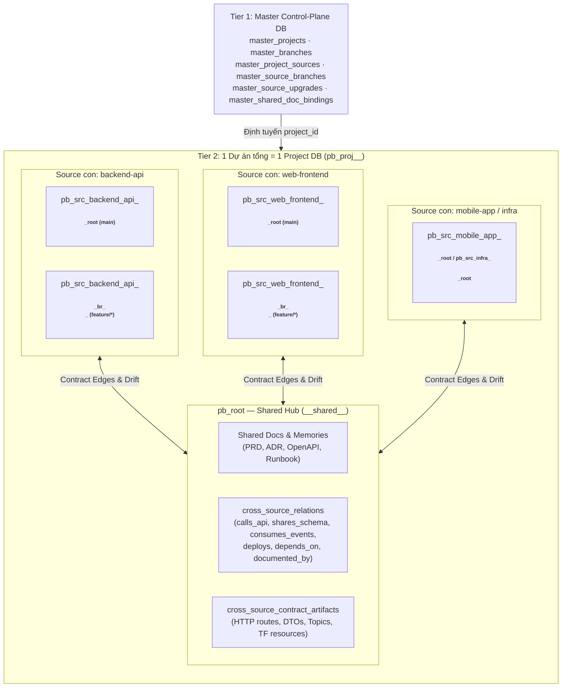
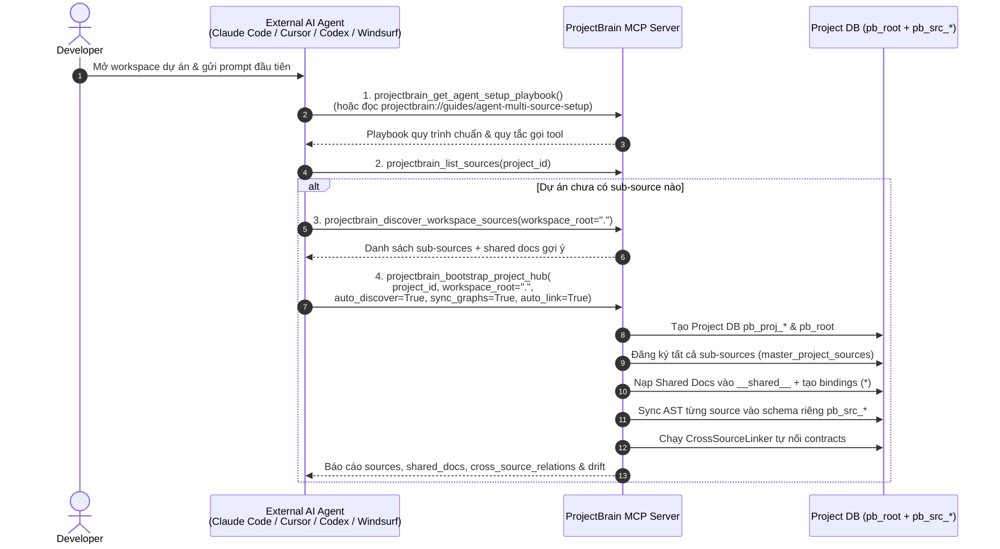

# Hướng Dẫn Multi-Source Project Hub & Zero-Touch Auto-Setup cho External AI Agents

> **Đối tượng sử dụng:** AI Coding Agents (**Claude Code**, **Cursor**, **Antigravity**, **Codex**, **Windsurf**), Software Architect, Fullstack / Mobile / Embedded Developer và DevOps / CI-CD Engineer.  
> **Mục tiêu:** Thiết lập và vận hành **100% tự động (Zero-Touch)** kiến trúc **Multi-Source Project Hub**, **Shared Docs (`__shared__`)**, **nâng cấp độc lập từng Source con (`pb_src_*`)**, và **truy vấn / phân tích ảnh hưởng liên Source qua MCP** mà không cần thao tác bấm tay trên Web UI.

---

## Mục Lục

1. [Tổng quan Kiến trúc Project Hub đa Source con](#1-tổng-quan-kiến-trúc-project-hub-đa-source-con)
   - [1.1. Mô hình `1 Dự án tổng = 1 Project DB` + `Shared Hub` + `Schema độc lập cho từng Source con`](#11-mô-hình-1-dự-án-tổng--1-project-db--shared-hub--schema-độc-lập-cho-từng-source-con)
   - [1.2. Quy ước định danh 3 phần: `project_id@source_id:branch` và `project_id@__shared__`](#12-quy-ước-định-danh-3-phần-project_idsource_idbranch-và-project_id__shared__)
   - [1.3. Chuỗi bảng dữ liệu Hub & Sơ đồ luồng xử lý](#13-chuỗi-bảng-dữ-liệu-hub--sơ-đồ-luồng-xử-lý)
2. [Zero-Touch Auto-Setup cho External AI Agents](#2-zero-touch-auto-setup-cho-external-ai-agents)
   - [2.1. Bước duy nhất phía con người: Kết nối ProjectBrain MCP](#21-bước-duy-nhất-phía-con-người-kết-nối-projectbrain-mcp)
   - [2.2. Quy trình Agent tự động setup toàn bộ qua 3 MCP Tools mới](#22-quy-trình-agent-tự-động-setup-toàn-bộ-qua-3-mcp-tools-mới)
   - [2.3. REST API tương đương cho CI/CD (`POST /master/hub/discover` & `POST /master/hub/bootstrap`)](#23-rest-api-tương-đương-cho-cicd-post-masterhubdiscover--post-masterhubbootstrap)
3. [Vận hành hằng ngày: Nâng cấp riêng lẻ từng Source con & Truy vấn liên Source](#3-vận-hành-hằng-ngày-nâng-cấp-riêng-lẻ-từng-source-con--truy-vấn-liên-source)
   - [3.1. Nâng cấp độc lập 1 Source con (`upgrade_mode="delta"`)](#31-nâng-cấp-độc-lập-1-source-con-upgrade_modedelta)
   - [3.2. Quản lý & Bind Tài liệu dùng chung (`__shared__`)](#32-quản-lý--bind-tài-liệu-dùng-chung-__shared__)
   - [3.3. Tìm kiếm liên Source & Kiểm tra cảnh báo `drifted` / `stale`](#33-tìm-kiếm-liên-source--kiểm-tra-cảnh-báo-drifted--stale)
4. [Template Copy-Paste vào `AGENTS.md` / `CLAUDE.md` / `.cursorrules`](#4-template-copy-paste-vào-agentsmd--claudemd--cursorrules)
   - [4.1. Template chuẩn cho `AGENTS.md` & `CLAUDE.md` (Claude Code, Codex, Antigravity)](#41-template-chuẩn-cho-agentsmd--claudemd-claude-code-codex-antigravity)
   - [4.2. Template chuẩn cho `.cursorrules` / Windsurf (`.windsurfrules`)](#42-template-chuẩn-cho-cursorrules--windsurf-windsurfrules)
   - [4.3. Prompt kích hoạt nhanh cho người dùng (1 câu lệnh đầu session)](#43-prompt-kích-hoạt-nhanh-cho-người-dùng-1-câu-lệnh-đầu-session)
5. [Bảng tham chiếu đầy đủ MCP Tools, Resource, REST API & Web UI](#5-bảng-tham-chiếu-đầy-đủ-mcp-tools-resource-rest-api--web-ui)
   - [5.1. Danh sách MCP Tools Multi-Source & Auto-Bootstrap](#51-danh-sách-mcp-tools-multi-source--auto-bootstrap)
   - [5.2. MCP Resource hướng dẫn tích hợp](#52-mcp-resource-hướng-dẫn-tích-hợp)
   - [5.3. Danh sách REST API Endpoints](#53-danh-sách-rest-api-endpoints)
   - [5.4. Theo dõi trực quan trên Web UI (`/app/workspace/sources`)](#54-theo-dõi-trực-quan-trên-web-ui-appworkspacesources)
6. [Hỗ trợ Dự án Legacy C++, Windows Session 0 IPC, PLC ST/LASAL & Mã nguồn Nhật Bản](#6-hỗ-trợ-dự-án-legacy-c-windows-session-0-ipc-plc-stlasal--mã-nguồn-nhật-bản)

---

## 1. Tổng quan Kiến trúc Project Hub đa Source con

Trong thực tế phát triển phần mềm hiện đại (Monorepo hoặc Multi-Repo), một sản phẩm hoàn chỉnh hiếm khi chỉ là 1 repo đơn lẻ. Một dự án thường bao gồm nhiều thành phần độc lập: `backend-api` (Python/Go/Node), `web-frontend` (React/Next.js), `mobile-app` (iOS/Android/Flutter), `infra` (Terraform/Docker Compose/K8s), cùng bộ tài liệu kiến trúc/hợp đồng dùng chung (`README.md`, PRD, ADR, OpenAPI spec).

Nếu gộp tất cả vào một đồ thị phẳng duy nhất:
- Sửa 1 file ở `web-frontend` có thể buộc quét lại toàn bộ `backend-api` hoặc làm loãng ngữ cảnh AST.
- Tài liệu kiến trúc/OpenAPI chung bị trùng lặp hoặc không đồng bộ giữa các dịch vụ.
- Không theo dõi được khi nào một thay đổi API ở Backend làm **lệch hợp đồng (drift)** ở Frontend hoặc Mobile.

**ProjectBrain Multi-Source Project Hub** giải quyết triệt để vấn đề này bằng kiến trúc **Hub-and-Spoke** đặt ngay trên tầng `Master DB -> Project DB -> Schema`.

### 1.1. Mô hình `1 Dự án tổng = 1 Project DB` + `Shared Hub` + `Schema độc lập cho từng Source con`



**Nguyên tắc cách ly & chia sẻ:**
1. **`1 Dự án tổng = 1 Project DB (pb_proj_*)`:** Toàn bộ dự án (ví dụ `ecommerce-platform`) nằm gọn trong 1 Project Database vật lý (`pb_proj_<slug>_<hash8>` trên PostgreSQL, hoặc thư mục `pb_projects/<db_name>/` trên SQLite).
2. **`pb_root` đóng vai trò Shared Hub (`__shared__`):**
   - Lưu **tài liệu dùng chung toàn dự án** (`scope="project_shared"` / `source_id="__shared__"`): PRD, ADR, OpenAPI specs, architecture docs.
   - Lưu **2 bảng điều phối hợp đồng liên Source**:
     - `cross_source_relations`: Đồ thị quan hệ có kiểu (`calls_api`, `shares_schema`, `consumes_events`, `publishes_events`, `implements_spec`, `shares_auth`, `deploys`, `depends_on`, `documented_by`) kèm trạng thái `active`, `pinned`, `rejected`, `drifted`, `stale`.
     - `cross_source_contract_artifacts`: Bề mặt hợp đồng (endpoint, HTTP client call, schema DTO/TS interface/Proto/SQL, pub/sub topic, infra service, spec requirement) được `CrossSourceLinker` trích xuất và gắn `signature_hash` để phát hiện drift.
3. **Mỗi Source con có schema nhánh độc lập (`pb_src_*_root` / `pb_src_*_br_*`):**
   - Trong `src/projectbrain/core/tenant_manager.py` (`sanitize_source_schema_name`), mỗi sub-source (`backend-api`, `web-frontend`, `mobile-app`, `infra`, ...) sở hữu schema gốc riêng:
     `pb_src_<src_slug[:18]>_<sha256_6>_root`
   - Và mỗi feature branch của riêng source con đó có schema delta riêng:
     `pb_src_<src_slug[:18]>_<sha256_6>_br_<br_slug[:18]>_<br_sha256_6>`
   - **Ý nghĩa thực tiễn:** Khi nâng cấp hoặc sync lại `backend-api` lên `v2.1.0` hoặc nhánh `feat/payment-v2`, **không một byte AST/Memory nào của `web-frontend`, `mobile-app`, `infra` hay `__shared__` bị ghi đè hay phải quét lại.**

### 1.2. Quy ước định danh 3 phần: `project_id@source_id:branch` và `project_id@__shared__`

Hàm `parse_tenant_spec()` (trong `src/projectbrain/core/tenant_manager.py`) phân giải thống nhất định danh 3 phần cho mọi MCP Tool và REST API:

| Định dạng chuỗi | `project_id` | `source_id` | `branch` | Ý nghĩa sử dụng |
| :--- | :--- | :--- | :--- | :--- |
| `my-app` | `my-app` | `None` (`__default__`) | `main` | Project đơn nguồn hoặc ngữ cảnh mặc định ở nhánh gốc. |
| `my-app:feat/auth` | `my-app` | `None` | `feat/auth` | Project mặc định trên nhánh `feat/auth`. |
| `my-app@backend-api` | `my-app` | `backend-api` | `main` | Nhánh gốc (`_root`) của sub-source `backend-api`. |
| `my-app@backend-api:feat/v2` | `my-app` | `backend-api` | `feat/v2` | Nhánh `feat/v2` (`_br_*`) của riêng sub-source `backend-api`. |
| `my-app@__shared__` | `my-app` | `__shared__` | `main` | Kho tài liệu dùng chung tại Shared Hub (`pb_root`). |
| `my-app@__shared__:release/2.0` | `my-app` | `__shared__` | `release/2.0` | Tài liệu dùng chung gắn với nhánh `release/2.0`. |

> [!TIP]
> Bạn có thể truyền **gộp** dạng `project_id="my-app@backend-api:feat/v2"` **hoặc tách rời** các tham số `project_id="my-app", source_id="backend-api", branch="feat/v2"` trong các tool MCP. Nếu truyền tách rời `source_id` (và `project_id` chưa chứa `@`), hệ thống tự động định tuyến vào đúng schema `pb_src_*`.

### 1.3. Chuỗi bảng dữ liệu Hub & Sơ đồ luồng xử lý

Trong Master DB (migration `013_project_sources_and_relations.sql`), ProjectBrain quản lý sổ cái Multi-Source gồm:
- **`master_project_sources`**: Danh mục các source con (`project_id`, `source_id`, `display_name`, `source_type`, `tech_stack_json`, `workspace_subpath`, `root_branch`, `root_schema`, `current_version`, `sync_generation`, `inherit_shared_docs`, `status`).
- **`master_source_branches`**: Ánh xạ nhánh của từng source con (`(project_id, source_id, branch_name)` → `schema_name`).
- **`master_source_upgrades`**: Nhật ký lịch sử nâng cấp từng source con (`from_version`, `to_version`, `upgrade_mode`, `nodes_delta`, `edges_delta`, `docs_updated`, `affected_relations`, `drifted_relations`, `commit_sha`, `actor`).
- **`master_shared_doc_bindings`**: Quy tắc gắn tài liệu `__shared__` (`doc_key` → `target_source_id` là `"*"` hoặc một `source_id` cụ thể, kèm `pinned_version` và `binding_role`).

---

## 2. Zero-Touch Auto-Setup cho External AI Agents

Triết lý thiết kế của ProjectBrain Multi-Source Hub là **Con người chỉ kết nối MCP 1 lần — AI Agent tự làm mọi bước còn lại** (phát hiện cấu trúc repo, khởi tạo Project DB, đăng ký từng sub-source, nạp Shared Docs, đồng bộ đồ thị AST và tự nối hợp đồng liên Source).

### 2.1. Bước duy nhất phía con người: Kết nối ProjectBrain MCP

Bạn chỉ cần gắn ProjectBrain MCP Server vào công cụ AI đang dùng bằng **1 trong 3 cách**:

#### Cách 1: Đăng ký nhanh qua CLI (`projectbrain register-mcp` / `projectbrain_register_mcp`)
```bash
# Cài đặt ProjectBrain (trong virtualenv hoặc global)
pip install -e .

# Đăng ký nhanh MCP vào client cấu hình (hoặc dùng tool projectbrain_register_mcp)
projectbrain register-mcp --project-id my-app
```

#### Cách 2: File cấu hình `.mcp.json` / `.cursor/mcp.json` (Local Stdio hoặc Proxy)
Đặt file `.mcp.json` ngay tại root workspace (hỗ trợ chuẩn cho **Claude Code**, **Cursor**, **Windsurf**, **Antigravity**):
```json
{
  "mcpServers": {
    "projectbrain": {
      "command": "python3",
      "args": ["-m", "projectbrain.main", "mcp"],
      "env": {
        "PB_DEFAULT_USER_ID": "my-app",
        "PB_WORKSPACE_ROOT": "."
      }
    }
  }
}
```
*(Nếu dùng chế độ Remote Server, thêm `"PB_MODE": "remote"`, `"PB_URL": "http://<host>:8080"`, `"PB_API_KEY": "<PB_TOKEN>"`).*

#### Cách 3: Kết nối Remote HTTP SSE hoặc Streamable HTTP
- **SSE Endpoint** (Antigravity, Cursor, Windsurf):
  ```json
  {
    "mcpServers": {
      "projectbrain": {
        "serverUrl": "http://<host>:8080/mcp/sse?token=<PB_API_KEY>&project_id=my-app"
      }
    }
  }
  ```
- **Streamable HTTP Endpoint**:
  ```json
  {
    "mcpServers": {
      "projectbrain": {
        "url": "http://<host>:8080/mcp-http",
        "headers": {
          "Authorization": "Bearer <PB_API_KEY>"
        }
      }
    }
  }
  ```

> [!IMPORTANT]
> **Quyền tối thiểu của Token:** Để AI Agent có thể tự bootstrap, đăng ký source và sync delta, hãy cấp token vai trò **`collaborator`** (hoặc **`admin`**). Token **`reader`** chỉ có thể đọc (`list_sources`, `query`, `hybrid_query`, `cross_source_impact`, `get_agent_setup_playbook`, `discover_workspace_sources`) và sẽ bị từ chối khi gọi `bootstrap_project_hub` / `sync_graphify`.

### 2.2. Quy trình Agent tự động setup toàn bộ qua 3 MCP Tools mới

Ngay khi MCP được kết nối, AI Agent thực hiện quy trình **Zero-Touch Auto-Setup** theo đúng 3 bước sau:



#### Bước 1 — Agent đọc Playbook chuẩn: `projectbrain_get_agent_setup_playbook`
- **Tool:** `projectbrain_get_agent_setup_playbook()` (không bắt buộc tham số) hoặc đọc **MCP Resource** `projectbrain://guides/agent-multi-source-setup`.
- **Tác dụng:** Trả về hướng dẫn cô đọng dành riêng cho máy (machine-readable + checklist) về thứ tự bootstrap, quy tắc chọn `source_id`, quy tắc nâng cấp `upgrade_mode="delta"` và kiểm tra `drifted`.

#### Bước 2 — Agent tự quét thư mục dự án: `projectbrain_discover_workspace_sources`
- **Tool:** `projectbrain_discover_workspace_sources(workspace_root=".")`
- **Cơ chế tự động phát hiện:**
  - **Sub-sources (Code Repositories / Modules):** Quét các manifest đặc trưng để phân loại `source_type` và `tech_stack`:
    - `pyproject.toml`, `requirements.txt`, `setup.py` → Python service / backend (`backend-api`, `worker`, ...)
    - `package.json`, `tsconfig.json`, `next.config.*`, `vite.config.*` → Node/TypeScript (`web-frontend`, `bff-api`, ...)
    - `go.mod` → Go microservice
    - `Cargo.toml` → Rust service / CLI
    - `pom.xml`, `build.gradle*` → Java / Kotlin / Android (`mobile-app`, `backend-service`)
    - `pubspec.yaml`, `*.xcodeproj`, `Package.swift` → Flutter / iOS mobile app
    - `*.tf`, `docker-compose*.yml`, `Chart.yaml`, `k8s/` → Infrastructure (`infra`)
  - **Tài liệu dùng chung (Shared Docs):** Tự nhận diện `README.md`, thư mục `docs/` (`.md`, `.pdf`, `.docx`, `.xlsx`, `.pptx`), `ADR`, `PRD`, `openapi.yaml` / `openapi.json` / `swagger.*` để đưa vào `__shared__`.
- **Lợi ích:** Agent không cần đoán tên thư mục hay hỏi người dùng cấu trúc dự án; có thể xem trước danh sách sẽ bootstrap hoặc tinh chỉnh `source_id` trước khi nạp.

#### Bước 3 — Agent khởi tạo toàn bộ Hub bằng 1 lệnh: `projectbrain_bootstrap_project_hub`
- **Tool:**
  ```json
  {
    "project_id": "ecommerce-platform",
    "workspace_root": ".",
    "auto_discover": true,
    "sync_graphs": true,
    "auto_link": true
  }
  ```
- **Những gì 1 lệnh này thực thi tự động trên Server:**
  1. Khởi tạo Project DB riêng (`pb_proj_<slug>_<hash8>`) và schema trung tâm `pb_root`.
  2. Gọi discovery (nếu `auto_discover=true`) hoặc nhận danh sách `sources` / `shared_docs` chỉ định tường minh để đăng ký vào `master_project_sources`.
  3. Nạp toàn bộ **Shared Docs** (`README.md`, `docs/*`, `openapi.yaml`, ...) vào `project_id@__shared__` (trong `pb_root`) và tự động tạo `master_shared_doc_bindings` (`target_source_id="*"` hoặc source cụ thể).
  4. Nếu `sync_graphs=true`: Chạy trích xuất AST Graphify cho **từng sub-source** theo đúng `workspace_subpath` và nạp vào **schema nhánh độc lập** `pb_src_<slug>_<h6>_root` (hoặc `_br_<br>_<h6_br>` nếu đang ở feature branch).
  5. Nếu `auto_link=true`: Kích hoạt `CrossSourceLinker.auto_link_project(...)` để trích xuất `cross_source_contract_artifacts` và tự động tạo các cạnh quan hệ `calls_api`, `shares_schema`, `consumes_events`, `deploys`, `depends_on`, `documented_by`.

### 2.3. REST API tương đương cho CI/CD (`POST /master/hub/discover` & `POST /master/hub/bootstrap`)

Trong pipeline CI/CD (GitHub Actions, GitLab CI, Jenkins) không chạy MCP Client, bạn gọi trực tiếp 2 REST endpoint sau:

```bash
# 1. Xem trước cấu trúc sub-sources & shared docs phát hiện được trong repo
curl -X POST "http://127.0.0.1:8080/master/hub/discover" \
  -H "Authorization: Bearer $PB_API_KEY" \
  -H "Content-Type: application/json" \
  -d '{
    "workspace_root": "/workspace/ecommerce-platform"
  }'

# 2. Bootstrap toàn bộ Project Hub, Shared Docs, Source Graphs & Cross-Source Relations trong 1 HTTP call
curl -X POST "http://127.0.0.1:8080/master/hub/bootstrap" \
  -H "Authorization: Bearer $PB_API_KEY" \
  -H "Content-Type: application/json" \
  -d '{
    "project_id": "ecommerce-platform",
    "workspace_root": "/workspace/ecommerce-platform",
    "branch": "main",
    "auto_discover": true,
    "sync_graphs": true,
    "auto_link": true
  }'
```

---

## 3. Vận hành hằng ngày: Nâng cấp riêng lẻ từng Source con & Truy vấn liên Source

Sau khi Project Hub đã được bootstrap, mọi thao tác hằng ngày của Agent đều tuân theo nguyên tắc **chạm đâu sync đó — giữ nguyên phần còn lại**.

### 3.1. Nâng cấp độc lập 1 Source con (`upgrade_mode="delta"`)

Khi Agent vừa sửa code trong thư mục của 1 source con (ví dụ `services/backend-api`), **KHÔNG** chạy lại bootstrap toàn repo. Agent chỉ gọi:

```json
// Tool: projectbrain_sync_graphify
{
  "workspace_path": "./services/backend-api",
  "project_id": "ecommerce-platform",
  "source_id": "backend-api",
  "branch": "feat/checkout-v2",
  "base_branch": "main",
  "git_dirty_only": true,
  "source_version": "1.4.2",
  "upgrade_mode": "delta",
  "auto_link_sources": true
}
```

**Điều gì xảy ra bên dưới?**
1. Chỉ schema `pb_src_backend_api_*` được cập nhật delta (`node_upserts` / `edge_upserts` / `tombstones`).
2. Các source khác (`web-frontend`, `mobile-app`, `infra`) và `__shared__` **không bị động chạm**.
3. `tenant_manager.record_source_upgrade(...)` ghi nhận phiên bản mới (`1.4.2`) và tăng `sync_generation` trong `master_source_upgrades`.
4. Do `auto_link_sources=true`, `CrossSourceLinker` tự đối chiếu lại `signature_hash` của các hợp đồng thuộc `backend-api`. Nếu endpoint `/api/v1/orders` đổi payload hoặc biến mất, các cạnh `calls_api` từ `web-frontend` / `mobile-app` trỏ tới endpoint đó sẽ tự động chuyển trạng thái sang **`drifted`** (hoặc **`stale`**).

> [!NOTE]
> Nếu bạn thực sự muốn tái lập hoàn toàn đồ thị của một source con (ví dụ sau khi tái cấu trúc toàn bộ thư mục), giữ nguyên `source_id` đó và đặt `"upgrade_mode": "full_replace"` — các source con khác vẫn hoàn toàn an toàn.

### 3.2. Quản lý & Bind Tài liệu dùng chung (`__shared__`)

Khi thêm hoặc cập nhật tài liệu kiến trúc/API Spec dùng chung cho nhiều source:

1. **Upload / Push vào Shared Hub (`scope="project_shared"` hoặc `source_id="__shared__"`):**
   ```json
   // Tool: projectbrain_upload_document
   {
     "file_path": "./docs/openapi.yaml",
     "project_id": "ecommerce-platform",
     "branch": "main",
     "source_id": "__shared__",
     "scope": "project_shared",
     "doc_key": "core-openapi-v2",
     "doc_version": "2.1.0",
     "doc_role": "api_contract"
   }
   ```
2. **Gắn (Bind) tài liệu chung vào toàn bộ hoặc 1 source con cụ thể:**
   ```json
   // Tool: projectbrain_bind_shared_doc
   {
     "project_id": "ecommerce-platform",
     "doc_key": "core-openapi-v2",
     "target_source_id": "*",
     "pinned_version": "2.1.0",
     "binding_role": "api_contract"
   }
   ```
   *(Có thể đặt `target_source_id="web-frontend"` nếu chỉ áp dụng riêng cho frontend, hoặc `"*"` để mọi source kế thừa tự động khi truy vấn).*

### 3.3. Tìm kiếm liên Source & Kiểm tra cảnh báo `drifted` / `stale`

Khi Agent truy vấn ngữ cảnh để code hoặc review PR, luôn bật đồng thời `include_shared_docs=true` và `relation_depth=1` (hoặc `2`):

1. **Truy vấn HSG Memory + Facts liên Source (`projectbrain_query`):**
   ```json
   {
     "query": "POST /api/v1/orders validation schema and timeout",
     "user_id": "ecommerce-platform",
     "source_id": "web-frontend",
     "include_shared_docs": true,
     "relation_depth": 1,
     "relation_types": ["calls_api", "shares_schema", "documented_by"]
   }
   ```
   Kết quả trả về gắn sẵn metadata provenance cho từng item: `source_id`, `scope` (`"source"` hoặc `"project_shared"`), `via_relation`, và `via_contract`.

2. **Truy vấn 3-Tier Hybrid AST + Shared Docs + Memories (`projectbrain_hybrid_query`):**
   ```json
   {
     "query": "createOrder checkout flow",
     "project_id": "ecommerce-platform",
     "branch": "feat/checkout-v2",
     "source_id": "web-frontend",
     "include_shared_docs": true,
     "relation_depth": 1,
     "include_memories": true
   }
   ```
   Trả về đồng thời `matched_nodes` trong source hiện tại, `shared_doc_chunks` từ `__shared__`, `cross_source_relations`, và `cognitive_memories`.

3. **Phân tích bán kính ảnh hưởng & Kiểm tra Drift trước khi sửa API/Schema (`projectbrain_cross_source_impact`):**
   ```json
   {
     "project_id": "ecommerce-platform",
     "target": "POST /api/v1/orders",
     "source_id": "backend-api",
     "branch": "feat/checkout-v2",
     "relation_depth": 2
   }
   ```
   **Cảnh báo quan trọng:** Agent phải kiểm tra mảng **`drifted_relations`** trong JSON trả về. Nếu `drifted_relations` khác rỗng, điều đó có nghĩa là chữ ký API/Schema/Event giữa các source đang bị lệch — Agent **bắt buộc phải báo cho người dùng hoặc sửa đồng bộ consumer source** trước khi kết thúc task.

---

## 4. Template Copy-Paste vào `AGENTS.md` / `CLAUDE.md` / `.cursorrules`

Các block dưới đây được viết bằng **tiếng Anh súc tích, mang tính mệnh lệnh kỹ thuật rõ ràng** để mọi LLM (Claude, GPT/Codex, Gemini, DeepSeek) tuân thủ chính xác tuyệt đối mà không bị nhầm tham số.

### 4.1. Template chuẩn cho `AGENTS.md` & `CLAUDE.md` (Claude Code, Codex, Antigravity)

Copy nguyên văn block sau vào file `AGENTS.md` hoặc `CLAUDE.md` ở thư mục gốc dự án của bạn (thay `<PROJECT_ID>` bằng ID dự án, hoặc để Agent tự suy ra từ tên thư mục gốc):

````markdown
## ProjectBrain Multi-Source Hub Rules

This repository is indexed in **ProjectBrain** using a Multi-Source Project Hub (`project_id@source_id:branch`, with `project_id@__shared__` for project-wide docs and contracts).

### 1. Session Start & Zero-Touch Auto-Bootstrap
- At the start of a new session or unfamiliar workspace, determine `<PROJECT_ID>` (or use the configured default) and call `projectbrain_list_sources(project_id="<PROJECT_ID>")`.
- If the returned `sources` list is empty (or the project hub is not initialized yet):
  1. Call `projectbrain_get_agent_setup_playbook()` if you need detailed conventions.
  2. Optionally preview with `projectbrain_discover_workspace_sources(workspace_root=".")`.
  3. Run `projectbrain_bootstrap_project_hub(project_id="<PROJECT_ID>", workspace_root=".", auto_discover=True, sync_graphs=True, auto_link=True)` to provision the Project DB, register all sub-sources, ingest shared docs into `__shared__`, sync each sub-source graph into its isolated `pb_src_*` schema, and auto-link cross-source contracts.

### 2. Scoped Context Retrieval (Before Editing)
- Always scope queries to the sub-source you are working on while keeping shared docs and cross-source links enabled:
  - Semantic & doc search: `projectbrain_query(query="...", user_id="<PROJECT_ID>", source_id="<SUB_SOURCE>", include_shared_docs=True, relation_depth=1)`
  - Code AST + Shared Docs + Memory search: `projectbrain_hybrid_query(query="...", project_id="<PROJECT_ID>", branch="<GIT_BRANCH>", source_id="<SUB_SOURCE>", include_shared_docs=True, relation_depth=1)`
  - Symbol/Doc trace: `projectbrain_trace_code_and_docs(target="...", project_id="<PROJECT_ID>", branch="<GIT_BRANCH>", source_id="<SUB_SOURCE>", include_shared_docs=True, relation_depth=1)`
- Before modifying any public API route, shared schema/DTO, event payload, or shared spec:
  - Call `projectbrain_cross_source_impact(project_id="<PROJECT_ID>", target="<ENDPOINT_OR_SYMBOL>", source_id="<SUB_SOURCE>", branch="<GIT_BRANCH>", relation_depth=2)`.
  - **DRIFT CHECK:** Inspect `drifted_relations` in the response. If any relation has status `drifted` (or `stale`), explicitly warn the user and list all `affected_sources` and `contract_key`s before or alongside your changes.

### 3. Independent Sub-Source Upgrade (After Editing)
- When you modify code inside a single sub-source, **NEVER** re-bootstrap the entire workspace or overwrite other sub-sources / `__shared__`.
- Upgrade **only** the modified sub-source using delta mode and automatic contract reconciliation:
  ```text
  projectbrain_sync_graphify(
    workspace_path="<SUB_SOURCE_PATH>",
    project_id="<PROJECT_ID>",
    source_id="<SUB_SOURCE>",
    branch="<GIT_BRANCH>",
    git_dirty_only=True,
    upgrade_mode="delta",
    auto_link_sources=True
  )
  ```
- When updating project-wide specs (PRD, ADR, OpenAPI, architecture docs), upload with `source_id="__shared__"` and `scope="project_shared"` via `projectbrain_upload_document` or `projectbrain_push_processed_document`, and bind with `projectbrain_bind_shared_doc` if needed.
- After syncing an API/schema change, re-run `projectbrain_cross_source_impact` or check the sync output's `cross_source_linking` for newly `drifted` edges.
````

### 4.2. Template chuẩn cho `.cursorrules` / Windsurf (`.windsurfrules`)

Copy block sau vào `.cursorrules` (hoặc `.cursor/rules/projectbrain.mdc` / `.windsurfrules`):

````markdown
# ProjectBrain Multi-Source & Cross-Source Contract Protocol

1. **Bootstrap Check (First Turn):**
   - Call `projectbrain_list_sources(project_id)`.
   - If empty, call `projectbrain_bootstrap_project_hub(project_id, workspace_root=".", auto_discover=True, sync_graphs=True, auto_link=True)`.
   - If unsure about multi-source conventions, read `projectbrain_get_agent_setup_playbook()` or resource `projectbrain://guides/agent-multi-source-setup`.

2. **Always Search with Cross-Source & Shared Context:**
   - Use `projectbrain_hybrid_query(query, project_id, branch, source_id="<sub_source>", include_shared_docs=True, relation_depth=1)` or `projectbrain_query(query, user_id=project_id, source_id="<sub_source>", include_shared_docs=True, relation_depth=1)` instead of blind grep across unrelated sub-sources.

3. **Impact & Drift Gate Before/After Contract Edits:**
   - Before changing HTTP routes, DTOs/schemas, pub/sub topics, or Terraform/compose interfaces, run `projectbrain_cross_source_impact(project_id, target, source_id="<sub_source>", branch, relation_depth=2)`.
   - Always check `drifted_relations` in the result; report or fix any `drifted` / `stale` contract edges immediately.

4. **Incremental Per-Source Sync Only:**
   - After editing files in `<sub_source>`, run `projectbrain_sync_graphify(workspace_path="<sub_source_dir>", project_id, source_id="<sub_source>", branch, git_dirty_only=True, upgrade_mode="delta", auto_link_sources=True)`.
   - Upload shared docs only to `source_id="__shared__"` with `scope="project_shared"`.
````

### 4.3. Prompt kích hoạt nhanh cho người dùng (1 câu lệnh đầu session)

Nếu bạn chưa kịp thêm file `AGENTS.md` / `CLAUDE.md` vào repo, chỉ cần dán câu lệnh sau cho AI Agent ngay khi mở dự án:

> *"Hãy kết nối ProjectBrain MCP, kiểm tra `projectbrain_list_sources` cho dự án này; nếu chưa setup thì tự chạy `projectbrain_bootstrap_project_hub` để quét toàn bộ sub-sources, shared docs và cross-source links. Sau khi sửa code ở sub-source nào, chỉ nâng cấp delta riêng sub-source đó và kiểm tra cảnh báo `drifted` bằng `projectbrain_cross_source_impact`."*

---

## 5. Bảng tham chiếu đầy đủ MCP Tools, Resource, REST API & Web UI

### 5.1. Danh sách MCP Tools Multi-Source & Auto-Bootstrap

| MCP Tool | Quyền tối thiểu | Tham số chính | Mục đích & Hành vi |
| :--- | :--- | :--- | :--- |
| **`projectbrain_get_agent_setup_playbook`** | `reader` | *(không bắt buộc)* | Trả về playbook chuẩn hóa cho AI Agent để tự cài đặt & vận hành Multi-Source Hub không cần UI. |
| **`projectbrain_discover_workspace_sources`** | `reader` | `workspace_root="."` | Quét thư mục dự án, phát hiện các sub-sources (`pyproject.toml`, `package.json`, `go.mod`, `Cargo.toml`, `*.tf`, ...) và shared docs (`README.md`, `docs/`, `openapi.yaml`). |
| **`projectbrain_bootstrap_project_hub`** | `collaborator` | `project_id`, `workspace_root="."`, `branch="main"`, `auto_discover=True`, `sync_graphs=True`, `auto_link=True` | **1-click Zero-Touch Setup:** Tạo Project DB, đăng ký sub-sources, nạp shared docs vào `__shared__`, sync AST từng source vào schema `pb_src_*` riêng, và chạy `CrossSourceLinker`. |
| **`projectbrain_register_source`** | `collaborator` | `project_id`, `source_id`, `display_name`, `source_type="service"`, `tech_stack`, `repo_url`, `workspace_subpath`, `current_version="1.0.0"`, `inherit_shared_docs=True` | Đăng ký hoặc cập nhật thông tin 1 sub-source trong `master_project_sources`. |
| **`projectbrain_list_sources`** | `reader` | `project_id` | Liệt kê tất cả sub-sources đã đăng ký, kèm `current_version`, `sync_generation`, `root_schema` và trạng thái sync. |
| **`projectbrain_link_sources`** | `collaborator` | `project_id`, `src_source_id`, `dst_source_id`, `relation_type`, `src_branch="main"`, `dst_branch="main"`, `contract_key=""`, `contract_metadata`, `pin=True` | Tạo hoặc ghim (`pinned`) thủ công 1 cạnh quan hệ có kiểu (`calls_api`, `shares_schema`, `consumes_events`, `deploys`, `depends_on`, `documented_by`, ...). |
| **`projectbrain_auto_link_sources`** | `collaborator` | `project_id`, `source_id=None`, `branch="main"`, `workspace_map=None` | Chạy `CrossSourceLinker` quét contract surfaces và đối chiếu quan hệ + phát hiện `drifted` / `stale` (bảo toàn mọi cạnh `manual` / `pinned` / `rejected`). |
| **`projectbrain_cross_source_impact`** | `reader` | `project_id`, `target`, `source_id=None`, `branch="main"`, `relation_depth=2` | Phân tích bán kính ảnh hưởng liên Source (BFS qua `cross_source_relations`), trả về `affected_sources`, `direct_relations`, `propagated_relations`, **`drifted_relations`**, `shared_doc_bindings`, và `intra_source_impact`. |
| **`projectbrain_bind_shared_doc`** | `collaborator` | `project_id`, `doc_key`, `target_source_id="*"`, `pinned_version=None`, `binding_role="reference"` | Gắn 1 tài liệu trong `__shared__` tới toàn bộ sub-source (`"*"`) hoặc 1 sub-source cụ thể, có thể ghim `pinned_version`. |
| **`projectbrain_sync_graphify`** *(nâng cấp sub-source)* | `collaborator` | `workspace_path`, `project_id`, `branch`, `source_id`, `source_version`, `upgrade_mode="delta"`, `auto_link_sources=True`, `git_dirty_only` | Sync AST riêng 1 sub-source vào schema `pb_src_*`, ghi nhật ký `master_source_upgrades`, và tự chạy `auto_link_sources`. |
| **`projectbrain_query`** / **`projectbrain_hybrid_query`** / **`projectbrain_trace_code_and_docs`** *(truy vấn)* | `reader` | `source_id`, `include_shared_docs=True`, `relation_depth=1`, `relation_types` | Truy vấn kết hợp ngữ cảnh của sub-source đích, tài liệu `__shared__`, và hàng xóm liên Source kèm provenance (`via_relation`, `via_contract`). |

### 5.2. MCP Resource hướng dẫn tích hợp

| Resource URI | Quyền | Nội dung |
| :--- | :--- | :--- |
| **`projectbrain://guides/agent-multi-source-setup`** | `reader` | Tài liệu playbook chuẩn cho MCP Client hỗ trợ đọc MCP Resources trực tiếp (Claude Code, Cursor, Antigravity). |

### 5.3. Danh sách REST API Endpoints

Tất cả REST endpoints hỗ trợ Bearer Token (`Authorization: Bearer <PB_API_KEY>`) và kiểm tra `PB_READ_ONLY`:

| Method & Endpoint | Nhóm | Chức năng chính |
| :--- | :--- | :--- |
| `POST /master/hub/discover` | Hub Auto-Setup | Quét `workspace_root` trên server/worker để phát hiện danh sách sub-sources và shared docs. |
| `POST /master/hub/bootstrap` | Hub Auto-Setup | Tạo Project DB + đăng ký sub-sources + nạp `__shared__` + sync graphs + chạy `CrossSourceLinker` trong 1 request. |
| `GET /master/sources?project_id=...` | Sub-Source Registry | Lấy danh sách toàn bộ sub-sources thuộc `project_id`. |
| `POST /master/sources` | Sub-Source Registry | Đăng ký mới hoặc cập nhật sub-source (`RegisterSourceRequest`). |
| `PATCH /master/sources/{source_id}` | Sub-Source Registry | Cập nhật metadata, version, `inherit_shared_docs` hoặc `status` của sub-source. |
| `DELETE /master/sources/{source_id}?project_id=...` | Sub-Source Registry | Xóa sub-source và dọn dẹp schema nhánh `pb_src_*` tương ứng. |
| `POST /master/sources/{source_id}/upgrade` | Source Upgrade Ledger | Ghi nhận bản nâng cấp độc lập (`to_version`, `upgrade_mode`, `nodes_delta`, `edges_delta`, `drifted_relations`, `commit_sha`). |
| `GET /master/sources/{source_id}/upgrades?project_id=...` | Source Upgrade Ledger | Xem lịch sử nâng cấp của riêng `source_id`. |
| `GET /master/relations?project_id=...` | Cross-Source Relations | Lọc danh sách quan hệ liên Source theo `source_id`, `branch`, `relation_type`, `status` (`active`, `pinned`, `drifted`, `stale`, `rejected`). |
| `POST /master/relations` | Cross-Source Relations | Tạo hoặc ghim (`pin=true`) cạnh quan hệ thủ công giữa 2 source. |
| `POST /master/relations/auto-link` | Cross-Source Relations | Kích hoạt `CrossSourceLinker` tự động trích xuất contracts và phát hiện drift. |
| `PATCH /master/relations/{relation_id}` | Cross-Source Relations | Đổi trạng thái (`active`, `pinned`, `rejected`) hoặc cập nhật `contract_metadata`. |
| `DELETE /master/relations/{relation_id}` | Cross-Source Relations | Xóa cạnh quan hệ liên Source. |
| `GET /sources/shared-bindings?project_id=...` | Shared Docs Hub | Liệt kê các ràng buộc tài liệu `__shared__` (tùy chọn `target_source_id`, `include_wildcard`). |
| `POST /sources/shared-bindings` | Shared Docs Hub | Bind `doc_key` từ `__shared__` vào `"*"` hoặc 1 sub-source cụ thể (`BindSharedDocRequest`). |

### 5.4. Theo dõi trực quan trên Web UI (`/app/workspace/sources`)

Mặc dù AI Agent có thể tự setup và vận hành 100% qua MCP, Tech Lead và thành viên team vẫn có thể kiểm tra trực quan bất kỳ lúc nào tại route **`/app/workspace/sources`** (tab **Sources & Relations** trên Workbench):
- **Child Sub-Sources & Independent Lifecycle:** Xem danh sách source con, phiên bản (`current_version`), `sync_generation`, schema `pb_src_*`, hoặc đăng ký thêm source mới.
- **Shared Project Documents (`__shared__`) & Bindings:** Quản lý tài liệu dùng chung và xem binding theo `binding_role` (`reference`, `architecture`, `api_contract`, `prd`, `adr`, `runbook`, `policy`).
- **Cross-Source Relationships & Drift Monitor:** Theo dõi toàn bộ cạnh `calls_api`, `shares_schema`, `consumes_events`, `deploys`, `documented_by`, nút **Run Auto-Linker**, ghim/từ chối cạnh, và xử lý tức thì các cạnh cảnh báo **`drifted`** hoặc **`stale`**.

---

## 6. Hỗ trợ Dự án Legacy C++, Windows Session 0 IPC, PLC ST/LASAL & Mã nguồn Nhật Bản

ProjectBrain hỗ trợ auto-bootstrap, trích xuất AST và theo dõi drift hợp đồng cho các hệ thống công nghiệp / Windows cũ và mã nguồn Nhật Bản mà không làm mất ngữ nghĩa comment hoặc ranh giới IPC nhị phân:

1. **Giải mã chuẩn xác tiếng Nhật & file Windows cũ (`legacy_encoding.py`):**
   - Tự động phát hiện và giải mã **UTF-8 (có/không BOM)**, **UTF-16 LE/BE** (kể cả `.rc` / `.reg` / `.def` không có BOM), **CP932 / Shift-JIS**, **EUC-JP**, và **ISO-2022-JP** trước khi đưa vào AST & HSG Memory — loại bỏ lỗi vỡ chữ (`\ufffd`) trên comment nghiệp vụ và bảng mã lỗi tiếng Nhật.
2. **Auto-Discover cấu trúc Legacy & PLC (`projectbrain_discover_workspace_sources` / `projectbrain_bootstrap_project_hub`):**
   - **Visual Studio (`.sln`, `.vcxproj`, `.vcproj`, `.csproj`, `.vbproj`):** Tách từng project con thành sub-source độc lập (`win_service`, `desktop_client`, `native_lib`, `backend`) và tự suy ra cạnh `depends_on` từ `.sln` `ProjectDependencies` và `<ProjectReference>`.
   - **PLC IEC 61131-3 Structured Text & Sigmatek LASAL (`.lcp`, `.lxp`, `*.st`, `*.scl`, `*.pou`):** Tự nhận diện thành `plc_st` (`tech_stack=["iec61131-st", "lasal"]`), trích xuất `PROGRAM`, `FUNCTION_BLOCK`, `CLASS`, `METHOD`, `TYPE ... STRUCT`, `VAR_GLOBAL` và node `server` / `client`.
   - **Legacy Stacks khác:** `CMakeLists.txt`, `Makefile`, Qt (`*.pro`), VB6 (`*.vbp`), Delphi (`*.dpr`, `*.dproj`), cùng parser cho `.idl`, `.def`, `.rc`, `.cbl`/`.cob`, `.bat`/`.cmd`, `.reg`.
3. **Nối tự động ranh giới Windows Session 0 IPC & PLC (`CrossSourceLinker`):**
   - Ngoài HTTP/Schema/Event, `CrossSourceLinker` tự động phát hiện và gắn `signature_hash` kiểm tra drift cho 9 loại quan hệ Legacy IPC & PLC:
     - `calls_pipe` (`\\.\pipe\<Name>`), `shares_shm` (`Global\` / `Local\` Shared Memory + `struct`), `controls_service` (SCM `ServiceMain` ↔ `ControlService`), `calls_com` (`.idl` UUID/interface ↔ `CoCreateInstance`), `sends_win32_msg` (`WM_COPYDATA` / `RegisterWindowMessage` / `ON_MESSAGE`), `loads_dll` (`__declspec(dllexport)` / `.def` ↔ `LoadLibrary` / `GetProcAddress`), `calls_socket` (Winsock port), và `links_plc_channel` / `shares_plc_tag` (LASAL `SERVER`/`CLIENT`, `VAR_GLOBAL`, thanh ghi I/O).
4. **Skill chuyên biệt cho AI Agent:**
   - Khi làm việc trên dự án C++/Win32 Session 0, PLC ST/LASAL hoặc reverse engineering Nhật Bản, Agent cần nạp thêm skill [`.agents/skills/legacy-cpp-windows-reverse/SKILL.md`](../../.agents/skills/legacy-cpp-windows-reverse/SKILL.md) (và các quy tắc dự án trong `.agents/skills/legacy-cpp-windows-reverse/sub/*.md`) để giữ nguyên encoding file gốc khi sửa code và luôn chạy `projectbrain_cross_source_impact` trước khi sửa struct nhị phân hoặc hợp đồng IPC.

---

## Tài liệu liên quan

- [README.md](../../README.md) — Tổng quan ProjectBrain v3.0, cài đặt nhanh và danh mục công cụ.
- [Hướng Dẫn MCP, Branch / Version Tag, OCR & Hệ Sinh Thái 26 Plugin](HUONG_DAN_MCP_BRANCH_VERSION_VA_PLUGINS.md) — Chi tiết cấu hình MCP Client, 3-Tier Hybrid Resolver và Testing Layer 1.
- [Hướng Dẫn Web UI & Phân Quyền RBAC](HUONG_DAN_WEB_UI_VA_PHAN_QUYEN_RBAC.md) — Quản trị tài khoản `admin` / `collaborator` / `reader` và thao tác Dashboard.
