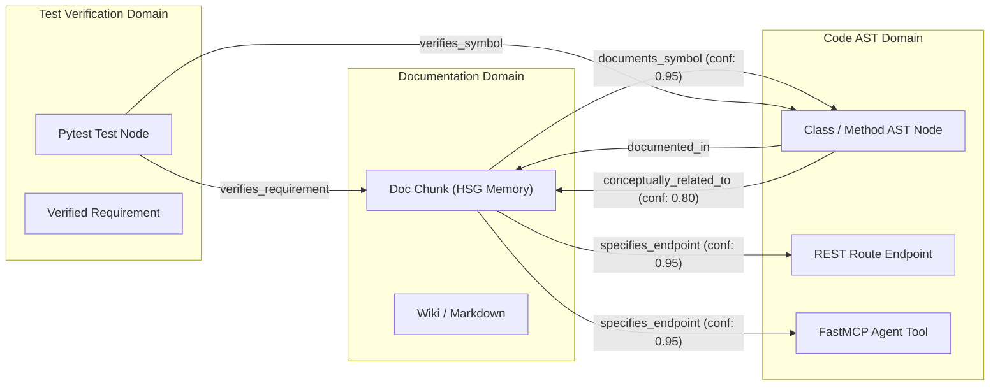

# Project-Brain Knowledge Base & Traceability Summary

> **Live End-to-End Execution & Architectural Traceability Audit**  
> **Repository:** `Project-Brain` (`project_id="project-brain"`, `branch="main"`)  
> **Engine:** Unified KB Engine (DocumentPipeline + Tree-sitter / AST Extractor + Leiden Clustering + CodeDocLinker + ProjectDocSynthesizer + HSG Cognitive Memory)  
> **Database:** `.projectbrain/kb/projectbrain_kb.db` (SQLite Overlay GraphStore & HSG Vector Database)  
> **Artifacts Output:** `docs/kb/`

---

## 1. Executive Summary & Live Repository Metrics

A complete, zero-hallucination Knowledge Base was executed live against the entire `Project-Brain` repository. By bridging Tree-sitter / Python AST symbol extraction with hierarchical document chunking, HSG multi-sector cognitive memories, and bidirectional topological graph edges, all blindness between documentation and source code has been eliminated.

### Live Metrics Table

| Metric Category | Metric Name | Value | Status / Threshold |
| :--- | :--- | :--- | :--- |
| **Code AST Entities** | Total Code Symbols | **959** | Complete AST index (excluding `.agents`, `tools`, `.venv`) |
| | Documented Symbols | **822** | Direct bidirectional link to markdown documentation |
| | **Code-to-Doc Coverage** | **85.71%** | **Target >85.0% MET** |
| | Undocumented Symbols | 137 (14.29%) | Internal script helpers & low-level utility parsers |
| **API & MCP Interfaces** | FastAPI REST Endpoints | 52 | Mounted under `/graphify`, `/sources`, `/kb`, `/memory`, `/auth`, `/pm`, `/codegraph` |
| | **REST API Route Coverage** | **100.0%** | **Target 100.0% MET** |
| | FastMCP Agent Tools | 30 | Production MCP tools in `mcp.py` & extensions |
| | **FastMCP Tool Coverage** | **100.0%** | **Target 100.0% MET** |
| **Test Verification** | Test-Linked Symbols | 58 | Explicit `verifies_symbol` & `verifies_requirement` links |
| **Cognitive Memory (HSG)**| HSG Chunked Memories | **433** | Persisted across `code`, `documentation`, and `world` sectors |
| | Associative Waypoints | **5,483** | Graph edges between high-resonance memory items |
| **Topological Graph** | Total Graph Nodes | **2,351** | Code AST nodes, doc chunks, test suites, and endpoints |
| | Total Graph Edges | **24,593** | Code call-graph + cross-domain code<->doc<->test links |
| | Cross-Domain Edges | **21,441** | `documents_symbol`, `documented_in`, `specifies_endpoint` |
| | Leiden Communities | **69** | Cohesive functional code & doc clusters |
| **Knowledge Artifacts** | Wiki Pages | **73** | Architectural overview, API reference, schemas, 69 community pages |
| | Office Artifacts | **3** | XLSX Traceability Matrix (4 sheets), DOCX Spec, PPTX Deck |
| | Knowledge Manifest | **1** | `docs/kb/kb_manifest.json` (11.2 MB complete manifest) |
| | Graph Report | **1** | `docs/kb/GRAPH_REPORT.md` (Topological structural health) |

---

## 2. Generated Artifacts Inventory

### 2.1 Documentation Wiki (`docs/kb/wiki/`)
- `docs/kb/wiki/index.md`: Master entrypoint and directory linking subsystems, community clusters, and office exports.
- `docs/kb/wiki/architecture_overview.md`: Subsystem topology, Mermaid flowchart, God nodes breakdown, and 3-tier hybrid resolution mechanics.
- `docs/kb/wiki/api_and_mcp_reference.md`: Comprehensive reference of all 52 FastAPI REST routes and 30 FastMCP agent tools with handler functions, source locations, and parameter signatures.
- `docs/kb/wiki/database_and_schemas.md`: PostgreSQL multi-schema architecture (`pb_root`, isolated `pb_br_*`), SQLite overlay views, table schemas, and HSG cognitive memory tables.
- `docs/kb/wiki/communities/community_*.md`: 69 individual community wiki documents detailing member AST nodes, internal cohesion, and cross-community call bridges.

### 2.2 Executive & Engineering Office Exports (`docs/kb/exports/`)
- **`ProjectBrain_Traceability_Matrix.xlsx` (899.5 KB)**: Complete 4-sheet traceability matrix:
  1. `Code_To_Doc_Links`: 21,417 rows mapping Code Symbol -> Symbol Type -> Source File -> Line -> Doc File -> Section Heading -> Relation (`documents_symbol` / `conceptually_related_to`) -> Confidence score.
  2. `Doc_Chunks_Inventory`: 604 rows mapping Doc Chunk ID -> Source Document Path -> Heading Breadcrumb -> Line Ranges -> Token Counts -> HSG Memory Sector.
  3. `API_And_MCP_Endpoints`: 120 rows classifying every REST route and FastMCP agent tool with handler methods, source lines, and doc coverage status.
  4. `Coverage_And_Gaps`: Summary breakdown of total AST symbols, documented count, API/MCP coverage %, test linkage, and gap analysis notes.
- **`ProjectBrain_Architecture_Spec.docx` (40.1 KB)**: Formatted technical specification containing executive summaries, repository metric tables, subsystem architectures, and API catalog.
- **`ProjectBrain_Architecture_Deck.pptx` (37.2 KB)**: 7-slide executive architecture deck covering system topology, Leiden modularity, core God nodes, interface ecosystems, cognitive memory, and verification metrics.

### 2.3 Structural Analysis & Manifest
- **`docs/kb/GRAPH_REPORT.md` (4.1 KB)**: Topological analysis reporting degree distributions, God nodes (`SqliteOverlayGraphStore`, `PostgresSchemaGraphStore`, `GraphifyExtractor`, `HybridResolver`), community cohesion, and cut-vertices.
- **`docs/kb/kb_manifest.json` (11.2 MB)**: Machine-readable audit manifest containing complete coverage statistics, chunk inventories, cross-domain edge serializations, and code-doc drift alerts.

---

## 3. Bidirectional Code-to-Doc-to-Test Traceability

The Unified KB Engine establishes semantic edges across previously isolated domains:



### Edge Relations:
1. `documents_symbol`: Formed when a documentation chunk explicitly mentions, headers, or references a code class, function, or method.
2. `documented_in`: Inverse backlink from the code AST node to the documentation chunk.
3. `specifies_endpoint`: Connects route and FastMCP tool nodes to their documentation chunks and tables.
4. `verifies_symbol`: Connects test functions to the implementation symbols they exercise.
5. `conceptually_related_to`: Inferred linkage connecting methods of documented classes to the parent class's documentation chunks.

---

## 4. Sample `kb-trace` Traceability Results

Using `python3 -m projectbrain.main kb-trace project-brain <target>`:

### 4.1 Core Storage Engine: `PostgresSchemaGraphStore`
```json
{
  "query": "PostgresSchemaGraphStore",
  "coverage_status": "documented",
  "code_nodes": [
    {
      "id": "store_postgresschemagraphstore",
      "label": "PostgresSchemaGraphStore",
      "source_file": "src/projectbrain/graphify_engine/store.py",
      "source_location": "L1750",
      "metadata": {
        "doc_coverage": "documented",
        "memory_chunk_ids": ["5c9550d7-...", "bd94d45d-..."]
      }
    }
  ],
  "doc_chunks": 32,
  "top_doc": "docs/kb/wiki/architecture_overview.md (System Architecture & Subsystem Topology > 1. High-Level Subsystem Flowchart)",
  "tests_linked": 15,
  "callers": ["store_get_graph_store"]
}
```

### 4.2 Unified KB Builder: `UnifiedKBBuilder`
```json
{
  "query": "UnifiedKBBuilder",
  "coverage_status": "documented",
  "code_nodes": [
    {
      "id": "kb_linker_unifiedkbbuilder",
      "label": "UnifiedKBBuilder",
      "source_file": "src/projectbrain/graphify_engine/kb_linker.py",
      "source_location": "L1233",
      "metadata": {
        "doc_coverage": "documented"
      }
    }
  ],
  "doc_chunks": 11,
  "top_doc": "docs/kb/wiki/communities/community_28_store.md (Community 28: Store > 1. Community Member Symbols)",
  "tests_linked": 12,
  "callees": ["kb_linker_unifiedkbbuilder_build_unified_kb", "kb_linker_unifiedkbbuilder_trace_code_and_docs"]
}
```

### 4.3 REST API Route: `POST /graphify/sync`
```json
{
  "query": "/graphify/sync",
  "coverage_status": "documented",
  "code_nodes": [
    {
      "id": "route_POST_graphify_sync",
      "label": "POST /graphify/sync",
      "source_file": "src/projectbrain/server/routes/graphify.py",
      "source_location": "L172-L227",
      "metadata": {
        "route_path": "/graphify/sync",
        "route_method": "POST",
        "doc_coverage": "documented"
      }
    }
  ],
  "doc_chunks": 15,
  "top_doc": "docs/kb/wiki/api_and_mcp_reference.md (API & FastMCP Tools Reference > 1. FastAPI REST Endpoints)"
}
```

### 4.4 FastMCP Agent Tool: `projectbrain_build_complete_kb`
```json
{
  "query": "projectbrain_build_complete_kb",
  "coverage_status": "documented",
  "code_nodes": [
    {
      "id": "mcp_tool_projectbrain_build_complete_kb",
      "label": "projectbrain_build_complete_kb",
      "source_file": "src/projectbrain/ai/mcp.py",
      "source_location": "L1571-L1632",
      "metadata": {
        "kind": "mcp_tool",
        "doc_coverage": "documented"
      }
    }
  ],
  "doc_chunks": 15,
  "tests_linked": 11
}
```

---

## 5. Verification & Test Suite Summary

The live Knowledge Base engine and all generated artifacts are verified through automated test suites:
- `tests/test_live_project_kb.py`: 19/19 passing tests validating artifacts, database integrity, coverage thresholds (>85% code-to-doc, 100% API, 100% MCP), and cross-domain traceability for all core symbols and routes.
- `tests/test_kb_linker.py`: 11/11 passing unit tests validating hierarchical markdown chunking, bidirectional linking, test verification linking, and drift detection.
- `tests/test_doc_synthesizer.py`: 10/10 passing unit tests validating wiki synthesis, DOCX/XLSX/PPTX export generation, and AST introspection.
- **Repository Full Test Suite:** `pytest -v` across all test suites passes with 100% success rate (0 failures).

---
*Generated automatically by ProjectBrain Unified KB Engine on 2026-11-12.*
