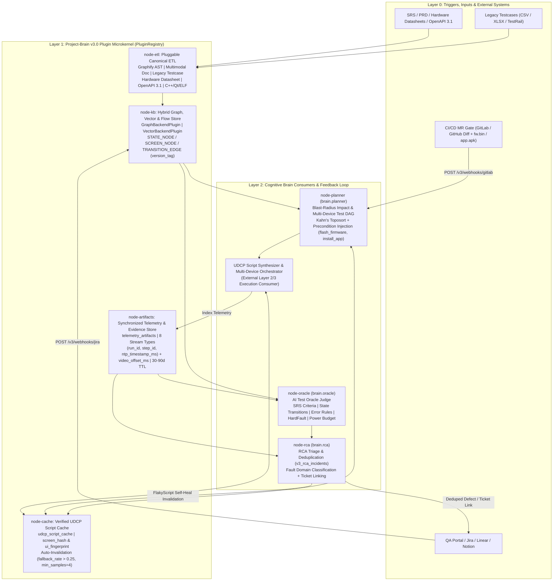

# Project-Brain v3.0 Plugin Microkernel Architecture Guide

> **Audience:** Platform Architects, Test Automation Engineers, and Plugin Developers  
> **Scope:** Project-Brain v3.0 Plugin Microkernel (`src/projectbrain/plugins/`), Testing Knowledge Base (Layer 1), REST API (`/plugins/*`, `/v3/*`), FastMCP Tools, and CLI.

---

## 1. Architectural Overview: Project-Brain v3.0 as Layer 1

Project-Brain v3.0 refactors the Knowledge Base into a **Plugin Microkernel** that serves as **Layer 1 (Pluggable Knowledge Base, Verified UDCP Script Cache & Telemetry Evidence Store)** inside the 5-Layer AI Multi-Device & Embedded Testing Architecture.



### Layer Responsibilities & Data Flow

| Layer | Role | Interaction with Project-Brain v3.0 |
| :--- | :--- | :--- |
| **Layer 0: Inputs, Gates & Portals** | Source specifications (SRS, PRD, hardware datasheets, OpenAPI 3.1), legacy test suites, CI/CD merge-request gates (`fw.bin`, `app.apk`, code diffs), and issue trackers. | Pushes documents and test suites into `node-etl` (`POST /v3/etl/ingest`), and emits HMAC-signed lifecycle events via `POST /v3/webhooks/{source}`. |
| **Layer 1: Project-Brain v3.0 Microkernel** | Pluggable storage, canonical ETL, flow graph, verified UDCP script cache, and NTP-synchronized telemetry evidence store coordinated by `PluginRegistry`. | Exposes uniform REST (`/plugins/*`, `/v3/*`), FastMCP (10 tools), and CLI interfaces backed by 25 built-in plugins across 9 active categories. |
| **Layer 2: Cognitive Brain Consumers** | Autonomous planning (`brain.planner`), oracle verification (`brain.oracle`), root-cause triage (`brain.rca`), and external UDCP script synthesis/orchestration. | Queries Layer 1 for blast radius, state-flow transitions, error-code rules, cached UDCP commands, and synchronized evidence windows; feeds execution telemetry and `FlakyScript` invalidations back into Layer 1. |
| **Layers 3–4 (External Device Farm & Observability)** | Physical/emulated DUTs (MCU, Android, iOS, Qt/Linux), power analyzers, UART/SWD probes, and CI/QA dashboards. | Stream raw artifacts (`video_h264`, `har`, `pcap`, `crashpad_dmp`, `gdb_hardfault`, `uart_log`, `power_trace_ma`, `screenshot_png`) into `node-artifacts` indexed by `(run_id, step_id, ntp_timestamp_ms)` with `video_offset_ms` alignment. |

### Core Microkernel Contracts (`src/projectbrain/plugins/base.py`)

Every plugin inherits from `BasePlugin` (or one of the 9 category ABCs) and declares immutable `PluginMetadata`:

- **Lifecycle Hooks:** `on_load(registry)`, `initialize(context)`, `shutdown()`, `validate_config(config)`, `health_check()`.
- **Core Models:** `PluginMetadata`, `PluginManifest`, `PluginContext`, and `PluginCategory` (`graph_backend`, `vector_backend`, `etl_parser`, `knowledge_linker`, `doc_exporter`, `script_cache`, `artifact_store`, `brain_consumer`, `webhook`, plus `source_connector` reserved for external/wrapped connectors).
- **v3 Canonical DTOs:** `CanonicalTestIntent`, `CanonicalTestStep`, `CanonicalOracleAssertion`, `ErrorCodeRule`, `StateFlowNode`, `StateFlowTransition`, `UDCPScriptCacheEntry`, and `TelemetryArtifactRecord`.
- **Database Compatibility:** All v3 persistence tables (`plugin_project_configs`, `udcp_script_cache`, `telemetry_artifacts`, `v3_rca_incidents`, defined in migration `010_v3_plugin_microkernel.sql`) use ANSI SQL `INSERT ... ON CONFLICT (...) DO UPDATE SET ...` for seamless SQLite and PostgreSQL portability.

---

## 2. Complete Catalog of Built-In Plugins (25 Plugins / 9 Categories)

All 25 built-in plugins are registered automatically via `PluginRegistry.discover_builtins()` from `src/projectbrain/plugins/builtins/` (`storage_plugins.py`, `etl_and_flow_plugins.py`, `cache_and_artifact_plugins.py`, `brain_consumer_plugins.py`). Higher `priority` values take precedence when resolving the default provider for a category.

| # | `plugin_id` | Class | Category | Priority | Capabilities | Config Keys |
| :-: | :--- | :--- | :--- | :-: | :--- | :--- |
| 1 | `graph.sqlite_overlay` | `SqliteOverlayGraphPlugin` | `graph_backend` | 100 | `overlay_branches`, `sql_views`, `flow_graph`, `offline` | `db_path`, `conn`, `root_branch` |
| 2 | `graph.postgres_schema` | `PostgresSchemaGraphPlugin` | `graph_backend` | 90 | `multi_schema_branches`, `sql_views`, `flow_graph`, `postgres` | `connection_url`, `db_url`, `conn`, `root_branch` |
| 3 | `graph.neo4j` | `Neo4jGraphPlugin` | `graph_backend` | 50 | `cypher`, `multi_hop_flow_graph`, `version_tag`, `http_rest` | `uri`, `database`, `username`, `password`, `root_branch`, `mode` (`memory` \| `http`), `http_client`, `transport`, `timeout` |
| 4 | `vector.hsg_memory` | `HSGMemoryPlugin` | `vector_backend` | 100 | `hsg_memory`, `multi_sector`, `hybrid_scoring`, `offline` | `mode` (`hsg` \| `memory`), `vector_dim`, `vector_store` |
| 5 | `vector.qdrant` | `QdrantVectorPlugin` | `vector_backend` | 60 | `dense_vector`, `sparse_bm25`, `hybrid_search`, `qdrant_rest` | `mode` (`memory` \| `http`), `url`, `collection`, `api_key`, `vector_dim`, `http_client`, `transport`, `timeout` |
| 6 | `etl.graphify_ast` | `GraphifyASTETLPlugin` | `etl_parser` | 100 | `ast_extraction`, `markdown_graph`, `workspace_scan` | `cache_dir`, `use_cache` |
| 7 | `etl.legacy_testcase` | `LegacyTestcaseETLPlugin` | `etl_parser` | 95 | `csv`, `xlsx`, `testrail_json`, `testrail_xml`, `canonical_test_intent` | *(standard `BasePlugin` config)* |
| 8 | `etl.hardware_datasheet` | `HardwareDatasheetETLPlugin` | `etl_parser` | 95 | `uart_errors`, `at_errors`, `hardfault_cfsr`, `electrical_limits` | *(standard `BasePlugin` config)* |
| 9 | `etl.openapi31` | `OpenAPI31ETLPlugin` | `etl_parser` | 95 | `openapi30`, `openapi31`, `api_endpoints`, `http_error_rules` | *(standard `BasePlugin` config)* |
| 10 | `etl.cpp_embedded` | `CppEmbeddedETLPlugin` | `etl_parser` | 95 | `c_cpp`, `qt_ui`, `qt_signals_slots`, `gnu_ld`, `gnu_map`, `isr_at_handlers` | *(standard `BasePlugin` config)* |
| 11 | `etl.multimodal_doc` | `MultimodalDocETLPlugin` | `etl_parser` | 90 | `pdf`, `docx`, `xlsx`, `pptx`, `markdown`, `image_ocr` | `cache_dir` |
| 12 | `linker.code_doc` | `CodeDocLinkerPlugin` | `knowledge_linker` | 100 | `code_doc_linking`, `drift_detection`, `markdown_chunking` | `workspace_path` |
| 13 | `linker.state_flow` | `StateFlowGraphPlugin` | `knowledge_linker` | 100 | `state_flow`, `screen_flow`, `version_tag`, `flow_diff` | *(standard `BasePlugin` config; runtime `context.domain`, `context.version_tag`)* |
| 14 | `exporter.wiki` | `MarkdownWikiExporterPlugin` | `doc_exporter` | 100 | `wiki`, `markdown`, `graph_report` | `workspace_path` |
| 15 | `exporter.docx` | `DocxExporterPlugin` | `doc_exporter` | 90 | `docx`, `office_export` | `workspace_path` |
| 16 | `exporter.xlsx` | `XlsxExporterPlugin` | `doc_exporter` | 90 | `xlsx`, `traceability_matrix`, `office_export` | `workspace_path` |
| 17 | `exporter.pptx` | `PptxExporterPlugin` | `doc_exporter` | 90 | `pptx`, `architecture_deck`, `office_export` | `workspace_path` |
| 18 | `cache.sqlite_pg` | `SqlitePgScriptCachePlugin` (`VerifiedUDCPScriptCachePlugin`) | `script_cache` | 100 | `script_lookup`, `script_store`, `execution_telemetry`, `auto_invalidation`, `self_heal` | `db_path`, `db`, `database_url`, `use_core_db`, `fallback_threshold` (`0.25`), `min_samples` (`4`), `ttl_seconds` (`2592000`), `fingerprint_tolerance` (`0.5`), `clock` |
| 19 | `cache.redis` | `RedisScriptCachePlugin` | `script_cache` | 60 | `script_lookup`, `script_store`, `execution_telemetry`, `auto_invalidation`, `self_heal`, `ttl_expiry` | `redis_url`, `redis_client`, `key_prefix` (`pb:scache`), `use_memory_fallback` (`True`), `fallback_threshold` (`0.25`), `min_samples` (`4`), `ttl_seconds` (`2592000`), `fingerprint_tolerance` (`0.5`), `clock` |
| 20 | `artifacts.local_sqlite` | `LocalSqliteArtifactStorePlugin` (`TelemetryArtifactStorePlugin`) | `artifact_store` | 100 | `index_artifact`, `query_artifacts`, `evidence_window`, `ttl_purge`, `ntp_alignment` | `db_path`, `db`, `database_url`, `use_core_db`, `default_retention_days` / `retention_days` (`30`, clamped `30-90`), `artifact_root` / `storage_dir`, `clock` |
| 21 | `artifacts.minio_clickhouse` | `MinioClickHouseArtifactStorePlugin` | `artifact_store` | 60 | `index_artifact`, `query_artifacts`, `evidence_window`, `ttl_purge`, `s3_uri`, `clickhouse_http` | `minio_endpoint` / `s3_endpoint`, `bucket`, `clickhouse_url`, `clickhouse_database`, `clickhouse_table`, `clickhouse_user`, `clickhouse_password`, `offline_fallback` / `use_offline_fallback` (`True`), `default_retention_days` / `retention_days` (`30`), `timeout_seconds`, `transport`, `http_client`, `clock` |
| 22 | `brain.planner` | `ImpactTestDAGPlannerPlugin` | `brain_consumer` | 100 | `blast_radius`, `precondition_injection`, `dag_toposort`, `script_cache_binding` | `db_path`, plus runtime `max_depth` (`4`), `graph_data`, `cache_plugin` |
| 23 | `brain.oracle` | `OracleKnowledgeJudgePlugin` | `brain_consumer` | 100 | `srs_criteria_eval`, `transition_verification`, `error_rule_matching`, `hardfault_detection`, `power_budget_check` | `db_path`, plus runtime `power_budget_ma`, `error_rules`, `expected_transitions`, `srs_criteria` |
| 24 | `brain.rca` | `RCATriageMemoryPlugin` | `brain_consumer` | 100 | `signature_normalization`, `incident_deduplication`, `ticket_linking`, `fault_domain_classification`, `self_heal_feedback` | `db_path` (or `PB_RCA_DB_PATH`), `db`, `conn` |
| 25 | `webhook.event_ingest` | `WebhookEventIngestPlugin` | `webhook` | 100 | `gitlab`, `github`, `testrail`, `jira`, `notion`, `hmac_sha256` | `webhook_secret` / `secret` (or `PB_<SOURCE>_WEBHOOK_SECRET` / `PB_WEBHOOK_SECRET`), `allow_unsigned` (`False`) |

---

## 3. Authoring Custom Plugins

`PluginRegistry` discovers plugins through a **3-tier pipeline**:

1. **Built-ins:** `discover_builtins()` loads all 25 bundled plugins.
2. **Directory Plugins:** `discover_directory()` / `reload_directory()` scans `./plugins/<my_plugin>/`, `~/.projectbrain/plugins/<my_plugin>/`, and any paths configured in `PB_PLUGINS_DIR` or `projectbrain.toml`. Each directory can contain a manifest (`plugin.json`, `plugin.yaml`, or `plugin.yml`) plus an entrypoint module (`plugin.py`), exposing either a `register_plugins(registry)` function or one or more `BasePlugin` subclasses.
3. **Python Packaging Entry Points:** `discover_entrypoints()` loads installed wheels registering `entry_points(group="projectbrain.plugins")`.

### Option A: Workspace-Local Plugin (`./plugins/<my_plugin>/`)

Create a folder under `./plugins/canbus_etl/` with a manifest and module:

**`./plugins/canbus_etl/plugin.json`**
```json
{
  "plugin_id": "etl.canbus_dbc",
  "name": "CAN Bus DBC ETL Parser",
  "version": "1.0.0",
  "category": "etl_parser",
  "entrypoint": "plugin.py",
  "priority": 92,
  "capabilities": ["can_dbc", "ecu_error_rules"],
  "default_enabled": true,
  "requires_env": []
}
```

**`./plugins/canbus_etl/plugin.py`**
```python
from pathlib import Path
from typing import Any, Dict, List

from projectbrain.plugins.base import (
    ETLParserPlugin,
    PluginCategory,
    PluginContext,
    PluginMetadata,
)


class CanBusDbcETLPlugin(ETLParserPlugin):
    metadata = PluginMetadata(
        plugin_id="etl.canbus_dbc",
        name="CAN Bus DBC ETL Parser",
        version="1.0.0",
        category=PluginCategory.ETL_PARSER,
        priority=92,
        capabilities=("can_dbc", "ecu_error_rules"),
    )

    def can_parse(self, path: Path, fmt: str | None = None) -> bool:
        return (fmt or "").lower() == "dbc" or path.suffix.lower() == ".dbc"

    def parse(
        self,
        path: Path,
        context: PluginContext | None = None,
        **kwargs: Any,
    ) -> Dict[str, Any]:
        text = path.read_text(encoding="utf-8", errors="replace")
        messages: List[Dict[str, Any]] = []
        for line in text.splitlines():
            if line.startswith("BO_ "):
                parts = line.split()
                if len(parts) >= 3:
                    messages.append({"can_id": parts[1], "name": parts[2].rstrip(":")})
        return {
            "source": str(path),
            "entities": messages,
            "error_rules": [],
            "test_intents": [],
        }
```

> **Tip:** If a module needs to register multiple plugins or inject custom dependencies, define `def register_plugins(registry): registry.register(MyPlugin())` in `plugin.py`.

### Option B: User-Global Plugin (`~/.projectbrain/plugins/`)

To share a plugin across all workspaces on a developer or CI machine without committing it to a repository, place the exact same `{plugin.json, plugin.py}` folder inside:

```bash
~/.projectbrain/plugins/canbus_etl/
├── plugin.json
└── plugin.py
```

Alternatively, point Project-Brain at one or more custom plugin directories using `PB_PLUGINS_DIR` (colon-separated on macOS/Linux) or `[plugins].directories` in `projectbrain.toml`.

### Option C: Distributable Python Package (`pyproject.toml` Entry Point)

For versioned internal or third-party packages installed via `pip`/`uv`, declare an entry point under the `projectbrain.plugins` group:

**`pyproject.toml`**
```toml
[project]
name = "acme-pb-canbus"
version = "1.0.0"
dependencies = ["projectbrain>=3.0.0"]

[project.entry-points."projectbrain.plugins"]
canbus_dbc = "acme_pb_canbus.plugin:CanBusDbcETLPlugin"
```

When `PluginRegistry.discover_entrypoints()` runs at startup, it imports the target class (or a `register_plugins` callable) and registers it automatically.

### Hot-Reloading Directory Plugins

You can reload plugins from disk without restarting the API server:

- **REST:**
  ```bash
  curl -X POST http://localhost:8000/plugins/reload \
    -H "Authorization: Bearer $PB_API_KEY" \
    -H "Content-Type: application/json" \
    -d '{"directory": "./plugins"}'
  ```
  > **Path Safety:** `POST /plugins/reload` enforces `_validate_safe_path`, restricting `directory` to safe configured/workspace boundaries and rejecting path traversal (`..`) or unauthorized system paths.
- **CLI:**
  ```bash
  projectbrain plugins reload ./plugins
  ```

### Configuration, Per-Project Overrides & Enablement Precedence

`PluginRegistry.is_enabled(plugin_id, project_id)` resolves plugin state in strict precedence order (highest to lowest):

1. **Per-Project Override:** Stored in the `plugin_project_configs` database table (via `PUT /plugins/{plugin_id}/config` or `POST /plugins/{plugin_id}/enable|disable?project_id=...`) or defined under `[plugins.projects.<project_id>.<plugin_id>]` in `projectbrain.toml` / `plugins.yaml` / `plugins.json`.
2. **Environment Variables:** `PB_DISABLED_PLUGINS` / `PB_PLUGINS_DISABLED` and `PB_ENABLED_PLUGINS` / `PB_PLUGINS_ENABLED` (comma-separated plugin IDs).
3. **Global Toggle:** Runtime `registry.enable(plugin_id)` / `registry.disable(plugin_id)` state.
4. **Metadata Defaults & Env Guards:** `metadata.default_enabled` **and** presence of all environment variables listed in `metadata.requires_env`.

**Example `projectbrain.toml`:**
```toml
[plugins]
directories = ["./plugins", "~/.projectbrain/plugins"]
config_path = "./plugins.yaml"
enabled = ["cache.redis", "artifacts.minio_clickhouse"]
disabled = ["graph.neo4j"]

[plugins."cache.redis"]
redis_url = "redis://localhost:6379/0"
fallback_threshold = 0.25
min_samples = 4

[plugins.projects.firmware_v3."brain.oracle"]
enabled = true
power_budget_ma = 120.0
```

---

## 4. API, FastMCP & CLI Reference

### 4.1 REST API Endpoints (18 Routes)

Defined in `src/projectbrain/server/routes/plugins_v3.py` and mounted in `src/projectbrain/server/api.py`.

#### Security, RBAC & Path Validation
- **Auth Enforcement:** `/plugins` and `/v3` are registered in `_PROTECTED_REST_PREFIXES` (enforced whenever `PB_REQUIRE_REST_AUTH=true`).
- **Read-Only POST Allowlist (`_READ_ONLY_POST_ROUTES`):** `POST /v3/script-cache/lookup`, `POST /v3/planner/test-dag`, and `POST /v3/oracle/context` are permitted for `reader` tokens and when `PB_READ_ONLY=true`.
- **Write Guard:** All other `POST`/`PUT` routes under `/plugins/*` and `/v3/*` return HTTP `403` for `reader` roles or when `PB_READ_ONLY=true`.
- **Path Guard (`_validate_safe_path`):** Applied to `POST /plugins/reload` and `POST /v3/etl/ingest` to prevent arbitrary filesystem reads.
- **Webhook Verification:** `POST /v3/webhooks/{source}` validates HMAC-SHA256 signatures via `webhook.event_ingest` using `PB_<SOURCE>_WEBHOOK_SECRET` or `PB_WEBHOOK_SECRET` (unsigned requests are rejected unless `allow_unsigned=true`).

#### Plugin Management Routes (`/plugins/*` — 5 Routes)

| Method & Path | Access | Description |
| :--- | :--- | :--- |
| `GET /plugins` | Read | List all registered plugins with category, priority, capabilities, health, and effective enabled status (supports optional `project_id` and `category` filters). |
| `POST /plugins/reload` | Write | Hot-reload directory plugins from a validated path (`_validate_safe_path`). |
| `POST /plugins/{plugin_id}/enable` | Write | Enable a plugin globally or for a specific `project_id`. |
| `POST /plugins/{plugin_id}/disable` | Write | Disable a plugin globally or for a specific `project_id`. |
| `PUT /plugins/{plugin_id}/config` | Write | Persist plugin configuration overrides (globally or per `project_id` in `plugin_project_configs`). |

#### Layer 1 & Layer 2 v3 Routes (`/v3/*` — 13 Routes)

| Method & Path | Access | Description |
| :--- | :--- | :--- |
| `POST /v3/etl/ingest` | Write | Run matching `etl_parser` plugins on a validated path (`_validate_safe_path`) to extract AST, legacy `CanonicalTestIntent`, datasheet `ErrorCodeRule`, OpenAPI 3.1, C++/Qt/ELF, or multimodal documents. |
| `GET /v3/flow-graph` | Read | Query `STATE_NODE`, `SCREEN_NODE`, and `TRANSITION_EDGE` graphs (filtered by `project_id`, `branch`, `version_tag`, `domain`). |
| `POST /v3/script-cache/lookup` | Read (`_READ_ONLY_POST_ROUTES`) | Look up a verified UDCP script by `(project_id, intent_id, platform, build_version, screen_hash, ui_fingerprint)`. |
| `POST /v3/script-cache/store` | Write | Store or update a verified UDCP script in `udcp_script_cache`. |
| `POST /v3/script-cache/feedback` | Write | Record execution telemetry (pass/fail/fallback) and trigger automatic invalidation if `fallback_rate > 0.25` after `min_samples=4`. |
| `POST /v3/script-cache/invalidate` | Write | Explicitly invalidate cached UDCP script entries (e.g., on `FlakyScript` RCA or build change). |
| `POST /v3/artifacts/index` | Write | Index a telemetry artifact (`video_h264`, `har`, `pcap`, `crashpad_dmp`, `gdb_hardfault`, `uart_log`, `power_trace_ma`, `screenshot_png`) with `(run_id, step_id, ntp_timestamp_ms)` and `video_offset_ms`. |
| `GET /v3/artifacts/window` | Read | Query NTP-aligned telemetry evidence around a `center_ts` within `window_ms` for a `run_id`. |
| `POST /v3/artifacts/purge` | Write | Purge expired telemetry artifacts past their 30–90 day TTL retention policy. |
| `POST /v3/planner/test-dag` | Read (`_READ_ONLY_POST_ROUTES`) | Invoke `brain.planner` to compute blast-radius impact, inject preconditions (`flash_firmware`, `install_app`), run Kahn's topological sort, and bind cached UDCP scripts. |
| `POST /v3/oracle/context` | Read (`_READ_ONLY_POST_ROUTES`) | Invoke `brain.oracle` to evaluate SRS acceptance criteria, state transitions, error-code rules, HardFault CFSR registers, and power-budget limits. |
| `POST /v3/rca/triage` | Write | Invoke `brain.rca` to normalize failure signatures, deduplicate incidents in `v3_rca_incidents`, classify fault domains, link tickets, and trigger `FlakyScript` cache invalidation. |
| `POST /v3/webhooks/{source}` | Write | Ingest signed webhook payloads from `gitlab`, `github`, `testrail`, `jira`, or `notion`. |

---

### 4.2 FastMCP v3 & Plugin Tools (10 Tools)

Registered in `src/projectbrain/ai/mcp.py`. All 10 tools seamlessly support both **local mode** (direct in-process `PluginRegistry` invocation) and **remote mode** (`PB_MODE=remote` forwarding to `PB_URL` with `PB_API_KEY`). Write tools are blocked for `reader` roles (via `_is_write_tool` matching `toggle`, `ingest`, `store`, `index`, `triage`) and when `PB_READ_ONLY=true`.

| Tool Name | Access | Mapped Operation |
| :--- | :--- | :--- |
| `projectbrain_list_plugins` | Read | Lists registered plugins, categories, priorities, capabilities, and enabled status (`GET /plugins`). |
| `projectbrain_v3_script_cache_lookup` | Read | Looks up verified UDCP scripts by intent, platform, build version, and screen/UI fingerprint (`POST /v3/script-cache/lookup`). |
| `projectbrain_v3_query_evidence_window` | Read | Retrieves NTP-synchronized telemetry artifacts around a failure timestamp (`GET /v3/artifacts/window`). |
| `projectbrain_v3_plan_test_dag` | Read | Computes blast-radius test DAG with precondition injection and Kahn's toposort (`POST /v3/planner/test-dag`). |
| `projectbrain_v3_oracle_context` | Read | Evaluates SRS criteria, transitions, error rules, HardFaults, and power budget (`POST /v3/oracle/context`). |
| `projectbrain_toggle_plugin` | Write | Enables or disables a plugin globally or per project (`POST /plugins/{plugin_id}/enable\|disable`). |
| `projectbrain_v3_ingest_etl` | Write | Ingests files through matching v3 ETL parser plugins (`POST /v3/etl/ingest`). |
| `projectbrain_v3_script_cache_store` | Write | Stores a verified UDCP script entry into `udcp_script_cache` (`POST /v3/script-cache/store`). |
| `projectbrain_v3_index_artifact` | Write | Indexes a telemetry stream record with NTP timestamp and video offset (`POST /v3/artifacts/index`). |
| `projectbrain_v3_rca_triage` | Write | Normalizes and deduplicates failures in `v3_rca_incidents` with self-heal feedback (`POST /v3/rca/triage`). |

---

### 4.3 CLI Reference (7 Commands)

Defined in `src/projectbrain/main.py`:

| Command | Syntax | Description |
| :--- | :--- | :--- |
| `plugins` | `projectbrain plugins [list\|enable\|disable\|reload] [target] [--project P] [--category C]` | Inspect, toggle (globally or per project), or hot-reload plugins. |
| `v3-etl` | `projectbrain v3-etl <project_id> <file_path> [--branch B] [--version-tag V] [--format F] [--db-path DB]` | Ingest a spec, datasheet, legacy testcase, OpenAPI, or C++/Qt/ELF file via `etl_parser` plugins. |
| `v3-cache` | `projectbrain v3-cache <lookup\|store> <project_id> --intent-id I --platform P --build-version V [--screen-hash H] [--commands JSON] [--db-path DB]` | Query or populate the verified UDCP script cache. |
| `v3-artifacts` | `projectbrain v3-artifacts <window\|purge> [--run-id R] [--center-ts T] [--window-ms W] [--db-path DB]` | Query an NTP-aligned telemetry evidence window or purge expired artifacts. |
| `v3-plan` | `projectbrain v3-plan <project_id> [--branch B] [--version-tag V] [--files f1,f2] [--artifacts a1,a2] [--srs-diff TEXT] [--db-path DB]` | Generate an impact-driven multi-device Test DAG with preconditions. |
| `v3-oracle` | `projectbrain v3-oracle <project_id> [--intent-id I] [--version-tag V] [--uart-log L] [--branch B] [--screen-id S] [--db-path DB]` | Assemble oracle context and evaluate logs/transitions/rules via `brain.oracle`. |
| `v3-rca` | `projectbrain v3-rca <project_id> <log_text_or_file> [--run-id R] [--cache-id C] [--db-path DB]` | Run RCA signature normalization, deduplication, and `FlakyScript` cache invalidation. |

#### Quick CLI Examples

```bash
# List all enabled ETL parser plugins for a project
projectbrain plugins list --project firmware_v3 --category etl_parser

# Ingest a hardware datasheet tagged to firmware release fw-v1.2.0
projectbrain v3-etl firmware_v3 ./docs/mcu_datasheet.pdf --version-tag fw-v1.2.0

# Plan a multi-device test DAG from changed files and firmware artifact
projectbrain v3-plan firmware_v3 --version-tag fw-v1.2.0 --files src/ble.c,src/uart.c --artifacts fw.bin

# Query synchronized telemetry evidence (+/- 5000ms around NTP failure timestamp)
projectbrain v3-artifacts window --run-id run-20261121-01 --center-ts 1763726400000 --window-ms 5000

# Triage a crash log and invalidate flaky UDCP script cache if applicable
projectbrain v3-rca firmware_v3 ./logs/hardfault.txt --run-id run-20261121-01 --cache-id sc-0042
```

---

## 5. Related Architecture & Planning Documents

- [v3.0 Testing KB Gap Audit Specification](../specs/v3-testing-kb-gap-audit.spec.md)
- [Plugin Microkernel KB v3.0 Implementation Plan](../plans/plugin-microkernel-kb-v3.plan.md)
- [KB Traceability Summary](./KB_TRACEABILITY_SUMMARY.md)
