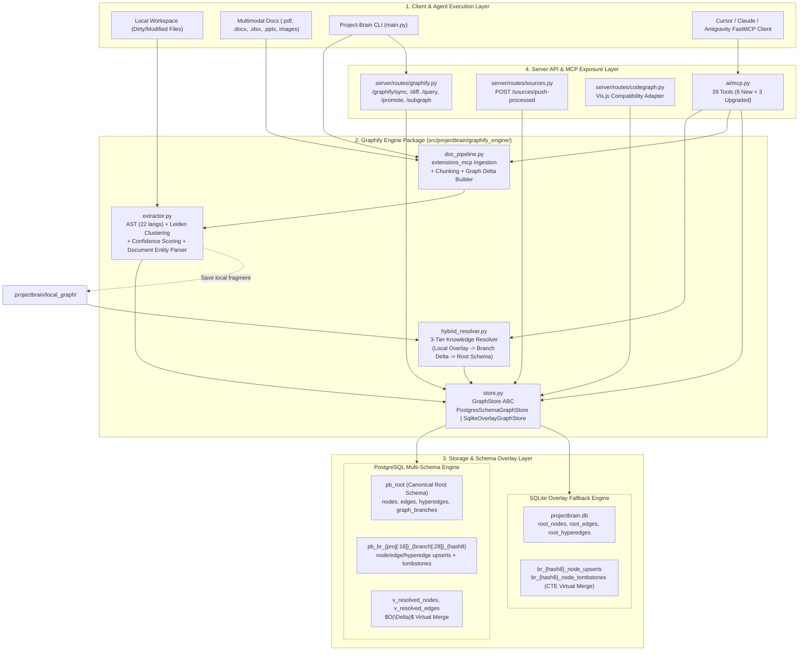
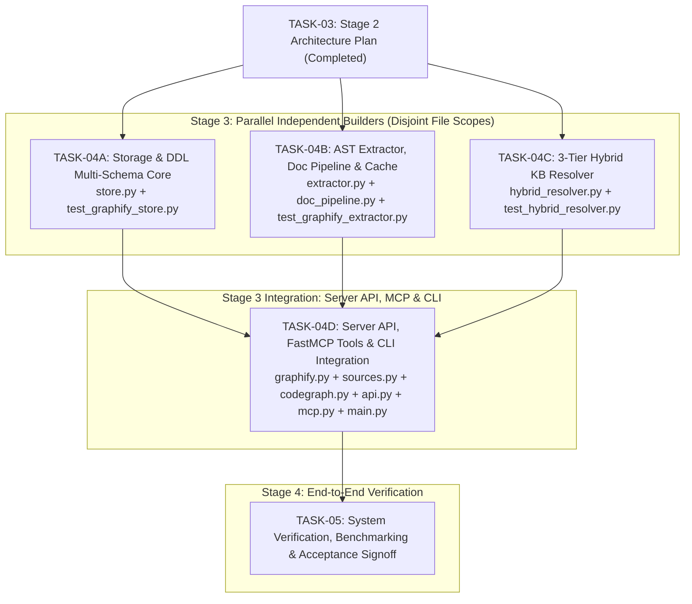

# System Architecture & Condition-Based Implementation Plan: Hybrid Graphify Engine

> **Plan ID**: `PLAN-HYBRID-GRAPHIFY-01`  
> **Target Release**: Project-Brain v1.4.0  
> **Status**: APPROVED FOR STAGE 3 IMPLEMENTATION  
> **Specification Reference**: [`docs/specs/hybrid-graphify-brain.spec.md`](file:///Users/macbbook/SourceCodes/Project-Brain/docs/specs/hybrid-graphify-brain.spec.md)  
> **Repository Root**: `/Users/macbbook/SourceCodes/Project-Brain`  
> **Author**: Fleet Architecture Specialist (`task-planner`)  

---

## 1. Executive Architecture Overview

This plan defines the end-to-end technical architecture, component contracts, schema migrations, and decoupled builder execution DAG for transitioning Project-Brain from its legacy `.codegraph/codegraph.db` SQLite parser to a high-performance **Hybrid Graphify Knowledge Engine**.



---

## 2. Critical Architectural Invariants & Hardening

### 2.1 Composite Multi-Project Keys (Zero Collision Invariant)
In multi-tenant or multi-repository Project-Brain instances, different projects frequently share symbol names or relative paths (e.g., `main_main`, `src/utils.py:format_date`).
- **Enforcement**: Every node, edge, hyperedge, upsert, and tombstone table MUST use composite keys scoped by `project_id`.
- `pb_root.nodes`: `PRIMARY KEY (project_id, id)`
- `pb_root.edges`: `PRIMARY KEY (project_id, source, target, relation)`
- `pb_root.hyperedges`: `PRIMARY KEY (project_id, id)`
- Per-branch overlay tables (`node_upserts`, `node_tombstones`, `edge_upserts`, `edge_tombstones`, `hyperedge_upserts`, `hyperedge_tombstones`, `synced_files`) enforce identical composite primary keys.

### 2.2 Schema Identifier Sanitization ($\le 63$ Bytes & Safe Scoping)
PostgreSQL strictly limits identifier names to 63 bytes (`NAMEDATALEN = 64`). Branch names in Git can be arbitrary strings up to 255 characters with slashes and special characters (e.g., `feature/user-auth-token-refresh-pipeline-v2`).
- **Sanitization Formula**:
  $$\text{schema\_name} = \texttt{"pb\_br\_"} + \text{clean\_proj[:16]} + \texttt{"\_"} + \text{clean\_branch[:28]} + \texttt{"\_"} + \text{hash8}$$
  where $\text{hash8} = \text{sha256}(project\_id + \texttt{":"} + branch\_name)[:8]$.
- Total length: $6 + 16 + 1 + 28 + 1 + 8 = 60 \le 63$ bytes.
- Regex validation check: `^[a-z_][a-z0-9_]{0,62}$`.
- All SQL identifier interpolations MUST use `psycopg2.sql.Identifier(schema_name)` and NEVER raw string formatting.

### 2.3 Safe DDL Bootstrapping (`core/db.py` Compatibility Invariant)
[`src/projectbrain/core/db.py`](file:///Users/macbbook/SourceCodes/Project-Brain/src/projectbrain/core/db.py#L47-L100) automatically iterates over all `.sql` files in `src/projectbrain/migrations/` and attempts to run them against SQLite using `c.executescript(sql)` or PostgreSQL using regex translation (`AUTOINCREMENT` $\to$ `SERIAL`).
- **Hazard**: Placing PostgreSQL-specific multi-schema DDL (`CREATE SCHEMA pb_root`, PL/pgSQL stored procedures with `$$...$$`, `CREATE TABLE ... (LIKE ... INCLUDING ALL)`) inside `src/projectbrain/migrations/*.sql` will immediately crash SQLite test runs and local dev environments because SQLite cannot parse PostgreSQL DDL.
- **Architectural Solution**: Multi-schema PostgreSQL and SQLite CTE overlay DDL is completely decoupled from `src/projectbrain/migrations/`. Storage initialization is encapsulated entirely within [`src/projectbrain/graphify_engine/store.py`](file:///Users/macbbook/SourceCodes/Project-Brain/src/projectbrain/graphify_engine/store.py) via `GraphStore.ensure_root_schema()` and `GraphStore.ensure_branch_schema()`.

### 2.4 True Partial Graph Sync & $O(\Delta)$ Diff Engine
- **Partial File-Scoped Sync**:
  When syncing only changed files (`partial=True`, `synced_files=[...]`, `deleted_files=[...]`):
  1. For `deleted_files`: find all existing entities in `pb_root` or branch overlay belonging to those files, and insert tombstone entries into `node_tombstones` and `edge_tombstones`.
  2. For `synced_files`: remove stale branch upserts for those files and insert updated `GraphNode` / `GraphEdge` entities into `node_upserts` and `edge_upserts`.
  3. Update `synced_files` registry table with file SHA256 hashes.
- **Branch-to-Root Diff ($O(\Delta)$ Complexity)**:
  Does zero table scans of unchanged root records. Queries only `node_upserts`, `node_tombstones`, `edge_upserts`, and `edge_tombstones`.
- **Branch-to-Branch Diff ($O(\Delta_A \cup \Delta_B)$ Complexity)**:
  Compares only entities present in either branch A or branch B overlay tables. Untouched base root records are skipped.

---

## 3. Module Breakdown & Component Contracts

### 3.1 [`src/projectbrain/graphify_engine/store.py`](file:///Users/macbbook/SourceCodes/Project-Brain/src/projectbrain/graphify_engine/store.py)

#### Pydantic Contracts & Data Transfer Objects:
```python
from pydantic import BaseModel, Field
from typing import List, Dict, Any, Optional
from abc import ABC, abstractmethod

class GraphNode(BaseModel):
    id: str
    project_id: str
    label: str
    file_type: str = "code"  # "code" | "document" | "config"
    source_file: str
    source_location: Optional[str] = None  # e.g., "src/auth.py:45" or "page:3"
    community: Optional[int] = None
    metadata: Dict[str, Any] = Field(default_factory=dict)
    updated_at: Optional[str] = None

class GraphEdge(BaseModel):
    project_id: str
    source: str
    target: str
    relation: str  # "calls" | "imports" | "defines" | "inherits" | "rationale_for" | "cites"
    confidence: str = "EXTRACTED"  # "EXTRACTED" | "INFERRED" | "AMBIGUOUS"
    confidence_score: float = 1.0
    source_file: Optional[str] = None
    source_location: Optional[str] = None
    weight: float = 1.0

class GraphHyperedge(BaseModel):
    id: str
    project_id: str
    label: str
    nodes: List[str]
    relation: str
    confidence: str = "EXTRACTED"
    confidence_score: float = 1.0
    source_file: Optional[str] = None

class GraphDelta(BaseModel):
    project_id: str
    branch: str = "main"
    nodes: List[GraphNode] = Field(default_factory=list)
    edges: List[GraphEdge] = Field(default_factory=list)
    hyperedges: List[GraphHyperedge] = Field(default_factory=list)
    node_tombstones: List[str] = Field(default_factory=list)
    edge_tombstones: List[Dict[str, str]] = Field(default_factory=list)  # [{"source": ..., "target": ..., "relation": ...}]
    hyperedge_tombstones: List[str] = Field(default_factory=list)
    synced_files: List[Dict[str, str]] = Field(default_factory=list)  # [{"file_path": ..., "sha256": ...}]

class BranchDiffSummary(BaseModel):
    new_nodes_count: int = 0
    modified_nodes_count: int = 0
    deleted_nodes_count: int = 0
    new_edges_count: int = 0
    deleted_edges_count: int = 0

class BranchDiffResult(BaseModel):
    summary: BranchDiffSummary
    new_nodes: List[Dict[str, Any]] = Field(default_factory=list)
    modified_nodes: List[Dict[str, Any]] = Field(default_factory=list)
    deleted_node_ids: List[str] = Field(default_factory=list)
    new_edges: List[Dict[str, Any]] = Field(default_factory=list)
    deleted_edges: List[Dict[str, Any]] = Field(default_factory=list)
```

#### GraphStore ABC Interface:
```python
class GraphStore(ABC):
    @abstractmethod
    def ensure_root_schema(self) -> None:
        """Create root schema and base tables (pb_root or root_*) if not existing."""
        pass

    @abstractmethod
    def ensure_branch_schema(self, project_id: str, branch_name: str, author: str = "system") -> str:
        """Create and register branch schema overlay. Returns schema name."""
        pass

    @abstractmethod
    def sync_branch_delta(
        self,
        project_id: str,
        branch_name: str,
        delta: GraphDelta,
        partial: bool = False,
        synced_files: Optional[List[str]] = None,
        deleted_files: Optional[List[str]] = None,
        author: str = "system"
    ) -> Dict[str, Any]:
        """Apply full or partial graph delta into the target branch overlay schema."""
        pass

    @abstractmethod
    def diff_branch_vs_root(
        self,
        project_id: str,
        branch_name: str,
        file_filter: Optional[str] = None,
        community: Optional[int] = None
    ) -> BranchDiffResult:
        """$O(\Delta)$ structural diff between branch overlay and base root schema."""
        pass

    @abstractmethod
    def diff_branches(
        self,
        project_id: str,
        base_branch: str,
        target_branch: str,
        file_filter: Optional[str] = None,
        community: Optional[int] = None
    ) -> BranchDiffResult:
        """$O(\Delta_A \cup \Delta_B)$ diff comparing two branch overlays."""
        pass

    @abstractmethod
    def promote_branch_to_root(self, project_id: str, branch_name: str) -> Dict[str, Any]:
        """Atomically merge branch overlay mutations into canonical root schema and drop schema."""
        pass

    @abstractmethod
    def get_resolved_subgraph(
        self,
        project_id: str,
        branch_name: str,
        files: Optional[List[str]] = None,
        limit: int = 1000
    ) -> Dict[str, Any]:
        """Query resolved virtual graph (overlay over root) with optional file filter."""
        pass

    @abstractmethod
    def to_legacy_visjs(
        self,
        project_id: str,
        branch_name: str,
        query: Optional[str] = None,
        kinds: Optional[str] = None,
        limit: int = 500
    ) -> Dict[str, Any]:
        """Format resolved graph into Vis.js compatible {nodes, edges} payload."""
        pass

    @abstractmethod
    def delete_branch(self, project_id: str, branch_name: str) -> bool:
        """Drop branch overlay schema and remove registration record."""
        pass

    @abstractmethod
    def list_branches(self, project_id: str) -> List[Dict[str, Any]]:
        """List active branch overlays for a project."""
        pass
```

---

### 3.2 [`src/projectbrain/graphify_engine/extractor.py`](file:///Users/macbbook/SourceCodes/Project-Brain/src/projectbrain/graphify_engine/extractor.py)

#### AST & Document Extractor Class Contract:
```python
class GraphifyExtractor:
    def __init__(self, cache_dir: Optional[str] = None):
        self.cache_dir = Path(cache_dir or ".projectbrain/cache")
        self.cache_dir.mkdir(parents=True, exist_ok=True)

    def extract_workspace(
        self,
        workspace_path: str,
        scoped_paths: Optional[List[str]] = None,
        use_cache: bool = True
    ) -> GraphDelta:
        """
        Invokes graphify.extract across supported code files (22 Tree-sitter languages).
        Applies SHA256 caching per file. Returns unified GraphDelta.
        """
        pass

    def extract_document_graph(
        self,
        file_path: str,
        markdown_content: str,
        project_id: str,
        branch: str = "main",
        metadata: Optional[Dict[str, Any]] = None
    ) -> GraphDelta:
        """
        Parses Markdown/Document text, extracts document sections as GraphNodes (file_type="document"),
        extracts explicit references, tables, and citations as GraphEdges (relation="rationale_for" | "cites"),
        and assigns epistemological confidence scores (EXTRACTED: 1.0, INFERRED: 0.7, AMBIGUOUS: 0.2).
        """
        pass

    def cluster_graph(
        self,
        delta: GraphDelta,
        method: str = "leiden"
    ) -> GraphDelta:
        """
        Applies Leiden (fallback to Louvain) community clustering via networkx.algorithms.community.
        Calculates cohesion score and splits oversized clusters (>25% total nodes).
        Assigns community IDs to nodes.
        """
        pass

    def compute_god_nodes_and_bridges(
        self,
        delta: GraphDelta,
        top_k: int = 10
    ) -> Dict[str, Any]:
        """
        Computes degree centrality to isolate god_nodes and cross-community bridge edges (surprising_connections).
        """
        pass

    def save_local_partial_graph(
        self,
        delta: GraphDelta,
        output_dir: str = ".projectbrain/local_graph"
    ) -> str:
        """
        Saves localized subgraph fragment G_local to .projectbrain/local_graph/partial_graph.json.
        """
        pass
```

---

### 3.3 [`src/projectbrain/graphify_engine/doc_pipeline.py`](file:///Users/macbbook/SourceCodes/Project-Brain/src/projectbrain/graphify_engine/doc_pipeline.py)

#### Document Processing & Push Pipeline Contract:
```python
class DocumentPipeline:
    def __init__(self, extractor: Optional[GraphifyExtractor] = None):
        self.extractor = extractor or GraphifyExtractor()

    async def process_file(
        self,
        file_path: str,
        project_id: str,
        branch: str = "main",
        author: Optional[str] = None
    ) -> Dict[str, Any]:
        """
        Reads local file (.pdf, .docx, .xlsx, .pptx, .md, images), calls doc_parser.py to convert
        to Markdown tables/text (with OCR fallback), feeds text to extractor.extract_document_graph(),
        and formats payload ready for server push.
        Returns: {
            "project_id": project_id,
            "branch": branch,
            "document": { "filename": ..., "sha256": ..., "chunks": [...], "markdown_content": ... },
            "graph_delta": GraphDelta.dict()
        }
        """
        pass

    async def push_processed_to_server(
        self,
        server_url: str,
        payload: Dict[str, Any],
        token: Optional[str] = None
    ) -> Dict[str, Any]:
        """
        Transmits pre-processed document chunks and graph delta to POST /sources/push-processed via HTTPX.
        """
        pass
```

---

### 3.4 [`src/projectbrain/graphify_engine/hybrid_resolver.py`](file:///Users/macbbook/SourceCodes/Project-Brain/src/projectbrain/graphify_engine/hybrid_resolver.py)

#### 3-Tier Hybrid KB Resolver Contract:
```python
class HybridResolver:
    def __init__(self, store: Optional[GraphStore] = None):
        self.store = store or get_graph_store()

    def load_local_graph(self, local_path: Optional[str] = None) -> Optional[GraphDelta]:
        """Loads .projectbrain/local_graph/partial_graph.json if present."""
        pass

    def resolve_hybrid_graph(
        self,
        project_id: str,
        branch: str = "main",
        local_path: Optional[str] = None
    ) -> nx.DiGraph:
        """
        Merges 3 tiers:
        Tier 1 (Local uncommitted overlay): Highest precedence.
        Tier 2 (Server branch delta schema): Middle precedence.
        Tier 3 (Server root base schema): Lowest precedence.
        Applies tombstone suppression and constructs unified NetworkX DiGraph.
        """
        pass

    def query(
        self,
        project_id: str,
        query_text: str,
        branch: str = "main",
        local_path: Optional[str] = None,
        mode: str = "bfs",
        min_confidence: str = "INFERRED",
        budget: int = 2500
    ) -> Dict[str, Any]:
        """
        Performs BFS or DFS traversal from matching seed entities.
        Filters by min_confidence threshold and formats output within token budget.
        """
        pass

    def trace_path(
        self,
        project_id: str,
        source_id: str,
        target_id: str,
        branch: str = "main",
        local_path: Optional[str] = None
    ) -> List[Dict[str, Any]]:
        """Finds shortest or all simple paths between two entities across hybrid tiers."""
        pass

    def get_impact_radius(
        self,
        project_id: str,
        node_id: str,
        max_hops: int = 3,
        branch: str = "main",
        local_path: Optional[str] = None
    ) -> Dict[str, Any]:
        """Calculates blast radius ego graph of a modified symbol up to max_hops."""
        pass

    def get_callers(self, project_id: str, node_id: str, branch: str = "main") -> List[Dict[str, Any]]:
        """Returns direct incoming caller nodes and call edges."""
        pass

    def get_callees(self, project_id: str, node_id: str, branch: str = "main") -> List[Dict[str, Any]]:
        """Returns direct outgoing callee nodes and call edges."""
        pass

    def diff_local_vs_remote(
        self,
        project_id: str,
        branch: str = "main",
        local_path: Optional[str] = None
    ) -> Dict[str, Any]:
        """Diffs local uncommitted working graph against remote branch or root schema."""
        pass
```

---

## 4. Stage 3 Parallel Builder Work Breakdown & Disjoint File Contracts

To ensure zero worker collisions during parallel code generation, implementation files are strictly partitioned. No two builders may create, modify, or delete the same file.



### 4.1 Builder Slices & Disjoint File Ownership Matrix

| Task ID | Agent Role | Exclusive File Ownership Scope (Strictly Disjoint) | Primary Output Artifacts |
| :--- | :--- | :--- | :--- |
| **`TASK-04A`** | `core-builder-a` | - `src/projectbrain/graphify_engine/__init__.py`<br/>- `src/projectbrain/graphify_engine/store.py`<br/>- `tests/test_graphify_store.py` | `GraphStore`, `PostgresSchemaGraphStore`, `SqliteOverlayGraphStore`, `sanitize_branch_schema_name`, Pydantic models (`GraphNode`, `GraphEdge`, `GraphDelta`, `BranchDiffResult`) |
| **`TASK-04B`** | `core-builder-b` | - `src/projectbrain/graphify_engine/extractor.py`<br/>- `src/projectbrain/graphify_engine/doc_pipeline.py`<br/>- `tests/test_graphify_extractor.py` | `GraphifyExtractor` (Tree-sitter AST, Leiden clustering, confidence scoring, doc entity parsing), `DocumentPipeline` (doc chunking, graph delta building, push dispatch) |
| **`TASK-04C`** | `core-builder-c` | - `src/projectbrain/graphify_engine/hybrid_resolver.py`<br/>- `tests/test_hybrid_resolver.py` | `HybridResolver` (3-tier resolution, tombstone suppression, BFS/DFS traversal, blast radius impact, shortest path, local-vs-remote diff) |
| **`TASK-04D`** | `integration-builder` | - `src/projectbrain/server/routes/graphify.py` (New)<br/>- `src/projectbrain/server/routes/sources.py` (Edit: `/sources/push-processed`)<br/>- `src/projectbrain/server/routes/codegraph.py` (Edit: forward to GraphStore)<br/>- `src/projectbrain/server/api.py` (Edit: include router)<br/>- `src/projectbrain/ai/mcp.py` (Edit: 6 new tools + 3 upgraded tools)<br/>- `src/projectbrain/main.py` (Edit: `graphify-sync`, `graphify-diff`, `upload-doc`)<br/>- `tests/test_graphify_integration.py` (New) | REST endpoints, FastMCP tools, CLI subcommands, end-to-end integration test suite |

---

## 5. Detailed Task Execution Specifications

### TASK-04A: Storage & DDL Multi-Schema Core

- **Assigned Agent**: `core-builder-a` (Model: `gemini-4-argon`, Complexity: `high`)
- **Exclusive Files**:
  - `src/projectbrain/graphify_engine/__init__.py`
  - `src/projectbrain/graphify_engine/store.py`
  - `tests/test_graphify_store.py`
- **Dependencies**: `TASK-03`
- **Implementation Requirements**:
  1. Define Pydantic models: `GraphNode`, `GraphEdge`, `GraphHyperedge`, `GraphDelta`, `BranchDiffSummary`, `BranchDiffResult`.
  2. Implement `sanitize_branch_schema_name(project_id: str, branch_name: str) -> str`:
     - Result strictly $\le 63$ bytes: `pb_br_{clean_proj[:16]}_{clean_branch[:28]}_{hash8}`.
     - Validate against regex `^[a-z_][a-z0-9_]{0,62}$`.
  3. Implement `GraphStore` ABC with abstract methods listed in Section 3.1.
  4. Implement `PostgresSchemaGraphStore(GraphStore)`:
     - `ensure_root_schema()`: creates schema `pb_root` and base tables `pb_root.nodes`, `pb_root.edges`, `pb_root.hyperedges`, `pb_root.graph_branches` with composite primary keys.
     - `ensure_branch_schema()`: registers branch in `pb_root.graph_branches`, creates schema `pb_br_...`, creates overlay tables (`node_upserts`, `node_tombstones`, `edge_upserts`, `edge_tombstones`, `hyperedge_upserts`, `hyperedge_tombstones`, `synced_files`), and creates dynamic resolved views (`v_resolved_nodes`, `v_resolved_edges`).
     - `sync_branch_delta()`: handles both full branch sync and partial file sync (`partial=True`, `synced_files=[...]`, `deleted_files=[...]`).
     - `diff_branch_vs_root()`: executes $O(\Delta)$ query inspecting only overlay tables.
     - `diff_branches()`: executes $O(\Delta_A \cup \Delta_B)$ query.
     - `promote_branch_to_root()`: executes atomic transaction upserting root, deleting tombstones, dropping schema, and removing branch registry entry.
     - `to_legacy_visjs()`: translates resolved nodes/edges to `{nodes, edges}` Vis.js format.
  5. Implement `SqliteOverlayGraphStore(GraphStore)`:
     - Provides offline SQLite CTE / prefixed table fallback ensuring all tests pass without a live PostgreSQL server.
  6. Implement factory function `get_graph_store() -> GraphStore`.
  7. Write comprehensive unit tests in `tests/test_graphify_store.py` covering schema creation, delta syncing, branch diffing, promotion, and SQLite fallback.

---

### TASK-04B: AST Extractor, Multimodal Document Pipeline & Cache

- **Assigned Agent**: `core-builder-b` (Model: `gemini-4-argon`, Complexity: `high`)
- **Exclusive Files**:
  - `src/projectbrain/graphify_engine/extractor.py`
  - `src/projectbrain/graphify_engine/doc_pipeline.py`
  - `tests/test_graphify_extractor.py`
- **Dependencies**: `TASK-03`
- **Implementation Requirements**:
  1. Implement `GraphifyExtractor`:
     - Wrap `graphify.extract` for 22 languages.
     - Maintain SHA256 cache in `.projectbrain/cache/` (cache hit skips AST walk).
     - Implement `cluster_graph()`: Leiden partitioning using `nx.community.leiden_communities` (fallback to `louvain_communities`). Recursive splitting of oversized communities (>25% graph size).
     - Implement `compute_god_nodes_and_bridges()`: degree centrality calculations.
     - Implement `extract_document_graph()`: parse Markdown into semantic nodes (`file_type="document"`), section headers, tables, code blocks, citations, and semantic relationships (`rationale_for`, `cites`) with confidence levels (`EXTRACTED`, `INFERRED`, `AMBIGUOUS`).
     - Implement `save_local_partial_graph()`: output to `.projectbrain/local_graph/partial_graph.json`.
  2. Implement `DocumentPipeline`:
     - Integrate with `src/projectbrain/utils/doc_parser.py` (handling PDF, DOCX, XLSX, PPTX, OCR images, Markdown).
     - Produce structured document text chunks and build corresponding `GraphDelta`.
     - Implement `push_processed_to_server()`: HTTP client pushing payload to remote server.
  3. Write unit tests in `tests/test_graphify_extractor.py` verifying AST extraction, caching, clustering, document parsing, and graph delta generation.

---

### TASK-04C: 3-Tier Hybrid KB Resolver & Traversal Engine

- **Assigned Agent**: `core-builder-c` (Model: `gemini-4-argon`, Complexity: `high`)
- **Exclusive Files**:
  - `src/projectbrain/graphify_engine/hybrid_resolver.py`
  - `tests/test_hybrid_resolver.py`
- **Dependencies**: `TASK-03`
- **Implementation Requirements**:
  1. Implement `HybridResolver`:
     - Resolves 3 tiers: Tier 1 (local `.projectbrain/local_graph/partial_graph.json`), Tier 2 (server branch overlay), Tier 3 (server root base schema).
     - Enforces Tombstone Suppression: local tombstones hide branch & root entities; branch tombstones hide root entities.
     - Enforces Attribute Overrides: local node definitions override branch & root records.
     - Builds consolidated NetworkX graph for traversal.
  2. Implement Traversal & Query Methods:
     - `query()`: BFS or DFS traversal with token-budget control and confidence thresholding (`min_confidence`).
     - `trace_path()`: shortest path tracing between source and target symbols.
     - `get_impact_radius()`: ego graph calculation up to $N$ hops.
     - `get_callers()` / `get_callees()`: call hierarchy navigation.
     - `diff_local_vs_remote()`: calculates structural diff between local working files and server branch/root.
  3. Write unit tests in `tests/test_hybrid_resolver.py` verifying multi-tier resolution, tombstone suppression, precedence ordering, and graph traversal algorithms.

---

### TASK-04D: Server REST Routes, FastMCP Tools & CLI Integration

- **Assigned Agent**: `integration-builder` (Model: `gemini-4-argon`, Complexity: `high`)
- **Exclusive Files**:
  - `src/projectbrain/server/routes/graphify.py` (New)
  - `src/projectbrain/server/routes/sources.py` (Update)
  - `src/projectbrain/server/routes/codegraph.py` (Update)
  - `src/projectbrain/server/api.py` (Update)
  - `src/projectbrain/ai/mcp.py` (Update)
  - `src/projectbrain/main.py` (Update)
  - `tests/test_graphify_integration.py` (New)
- **Dependencies**: `TASK-04A`, `TASK-04B`, `TASK-04C`
- **Implementation Requirements**:
  1. Create `src/projectbrain/server/routes/graphify.py`:
     - `POST /graphify/sync`: receives `GraphDelta` payload and calls `store.sync_branch_delta()`.
     - `POST /graphify/query`: invokes `hybrid_resolver.query()`.
     - `GET /graphify/diff`: invokes `store.diff_branch_vs_root()` or `store.diff_branches()`.
     - `POST /graphify/promote`: invokes `store.promote_branch_to_root()`.
     - `GET /graphify/subgraph`: returns scoped file subgraph.
     - `GET /graphify/branches`: lists branch overlays.
  2. Update `src/projectbrain/server/routes/sources.py`:
     - Add `POST /sources/push-processed`: ingests pre-extracted doc chunks + graph delta directly into branch overlay.
     - Update `POST /sources/upload` to automatically generate Graphify entities from uploaded documents.
  3. Update `src/projectbrain/server/routes/codegraph.py`:
     - Update `/codegraph/data` to query `store.to_legacy_visjs()` ensuring 100% backward compatibility with Vis.js glassmorphic UI.
     - Update `/codegraph/sync` to forward into `store.sync_branch_delta()`.
  4. Update `src/projectbrain/server/api.py`:
     - Register `graphify.router` with prefix `/graphify`.
  5. Update `src/projectbrain/ai/mcp.py`:
     - Register 6 new FastMCP tools:
       1. `projectbrain_upload_document`
       2. `projectbrain_push_processed_document`
       3. `projectbrain_sync_graphify`
       4. `projectbrain_query_graphify`
       5. `projectbrain_local_graphify_diff`
       6. `projectbrain_hybrid_query`
     - Maintain backward compatibility for `projectbrain_sync_codegraph`, `projectbrain_query_codegraph`, and `projectbrain_diff_project_versions`.
  6. Update `src/projectbrain/main.py`:
     - Add subcommands `graphify-sync`, `graphify-diff`, `upload-doc`.
  7. Write end-to-end integration tests in `tests/test_graphify_integration.py` validating REST endpoints, FastMCP tool execution, Vis.js payload formats, and CLI entry points.

---

### TASK-05: Stage 4 Verification, Benchmarking & Acceptance Signoff

- **Assigned Agent**: `test-engineer` / `orchestrator`
- **Dependencies**: `TASK-04D`
- **Scope & Acceptance Verification**:
  1. Execute full pytest test suite across `tests/test_graphify_store.py`, `tests/test_graphify_extractor.py`, `tests/test_hybrid_resolver.py`, and `tests/test_graphify_integration.py`.
  2. Verify 100% test compatibility with existing test suite (`test_mcp_auth.py`, `test_compat.py`, `test_memory_diff.py`, `test_branch_search.py`).
  3. Validate all 15 specification acceptance criteria (`AC-01` through `AC-15`).
  4. Confirm that the Vis.js Web Dashboard renders graph topology without browser console errors.

---

## 6. Risk Register & Fallback Contingencies

| Risk ID | Hazard Description | Impact | Architectural Mitigation Strategy |
| :--- | :--- | :--- | :--- |
| **RSK-01** | Branch name length $> 63$ bytes crashes PostgreSQL | High | Enforced by `sanitize_branch_schema_name()` generating `pb_br_{proj[:16]}_{branch[:28]}_{hash8}` ($\le 60$ bytes). Collision-free hash guarantee. |
| **RSK-02** | Multi-schema DDL breaks `core/db.py` SQLite migration runner | Critical | Decoupled entirely from `src/projectbrain/migrations/*.sql`. Managed via `GraphStore` programmatic DDL methods. |
| **RSK-03** | Parallel builders collide on shared files | High | Enforced strictly disjoint file scopes between `TASK-04A`, `TASK-04B`, and `TASK-04C`. All integration deferred to sequential `TASK-04D`. |
| **RSK-04** | Missing PostgreSQL in offline local developer environments | Medium | Transparent fallback to `SqliteOverlayGraphStore` using SQLite CTEs and table prefixes. 100% test suite determinism. |
| **RSK-05** | Graph visualization memory crash on large codebases (>5,000 nodes) | Medium | `/codegraph/data` enforces degree centrality ranking with default 500-node limit and Leiden community filtering. |

---

## 7. Signoff & Handoff

This plan is complete, structurally sound, and immediately executable. All file paths, class signatures, and interface contracts are locked. Parallel builder workers (`TASK-04A`, `TASK-04B`, `TASK-04C`) can now begin execution concurrently.
