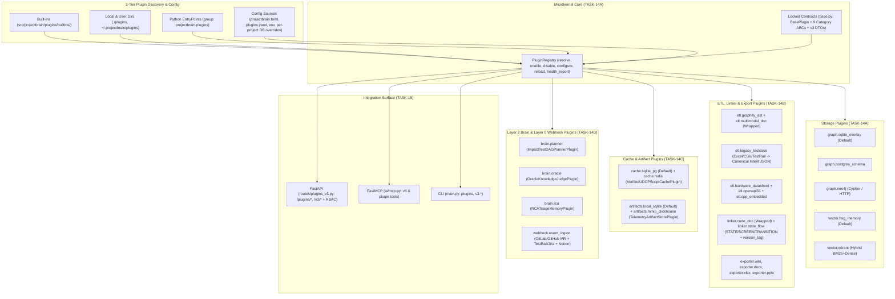
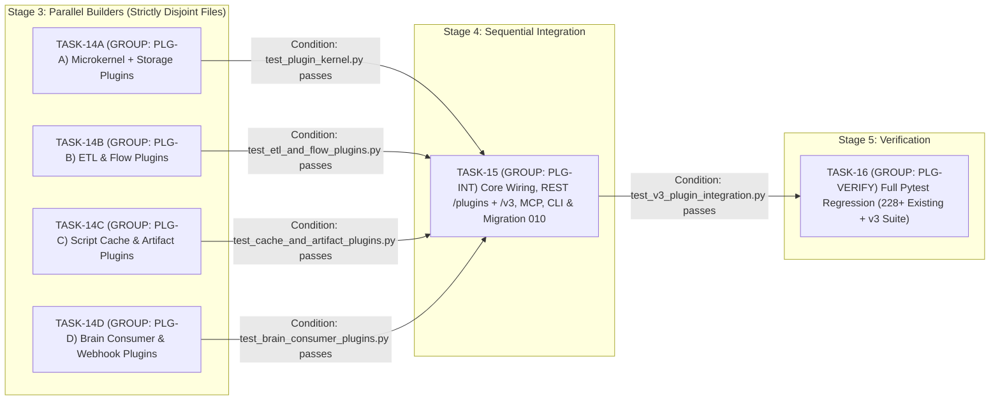

# Architecture & Condition-Based Implementation Plan: 100% Plugin-Driven Microkernel & v3.0 Testing KB

> **Plan ID**: `PLAN-PLUGIN-MICROKERNEL-V3`  
> **Target Release**: Project-Brain v3.0.0  
> **Status**: APPROVED FOR STAGE 3 PARALLEL EXECUTION  
> **Condition Precedent**: `SPEC-V3-TESTING-KB-AUDIT-01` (`docs/specs/v3-testing-kb-gap-audit.spec.md`)  
> **Workspace Root**: `/Users/macbbook/SourceCodes/Project-Brain`  
> **Artifact Path**: `docs/plans/plugin-microkernel-kb-v3.plan.md`

---

## 1. Executive Microkernel Architecture

This plan replaces Project-Brain's hardcoded factory switches, monolithic ETL pipelines, and missing Layer 1/Layer 2 testing capabilities with a **100% Plugin-Driven Microkernel** rooted at `src/projectbrain/plugins/`. Every capability—Graph storage, Vector retrieval, ETL parsing, Flow & Code-Doc linking, Document/Office export, UDCP Script Caching, Synchronized Telemetry/Artifacts, Brain Consumers (Planner, Oracle, RCA), and Layer 0 Webhooks—is implemented as a discoverable, configurable, hot-swappable plugin registered in `PluginRegistry`.

### 1.1 Architectural Guarantees
1. **100% Pluggable Capabilities**: Zero hardcoded backend switches in application logic; `PluginRegistry.resolve(category, preferred_id, project_id)` selects active plugins by priority, project config, and health status.
2. **3-Tier Plugin Discovery**:
   - **Tier 1 (Built-ins)**: `src/projectbrain/plugins/builtins/` (wraps all existing v1.5 capabilities + provides all new v3.0 engines out of the box).
   - **Tier 2 (Local & User Directories)**: `./plugins/` and `~/.projectbrain/plugins/` (or `PB_PLUGINS_DIR`), supporting `plugin.json`/`plugin.yaml` manifests + `plugin.py` (`register_plugins(registry)` or `BasePlugin` subclasses) with runtime `reload_directory()`.
   - **Tier 3 (Packaging Entrypoints)**: `importlib.metadata.entry_points(group="projectbrain.plugins")` for third-party pip-installed plugins.
3. **Zero-Install Offline Determinism & Full Backward Compatibility**:
   - External backends (`Neo4jGraphPlugin`, `QdrantVectorPlugin`, `RedisScriptCachePlugin`, `MinioClickHouseArtifactStorePlugin`) use standard HTTP/REST (`httpx` with injectable mock transports) or optional client injection, never failing imports when external drivers or servers are absent.
   - Built-in SQLite/PG defaults preserve 100% of existing behavior so all **228 collected baseline tests** in `tests/` continue to pass unchanged.



---

## 2. Database Schema Evolution & SQL Compatibility Rules

Inspection of [`src/projectbrain/core/db.py`](file:///Users/macbbook/SourceCodes/Project-Brain/src/projectbrain/core/db.py#L113-L160) shows that `DB.translate_query()` translates `?` -> `%s` for PostgreSQL, while `INSERT OR REPLACE` rewrites are whitelisted only for 8 legacy tables. Therefore:
1. **Cross-Dialect SQL Invariant**: All v3 plugin SQL statements MUST use standard **ANSI `INSERT INTO ... VALUES (...) ON CONFLICT (...) DO UPDATE SET ...`** (compatible with both SQLite $\ge 3.24$ and PostgreSQL) rather than `INSERT OR REPLACE`.
2. **Idempotent Self-Bootstrap + Migration `010`**: Each stateful plugin (`TASK-14A`, `TASK-14C`, `TASK-14D`) executes idempotent `CREATE TABLE IF NOT EXISTS` / `CREATE INDEX IF NOT EXISTS` inside `ensure_tables()` so parallel slices test cleanly in isolation, while `TASK-15` ships [`src/projectbrain/migrations/010_v3_plugin_microkernel.sql`](file:///Users/macbbook/SourceCodes/Project-Brain/src/projectbrain/migrations/010_v3_plugin_microkernel.sql) for declarative server startup migrations.

### Core v3 Tables (SQLite & PostgreSQL Compatible)
- `plugin_project_configs(project_id TEXT, plugin_id TEXT, enabled INTEGER DEFAULT 1, priority INTEGER, config_json TEXT DEFAULT '{}', updated_at BIGINT, PRIMARY KEY (project_id, plugin_id))`
- `udcp_script_cache(cache_id TEXT PRIMARY KEY, project_id TEXT NOT NULL, intent_id TEXT NOT NULL, platform TEXT NOT NULL, build_version TEXT NOT NULL, screen_hash TEXT DEFAULT '', ui_fingerprint_json TEXT DEFAULT '{}', udcp_commands_json TEXT NOT NULL, hit_count INTEGER DEFAULT 0, fallback_count INTEGER DEFAULT 0, fallback_rate DOUBLE PRECISION DEFAULT 0.0, invalidated INTEGER DEFAULT 0, invalidation_reason TEXT, self_heal_history_json TEXT DEFAULT '[]', ttl_seconds INTEGER DEFAULT 2592000, created_at BIGINT NOT NULL, updated_at BIGINT NOT NULL)`
- `telemetry_artifacts(artifact_id TEXT PRIMARY KEY, run_id TEXT NOT NULL, step_id TEXT NOT NULL, project_id TEXT NOT NULL, device_id TEXT DEFAULT '', build_version TEXT DEFAULT '', artifact_type TEXT NOT NULL, ntp_timestamp_ms BIGINT NOT NULL, duration_ms BIGINT DEFAULT 0, uri TEXT NOT NULL, sha256 TEXT DEFAULT '', size_bytes BIGINT DEFAULT 0, summary_metrics_json TEXT DEFAULT '{}', retention_days INTEGER DEFAULT 30, expires_at BIGINT NOT NULL, created_at BIGINT NOT NULL)`
- `v3_rca_incidents(incident_id TEXT PRIMARY KEY, project_id TEXT NOT NULL, signature_hash TEXT NOT NULL, fault_domain TEXT NOT NULL, normalized_signature TEXT NOT NULL, ticket_refs_json TEXT DEFAULT '[]', occurrence_count INTEGER DEFAULT 1, last_run_id TEXT, self_heal_hint TEXT, metadata_json TEXT DEFAULT '{}', first_seen_at BIGINT NOT NULL, last_seen_at BIGINT NOT NULL, UNIQUE(project_id, signature_hash))`

---

## 3. Locked Python Contracts (`src/projectbrain/plugins/base.py`)

> **CRITICAL PARALLEL BUILDER INVARIANT**: `TASK-14A` owns `src/projectbrain/plugins/base.py`. `TASK-14B`, `TASK-14C`, and `TASK-14D` MUST copy the **Concurrency-Safe Defensive Base Import Pattern** below so they can execute concurrently with `TASK-14A` and never fail if `base.py` is still being written.

### 3.1 Locked Plugin Base Classes, Metadata & Category Interfaces

```python
# Canonical contract locked in src/projectbrain/plugins/base.py
from __future__ import annotations

from abc import ABC, abstractmethod
from enum import Enum
from typing import Any, Dict, List, Optional, Tuple, Union
from pydantic import BaseModel, Field

try:
    from pydantic import ConfigDict
    _HAS_CONFIG_DICT = True
except ImportError:
    ConfigDict = None
    _HAS_CONFIG_DICT = False


class PluginCategory(str, Enum):
    GRAPH_BACKEND = "graph_backend"
    VECTOR_BACKEND = "vector_backend"
    ETL_PARSER = "etl_parser"
    KNOWLEDGE_LINKER = "knowledge_linker"
    DOC_EXPORTER = "doc_exporter"
    SCRIPT_CACHE = "script_cache"
    ARTIFACT_STORE = "artifact_store"
    BRAIN_CONSUMER = "brain_consumer"
    WEBHOOK = "webhook"
    SOURCE_CONNECTOR = "source_connector"


class BasePluginModel(BaseModel):
    if _HAS_CONFIG_DICT:
        model_config = ConfigDict(extra="allow")
    else:
        class Config:
            extra = "allow"

    def to_dict(self) -> Dict[str, Any]:
        if hasattr(self, "model_dump"):
            return self.model_dump()
        return self.dict()


class PluginMetadata(BasePluginModel):
    plugin_id: str
    name: str
    version: str = "1.0.0"
    category: str  # PluginCategory value
    description: str = ""
    author: str = "projectbrain"
    priority: int = 100
    capabilities: List[str] = Field(default_factory=list)
    requires_env: List[str] = Field(default_factory=list)
    config_schema: Dict[str, Any] = Field(default_factory=dict)
    default_enabled: bool = True
    entrypoint: Optional[str] = None


class PluginManifest(BasePluginModel):
    plugin_id: str
    name: str
    version: str = "1.0.0"
    category: str
    entrypoint: str = "plugin.py"
    class_name: Optional[str] = None
    description: str = ""
    priority: int = 100
    requires_env: List[str] = Field(default_factory=list)
    default_config: Dict[str, Any] = Field(default_factory=dict)
    default_enabled: bool = True


class PluginContext(BasePluginModel):
    project_id: str = "default"
    branch: str = "main"
    version_tag: Optional[str] = None
    workspace_path: str = "."
    config: Dict[str, Any] = Field(default_factory=dict)
    registry: Optional[Any] = None


# ---------------------------------------------------------------------------
# Canonical v3.0 Domain DTOs
# ---------------------------------------------------------------------------
class CanonicalTestStep(BasePluginModel):
    step_index: int
    action: str  # tap | input | assert | uart_send | wait_signal | api_call | power_measure
    target_intent: str = ""
    parameters: Dict[str, Any] = Field(default_factory=dict)
    timeout_ms: int = 10000


class CanonicalOracleAssertion(BasePluginModel):
    assertion_type: str  # ui_state | uart_pattern | api_status | log_regex | power_budget_ma
    expected_value: Any
    tolerance: Optional[str] = None
    severity: str = "error"


class CanonicalTestIntent(BasePluginModel):
    intent_id: str
    title: str
    description: str = ""
    priority: str = "P1"  # P0 | P1 | P2 | P3
    target_platforms: List[str] = Field(default_factory=list)
    preconditions: List[Dict[str, Any]] = Field(default_factory=list)
    steps: List[CanonicalTestStep] = Field(default_factory=list)
    expected_oracle_assertions: List[CanonicalOracleAssertion] = Field(default_factory=list)
    linked_requirements: List[str] = Field(default_factory=list)
    tags: List[str] = Field(default_factory=list)
    version_tag: Optional[str] = None


class ErrorCodeRule(BasePluginModel):
    rule_id: str
    code: str
    protocol: str  # uart | at | http | hardfault | kernel | custom
    severity: str = "error"  # critical | error | warning
    pattern: str
    description: str = ""
    fault_domain: str = "Firmware"
    remediation_hint: str = ""
    source_file: str = ""
    version_tag: Optional[str] = None


class StateFlowNode(BasePluginModel):
    node_id: str
    node_kind: str = "STATE_NODE"  # STATE_NODE | SCREEN_NODE
    label: str
    domain: str = "firmware"  # firmware | app | backend
    platform: Optional[str] = None
    screen_hash: Optional[str] = None
    ui_fingerprint: Dict[str, Any] = Field(default_factory=dict)
    version_tag: Optional[str] = None
    metadata: Dict[str, Any] = Field(default_factory=dict)


class StateFlowTransition(BasePluginModel):
    source_state: str
    target_state: str
    trigger_action: str
    guard_condition: Optional[str] = None
    expected_signals: List[str] = Field(default_factory=list)
    timeout_ms: int = 5000
    version_tag: Optional[str] = None
    metadata: Dict[str, Any] = Field(default_factory=dict)


class UDCPScriptCacheEntry(BasePluginModel):
    cache_id: str
    project_id: str
    intent_id: str
    platform: str
    build_version: str
    screen_hash: str = ""
    ui_fingerprint: Dict[str, Any] = Field(default_factory=dict)
    udcp_commands: List[Dict[str, Any]] = Field(default_factory=list)
    hit_count: int = 0
    fallback_count: int = 0
    fallback_rate: float = 0.0
    invalidated: bool = False
    invalidation_reason: Optional[str] = None
    self_heal_history: List[Dict[str, Any]] = Field(default_factory=list)
    ttl_seconds: int = 2592000


class TelemetryArtifactRecord(BasePluginModel):
    artifact_id: str
    run_id: str
    step_id: str
    project_id: str
    device_id: str = ""
    build_version: str = ""
    artifact_type: str  # video_h264 | har | pcap | crashpad_dmp | gdb_hardfault | uart_log | power_trace_ma | screenshot_png
    ntp_timestamp_ms: int
    duration_ms: int = 0
    uri: str
    sha256: str = ""
    size_bytes: int = 0
    summary_metrics: Dict[str, Any] = Field(default_factory=dict)
    retention_days: int = 30
    expires_at: Optional[int] = None


# ---------------------------------------------------------------------------
# Abstract Base Plugin Contracts
# ---------------------------------------------------------------------------
class BasePlugin(ABC):
    """Root contract implemented by every Project-Brain v3.0 plugin."""

    metadata: PluginMetadata

    def __init__(self, config: Optional[Dict[str, Any]] = None):
        self.config: Dict[str, Any] = dict(config or {})
        self._initialized: bool = False

    def on_load(self, config: Optional[Dict[str, Any]] = None) -> None:
        if config:
            self.config.update(config)

    def initialize(self, context: Optional[PluginContext] = None) -> None:
        if context and context.config:
            self.config.update(context.config)
        self._initialized = True

    def shutdown(self) -> None:
        self._initialized = False

    def validate_config(self, config: Dict[str, Any]) -> Dict[str, Any]:
        return dict(config)

    def health_check(self) -> Dict[str, Any]:
        return {
            "plugin_id": self.metadata.plugin_id,
            "category": self.metadata.category,
            "status": "healthy",
            "initialized": self._initialized,
        }


class GraphBackendPlugin(BasePlugin):
    """Contract for GraphStore backend plugins (SQLite, PostgreSQL, Neo4j)."""

    @abstractmethod
    def create_store(self, config: Optional[Dict[str, Any]] = None) -> Any:
        """Return a GraphStore-compatible object."""

    def query_flow_graph(
        self,
        project_id: str,
        branch: str = "main",
        version_tag: Optional[str] = None,
        store: Optional[Any] = None,
    ) -> Dict[str, Any]:
        active = store or self.create_store(self.config)
        sub = active.get_resolved_subgraph(project_id, branch, limit=100000)
        nodes = [
            n for n in sub.get("nodes", [])
            if n.get("file_type") in ("state", "screen")
            and (not version_tag or (n.get("metadata") or {}).get("version_tag") == version_tag)
        ]
        node_ids = {n["id"] for n in nodes}
        edges = [
            e for e in sub.get("edges", [])
            if e.get("relation") == "transitions_to"
            or (e.get("source") in node_ids and e.get("target") in node_ids)
        ]
        return {"project_id": project_id, "branch": branch, "version_tag": version_tag, "nodes": nodes, "edges": edges}


class VectorBackendPlugin(BasePlugin):
    """Contract for Vector & Hybrid Search backend plugins (HSG Memory, Qdrant)."""

    @abstractmethod
    async def upsert_vectors(self, items: List[Dict[str, Any]], namespace: str = "default") -> Dict[str, Any]:
        pass

    @abstractmethod
    async def search(
        self,
        query: str,
        vector: Optional[List[float]] = None,
        top_k: int = 10,
        filters: Optional[Dict[str, Any]] = None,
        hybrid_alpha: float = 0.7,
    ) -> List[Dict[str, Any]]:
        pass

    @abstractmethod
    async def delete_by_filter(self, filters: Dict[str, Any]) -> Dict[str, Any]:
        pass


class ETLParserPlugin(BasePlugin):
    """Contract for node-etl canonical parsers (Legacy Testcases, Hardware Datasheets, OpenAPI, C++, AST, Docs)."""

    supported_extensions: Tuple[str, ...] = ()
    supported_formats: Tuple[str, ...] = ()

    @abstractmethod
    def can_parse(self, source_name: str, format_hint: Optional[str] = None, content_preview: Optional[str] = None) -> bool:
        pass

    @abstractmethod
    async def parse(
        self,
        source: Union[str, bytes],
        source_name: str = "input",
        project_id: str = "default",
        branch: str = "main",
        version_tag: Optional[str] = None,
        metadata: Optional[Dict[str, Any]] = None,
    ) -> Dict[str, Any]:
        """Return {'graph_delta': ..., 'canonical_intents': [...], 'error_rules': [...], 'flow_nodes': [...], 'flow_edges': [...], 'chunks': [...]}."""


class KnowledgeLinkerPlugin(BasePlugin):
    """Contract for cross-domain knowledge and state-flow linkers."""

    @abstractmethod
    def link(
        self,
        project_id: str,
        branch: str = "main",
        graph_data: Optional[Any] = None,
        chunks: Optional[List[Any]] = None,
        version_tag: Optional[str] = None,
        context: Optional[Dict[str, Any]] = None,
    ) -> Dict[str, Any]:
        pass


class DocExporterPlugin(BasePlugin):
    """Contract for deterministic Wiki and Office/Report exporters."""

    export_format: str = "wiki"

    @abstractmethod
    def export(
        self,
        graph_data: Any,
        output_path: str,
        linker_index: Optional[Dict[str, Any]] = None,
        context: Optional[Dict[str, Any]] = None,
    ) -> Dict[str, Any]:
        pass


class ScriptCachePlugin(BasePlugin):
    """Contract for Layer 1 node-cache Verified UDCP Script Cache plugins."""

    @abstractmethod
    def lookup_script(
        self,
        project_id: str,
        intent_id: str,
        platform: str,
        build_version: str,
        screen_hash: Optional[str] = None,
        include_invalidated: bool = False,
    ) -> Optional[Dict[str, Any]]:
        pass

    @abstractmethod
    def store_script(self, entry: Dict[str, Any]) -> Dict[str, Any]:
        pass

    @abstractmethod
    def record_execution(
        self,
        cache_id: str,
        success: bool,
        fallback_reason: Optional[str] = None,
        self_heal_patch: Optional[Dict[str, Any]] = None,
    ) -> Dict[str, Any]:
        pass

    @abstractmethod
    def invalidate_script(self, cache_id: str, reason: str) -> bool:
        pass

    @abstractmethod
    def list_scripts(
        self,
        project_id: str,
        platform: Optional[str] = None,
        build_version: Optional[str] = None,
        include_invalidated: bool = True,
    ) -> List[Dict[str, Any]]:
        pass


class ArtifactStorePlugin(BasePlugin):
    """Contract for Layer 1 node-artifacts Synchronized Telemetry & Evidence stores."""

    @abstractmethod
    def index_artifact(self, record: Dict[str, Any]) -> Dict[str, Any]:
        pass

    @abstractmethod
    def query_artifacts(
        self,
        run_id: Optional[str] = None,
        step_id: Optional[str] = None,
        artifact_type: Optional[str] = None,
        build_version: Optional[str] = None,
        limit: int = 100,
    ) -> List[Dict[str, Any]]:
        pass

    @abstractmethod
    def query_evidence_window(
        self,
        run_id: str,
        center_ts_ms: int,
        window_ms: int = 5000,
    ) -> Dict[str, Any]:
        pass

    @abstractmethod
    def purge_expired(self, now_ms: Optional[int] = None) -> Dict[str, Any]:
        pass


class BrainConsumerPlugin(BasePlugin):
    """Contract for Layer 2 cognitive consumers (node-planner, node-oracle, node-rca)."""

    role: str = "planner"  # planner | oracle | rca

    @abstractmethod
    async def execute(
        self,
        request: Dict[str, Any],
        registry: Optional[Any] = None,
        context: Optional[Dict[str, Any]] = None,
    ) -> Dict[str, Any]:
        pass


class WebhookPlugin(BasePlugin):
    """Contract for Layer 0 CI/CD & QA Tracker webhook ingestors."""

    source_name: str = "generic"

    @abstractmethod
    def verify_signature(self, headers: Dict[str, str], raw_body: bytes, secret: Optional[str] = None) -> bool:
        pass

    @abstractmethod
    async def parse_event(self, headers: Dict[str, str], payload: Dict[str, Any]) -> Dict[str, Any]:
        pass
```

### 3.2 Concurrency-Safe Defensive Import Pattern for `TASK-14B`, `TASK-14C`, `TASK-14D`

Each parallel builder module MUST place this defensive block at the top before defining plugin subclasses so modules remain 100% importable even before `TASK-14A` completes:

```python
try:
    from projectbrain.plugins.base import (
        ArtifactStorePlugin,
        BasePlugin,
        BasePluginModel,
        BrainConsumerPlugin,
        CanonicalOracleAssertion,
        CanonicalTestIntent,
        CanonicalTestStep,
        DocExporterPlugin,
        ErrorCodeRule,
        ETLParserPlugin,
        GraphBackendPlugin,
        KnowledgeLinkerPlugin,
        PluginCategory,
        PluginContext,
        PluginManifest,
        PluginMetadata,
        ScriptCachePlugin,
        StateFlowNode,
        StateFlowTransition,
        TelemetryArtifactRecord,
        UDCPScriptCacheEntry,
        VectorBackendPlugin,
        WebhookPlugin,
    )
except ImportError:  # pragma: no cover - defensive fallback for concurrent Stage 3 build
    from abc import ABC, abstractmethod
    from enum import Enum
    from typing import Any, Dict, List, Optional, Tuple, Union
    from pydantic import BaseModel, Field

    class PluginCategory(str, Enum):
        GRAPH_BACKEND = "graph_backend"
        VECTOR_BACKEND = "vector_backend"
        ETL_PARSER = "etl_parser"
        KNOWLEDGE_LINKER = "knowledge_linker"
        DOC_EXPORTER = "doc_exporter"
        SCRIPT_CACHE = "script_cache"
        ARTIFACT_STORE = "artifact_store"
        BRAIN_CONSUMER = "brain_consumer"
        WEBHOOK = "webhook"

    class BasePluginModel(BaseModel):
        class Config:
            extra = "allow"
        def to_dict(self) -> Dict[str, Any]:
            return self.model_dump() if hasattr(self, "model_dump") else self.dict()

    class PluginMetadata(BasePluginModel):
        plugin_id: str
        name: str
        version: str = "1.0.0"
        category: str
        description: str = ""
        author: str = "projectbrain"
        priority: int = 100
        capabilities: List[str] = Field(default_factory=list)
        requires_env: List[str] = Field(default_factory=list)
        config_schema: Dict[str, Any] = Field(default_factory=dict)
        default_enabled: bool = True
        entrypoint: Optional[str] = None

    class BasePlugin(ABC):
        metadata: PluginMetadata
        def __init__(self, config: Optional[Dict[str, Any]] = None):
            self.config = dict(config or {})
            self._initialized = False
        def on_load(self, config: Optional[Dict[str, Any]] = None) -> None:
            if config: self.config.update(config)
        def initialize(self, context: Optional[Any] = None) -> None:
            self._initialized = True
        def shutdown(self) -> None:
            self._initialized = False
        def health_check(self) -> Dict[str, Any]:
            return {"plugin_id": self.metadata.plugin_id, "category": self.metadata.category, "status": "healthy"}
```
*(In actual builder files, only the specific ABCs and DTOs required by that slice need fallback definitions.)*

---

## 4. Condition-Based Task DAG & Strictly Disjoint File Scope Matrix



### Strict Disjoint File Ownership Table

| Task ID | Parallel Group | Assigned Files (Strictly Disjoint) | Condition / Gate |
| :--- | :--- | :--- | :--- |
| **`TASK-14A`** | `PLG-A` | • [`src/projectbrain/plugins/__init__.py`](file:///Users/macbbook/SourceCodes/Project-Brain/src/projectbrain/plugins/__init__.py)<br/>• [`src/projectbrain/plugins/base.py`](file:///Users/macbbook/SourceCodes/Project-Brain/src/projectbrain/plugins/base.py)<br/>• [`src/projectbrain/plugins/registry.py`](file:///Users/macbbook/SourceCodes/Project-Brain/src/projectbrain/plugins/registry.py)<br/>• [`src/projectbrain/plugins/builtins/__init__.py`](file:///Users/macbbook/SourceCodes/Project-Brain/src/projectbrain/plugins/builtins/__init__.py)<br/>• [`src/projectbrain/plugins/builtins/storage_plugins.py`](file:///Users/macbbook/SourceCodes/Project-Brain/src/projectbrain/plugins/builtins/storage_plugins.py)<br/>• [`tests/test_plugin_kernel.py`](file:///Users/macbbook/SourceCodes/Project-Brain/tests/test_plugin_kernel.py) | Independent (Starts immediately after `TASK-13`) |
| **`TASK-14B`** | `PLG-B` | • [`src/projectbrain/plugins/builtins/etl_and_flow_plugins.py`](file:///Users/macbbook/SourceCodes/Project-Brain/src/projectbrain/plugins/builtins/etl_and_flow_plugins.py)<br/>• [`tests/test_etl_and_flow_plugins.py`](file:///Users/macbbook/SourceCodes/Project-Brain/tests/test_etl_and_flow_plugins.py) | Independent (Uses defensive `base.py` import fallback) |
| **`TASK-14C`** | `PLG-C` | • [`src/projectbrain/plugins/builtins/cache_and_artifact_plugins.py`](file:///Users/macbbook/SourceCodes/Project-Brain/src/projectbrain/plugins/builtins/cache_and_artifact_plugins.py)<br/>• [`tests/test_cache_and_artifact_plugins.py`](file:///Users/macbbook/SourceCodes/Project-Brain/tests/test_cache_and_artifact_plugins.py) | Independent (Uses defensive `base.py` import fallback) |
| **`TASK-14D`** | `PLG-D` | • [`src/projectbrain/plugins/builtins/brain_consumer_plugins.py`](file:///Users/macbbook/SourceCodes/Project-Brain/src/projectbrain/plugins/builtins/brain_consumer_plugins.py)<br/>• [`tests/test_brain_consumer_plugins.py`](file:///Users/macbbook/SourceCodes/Project-Brain/tests/test_brain_consumer_plugins.py) | Independent (Uses defensive `base.py` import fallback) |
| **`TASK-15`** | `PLG-INT` | • [`src/projectbrain/core/config.py`](file:///Users/macbbook/SourceCodes/Project-Brain/src/projectbrain/core/config.py)<br/>• [`src/projectbrain/migrations/010_v3_plugin_microkernel.sql`](file:///Users/macbbook/SourceCodes/Project-Brain/src/projectbrain/migrations/010_v3_plugin_microkernel.sql)<br/>• [`src/projectbrain/graphify_engine/store.py`](file:///Users/macbbook/SourceCodes/Project-Brain/src/projectbrain/graphify_engine/store.py)<br/>• [`src/projectbrain/graphify_engine/kb_linker.py`](file:///Users/macbbook/SourceCodes/Project-Brain/src/projectbrain/graphify_engine/kb_linker.py)<br/>• [`src/projectbrain/server/routes/plugins_v3.py`](file:///Users/macbbook/SourceCodes/Project-Brain/src/projectbrain/server/routes/plugins_v3.py)<br/>• [`src/projectbrain/server/api.py`](file:///Users/macbbook/SourceCodes/Project-Brain/src/projectbrain/server/api.py)<br/>• [`src/projectbrain/ai/mcp.py`](file:///Users/macbbook/SourceCodes/Project-Brain/src/projectbrain/ai/mcp.py)<br/>• [`src/projectbrain/main.py`](file:///Users/macbbook/SourceCodes/Project-Brain/src/projectbrain/main.py)<br/>• [`tests/test_v3_plugin_integration.py`](file:///Users/macbbook/SourceCodes/Project-Brain/tests/test_v3_plugin_integration.py) | Depends on `TASK-14A`, `TASK-14B`, `TASK-14C`, `TASK-14D` |

---

## 5. Slice `TASK-14A`: Microkernel Core & Storage Plugins

### 5.1 `src/projectbrain/plugins/registry.py` (`PluginRegistry`)
- **State Managed**: `_plugins: Dict[str, BasePlugin]`, `_enabled: Dict[str, bool]`, `_project_overrides: Dict[str, Dict[str, Dict[str, Any]]]`, `_plugin_dirs: List[Path]`.
- **Methods**:
  - `register(plugin: BasePlugin, override: bool = False) -> None`: Validates `metadata`, calls `plugin.on_load(...)`, applies TOML/YAML/env overrides.
  - `unregister(plugin_id: str) -> bool`: Calls `plugin.shutdown()` and removes plugin.
  - `discover_builtins() -> int`: Loads built-in classes from `storage_plugins.py`, `etl_and_flow_plugins.py`, `cache_and_artifact_plugins.py`, and `brain_consumer_plugins.py` (gracefully skipping unavailable modules).
  - `discover_directory(directory: Union[str, Path]) -> List[str]`: Scans subdirectories for `plugin.json`/`plugin.yaml` manifests (`PluginManifest`) + `plugin.py` entrypoint, OR standalone `*.py` exposing `register_plugins(registry)` or `BasePlugin` subclasses; checks `requires_env` before enabling.
  - `discover_entrypoints(group: str = "projectbrain.plugins") -> List[str]`: Uses `importlib.metadata.entry_points()` cleanly across Python 3.10–3.13.
  - `reload_directory(directory: Union[str, Path]) -> List[str]`: Unregisters previously directory-loaded plugins from that path and reloads modules cleanly (`importlib.util.spec_from_file_location`).
  - `enable(plugin_id: str, project_id: Optional[str] = None)` / `disable(plugin_id: str, project_id: Optional[str] = None)` / `configure(plugin_id: str, config: Dict[str, Any], project_id: Optional[str] = None)`.
  - `is_enabled(plugin_id: str, project_id: Optional[str] = None) -> bool`: Checks per-project override -> `PB_DISABLED_PLUGINS` / `PB_ENABLED_PLUGINS` -> global toggle -> `default_enabled`.
  - `resolve(category: str, preferred_id: Optional[str] = None, project_id: Optional[str] = None) -> BasePlugin` & `resolve_all(category: str, project_id: Optional[str] = None) -> List[BasePlugin]`: Sorts enabled plugins by `priority` descending (`preferred_id` wins if enabled).
  - `load_config_file(path: Union[str, Path]) -> None`: Parses `projectbrain.toml` `[plugins]` or `plugins.yaml` / `plugins.json`.
  - `health_report(project_id: Optional[str] = None) -> Dict[str, Any]`.
- Provide module-level `get_default_registry() -> PluginRegistry` (lazy singleton) and `reset_default_registry()`.

### 5.2 `src/projectbrain/plugins/builtins/__init__.py`
Exports built-in plugin classes using defensive `try: ... except ImportError:` guards for `storage_plugins`, `etl_and_flow_plugins`, `cache_and_artifact_plugins`, and `brain_consumer_plugins`, plus `get_all_builtin_plugins() -> List[BasePlugin]`.

### 5.3 `src/projectbrain/plugins/builtins/storage_plugins.py`
1. **`SqliteOverlayGraphPlugin`** (`plugin_id="graph.sqlite_overlay"`, `priority=100`): Wraps [`SqliteOverlayGraphStore`](file:///Users/macbbook/SourceCodes/Project-Brain/src/projectbrain/graphify_engine/store.py#L706) cleanly.
2. **`PostgresSchemaGraphPlugin`** (`plugin_id="graph.postgres_schema"`, `priority=90`): Wraps [`PostgresSchemaGraphStore`](file:///Users/macbbook/SourceCodes/Project-Brain/src/projectbrain/graphify_engine/store.py#L2227).
3. **`Neo4jGraphPlugin`** (`plugin_id="graph.neo4j"`, `priority=50`):
   - Provides `Neo4jGraphStore(GraphStore)` implementing `ensure_root_schema`, `ensure_branch_schema`, `sync_branch_delta`, `get_resolved_subgraph`, `diff_branch_vs_root`, `diff_branches`, `promote_branch_to_root`, `get_stats`, `list_projects`, `delete_project`, `delete_branch`, `list_branches`, `to_legacy_visjs`, plus multi-hop Cypher `query_flow_graph(..., version_tag=...)`.
   - Uses Neo4j HTTP Transaction/Query API via `httpx.Client` with injectable `http_client` / `transport` (and an optional in-memory mock store mode `mode="memory"` or mock HTTP responses for offline tests).
4. **`HSGMemoryPlugin`** (`plugin_id="vector.hsg_memory"`, `priority=100`):
   - Implements `VectorBackendPlugin` wrapping `SQLiteVectorStore` / `PostgresVectorStore` / `ValkeyVectorStore`, `embed_for_sector`, `add_hsg_memory`, and `hsg_query` (respecting `project_id`, `branch`, `version_tag` filters).
5. **`QdrantVectorPlugin`** (`plugin_id="vector.qdrant"`, `priority=60`):
   - Implements `VectorBackendPlugin` with **Hybrid Dense + Sparse BM25** search (`dense_vector` + deterministic BM25 sparse term-frequency vector) over Qdrant REST API (`PUT /collections/{name}/points`, `POST /collections/{name}/points/query`) using `httpx.AsyncClient` with injectable `transport` and in-memory Qdrant fallback mode for zero-install testing.

### 5.4 `tests/test_plugin_kernel.py`
- Verify built-in plugin discovery, directory plugin discovery (`plugin.json` + `plugin.py`), entrypoints mock discovery, per-project enable/disable & config override, priority resolution, runtime `reload_directory()`, `SqliteOverlayGraphPlugin`, `Neo4jGraphPlugin` (mock HTTP Cypher transport + flow query), `HSGMemoryPlugin`, and `QdrantVectorPlugin` (hybrid BM25+dense offline test).

---

## 6. Slice `TASK-14B`: Canonical ETL, Hardware/Code Extractors & State Flow Plugins

### 6.1 `src/projectbrain/plugins/builtins/etl_and_flow_plugins.py`
Contains **12 plugins** (7 built-in wrappers + 5 new v3.0 canonical ETL & Flow Graph engines):
1. **Built-in Wrappers for Existing v1.5 Engines**:
   - `GraphifyASTETLPlugin` (`etl.graphify_ast`): Wraps `GraphifyExtractor`.
   - `MultimodalDocETLPlugin` (`etl.multimodal_doc`): Wraps `DocumentPipeline`.
   - `CodeDocLinkerPlugin` (`linker.code_doc`): Wraps `CodeDocLinker`.
   - `MarkdownWikiExporterPlugin` (`exporter.wiki`, `export_format="wiki"`): Wraps `ProjectDocSynthesizer.synthesize_wiki`.
   - `DocxExporterPlugin` (`exporter.docx`, `export_format="docx"`): Wraps `export_docx_specification`.
   - `XlsxExporterPlugin` (`exporter.xlsx`, `export_format="xlsx"`): Wraps `export_xlsx_traceability_matrix`.
   - `PptxExporterPlugin` (`exporter.pptx`, `export_format="pptx"`): Wraps `export_pptx_architecture_deck`.
2. **`LegacyTestcaseETLPlugin`** (`etl.legacy_testcase`, `supported_extensions=(".csv", ".xlsx", ".json", ".xml")`):
   - Accepts CSV, Excel `.xlsx` (via `openpyxl`), TestRail JSON (`cases` / `sections`), and TestRail XML (`<suite><sections><case>`).
   - Maps column aliases flexibly (`id`/`case_id`/`TC_ID`, `title`/`name`, `preconditions`/`setup`, `steps`/`actions`, `expected`/`expected_result`, `priority`, `platform`/`targets`, `requirement`/`srs_ref`).
   - Infers preconditions (`flash_firmware`, `power_cycle`, `seed_db`, `pair_ble`, `login_session`) and assertion types (`ui_state`, `uart_pattern`, `api_status`, `log_regex`, `power_budget_ma`).
   - Emits `CanonicalTestIntent` objects + `GraphNode(file_type="test_intent")` + `GraphEdge` (`verifies_requirement`, `requires_precondition`).
3. **`HardwareDatasheetETLPlugin`** (`etl.hardware_datasheet`, `supported_extensions=(".md", ".csv", ".txt")`):
   - Parses Markdown/CSV/plain-text datasheets containing **UART & AT Error Code Tables** (e.g., `AT+ERR=0x04`, `UART_ERR_CRC`, `E_BLE_TIMEOUT`), Cortex-M `CFSR`/`HFSR` HardFault bits, and electrical/timing limits (`max_current_ma`, `boot_timeout_ms`, `voltage_mv`).
   - Emits `ErrorCodeRule` objects + `GraphNode(file_type="hardware_rule")` + `GraphEdge(relation="defines_error_rule")`.
4. **`OpenAPI31ETLPlugin`** (`etl.openapi31`, `supported_extensions=(".yaml", ".yml", ".json")`):
   - Validates `openapi` (`3.0.*` / `3.1.*`) header, extracts paths/methods/operationIds, component schemas, and HTTP status error rules (`4xx`/`5xx`), emitting `GraphNode(file_type="api_endpoint")` + `ErrorCodeRule`s + `specifies_endpoint` edges.
5. **`CppEmbeddedETLPlugin`** (`etl.cpp_embedded`, `supported_extensions=(".c", ".h", ".hpp", ".cpp", ".cc", ".ui", ".ld", ".map")`):
   - Deterministic AST/Regex + Qt XML + GNU LD/MAP parser extracting:
     - C/C++ classes, structs, enums, functions, `#define ERR_*` / `AT_CMD_*` constants
     - Firmware AT command handler dispatch tables & `ISR`/`IRQHandler` symbols
     - Qt `.ui` widgets (`<widget class="..." name="...">`) and `Q_OBJECT` `signals:`/`slots:` (`emits_signal`, `connects_slot`)
     - ELF linker script `.ld` `MEMORY` regions (`FLASH`, `RAM`, `ORIGIN`, `LENGTH`) and `.map` section memory footprints.
6. **`StateFlowGraphPlugin`** (`linker.state_flow`, `KnowledgeLinkerPlugin`):
   - Extracts `STATE_NODE`, `SCREEN_NODE`, and `TRANSITION_EDGE` (`trigger_action`, `guard_condition`, `expected_signals` e.g. `BOOT_OK -> PAIRED_EVENT`, `timeout_ms`) from Mermaid `stateDiagram-v2` blocks, Markdown state-transition tables, firmware boot/BLE sequence descriptors, and Qt UI navigation graphs.
   - Annotates every node/edge with `version_tag` (`fw-v1.2.0`, `app-v3.0.1`) and provides `diff_flow_versions(graph_a, graph_b)` to detect added/removed/modified transitions between firmware/app releases.

### 6.2 `tests/test_etl_and_flow_plugins.py`
- Verify CSV, `.xlsx` (`openpyxl`), and TestRail XML/JSON -> `CanonicalTestIntent` output.
- Verify Hardware Datasheet UART/AT error code table extraction, OpenAPI 3.1 parsing, C++/Qt `.ui`/ELF `.ld` parsing, and `StateFlowGraphPlugin` transition linking + `version_tag` cross-version diffing.

---

## 7. Slice `TASK-14C`: Verified UDCP Script Cache & Synchronized Telemetry Artifact Plugins

### 7.1 `src/projectbrain/plugins/builtins/cache_and_artifact_plugins.py`
1. **`SqlitePgScriptCachePlugin`** (`plugin_id="cache.sqlite_pg"`, `priority=100`, also exported/aliased as **`VerifiedUDCPScriptCachePlugin`** factory/base):
   - Auto-creates `udcp_script_cache` table in SQLite (`db_path`) or via `core.db` (ANSI SQL `ON CONFLICT(cache_id) DO UPDATE`).
   - `lookup_script(project_id, intent_id, platform, build_version, screen_hash=None, include_invalidated=False)`: Matches exact `(project_id, intent_id, platform, build_version)` and optional `screen_hash` (or matches UI fingerprint tolerance if `screen_hash` omitted); excludes `invalidated=1` unless `include_invalidated=True`.
   - `store_script(entry)`: Computes deterministic `cache_id` (`sha256(project_id|intent_id|platform|build_version|screen_hash)[:24]` if absent), persists `udcp_commands`, `ui_fingerprint`, `screen_hash`, `ttl_seconds`.
   - `record_execution(cache_id, success, fallback_reason=None, self_heal_patch=None)`:
     - Increments `hit_count` (on `success=True`) or `fallback_count` (on `success=False`).
     - Computes `fallback_rate = fallback_count / max(1, hit_count + fallback_count)`.
     - **Auto-Invalidation Policy**: Configurable `fallback_threshold` (default `0.25`) and `min_samples` (default `4`). When `(hit_count + fallback_count) >= min_samples` and `fallback_rate > fallback_threshold`, sets `invalidated = True` and `invalidation_reason = f"fallback_rate {fallback_rate:.2f} > {fallback_threshold:.2f} ({fallback_reason or 'threshold'})"`.
     - If `self_heal_patch` is supplied (from `UDCP Script Synthesizer` or `RCA`), appends timestamped entry to `self_heal_history`, updates `udcp_commands`/`screen_hash`/`ui_fingerprint`, and can re-enable (`invalidated = False`) when `self_heal_patch.get("verified")` is True.
2. **`RedisScriptCachePlugin`** (`plugin_id="cache.redis"`, `priority=60`):
   - Redis/Valkey adapter supporting injected `redis_client` or built-in offline in-memory key/TTL dict store (`use_memory_fallback=True`), implementing the exact `ScriptCachePlugin` contract with key pattern `pb:scache:{project_id}:{intent_id}:{platform}:{build_version}` and TTL expiry.
3. **`LocalSqliteArtifactStorePlugin`** (`plugin_id="artifacts.local_sqlite"`, `priority=100`, also exported/aliased as **`TelemetryArtifactStorePlugin`**):
   - Auto-creates `telemetry_artifacts` table keyed by `(run_id, step_id, ntp_timestamp_ms)` with `artifact_type`, `device_id`, `build_version`, `uri`, `sha256`, `size_bytes`, `summary_metrics`, `retention_days` (default `30`, configurable `30–90`), and `expires_at = created_at + retention_days * 86400 * 1000`.
   - `query_evidence_window(run_id, center_ts_ms, window_ms=5000)`:
     - Selects all artifacts for `run_id` where `ntp_timestamp_ms BETWEEN center_ts_ms - window_ms AND center_ts_ms + window_ms`.
     - Computes `video_start_ms = min(ntp_timestamp_ms for video_h264 in run)` and annotates each matched item with `delta_from_center_ms` and `video_offset_ms = max(0, item.ntp_timestamp_ms - video_start_ms)`.
     - Returns grouped streams (`streams_by_type`), ordered timeline (`timeline`), and `summary`.
   - `purge_expired(now_ms=None)`: Deletes rows where `expires_at <= now_ms` (and optionally removes managed local files inside configured root directory), returning `{"deleted_count": N, "deleted_ids": [...]}`.
4. **`MinioClickHouseArtifactStorePlugin`** (`plugin_id="artifacts.minio_clickhouse"`, `priority=60`):
   - Hybrid adapter storing S3/MinIO object references (`s3://{bucket}/{run_id}/{step_id}/...`) and issuing ClickHouse HTTP `JSONEachRow` inserts & parameterized `FORMAT JSON` window queries via `httpx` (with injectable transport / offline buffer for unit tests).

### 7.2 `tests/test_cache_and_artifact_plugins.py`
- Verify script store/lookup by `(intent_id, platform, build_version, screen_hash)`, hit/fallback counter tracking, auto-invalidation when `fallback_rate > 0.25`, self-heal patching & audit history, Redis adapter TTL + fallback, artifact indexing across all 8 evidence types (`video_h264`, `har`, `pcap`, `crashpad_dmp`, `gdb_hardfault`, `uart_log`, `power_trace_ma`, `screenshot_png`), `query_evidence_window` `video_offset_ms` math, TTL purge (`30-90d`), and MinIO/ClickHouse mock HTTP transport.

---

## 8. Slice `TASK-14D`: Layer 2 Brain Consumer & Layer 0 Webhook Plugins

### 8.1 `src/projectbrain/plugins/builtins/brain_consumer_plugins.py`
1. **`ImpactTestDAGPlannerPlugin`** (`plugin_id="brain.planner"`, `role="planner"`):
   - Input `request`: `{"project_id", "branch", "base_branch", "version_tag", "srs_diff", "code_diff_files", "artifacts": ["fw.bin", "app.apk"], "target_devices": [...], "max_depth": 4}`.
   - Execution pipeline:
     1. Resolves active `GraphBackendPlugin` and `ScriptCachePlugin` from `registry` (if provided, else accepts injected `graph_data` / `cache_plugin`).
     2. Maps `code_diff_files` and `srs_diff` tokens to AST symbols, `STATE_NODE`/`SCREEN_NODE` flow nodes, and `CanonicalTestIntent` nodes; runs BFS reverse/forward blast-radius traversal up to `max_depth`.
     3. Scores and selects impacted intents (always retaining `P0` regression intents when core firmware/auth/payment hubs are touched; filtering `P1`/`P2` by blast radius).
     4. **Automatic Precondition Injection**:
        - If `.bin` / `.elf` / `.hex` in `artifacts` or any `.c`/`.h`/`.cpp`/firmware file in `code_diff_files` -> injects `precond_flash_firmware` (`action="flash_firmware"`) DAG node as parent edge to firmware/hardware intents.
        - If `.apk` / `.ipa` / `.appx` in `artifacts` -> injects `precond_install_app` (`action="install_app"`) DAG node.
        - Extracts unique intent `preconditions` (`power_cycle`, `seed_db`, `pair_ble`) into topological precondition nodes.
     5. Checks `ScriptCachePlugin.lookup_script(...)` for each test step/intent and attaches `cache_binding: {"cache_hit": bool, "cache_id": ..., "udcp_commands": ...}`.
     6. Validates DAG acyclicity via Kahn's topological sort and returns `{"status": "ok", "dag": {"nodes": [...], "edges": [...], "execution_waves": [...]}, "stats": {"total_intents", "precondition_nodes", "cache_hits", "cache_hit_ratio"}}`.
2. **`OracleKnowledgeJudgePlugin`** (`plugin_id="brain.oracle"`, `role="oracle"`):
   - Input `request`: `{"project_id", "branch", "version_tag", "test_intent_id", "screen_id", "symbols", "telemetry_summary": {"uart_lines": [...], "http_responses": [...], "power_ma_peak": 120, "observed_state": "...", "crash_detected": false, "hardfault_cfsr": null}}`.
   - Retrieves SRS Acceptance Criteria chunks, expected `TRANSITION_EDGE` signals, and `ErrorCodeRule`s from graph/vector plugins (or `context`), runs deterministic assertion evaluation:
     - Detects matching UART/AT error patterns, ARM `HardFault`/`CFSR != 0`, HTTP `5xx` or unexpected `4xx`, power budget overruns (`power_ma_peak > max_current_ma`), and missing expected state transitions.
   - Returns `{"verdict": "PASS" | "FAIL" | "INCONCLUSIVE", "violated_rules": [...], "matched_criteria": [...], "expected_transitions": [...], "confidence": float, "explanation": str}`.
3. **`RCATriageMemoryPlugin`** (`plugin_id="brain.rca"`, `role="rca"`):
   - Input `request`: `{"project_id", "run_id", "stacktrace_or_log", "failure_artifacts": [...], "test_intent_id": ..., "screen_hash": ..., "cache_id": ...}`.
   - **Signature Normalization & Hashing**: Strips timestamps, PIDs/TIDs, hex memory addresses (`0x[0-9a-fA-F]+`), and volatile register dumps (`R0=..`), retaining symbolic function frames, fault names (`HardFault_Handler`, `CFSR=0x00008200`, `SIGSEGV`, `NullPointerException`, `UART_WDT_RESET`, `HTTP 500`), and builds SHA256 `signature_hash`.
   - **Deduplication & Ticket Linking**: Upserts into `v3_rca_incidents` (`ON CONFLICT(project_id, signature_hash) DO UPDATE SET occurrence_count = occurrence_count + 1`), extracts/merges Jira/Linear/GitHub ticket refs (`[A-Z]{2,10}-\d+`), returns `is_duplicate: bool` and `occurrence_count`.
   - **Fault Domain Classification**: Classifies into `"Firmware"` (HardFault/ISR/UART panic/C++ `.cpp`/MCU), `"Hardware/Power"` (brownout/overcurrent/voltage drop), `"App"` (Crashpad/Android/iOS/Qt UI), `"Backend"` (HTTP 500/SQL/FastAPI traceback), or `"FlakyScript"` (element-not-found / `screen_hash` mismatch without crash).
   - **Self-Heal Feedback Loop**: Emits `self_heal_hint`; if `fault_domain == "FlakyScript"` and `cache_id` is provided, automatically records failure / invalidation or heal hint into `ScriptCachePlugin` via `registry`.
4. **`WebhookEventIngestPlugin`** (`plugin_id="webhook.event_ingest"`):
   - Unified Layer 0 `WebhookPlugin` supporting `source` modes `"gitlab"`, `"github"`, `"testrail"`, `"jira"`, and `"notion"`.
   - Verifies HMAC-SHA256 (`X-Hub-Signature-256` / `X-PB-Signature`) or GitLab token (`X-Gitlab-Token`) cleanly.
   - Normalizes CI/CD Merge Request payloads (extracting `changed_files`, `branch`, `base_branch`, `version_tag`, and `.bin`/`.apk`/`.ipa`/`.elf` build artifact descriptors) and QA tracker spec/testcase updates into `WebhookNormalizedEvent`.

### 8.2 `tests/test_brain_consumer_plugins.py`
- Verify `ImpactTestDAGPlannerPlugin` blast radius + `flash_firmware`/`install_app` injection + DAG acyclicity + cache hit ratio.
- Verify `OracleKnowledgeJudgePlugin` PASS vs FAIL detection on UART error rules, ARM HardFaults, power budget exceedance, and HTTP 500s.
- Verify `RCATriageMemoryPlugin` deterministic signature hashing across differing hex addresses/timestamps, incident deduplication (`occurrence_count == 2`), fault domain classification, Jira ticket linking, and `FlakyScript` cache invalidation feedback.
- Verify `WebhookEventIngestPlugin` HMAC verification and GitLab/GitHub MR + `.bin`/`.apk` normalization + TestRail/Jira events.

---

## 9. Slice `TASK-15`: Sequential Integrator (Core Wiring, REST, RBAC, MCP, CLI & Migration)

### 9.1 Core & Storage Wiring (`store.py`, `kb_linker.py`, `config.py`, `010_v3_plugin_microkernel.sql`)
1. [`src/projectbrain/core/config.py`](file:///Users/macbbook/SourceCodes/Project-Brain/src/projectbrain/core/config.py): Add `plugins_dir`, `plugins_config_path`, `enabled_plugins`, `disabled_plugins` (from `projectbrain.toml` `[plugins]` and `PB_PLUGINS_*` env vars).
2. [`src/projectbrain/migrations/010_v3_plugin_microkernel.sql`](file:///Users/macbbook/SourceCodes/Project-Brain/src/projectbrain/migrations/010_v3_plugin_microkernel.sql): Declarative DDL for `plugin_project_configs`, `udcp_script_cache`, `telemetry_artifacts`, and `v3_rca_incidents` using SQLite/PostgreSQL compatible types (`BIGINT`, `DOUBLE PRECISION`, `TEXT`, `INTEGER`).
3. [`src/projectbrain/graphify_engine/store.py`](file:///Users/macbbook/SourceCodes/Project-Brain/src/projectbrain/graphify_engine/store.py#L3673): Update `get_graph_store(...)` to accept optional `project_id: Optional[str] = None` and `registry: Optional[Any] = None`; when a custom/configured `graph_backend` plugin (e.g. `graph.neo4j` or custom plugin) is selected via `backend` or `PluginRegistry`, return `plugin.create_store(config)`, falling back identically to `PostgresSchemaGraphStore` / `SqliteOverlayGraphStore` so all existing callers remain 100% intact.
4. [`src/projectbrain/graphify_engine/kb_linker.py`](file:///Users/macbbook/SourceCodes/Project-Brain/src/projectbrain/graphify_engine/kb_linker.py#L1233): Update `UnifiedKBBuilder.__init__` and `build_unified_kb(...)` to accept optional `registry` (defaulting to `get_default_registry()`), resolving `etl_parser`, `knowledge_linker`, and `doc_exporter` plugins dynamically while preserving exact default outputs and existing `CodeDocLinker` behavior.

### 9.2 FastAPI Routes & RBAC Security (`server/routes/plugins_v3.py`, `server/api.py`)
Create [`src/projectbrain/server/routes/plugins_v3.py`](file:///Users/macbbook/SourceCodes/Project-Brain/src/projectbrain/server/routes/plugins_v3.py) exposing:
- **Plugin Microkernel Endpoints (`/plugins/*`)**:
  - `GET /plugins` — List all registered plugins, categories, priorities, health, and per-project enablement.
  - `POST /plugins/reload` — Hot-reload plugin directories (`_check_read_only()`, path validated via `_validate_safe_path`).
  - `POST /plugins/{plugin_id}/enable` & `POST /plugins/{plugin_id}/disable` & `PUT /plugins/{plugin_id}/config`.
- **v3 Layer 1 & Layer 2 Endpoints (`/v3/*`)**:
  - `POST /v3/etl/ingest` — Accepts `file_path` (strictly validated inside workspace via `_validate_safe_path`) or inline `content` + `format_hint` + `version_tag`, dispatches matching `ETLParserPlugin` + optional `StateFlowGraphPlugin`, and syncs resulting `GraphDelta` to `GraphStore`.
  - `GET /v3/flow-graph` — Queries `STATE_NODE`/`SCREEN_NODE`/`TRANSITION_EDGE` filtered by `(project_id, branch, version_tag)`.
  - `POST /v3/script-cache/lookup`, `POST /v3/script-cache/store`, `POST /v3/script-cache/feedback`, `POST /v3/script-cache/invalidate`.
  - `POST /v3/artifacts/index`, `GET /v3/artifacts/window`, `POST /v3/artifacts/purge`.
  - `POST /v3/planner/test-dag` — Invokes `brain.planner`.
  - `POST /v3/oracle/context` — Invokes `brain.oracle`.
  - `POST /v3/rca/triage` — Invokes `brain.rca`.
  - `POST /v3/webhooks/{source}` — Dispatches Layer 0 `WebhookPlugin`.
- **RBAC & Security Updates in [`src/projectbrain/server/api.py`](file:///Users/macbbook/SourceCodes/Project-Brain/src/projectbrain/server/api.py)**:
  - Include `plugins_v3.router`.
  - Add `"/plugins"` and `"/v3"` to `_PROTECTED_REST_PREFIXES` (`L65-L72`).
  - Add read-only query POST routes (`"/v3/script-cache/lookup"`, `"/v3/planner/test-dag"`, `"/v3/oracle/context"`) to `_READ_ONLY_POST_ROUTES` (`L56-L63`) so `reader` accounts can query planner/oracle/cache while mutating routes (`store`, `feedback`, `invalidate`, `index`, `purge`, `etl/ingest`, `rca/triage`, `/plugins/*/enable|disable|reload|config`) return `403` for `reader` tokens.
  - Extend `_WRITE_TOOL_KEYWORDS` (`L19-L40`) with `"enable"`, `"disable"`, `"reload"`, `"invalidate"`, `"purge"`, `"index"`, `"triage"`, `"toggle"` so `_is_write_tool()` blocks mutating v3 FastMCP tools for `reader` roles.

### 9.3 FastMCP Tools (`ai/mcp.py`) & CLI (`main.py`)
- **FastMCP Tools in [`src/projectbrain/ai/mcp.py`](file:///Users/macbbook/SourceCodes/Project-Brain/src/projectbrain/ai/mcp.py)** (all respecting `check_read_only()` and local/remote `PB_MODE`):
  - `projectbrain_list_plugins` (read-only)
  - `projectbrain_toggle_plugin` (write)
  - `projectbrain_v3_ingest_etl` (write)
  - `projectbrain_v3_script_cache_lookup` (read-only) & `projectbrain_v3_script_cache_store` (write)
  - `projectbrain_v3_index_artifact` (write) & `projectbrain_v3_query_evidence_window` (read-only)
  - `projectbrain_v3_plan_test_dag` (read-only)
  - `projectbrain_v3_oracle_context` (read-only)
  - `projectbrain_v3_rca_triage` (write)
- **CLI Subcommands in [`src/projectbrain/main.py`](file:///Users/macbbook/SourceCodes/Project-Brain/src/projectbrain/main.py)**:
  - `plugins` (`list`, `enable`, `disable`, `reload`)
  - `v3-etl`, `v3-cache`, `v3-artifacts`, `v3-plan`, `v3-oracle`, `v3-rca` (registering new flags like `--version-tag`, `--intent-id`, `--platform`, `--run-id`, `--center-ts`, `--window-ms` in `_CLI_VALUE_FLAGS`).

### 9.4 `tests/test_v3_plugin_integration.py`
- Test all `/plugins/*` and `/v3/*` FastAPI routes (including `PB_REQUIRE_REST_AUTH=true` `reader` vs `writer`/`admin` RBAC checks and `_validate_safe_path` traversal rejection `400`), FastMCP tool execution + `_is_write_tool` enforcement, CLI flag parsing & execution, `get_graph_store` / `UnifiedKBBuilder` registry delegation, and full end-to-end Layer 0 -> Layer 1 -> Layer 2 flow alongside full `pytest` regression (`228` baseline + new tests).
