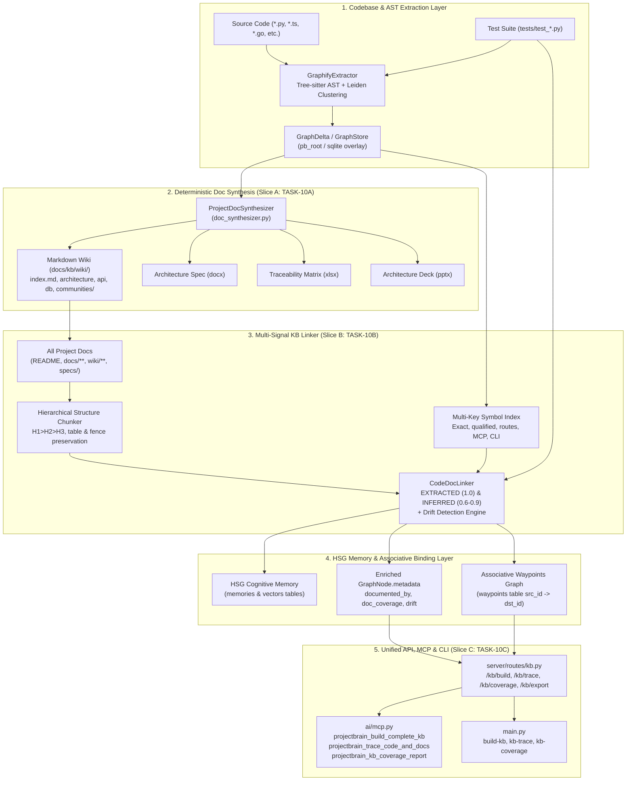
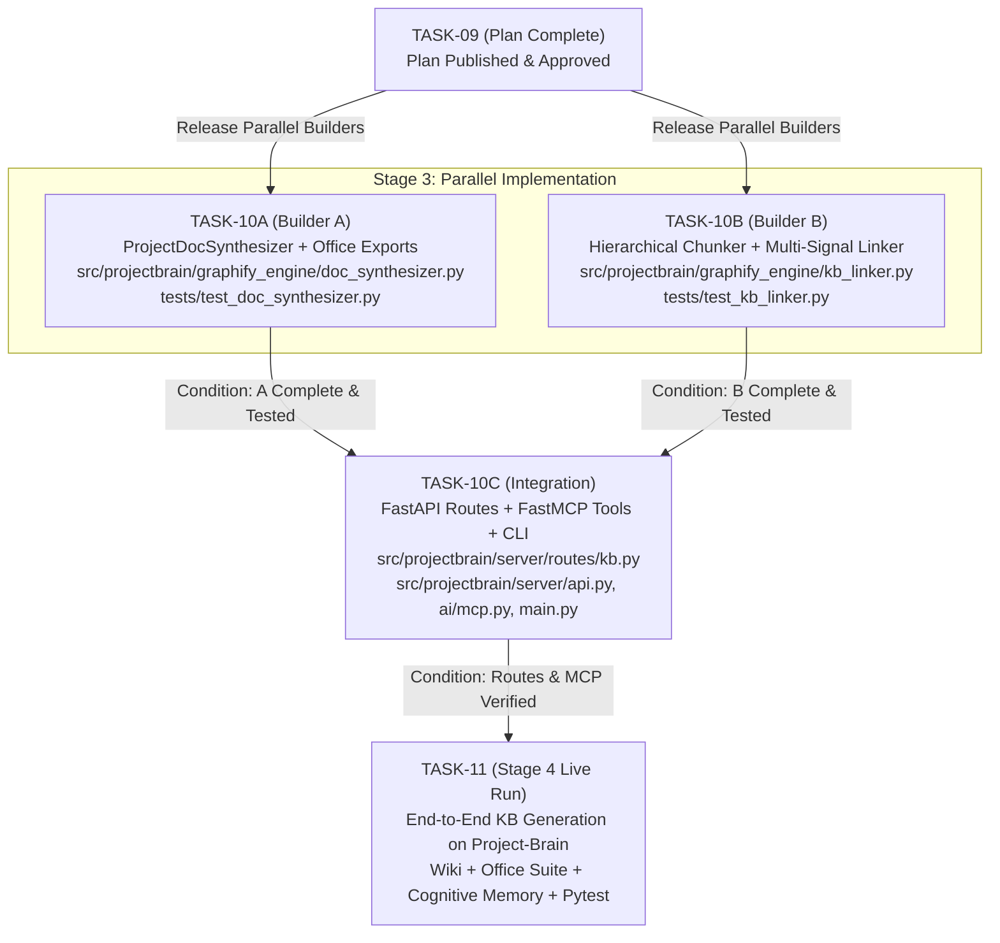

# System Architecture & Condition-Based Implementation Plan: Unified Code-Doc Knowledge Base Engine

> **Plan ID**: `PLAN-UNIFIED-KB-02`  
> **Target Release**: Project-Brain v1.5.0  
> **Status**: APPROVED FOR STAGE 3 IMPLEMENTATION  
> **Condition Precedent**: `TASK-08` / `PLAN-HYBRID-GRAPHIFY-01` Complete & Verified  
> **Repository Root**: `/Users/macbbook/SourceCodes/Project-Brain`  
> **Author**: Fleet Architecture Specialist (`task-planner`)  

---

## 1. Executive Architecture Overview

This plan defines the end-to-end architecture, data schemas, bidirectional graph bindings, and disjoint builder execution DAG for synthesizing a **Complete, Tightly Cross-Linked Knowledge Base (KB)** for Project-Brain.

The engine unifies three foundational subsystems:
1. **Zero-Hallucination Document Generation Suite**: Deterministic synthesis of a Markdown Knowledge Wiki (`docs/kb/wiki/`) and Multimodal Office Artifacts (`.docx`, `.xlsx`, `.pptx` in `docs/kb/exports/`) grounded strictly in AST code graphs, Leiden community structures, route tables, and database schemas.
2. **Structure-Aware Document Chunker & Cognitive Memory Binding**: Hierarchical heading-breadcrumb chunker (`H1 > H2 > H3`) that preserves code fences and Markdown tables intact, deduplicates content via SHA256 hashes, stores chunks into HSG Cognitive Memory (`add_hsg_memory`), and links interconnected chunks via directed `waypoints` associative graph edges.
3. **Multi-Signal Code <-> Doc <-> Test Bidirectional Linker**: Multi-key symbol and route indexer that binds every document section to exact AST code symbols (`documents_symbol` / `documented_in`), detects code-doc drift (mtime/hash updates, parameter/signature changes), maps pytest tests to verified symbols and requirements (`verifies_symbol`, `verifies_requirement`), and powers unified cross-layer traceability queries (`trace_code_and_docs`).



---

## 2. Specification Acceptance Criteria (AC-KB-01 through AC-KB-10)

| ID | Title | Acceptance Requirement | Verification Method |
| :--- | :--- | :--- | :--- |
| `AC-KB-01` | **Deterministic Wiki Synthesis** | `ProjectDocSynthesizer` generates complete Markdown wiki (`index.md`, `architecture_overview.md`, `api_and_mcp_reference.md`, `database_and_schemas.md`, `communities/community_{id}_{slug}.md`, `GRAPH_REPORT.md`) without hallucination. All symbols, routes, and communities match graph entities exactly. | Pytest suite asserts all required wiki files exist, parse as valid Markdown, and contain verified node identifiers. |
| `AC-KB-02` | **Multimodal Office Exports** | Synthesizer generates `.docx` specification, `.xlsx` traceability workbook (4 sheets: `Code_To_Doc_Links`, `Doc_Chunks_Inventory`, `API_And_MCP_Endpoints`, `Coverage_And_Gaps`), and `.pptx` presentation deck using native libraries (`python-docx`, `openpyxl`, `python-pptx`). | Pytest suite opens generated files with `openpyxl`, `docx.Document`, and `pptx.Presentation`, asserting valid sheet names, slide counts $>4$, and non-zero table rows. |
| `AC-KB-03` | **Hierarchical Document Chunker** | Chunker splits documents by heading hierarchy (`H1 > H2 > H3`), preserves Markdown tables and code fences without splitting, records `(chunk_id, doc_node_id, doc_path, heading_breadcrumb, start_line, end_line, sha256)`, and deduplicates chunks via SHA256. | Unit tests verify heading breadcrumbs match parent headers, code blocks remain contiguous, and re-running on identical content yields identical chunk IDs. |
| `AC-KB-04` | **Multi-Key Symbol Indexer** | Indexer creates multi-key lookups for code AST nodes: exact symbol name, `Class.method`, snake/camel normalized forms, relative file path + symbol, FastAPI route paths (`@router.get(...)`), FastMCP tool names (`@mcp_server.tool(...)`), and CLI subcommands. | Unit tests query index with symbol variants, route paths, and tool names, verifying resolution to expected `GraphNode`. |
| `AC-KB-05` | **Bidirectional Code-Doc-Test Linking** | Linker emits bidirectional `EXTRACTED` (`1.0`) edges (`doc_section --documents_symbol--> code_node`, `code_node --documented_in--> doc_section`, `test_node --verifies_symbol--> code_node`) and high-precision `INFERRED` (`0.60-0.90`) semantic edges based on symbol references in prose. | Test asserts bidirectional edge existence in `GraphDelta`, correct relation labels, and valid confidence scoring bounds. |
| `AC-KB-06` | **HSG Memory & Waypoints Binding** | Every document chunk is persisted into HSG Cognitive Memory (`add_hsg_memory`) with metadata containing `chunk_id`, `doc_path`, `heading`, and `linked_code_node_ids`. Directed associative links are created in `waypoints` between chunks documenting connected code symbols. | Test verifies `memories` table rows contain proper metadata and `waypoints` table contains entries linking interconnected doc chunks. |
| `AC-KB-07` | **GraphNode Metadata & Drift Detection** | Enriches `GraphNode.metadata` in `GraphStore` with `documented_by`, `documents_symbols`, `verified_by_tests`, and `doc_coverage` (`documented` \| `inferred` \| `undocumented`). Detects Code-Doc Drift when source file hash/mtime is newer than doc chunk or symbol signature mismatches doc references. | Test modifies symbol signature or updates code mtime without updating doc, asserting drift flag is raised. |
| `AC-KB-08` | **Unified Traceability Inspector** | `trace_code_and_docs(project_id, target, branch)` returns unified inspection payload containing: AST node, signature, `file:line`, callers/callees, linked doc chunks & HSG memory IDs, linked tests, and drift status. | Test invokes `trace_code_and_docs` for a known function, verifying return payload contains both code graph and doc chunk data. |
| `AC-KB-09` | **Knowledge Base Coverage Analytics** | `get_kb_coverage_report(project_id, branch)` aggregates: total symbols, documented %, inferred %, undocumented %, route doc coverage %, MCP doc coverage %, test-linked %, total doc chunks, cross-domain edges, orphan docs, and undocumented god nodes. | Test asserts coverage report fields, verifies percentages are in range `[0.0, 100.0]`, and orphan doc list accurately flags invalid symbol references. |
| `AC-KB-10` | **FastAPI, FastMCP & CLI Integration** | Exposes `/kb/build`, `/kb/trace`, `/kb/coverage`, `/kb/export` in FastAPI; registers 4 FastMCP tools (`projectbrain_build_complete_kb`, `projectbrain_trace_code_and_docs`, `projectbrain_kb_coverage_report`, `projectbrain_generate_project_docs`); provides CLI subcommands (`build-kb`, `kb-trace`, `kb-coverage`). | Integration tests execute route requests, FastMCP tool calls, and CLI argument parsing successfully. |

---

## 3. Strict Disjoint File Scope Invariant & Builder Task Matrix

To guarantee zero merge collisions during parallel builder execution, file ownership is strictly partitioned into disjoint sets. No two parallel tasks may touch the same file path.

```mermaid
flowchart LR
    subgraph SliceA ["TASK-10A: Doc Synthesizer (Parallel Group KB-A)"]
        direction TB
        FA1["src/projectbrain/graphify_engine/doc_synthesizer.py"]
        FA2["tests/test_doc_synthesizer.py"]
    end

    subgraph SliceB ["TASK-10B: KB Linker (Parallel Group KB-B)"]
        direction TB
        FB1["src/projectbrain/graphify_engine/kb_linker.py"]
        FB2["tests/test_kb_linker.py"]
    end

    subgraph SliceC ["TASK-10C: Server, MCP & CLI (Sequential Group KB-C)"]
        direction TB
        FC1["src/projectbrain/server/routes/kb.py"]
        FC2["tests/test_kb_routes.py"]
        FC3["src/projectbrain/server/api.py"]
        FC4["src/projectbrain/ai/mcp.py"]
        FC5["src/projectbrain/main.py"]
    end

    subgraph Stage4 ["TASK-11: Verification & Live Run (Sequential Group KB-EXEC)"]
        direction TB
        FD1["docs/kb/wiki/**"]
        FD2["docs/kb/GRAPH_REPORT.md"]
        FD3["docs/kb/exports/**"]
        FD4["docs/kb/kb_manifest.json"]
        FD5[".projectbrain/kb/projectbrain_kb.db"]
    end

    SliceA -->|Condition: A Complete| SliceC
    SliceB -->|Condition: B Complete| SliceC
    SliceC -->|Condition: C Complete| Stage4
```



### File Ownership Table

| Task ID | Parallel Group | Assigned Files (Strictly Disjoint) | Concurrency Mode |
| :--- | :--- | :--- | :--- |
| **`TASK-10A`** | `KB-A` | • [`src/projectbrain/graphify_engine/doc_synthesizer.py`](file:///Users/macbbook/SourceCodes/Project-Brain/src/projectbrain/graphify_engine/doc_synthesizer.py)<br/>• [`tests/test_doc_synthesizer.py`](file:///Users/macbbook/SourceCodes/Project-Brain/tests/test_doc_synthesizer.py) | **Parallel Builder A** (Independent) |
| **`TASK-10B`** | `KB-B` | • [`src/projectbrain/graphify_engine/kb_linker.py`](file:///Users/macbbook/SourceCodes/Project-Brain/src/projectbrain/graphify_engine/kb_linker.py)<br/>• [`tests/test_kb_linker.py`](file:///Users/macbbook/SourceCodes/Project-Brain/tests/test_kb_linker.py) | **Parallel Builder B** (Independent) |
| **`TASK-10C`** | `KB-C` | • [`src/projectbrain/server/routes/kb.py`](file:///Users/macbbook/SourceCodes/Project-Brain/src/projectbrain/server/routes/kb.py)<br/>• [`tests/test_kb_routes.py`](file:///Users/macbbook/SourceCodes/Project-Brain/tests/test_kb_routes.py)<br/>• [`src/projectbrain/server/api.py`](file:///Users/macbbook/SourceCodes/Project-Brain/src/projectbrain/server/api.py)<br/>• [`src/projectbrain/ai/mcp.py`](file:///Users/macbbook/SourceCodes/Project-Brain/src/projectbrain/ai/mcp.py)<br/>• [`src/projectbrain/main.py`](file:///Users/macbbook/SourceCodes/Project-Brain/src/projectbrain/main.py) | **Sequential Integrator** (Depends on A & B) |
| **`TASK-11`** | `KB-EXEC` | • `docs/kb/wiki/**`<br/>• `docs/kb/GRAPH_REPORT.md`<br/>• `docs/kb/exports/**`<br/>• `docs/kb/kb_manifest.json`<br/>• `.projectbrain/kb/projectbrain_kb.db` | **Execution & Live E2E** (Depends on C) |

---

## 4. Slice A Architecture: `ProjectDocSynthesizer` (`TASK-10A`)

### 4.1 Purpose & Synthesis Guarantees
`ProjectDocSynthesizer` takes a populated `GraphDelta` or `GraphStore` subgraph alongside workspace file metadata, generating code-grounded documentation without hallucination. All entity names, signatures, file locations, community structures, routes, and schema models are derived deterministically from AST nodes and relations.

### 4.2 Locked Python Contract: [`src/projectbrain/graphify_engine/doc_synthesizer.py`](file:///Users/macbbook/SourceCodes/Project-Brain/src/projectbrain/graphify_engine/doc_synthesizer.py)

```python
"""
Deterministic Zero-Hallucination Documentation Synthesizer & Office Exporter.

Synthesizes:
1. Markdown Knowledge Wiki (docs/kb/wiki/)
2. Multimodal Office Suite Artifacts (.docx, .xlsx, .pptx in docs/kb/exports/)
"""

from __future__ import annotations

import os
import re
from pathlib import Path
from typing import Any, Dict, List, Optional, Set, Tuple, Union
from pydantic import BaseModel, Field

from projectbrain.graphify_engine.models import (
    GraphDelta,
    GraphEdge,
    GraphHyperedge,
    GraphNode,
)


class WikiPage(BaseModel):
    """Represents a generated Markdown wiki document."""
    slug: str
    title: str
    relative_path: str  # e.g., "wiki/architecture_overview.md"
    content: str
    category: str       # "overview" | "api" | "database" | "community" | "report"
    metadata: Dict[str, Any] = Field(default_factory=dict)


class OfficeExportResult(BaseModel):
    """Summary of a generated Office document."""
    file_path: str
    export_type: str    # "docx" | "xlsx" | "pptx"
    file_size_bytes: int
    sections_count: int
    metadata: Dict[str, Any] = Field(default_factory=dict)


class SynthesisResult(BaseModel):
    """Aggregate output from doc synthesis."""
    wiki_pages: List[WikiPage] = Field(default_factory=list)
    office_exports: List[OfficeExportResult] = Field(default_factory=list)
    stats: Dict[str, Any] = Field(default_factory=dict)


class ProjectDocSynthesizer:
    """
    Synthesizes complete, code-grounded Markdown wiki and multimodal Office documents.
    """

    def __init__(self, workspace_path: Union[str, Path] = "."):
        self.workspace_path = Path(workspace_path).resolve()

    def synthesize_wiki(
        self,
        graph_data: Union[GraphDelta, Dict[str, Any]],
        output_dir: Union[str, Path] = "docs/kb/wiki",
        top_god_nodes: int = 15,
        top_bridges: int = 15,
    ) -> List[WikiPage]:
        """
        Generate complete Markdown knowledge wiki:
        - index.md
        - architecture_overview.md
        - api_and_mcp_reference.md
        - database_and_schemas.md
        - communities/community_{id}_{slug}.md (per Leiden community)
        - ../GRAPH_REPORT.md (god nodes & structural analysis)
        """
        ...

    def _generate_index_page(
        self,
        nodes: List[Dict[str, Any]],
        edges: List[Dict[str, Any]],
        communities: Dict[int, List[Dict[str, Any]]],
        god_nodes: List[Dict[str, Any]],
    ) -> WikiPage:
        """Master navigation map, summary metrics, and community directory."""
        ...

    def _generate_architecture_overview(
        self,
        nodes: List[Dict[str, Any]],
        edges: List[Dict[str, Any]],
        communities: Dict[int, List[Dict[str, Any]]],
    ) -> WikiPage:
        """System topology, Mermaid flowchart, module hierarchy, and data flow."""
        ...

    def _generate_api_and_mcp_reference(
        self,
        nodes: List[Dict[str, Any]],
    ) -> WikiPage:
        """Every FastAPI endpoint and FastMCP tool mapped to file:line handler and args."""
        ...

    def _generate_database_and_schemas(
        self,
        nodes: List[Dict[str, Any]],
    ) -> WikiPage:
        """PostgreSQL schemas (pb_root, pb_br_*), dynamic views, and HSG memory tables."""
        ...

    def _generate_community_pages(
        self,
        communities: Dict[int, List[Dict[str, Any]]],
        edges: List[Dict[str, Any]],
    ) -> List[WikiPage]:
        """One page per Leiden cluster detailing member classes/functions and call graph."""
        ...

    def _generate_graph_report(
        self,
        nodes: List[Dict[str, Any]],
        edges: List[Dict[str, Any]],
        god_nodes: List[Dict[str, Any]],
        surprising_bridges: List[Dict[str, Any]],
        output_path: Path,
    ) -> WikiPage:
        """Structural analysis report: God nodes, degree distribution, cross-community links."""
        ...

    # Multimodal Office Suite Exports
    def export_docx_specification(
        self,
        graph_data: Union[GraphDelta, Dict[str, Any]],
        output_path: Union[str, Path] = "docs/kb/exports/ProjectBrain_Architecture_Spec.docx",
    ) -> OfficeExportResult:
        """
        Generate structured Microsoft Word (.docx) specification using python-docx.
        Includes title, executive summary, component tables, community breakdowns, and schemas.
        """
        ...

    def export_xlsx_traceability_matrix(
        self,
        graph_data: Union[GraphDelta, Dict[str, Any]],
        output_path: Union[str, Path] = "docs/kb/exports/ProjectBrain_Traceability_Matrix.xlsx",
        linker_index: Optional[Dict[str, Any]] = None,
    ) -> OfficeExportResult:
        """
        Generate multi-sheet Microsoft Excel (.xlsx) workbook using openpyxl:
        - Sheet 1: Code_To_Doc_Links (Symbol, Type, Source File, Line, Doc File, Heading, Relation)
        - Sheet 2: Doc_Chunks_Inventory (Chunk ID, Doc Path, Breadcrumb, Lines, Tokens, Sector)
        - Sheet 3: API_And_MCP_Endpoints (Kind, Route/Tool, Handler, Location, Params, Doc Status)
        - Sheet 4: Coverage_And_Gaps (Metric, Count, Percentage, Notes)
        """
        ...

    def export_pptx_architecture_deck(
        self,
        graph_data: Union[GraphDelta, Dict[str, Any]],
        output_path: Union[str, Path] = "docs/kb/exports/ProjectBrain_Architecture_Deck.pptx",
    ) -> OfficeExportResult:
        """
        Generate executive & engineering PowerPoint (.pptx) deck using python-pptx:
        - Slide 1: Title & Executive Summary
        - Slide 2: Architectural Layers & System Topology
        - Slide 3: Leiden Community Clusters & Functional Modularity
        - Slide 4: Key God Nodes & High-Degree Components
        - Slide 5: API & FastMCP Ecosystem
        - Slide 6: Cognitive Memory & HSG Associative Knowledge
        - Slide 7: Verification, Drift Detection & Quality Metrics
        """
        ...

    def synthesize_all(
        self,
        graph_data: Union[GraphDelta, Dict[str, Any]],
        wiki_dir: Union[str, Path] = "docs/kb/wiki",
        exports_dir: Union[str, Path] = "docs/kb/exports",
    ) -> SynthesisResult:
        """Orchestrate full wiki and office document generation suite."""
        ...
```

---

## 5. Slice B Architecture: `CodeDocLinker` & `UnifiedKBBuilder` (`TASK-10B`)

### 5.1 Purpose & Linkage Guarantees
`CodeDocLinker` ingests all project documentation (`README.md`, `docs/**/*.md`, `docs/specs/`, `docs/plans/`, `docs/kb/wiki/**`, and office files via `DocumentPipeline`). It executes:
1. **Hierarchical Structure Chunker**: Recursively splits Markdown by heading levels (`# H1`, `## H2`, `### H3`), recording breadcrumbs (e.g. `Architecture Overview > Storage Backends > PostgreSQL Multi-Schema`). Code fences (` ``` `) and Markdown tables (`| ... |`) are preserved intact without being sliced across chunks.
2. **Multi-Key Symbol Indexer**: Builds normalized indices matching:
   - Qualified names (`projectbrain.graphify_engine.store.GraphStore`)
   - Exact symbol names (`GraphStore`, `sync_branch_delta`)
   - `Class.method` combinations (`GraphStore.get_resolved_subgraph`)
   - Route patterns (`POST /graphify/sync`)
   - FastMCP tool names (`projectbrain_sync_graphify`)
   - CLI subcommands (`graphify-sync`)
3. **Dual-Confidence Bidirectional Linker**:
   - `EXTRACTED` (`1.0`): Explicit symbol mentions within backticks, code fences, endpoint declarations, and tests verifying symbols.
   - `INFERRED` (`0.60 - 0.90`): Semantic and lexical TF-IDF overlap between document prose and symbol identifiers in shared Leiden communities.
4. **HSG Memory Foreign-Key Binding & Waypoints**:
   - Saves every chunk into HSG Cognitive Memory (`add_hsg_memory`) with metadata carrying `chunk_id`, `doc_path`, `heading`, `doc_node_id`, and `linked_code_node_ids`.
   - Creates directed associative links in `waypoints` (`src_id -> dst_id`) between chunks that document interconnected code symbols.
5. **Code-Doc Drift Detection**:
   - Flags symbols whose source file SHA256/mtime is newer than the linked doc chunk.
   - Detects method signature changes (e.g., parameter added/renamed) not reflected in the documentation text.

### 5.2 Locked Python Contract: [`src/projectbrain/graphify_engine/kb_linker.py`](file:///Users/macbbook/SourceCodes/Project-Brain/src/projectbrain/graphify_engine/kb_linker.py)

```python
"""
Hierarchical Structure-Aware Chunker, Multi-Signal Cross-Linker, and Unified KB Builder.
"""

from __future__ import annotations

import hashlib
import json
import logging
import os
import re
import time
from pathlib import Path
from typing import Any, Dict, List, Optional, Set, Tuple, Union
from pydantic import BaseModel, Field

from projectbrain.graphify_engine.models import (
    GraphDelta,
    GraphEdge,
    GraphHyperedge,
    GraphNode,
)

logger = logging.getLogger(__name__)


class DocChunk(BaseModel):
    """Hierarchically scoped document segment."""
    chunk_id: str
    doc_node_id: str
    doc_path: str
    heading_breadcrumb: str  # e.g., "Architecture Overview > Storage > PostgreSQL Multi-Schema"
    level: int               # Heading depth (1, 2, 3...)
    start_line: int
    end_line: int
    content: str
    sha256: str
    tokens: int
    sector: str = "semantic"
    metadata: Dict[str, Any] = Field(default_factory=dict)


class CodeSymbolRef(BaseModel):
    """Reference index item for AST code & test symbols."""
    node_id: str
    symbol_name: str
    symbol_type: str         # "class" | "function" | "method" | "route" | "mcp_tool" | "cli" | "test"
    file_path: str
    start_line: Optional[int] = None
    end_line: Optional[int] = None
    signature: Optional[str] = None
    community_id: Optional[int] = None
    docstring: Optional[str] = None
    mtime: Optional[float] = None
    sha256: Optional[str] = None


class CrossLinkEdge(BaseModel):
    """Bidirectional cross-domain relationship."""
    source_id: str
    target_id: str
    relation: str            # "documents_symbol" | "documented_in" | "specifies_endpoint" | "verifies_symbol" | "verifies_requirement" | "conceptually_related_to"
    confidence: str          # "EXTRACTED" | "INFERRED"
    confidence_score: float  # 1.0 for EXTRACTED, 0.60-0.90 for INFERRED
    evidence: str            # e.g., "Explicit symbol backtick mention in heading"
    metadata: Dict[str, Any] = Field(default_factory=dict)


class CodeDocDrift(BaseModel):
    """Detected misalignment between documentation and code."""
    symbol_id: str
    doc_chunk_id: str
    drift_type: str          # "code_newer_than_doc" | "signature_mismatch" | "removed_symbol_in_doc"
    severity: str            # "high" | "medium" | "low"
    detail: str
    source_file: str
    doc_path: str


class KBTraceResult(BaseModel):
    """Unified inspection output for any target query."""
    query: str
    code_nodes: List[Dict[str, Any]] = Field(default_factory=list)
    doc_chunks: List[Dict[str, Any]] = Field(default_factory=list)
    tests: List[Dict[str, Any]] = Field(default_factory=list)
    callers: List[str] = Field(default_factory=list)
    callees: List[str] = Field(default_factory=list)
    coverage_status: str     # "documented" | "inferred" | "undocumented"
    drift: List[CodeDocDrift] = Field(default_factory=list)


class KBCoverageReport(BaseModel):
    """Repository-wide documentation & test traceability analytics."""
    project_id: str
    branch: str = "main"
    total_symbols: int = 0
    documented_symbols: int = 0
    documented_pct: float = 0.0
    inferred_symbols: int = 0
    inferred_pct: float = 0.0
    undocumented_symbols: int = 0
    undocumented_pct: float = 0.0
    api_coverage_pct: float = 0.0
    mcp_coverage_pct: float = 0.0
    test_linked_symbols: int = 0
    test_linked_pct: float = 0.0
    total_doc_chunks: int = 0
    cross_domain_edges: int = 0
    orphan_docs: List[str] = Field(default_factory=list)
    undocumented_key_symbols: List[Dict[str, Any]] = Field(default_factory=list)
    drift_items: List[CodeDocDrift] = Field(default_factory=list)


class CodeDocLinker:
    """
    Hierarchical document chunker, symbol indexer, and multi-signal linking engine.
    """

    def __init__(self, workspace_path: Union[str, Path] = "."):
        self.workspace_path = Path(workspace_path).resolve()

    def chunk_markdown_document(
        self,
        doc_path: str,
        content: str,
        doc_node_id: Optional[str] = None,
    ) -> List[DocChunk]:
        """
        Structure-aware Markdown chunker:
        - Splits by H1, H2, H3 breadcrumb headers.
        - Preserves code fences (``` ... ```) and Markdown tables (| ... |) without splitting.
        - Calculates lines, tokens, and SHA256 hashes for idempotent deduplication.
        """
        ...

    def build_symbol_index(
        self,
        graph_data: Union[GraphDelta, Dict[str, Any]],
    ) -> Dict[str, List[CodeSymbolRef]]:
        """
        Multi-key index over AST code and test nodes:
        - Exact symbol names
        - Class.method qualified names
        - Snake_case and camelCase normalized keys
        - Relative file paths
        - FastAPI routes and FastMCP tool names
        - CLI subcommands
        """
        ...

    def link_chunks_to_code(
        self,
        chunks: List[DocChunk],
        symbol_index: Dict[str, List[CodeSymbolRef]],
        graph_data: Union[GraphDelta, Dict[str, Any]],
    ) -> Tuple[List[CrossLinkEdge], List[CodeDocDrift]]:
        """
        Emit EXTRACTED (1.0) and INFERRED (0.60-0.90) edges connecting doc chunks to code symbols.
        Detects drift when source file hash/mtime is newer or symbol signature mismatches.
        """
        ...

    def link_tests_to_code(
        self,
        graph_data: Union[GraphDelta, Dict[str, Any]],
        chunks: List[DocChunk],
    ) -> List[CrossLinkEdge]:
        """
        Emit verifies_symbol and verifies_requirement edges from test AST nodes.
        """
        ...


class UnifiedKBBuilder:
    """
    High-level orchestrator executing end-to-end KB synthesis, chunking, linking,
    cognitive memory persistence, and traceability inspection.
    """

    def __init__(self, workspace_path: Union[str, Path] = "."):
        self.workspace_path = Path(workspace_path).resolve()
        self.linker = CodeDocLinker(workspace_path=self.workspace_path)

    async def build_unified_kb(
        self,
        project_id: str = "project-brain",
        branch: str = "main",
        persist_memory: bool = True,
        output_dir: Optional[str] = None,
        generate_office_exports: bool = True,
    ) -> Dict[str, Any]:
        """
        End-to-end execution:
        1. Extract AST workspace graph with Leiden clustering.
        2. Synthesize Markdown wiki and multimodal Office exports via ProjectDocSynthesizer.
        3. Ingest and hierarchically chunk all project docs (docs/**, wiki/**, README.md).
        4. Build symbol index and emit bidirectional cross-linking edges.
        5. Persist chunks to HSG cognitive memory and create waypoints between connected chunks.
        6. Enrich GraphNode.metadata in GraphStore and persist manifest.
        """
        ...

    def trace_code_and_docs(
        self,
        project_id: str,
        target: str,
        branch: str = "main",
    ) -> KBTraceResult:
        """
        Given ANY symbol, file path, route, or doc heading, returns unified code+doc+test view.
        """
        ...

    def get_kb_coverage_report(
        self,
        project_id: str,
        branch: str = "main",
    ) -> KBCoverageReport:
        """
        Compute repository-wide documentation, test linkage, and drift analytics.
        """
        ...
```

---

## 6. Slice C Architecture: Sequential Server, MCP & CLI Integration (`TASK-10C`)

### 6.1 Purpose & Endpoints
Slice C exposes the unified KB engine across Project-Brain's three consumption channels:
1. **FastAPI REST Endpoints** in [`src/projectbrain/server/routes/kb.py`](file:///Users/macbbook/SourceCodes/Project-Brain/src/projectbrain/server/routes/kb.py):
   - `POST /kb/build`: Triggers complete KB synthesis, chunking, linking, and HSG memory ingestion.
   - `GET /kb/trace`: Queries unified traceability context for a target symbol, route, or file.
   - `GET /kb/coverage`: Fetches coverage metrics, gap statistics, orphan docs, and drift alerts.
   - `POST /kb/export`: Generates on-demand `.docx`, `.xlsx`, or `.pptx` exports.
2. **FastMCP Server Tools** in [`src/projectbrain/ai/mcp.py`](file:///Users/macbbook/SourceCodes/Project-Brain/src/projectbrain/ai/mcp.py):
   - `projectbrain_build_complete_kb(workspace_path, project_id, branch, persist_memory)`
   - `projectbrain_trace_code_and_docs(target, project_id, branch)`
   - `projectbrain_kb_coverage_report(project_id, branch)`
   - `projectbrain_generate_project_docs(workspace_path, output_dir, doc_types)`
3. **CLI Subcommands** in [`src/projectbrain/main.py`](file:///Users/macbbook/SourceCodes/Project-Brain/src/projectbrain/main.py):
   - `python -m projectbrain.main build-kb <project_id> [path] [--branch B] [--no-memory] [--output O]`
   - `python -m projectbrain.main kb-trace <project_id> <target> [--branch B]`
   - `python -m projectbrain.main kb-coverage <project_id> [--branch B]`
4. **Security & SSE Filter Guardrails** in [`src/projectbrain/server/api.py`](file:///Users/macbbook/SourceCodes/Project-Brain/src/projectbrain/server/api.py):
   - Update `write_keywords` in `SSEFilter` to include `"build"`, `"export"`, ensuring reader-restricted agent roles cannot trigger intensive batch builds.

---

## 7. Stage 4 Live Execution & Verification Plan (`TASK-11`)

In Stage 4, the unified engine will be executed directly on `/Users/macbbook/SourceCodes/Project-Brain` itself:
1. **Target Parameters**:
   - `project_id`: `"project-brain"`
   - `branch`: `"main"`
   - `workspace_path`: `"/Users/macbbook/SourceCodes/Project-Brain"`
2. **Artifact Verification Targets**:
   - `docs/kb/wiki/index.md`
   - `docs/kb/wiki/architecture_overview.md`
   - `docs/kb/wiki/api_and_mcp_reference.md`
   - `docs/kb/wiki/database_and_schemas.md`
   - `docs/kb/wiki/communities/community_*.md`
   - `docs/kb/GRAPH_REPORT.md`
   - `docs/kb/exports/ProjectBrain_Architecture_Spec.docx`
   - `docs/kb/exports/ProjectBrain_Traceability_Matrix.xlsx`
   - `docs/kb/exports/ProjectBrain_Architecture_Deck.pptx`
   - `docs/kb/kb_manifest.json`
   - `.projectbrain/kb/projectbrain_kb.db`
3. **Traceability Verification**:
   - Execute `trace_code_and_docs` on key architectural symbols: `GraphStore`, `GraphifyExtractor`, `add_hsg_memory`, `DocumentPipeline`, `/graphify/sync`.
   - Verify every query returns matched AST nodes, linked doc chunks, and linked tests with zero crashes.
4. **Test Suite Invariant**:
   - Run complete repository pytest suite:
     `pytest tests/test_doc_synthesizer.py tests/test_kb_linker.py tests/test_kb_routes.py tests/test_graphify_store.py tests/test_graphify_extractor.py tests/test_hybrid_resolver.py`
   - Require 100% pass rate.

---

## 8. Condition-Based Task DAG & Orchestrator Telemetry Sequence



### Telemetry Progression
1. **TASK-09**:
   - Start: `tools/orchestrator/client.py update --task TASK-09 --agent task-planner --status running --progress 15 ...`
   - Finish: `tools/orchestrator/client.py update --task TASK-09 --agent task-planner --status completed --progress 100 ...`
2. **TASK-10A**:
   - Start: `tools/orchestrator/client.py update --task TASK-10A --agent backend-dev --status running --progress 10 --group KB-A ...`
   - Finish: `tools/orchestrator/client.py update --task TASK-10A --agent backend-dev --status completed --progress 100 --group KB-A ...`
3. **TASK-10B**:
   - Start: `tools/orchestrator/client.py update --task TASK-10B --agent backend-dev --status running --progress 10 --group KB-B ...`
   - Finish: `tools/orchestrator/client.py update --task TASK-10B --agent backend-dev --status completed --progress 100 --group KB-B ...`
4. **TASK-10C**:
   - Start: `tools/orchestrator/client.py update --task TASK-10C --agent fullstack-dev --status running --progress 10 --group KB-C ...`
   - Finish: `tools/orchestrator/client.py update --task TASK-10C --agent fullstack-dev --status completed --progress 100 --group KB-C ...`
5. **TASK-11**:
   - Start: `tools/orchestrator/client.py update --task TASK-11 --agent tester --status running --progress 10 --group KB-EXEC ...`
   - Finish: `tools/orchestrator/client.py update --task TASK-11 --agent tester --status completed --progress 100 --group KB-EXEC ...`
