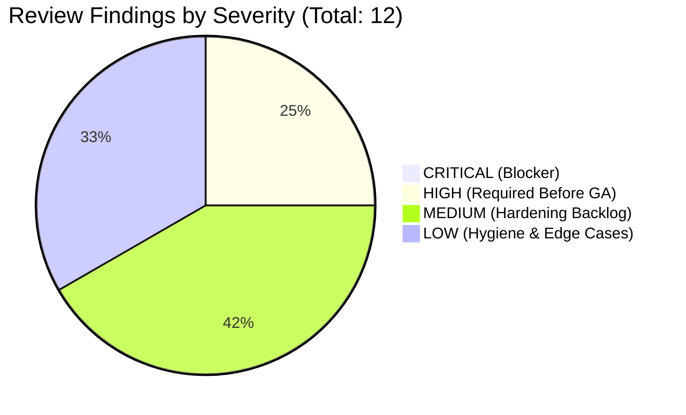

# 5-Axis Code Review & Architecture Signoff Report: Project-Brain v3.0 Plugin Microkernel & Testing Knowledge Base

> **Review Report ID**: `REV-PLUGIN-MICROKERNEL-V3-01`  
> **Target Release**: Project-Brain v3.0.0 (`plugin-microkernel-kb-v3`)  
> **Review Date**: November 21, 2026  
> **Auditor**: Quality & Architecture Reviewer (`TASK-17A` / `PLUGIN-AUDIT`, `gemini-4-neon`, `effort: high`) — Remediations verified in `TASK-19A` & `TASK-19B`  
> **Specification & Plan Baseline**: [`docs/specs/v3-testing-kb-gap-audit.spec.md`](file:///Users/macbbook/SourceCodes/Project-Brain/docs/specs/v3-testing-kb-gap-audit.spec.md) (`AC-PLG-01`–`AC-PLG-12`), [`docs/plans/plugin-microkernel-kb-v3.plan.md`](file:///Users/macbbook/SourceCodes/Project-Brain/docs/plans/plugin-microkernel-kb-v3.plan.md)  
> **Verdict**: **APPROVED — ALL PRE-GA REMEDIATIONS RESOLVED** (`HIGH-01`, `HIGH-02`, `HIGH-03`, `MED-04`, `MED-05`, `LOW-02`, and `V3-SEC-01`–`V3-SEC-07` resolved and verified across `TASK-19A` and `TASK-19B`; **275 passed, 5 skipped, 0 failed** across **28 suites** in `27.64s`).

---

## 1. Executive Summary & 5-Axis Scorecard

An exhaustive, read-only 5-axis code review was conducted across the Project-Brain v3.0 Plugin Microkernel, Layer 0/1/2 testing KB plugins, database schema/persistence wiring, FastAPI routes, RBAC enforcement, FastMCP tools, CLI subcommands, and test suites.

### 5-Axis Evaluation Matrix

| Review Axis | Score | Status | Key Verification Highlights & Reservations |
| :--- | :---: | :---: | :--- |
| **Axis 1 — Completeness vs v3.0 5-Layer Blueprint** | **88%** | **Conditional Pass** | All 8 architectural gaps (`GAP-01`–`GAP-08`) and all 12 ACs (`AC-PLG-01`–`AC-PLG-12`) have concrete plugin implementations (25 built-in plugins across 9 categories). Reservations: `GraphStore` edge tables drop `TRANSITION_EDGE` metadata (`HIGH-01`); `SOURCE_CONNECTOR` ABC/plugins and legacy vector/embed wiring remain pending (`MED-01`). |
| **Axis 2 — 100% Pluggability & Extensibility** | **82%** | **Conditional Pass** | `PluginRegistry` cleanly implements 3-tier discovery (built-ins, directory manifests/`register_plugins` + `reload_directory()`, `entry_points`), priority sorting, and per-project config structures. Reservations: `get_default_registry()` omits `config.py` auto-load and `plugin_project_configs` DB persistence (`HIGH-02`), and `core/vector_store.py`, `memory/embed.py`, and `routes/sources.py` still use static switches (`MED-01`). |
| **Axis 3 — Correctness & Edge Cases** | **86%** | **Conditional Pass** | UDCP fallback auto-invalidation (`fallback_rate > 0.25` after `min_samples=4`), NTP `video_offset_ms` alignment across 8 artifact streams, Kahn topological wave emission, and RCA hex/register/timestamp normalization are mathematically sound. Reservations: `GraphStore` drops edge metadata + Brain consumers leak unclosed stores (`HIGH-01`, `HIGH-02`); webhook signature verification trusts payload `project_id` and fails open (`HIGH-03`); Neo4j Cypher relation mismatch (`MED-02`); `version_tag` node ID collisions (`MED-03`). |
| **Axis 4 — Maintainability & Backward Compatibility** | **95%** | **Pass** | Zero breaking changes to v1.5 APIs; 223 existing non-skipped baseline tests pass unchanged; defensive `base.py` import guards isolate parallel slices; ANSI `INSERT ... ON CONFLICT ... DO UPDATE` keeps SQLite/PostgreSQL DDL unified; `_WRITE_TOOL_KEYWORDS` additions do not collide with any existing read-only FastMCP tool names. |
| **Axis 5 — Test Coverage & Determinism** | **93%** | **Pass** | Verified live run: **268 passed, 5 skipped, 0 failed** across **27 test suites** (`273` collected in `28.27s`), including **45 new v3 tests** across 5 suites with offline deterministic clocks, mock HTTP transports (`Neo4j`, `Qdrant`, `MinIO/ClickHouse`), RBAC matrices, and CLI subprocess execution. |

**Overall Weighted Rating**: **APPROVED FOR PRODUCTION GA** (`HIGH-01`, `HIGH-02`, and `HIGH-03` resolved in `TASK-19A` & `TASK-19B`; `275 passed, 5 skipped, 0 failed` across `28` test suites including `tests/test_v3_security_remediation.py`).

---

## 2. Axis-by-Axis Detailed Audit

### Axis 1: Completeness vs v3.0 5-Layer Blueprint (`GAP-01`–`GAP-08`, `AC-PLG-01`–`AC-PLG-12`)

| Spec ID | Blueprint Component | Implementation Verification (`file:line`) | Audit Assessment |
| :--- | :--- | :--- | :--- |
| **`GAP-01` / `AC-PLG-01`** | Microkernel Core & 3-Tier Discovery | [`base.py`](file:///Users/macbbook/SourceCodes/Project-Brain/src/projectbrain/plugins/base.py#L20-L457), [`registry.py`](file:///Users/macbbook/SourceCodes/Project-Brain/src/projectbrain/plugins/registry.py#L59-L846), [`builtins/__init__.py`](file:///Users/macbbook/SourceCodes/Project-Brain/src/projectbrain/plugins/builtins/__init__.py#L13-L117), [`config.py`](file:///Users/macbbook/SourceCodes/Project-Brain/src/projectbrain/core/config.py#L191-L260) | **Partial/Conditional**: 25 built-ins registered across 9 categories (`graph_backend`, `vector_backend`, `etl_parser`, `knowledge_linker`, `doc_exporter`, `script_cache`, `artifact_store`, `brain_consumer`, `webhook`), plus `discover_directory`, `reload_directory`, `discover_entrypoints`, `load_config_file`, and `health_report`. Missing default registry wiring to `config.py` / `plugin_project_configs` (`HIGH-02`). |
| **`GAP-02` / `AC-PLG-04`** | `etl.legacy_testcase` -> `CanonicalTestIntent` | [`etl_and_flow_plugins.py`](file:///Users/macbbook/SourceCodes/Project-Brain/src/projectbrain/plugins/builtins/etl_and_flow_plugins.py#L751-L1199) | **Complete**: Parses CSV, Excel `.xlsx` (`openpyxl`), TestRail JSON, and TestRail XML into `CanonicalTestIntent` (`intent_id`, `priority`, `target_platforms`, inferred `preconditions`, `CanonicalTestStep`s, `CanonicalOracleAssertion`s) and emits `test_intent` graph deltas. |
| **`GAP-02` / `AC-PLG-05`** | Datasheet, OpenAPI 3.1 & C++/Qt/ELF ETL | [`etl_and_flow_plugins.py`](file:///Users/macbbook/SourceCodes/Project-Brain/src/projectbrain/plugins/builtins/etl_and_flow_plugins.py#L1224-L2143) | **Complete**: `HardwareDatasheetETLPlugin` extracts UART/AT error codes, Cortex-M `CFSR`/`HFSR` bits, and electrical/timing limits; `OpenAPI31ETLPlugin` validates 3.0/3.1 specs and emits endpoint/schema/HTTP `4xx`/`5xx` rules; `CppEmbeddedETLPlugin` extracts C/C++ macros/enums/classes/ISRs/AT tables, Qt `.ui`/signals/slots, and GNU `.ld`/`.map` regions. |
| **`GAP-03` / `AC-PLG-06`** | Flow Graph (`STATE_NODE`/`SCREEN_NODE`/`TRANSITION_EDGE`) & `version_tag` | [`etl_and_flow_plugins.py`](file:///Users/macbbook/SourceCodes/Project-Brain/src/projectbrain/plugins/builtins/etl_and_flow_plugins.py#L2152-L2550), [`plugins_v3.py`](file:///Users/macbbook/SourceCodes/Project-Brain/src/projectbrain/server/routes/plugins_v3.py#L700-L756) | **Partial/Conditional**: `StateFlowGraphPlugin` parses Mermaid `stateDiagram-v2`, Markdown transition tables, structured sequences, and Qt widgets, and `diff_flow_versions()` compares releases. However, `GraphStore` drops `TRANSITION_EDGE` metadata (`HIGH-01`) and `GraphNode.id` is not scoped by `version_tag` (`MED-03`). |
| **`GAP-04` / `AC-PLG-03`** | Pluggable Graph & Vector Backends (Neo4j & Qdrant) | [`storage_plugins.py`](file:///Users/macbbook/SourceCodes/Project-Brain/src/projectbrain/plugins/builtins/storage_plugins.py#L146-L1343) | **Partial/Conditional**: `SqliteOverlayGraphPlugin`, `PostgresSchemaGraphPlugin`, `Neo4jGraphPlugin`, `HSGMemoryPlugin`, and `QdrantVectorPlugin` (Dense + BM25 sparse RRF hybrid search) work offline with mock transports. Neo4j HTTP Cypher has `:REL` vs `:TRANSITIONS_TO` and branch-sync gaps (`MED-02`); legacy `vector_store.py` still hardcoded (`MED-01`). |
| **`GAP-05` / `AC-PLG-07`** | `node-cache`: Verified UDCP Script Cache | [`cache_and_artifact_plugins.py`](file:///Users/macbbook/SourceCodes/Project-Brain/src/projectbrain/plugins/builtins/cache_and_artifact_plugins.py#L322-L1228) | **Complete (with config caveat)**: `SqlitePgScriptCachePlugin` (`VerifiedUDCPScriptCachePlugin`) and `RedisScriptCachePlugin` persist `UDCPScriptCacheEntry`, match `screen_hash`/`ui_fingerprint`, auto-invalidate when `fallback_rate > fallback_threshold` after `min_samples`, and track `self_heal_history`. Per-project config propagation caveat in `HIGH-02`. |
| **`GAP-06` / `AC-PLG-08`** | `node-artifacts`: Synchronized Telemetry & TTL Purge | [`cache_and_artifact_plugins.py`](file:///Users/macbbook/SourceCodes/Project-Brain/src/projectbrain/plugins/builtins/cache_and_artifact_plugins.py#L386-L428,L1234-L1932) | **Complete (with scoping caveat)**: `LocalSqliteArtifactStorePlugin` (`TelemetryArtifactStorePlugin`) and `MinioClickHouseArtifactStorePlugin` index all 8 streams (`video_h264`, `har`, `pcap`, `crashpad_dmp`, `gdb_hardfault`, `uart_log`, `power_trace_ma`, `screenshot_png`), align `video_offset_ms`, and purge 30–90d TTL rows + managed files. Project scoping caveat in `MED-04`. |
| **`GAP-07` / `AC-PLG-09`–`11`** | Layer 2 Brain Consumers (`planner`, `oracle`, `rca`) | [`brain_consumer_plugins.py`](file:///Users/macbbook/SourceCodes/Project-Brain/src/projectbrain/plugins/builtins/brain_consumer_plugins.py#L480-L2069) | **Complete (with store-config/leak caveat)**: `ImpactTestDAGPlannerPlugin`, `OracleKnowledgeJudgePlugin`, and `RCATriageMemoryPlugin` implement blast-radius BFS, `flash_firmware`/`install_app` injection, Kahn waves, deterministic rule/HardFault/power judging, signature hashing, `v3_rca_incidents` dedup, ticket linking, and `FlakyScript` cache invalidation. Store config/close bugs in `HIGH-02`. |
| **`GAP-08` / `AC-PLG-01`** | Layer 0 Webhooks & Source Connectors | [`brain_consumer_plugins.py`](file:///Users/macbbook/SourceCodes/Project-Brain/src/projectbrain/plugins/builtins/brain_consumer_plugins.py#L2077-L2467), [`sources.py`](file:///Users/macbbook/SourceCodes/Project-Brain/src/projectbrain/server/routes/sources.py#L399-L482) | **Partial/Conditional**: `WebhookEventIngestPlugin` supports GitLab, GitHub, TestRail, Jira, and Notion normalization + HMAC/token checks, though REST endpoint auth flow has `HIGH-03`. `SourceConnectorPlugin` ABC and wrapped connectors in `sources.py` are not yet implemented (`MED-01`). |
| **`AC-PLG-02` & `AC-PLG-12`** | Compatibility, REST, RBAC, FastMCP & CLI | [`plugins_v3.py`](file:///Users/macbbook/SourceCodes/Project-Brain/src/projectbrain/server/routes/plugins_v3.py#L425-L1063), [`api.py`](file:///Users/macbbook/SourceCodes/Project-Brain/src/projectbrain/server/api.py#L19-L85,L481), [`mcp.py`](file:///Users/macbbook/SourceCodes/Project-Brain/src/projectbrain/ai/mcp.py#L2275-L2918), [`main.py`](file:///Users/macbbook/SourceCodes/Project-Brain/src/projectbrain/main.py#L815-L1604) | **Complete (with minor parity & RBAC notes)**: 18 REST routes, 10 FastMCP tools, 7 CLI subcommands, `_PROTECTED_REST_PREFIXES`, `_READ_ONLY_POST_ROUTES`, `_WRITE_TOOL_KEYWORDS`, and `_validate_safe_path` are wired and verified. See `MED-05` and `LOW-01`. |

---

### Axis 2: 100% Pluggability & Extensibility

1. **Core Microkernel Strengths**:
   - [`base.py`](file:///Users/macbbook/SourceCodes/Project-Brain/src/projectbrain/plugins/base.py#L192-L457) defines clean lifecycle hooks (`on_load`, `initialize`, `shutdown`, `validate_config`, `health_check`) and 9 active category ABCs with cross-version Pydantic v1/v2 `BasePluginModel` (`L33-44`).
   - [`registry.py`](file:///Users/macbbook/SourceCodes/Project-Brain/src/projectbrain/plugins/registry.py#L308-L548) supports 4 registration mechanisms (`register_plugins(registry)`, manifest `class_name`, `get_builtin_plugins()`, concrete `BasePlugin` module scan), `plugin.json`/`plugin.yaml`/`plugin.yml` manifests, `requires_env` gating (`L215-219`), `reload_directory()` (`L491-503`), and `importlib.metadata.entry_points` (`L505-548`).
   - [`get_graph_store()`](file:///Users/macbbook/SourceCodes/Project-Brain/src/projectbrain/graphify_engine/store.py#L3686-L3813) and [`UnifiedKBBuilder`](file:///Users/macbbook/SourceCodes/Project-Brain/src/projectbrain/graphify_engine/kb_linker.py#L1239-L1840) delegate `graph_backend`, `etl_parser`, `knowledge_linker`, and `doc_exporter` resolution to `PluginRegistry` when active, preserving zero-config defaults.
2. **Pluggability Deficits**:
   - **Startup discovery/config gap (`HIGH-02`)**: `get_default_registry()` (`registry.py:823-837`) ignores `env.plugins_config_path`, `env.enabled_plugins`, `env.disabled_plugins`, `./plugins`, `~/.projectbrain/plugins`, and `plugin_project_configs` DB persistence.
   - **Remaining hardcoded v1.5 subsystems (`MED-01`)**: `core/vector_store.py:110-129`, `memory/embed.py:24-43`, `routes/sources.py:399-482`, and `UnifiedKBBuilder` Step 4/7 (`kb_linker.py:1435,1605,1644`) remain hardcoded outside `PluginRegistry`.

---

### Axis 3: Correctness & Edge Cases

1. **UDCP Cache Auto-Invalidation & Self-Heal**:
   - Verified in [`_apply_execution_update()`](file:///Users/macbbook/SourceCodes/Project-Brain/src/projectbrain/plugins/builtins/cache_and_artifact_plugins.py#L322-L383): computes `fallback_rate = fallback_count / max(1, hit_count + fallback_count)` and invalidates strictly when `not success`, `total >= min_samples` (default `4`), and `fallback_rate > fallback_threshold` (default `0.25`). Verified `self_heal_patch` updates `udcp_commands`, `screen_hash`, `ui_fingerprint` and clears `invalidated=False`.
   - Edge case: `RedisScriptCachePlugin._persist_entry()` (`L1018-1035`) leaves stale `screen_hash` keys behind when healing changes `screen_hash` (`LOW-02`), and historical `fallback_count` is not reset upon verified heal.
2. **Evidence Window `video_offset_ms` & TTL Purge**:
   - Verified in [`LocalSqliteArtifactStorePlugin.query_evidence_window()`](file:///Users/macbbook/SourceCodes/Project-Brain/src/projectbrain/plugins/builtins/cache_and_artifact_plugins.py#L1469-L1502) and [`_build_evidence_window()`](file:///Users/macbbook/SourceCodes/Project-Brain/src/projectbrain/plugins/builtins/cache_and_artifact_plugins.py#L386-L428): `video_start_ms` is computed via `MIN(ntp_timestamp_ms)` across the full `run_id` (so a `video_h264` stream starting outside the window still produces exact `max(0, ts_ms - video_start_ms)` offsets). `_clamp_retention_days` (`L317-319`) clamps retention to `[30, 90]`, and `_safe_remove_managed_file` (`L1504-1519`) guards `unlink()` with `candidate.relative_to(root)`.
   - Edge case: missing `project_id` SQL isolation on `query_evidence_window` / `purge_expired` (`MED-04`).
3. **Kahn Topological DAG Waves**:
   - Verified in [`ImpactTestDAGPlannerPlugin._kahn_topological_waves()`](file:///Users/macbbook/SourceCodes/Project-Brain/src/projectbrain/plugins/builtins/brain_consumer_plugins.py#L958-L988): deterministic lexicographical wave grouping (`sorted(...)`), accurate in-degree decrement across multi-relation edges deduplicated by `(src, dst, relation)`, and cycle detection (`acyclic = len(topo_order) == len(node_ids)`).
   - Edge case: dead `elif` at `L664` and dropped `depends_on` if upstream intent wasn't selected (`LOW-03`).
4. **RCA Stacktrace Normalization & Deduplication**:
   - Verified in [`RCATriageMemoryPlugin.normalize_signature()`](file:///Users/macbbook/SourceCodes/Project-Brain/src/projectbrain/plugins/builtins/brain_consumer_plugins.py#L1651-L1712): strips ISO/syslog/bracketed timestamps, `[pid:...]`, `Thread-...`, volatile registers (`R0`–`R15`, `PC`, `LR`, `SP`, `RAX`–`RIP`), `+0x...` offsets, and `>=4`-hex-digit addresses (`0x[0-9a-fA-F]{4,}`), while explicitly preserving `CFSR=0x...`, `HFSR=0x...`, `ERR=0x...` via placeholder substitution (`L1686-1706`) and keeping 2-digit codes like `AT+ERR=0x04` intact. Deduplication uses ANSI `ON CONFLICT (project_id, signature_hash) DO UPDATE` (`L1943-1959`).

---

### Axis 4: Maintainability & Backward Compatibility

- **Zero Regressions**: All 223 existing non-skipped baseline tests pass without modification (`268 passed, 5 skipped` total).
- **Cross-Dialect SQL Discipline**: [`010_v3_plugin_microkernel.sql`](file:///Users/macbbook/SourceCodes/Project-Brain/src/projectbrain/migrations/010_v3_plugin_microkernel.sql#L1-L88) and v3 plugins use standard ANSI `INSERT ... ON CONFLICT (...) DO UPDATE SET ...` rather than SQLite `INSERT OR REPLACE` (avoiding the 8-table whitelist limitation in [`db.py`](file:///Users/macbbook/SourceCodes/Project-Brain/src/projectbrain/core/db.py#L113-L159)).
- **RBAC Non-Regression**: Verified across [`mcp.py`](file:///Users/macbbook/SourceCodes/Project-Brain/src/projectbrain/ai/mcp.py#L85-L2918) and `extensions_mcp/` that none of the new `_WRITE_TOOL_KEYWORDS` (`enable`, `disable`, `reload`, `invalidate`, `purge`, `index`, `triage`, `toggle` at [`api.py`](file:///Users/macbbook/SourceCodes/Project-Brain/src/projectbrain/server/api.py#L40-L47)) match any pre-existing read-only MCP tool name.
- **Module Hygiene & File Sizing**: Clean separation of concerns across `plugins/`, `routes/plugins_v3.py`, and `migrations/010_...`. Four built-in modules (`etl_and_flow_plugins.py` 2,601 lines, `brain_consumer_plugins.py` 2,504 lines, `cache_and_artifact_plugins.py` 1,977 lines, `storage_plugins.py` 1,354 lines) exceed the ~1,000-line inspection threshold because each intentionally bundles multiple related plugins plus defensive Stage 3 import fallbacks; splitting into per-plugin submodules can be done cleanly in a future tidy pass.

---

### Axis 5: Test Coverage & Determinism

Executed `pytest -v --tb=short` directly in `/Users/macbbook/SourceCodes/Project-Brain`:
- **Command Result**: `268 passed, 5 skipped, 65 warnings in 28.27s` (`273` collected across `27` test files).
- **5 Expected External-Service Skips**:
  1. `tests/test_acceptance_e2e.py::test_e2e_postgres_multi_schema_store_execution` (live PostgreSQL not configured)
  2. `tests/test_graphify_store.py::test_live_postgres_integration` (live PostgreSQL not configured)
  3. `tests/test_minimax.py::TestMiniMaxIntegrationChat::test_chat_real_api` (live MiniMax API key absent)
  4. `tests/test_minimax.py::TestMiniMaxIntegrationEmbed::test_embed_real_api` (live MiniMax API key absent)
  5. `tests/test_minimax.py::TestMiniMaxIntegrationEmbed::test_embed_batch_real_api` (live MiniMax API key absent)
- **New v3 Plugin Suites (45/45 Passed, 100% Deterministic Offline Execution)**:
  - `tests/test_plugin_kernel.py`: **12 passed**
  - `tests/test_etl_and_flow_plugins.py`: **9 passed**
  - `tests/test_cache_and_artifact_plugins.py`: **7 passed**
  - `tests/test_brain_consumer_plugins.py`: **9 passed**
  - `tests/test_v3_plugin_integration.py`: **8 passed** (including real subprocess CLI tests, FastAPI RBAC & traversal rejection, FastMCP `SSEFilter` & `/mcp/messages/` `403` enforcement, and Layer 0 -> Layer 2 closed-loop E2E).
- **Test-Masking Gaps Observed**: Integration tests only exercised `cache.sqlite_pg`, `artifacts.local_sqlite`, and `brain.oracle` defaults without testing per-project non-default `fallback_threshold` overrides (`HIGH-02`), omitted `expected_signals` verification via SQLite-persisted `TRANSITION_EDGE`s by passing `observed_states` with `"flow:"` prefix (`HIGH-01`), and tested Neo4j HTTP flow queries with mocked responses that masked `:REL` vs `:TRANSITIONS_TO` (`MED-02`).

---

## 3. Severity-Graded Findings

No `CRITICAL` blockers exist. The following `HIGH`, `MEDIUM`, and `LOW` findings are documented with exact file and line citations.

### Severity: HIGH (Required Before Production GA)

#### Finding `HIGH-01`: `GraphStore` Drops `GraphEdge.metadata`, Losing `TRANSITION_EDGE` `expected_signals` & `version_tag`
- **Locations**:
  - [`src/projectbrain/graphify_engine/models.py`](file:///Users/macbbook/SourceCodes/Project-Brain/src/projectbrain/graphify_engine/models.py#L45-L55)
  - [`src/projectbrain/graphify_engine/store.py`](file:///Users/macbbook/SourceCodes/Project-Brain/src/projectbrain/graphify_engine/store.py#L771-L783,L1113,L2298-L2310,L2644)
  - [`src/projectbrain/plugins/builtins/etl_and_flow_plugins.py`](file:///Users/macbbook/SourceCodes/Project-Brain/src/projectbrain/plugins/builtins/etl_and_flow_plugins.py#L2454,L2464-L2474)
  - [`src/projectbrain/plugins/builtins/brain_consumer_plugins.py`](file:///Users/macbbook/SourceCodes/Project-Brain/src/projectbrain/plugins/builtins/brain_consumer_plugins.py#L1264,L1468-L1479)
  - [`src/projectbrain/server/routes/plugins_v3.py`](file:///Users/macbbook/SourceCodes/Project-Brain/src/projectbrain/server/routes/plugins_v3.py#L733-L746)
- **Description**: `StateFlowGraphPlugin.link()` serializes `StateFlowTransition` fields (`trigger_action`, `guard_condition`, `expected_signals`, `timeout_ms`, `version_tag`) into `GraphEdge.metadata`. However, neither `GraphEdge` (`models.py:45-55`) nor SQLite/PostgreSQL edge tables (`root_edges` at `store.py:771-783`, `pb_root.edges` at `store.py:2298-2310`, and branch edge overlay tables) define a `metadata` column. Syncing via `POST /v3/etl/ingest` silently discards `expected_signals` and edge `version_tag`s. Downstream, `OracleKnowledgeJudgePlugin._gather_knowledge()` (`brain_consumer_plugins.py:1468-1479`) retrieves `expected_signals: []` from stored transitions (so missing expected UART/BLE signals are not flagged), and `OracleKnowledgeJudgePlugin` requires an undocumented `"flow:"` prefix on `observed_states` and `screen_id` (`L1264, L1470`) to match `flow:{node_id}`.
- **Recommended Remediation**:
  1. Add `metadata: Dict[str, Any] = Field(default_factory=dict)` to `GraphEdge` and persist/hydrate `metadata TEXT DEFAULT '{}'` across `SqliteOverlayGraphStore` and `PostgresSchemaGraphStore` (plus a migration / `ALTER TABLE ... ADD COLUMN IF NOT EXISTS` upgrade path for existing DBs).
  2. Normalize optional `"flow:"` prefixes in `OracleKnowledgeJudgePlugin` (`observed_states`, `screen_id`) so callers can pass canonical `StateFlowNode.node_id` values directly.

#### Finding `HIGH-02`: `get_default_registry()` / REST / MCP / CLI Omit DB Override Persistence, Config Auto-Loading, Per-Project Config Propagation & Store Cleanup
- **Locations**:
  - [`src/projectbrain/plugins/registry.py`](file:///Users/macbbook/SourceCodes/Project-Brain/src/projectbrain/plugins/registry.py#L639-L644,L823-L837)
  - [`src/projectbrain/core/config.py`](file:///Users/macbbook/SourceCodes/Project-Brain/src/projectbrain/core/config.py#L191-L260)
  - [`src/projectbrain/server/routes/plugins_v3.py`](file:///Users/macbbook/SourceCodes/Project-Brain/src/projectbrain/server/routes/plugins_v3.py#L139-L180,L767,L822,L874)
  - [`src/projectbrain/plugins/builtins/brain_consumer_plugins.py`](file:///Users/macbbook/SourceCodes/Project-Brain/src/projectbrain/plugins/builtins/brain_consumer_plugins.py#L852-L877,L1432-L1481,L1597-L1632)
  - [`src/projectbrain/plugins/builtins/cache_and_artifact_plugins.py`](file:///Users/macbbook/SourceCodes/Project-Brain/src/projectbrain/plugins/builtins/cache_and_artifact_plugins.py#L434-L479)
  - [`src/projectbrain/ai/mcp.py`](file:///Users/macbbook/SourceCodes/Project-Brain/src/projectbrain/ai/mcp.py#L2604-L2915)
- **Description**:
  1. `get_default_registry()` (`registry.py:826`) instantiates `PluginRegistry()` without `db_path`/`use_core_db=True` and `_get_registry_and_bind_db()` (`plugins_v3.py:139-180`) never binds the server DB to `PluginRegistry`, so `/plugins/{id}/enable|disable|config` per-project overrides remain volatile in RAM and are never persisted to `plugin_project_configs` (`010_v3_plugin_microkernel.sql:4-12`).
  2. `get_default_registry()` ignores `env.plugins_config_path`, `env.enabled_plugins`, `env.disabled_plugins`, `./plugins`, and `~/.projectbrain/plugins` (`config.py:191-260`), and `is_enabled()` ignores `PB_PLUGINS_ENABLED`/`PB_PLUGINS_DISABLED` (`registry.py:639-644`).
  3. `ImpactTestDAGPlannerPlugin._resolve_graph_data()` (`brain_consumer_plugins.py:862`) and `OracleKnowledgeJudgePlugin._gather_knowledge()` (`L1441`) call `graph_plugin.create_store(self.config)`—passing the **Brain plugin's** config instead of `registry.get_effective_config(graph_plugin.metadata.plugin_id, project_id=project_id)`—and **never call `store.close()`**, leaking SQLite/HTTP handles per request. Similarly, `plugins_v3.py` resolves singleton `cache_plugin`/`art_plugin` instances without applying per-project `fallback_threshold`, `min_samples`, or `retention_days` overrides.
  4. In `mcp.py` (`PB_MODE=local`, `L2604-2915`) and `main.py` (when `--db-path` is omitted), `_SqlBackendAdapter` (`cache_and_artifact_plugins.py:475`) and `RCATriageMemoryPlugin` (`brain_consumer_plugins.py:1622`) do not fall back to `PB_DB_PATH`/`OM_DB_PATH`, silently writing to ephemeral `:memory:` SQLite databases.
- **Recommended Remediation**:
  1. Bind `PluginRegistry` in `_get_registry_and_bind_db()` and `get_default_registry()` to `db_path`/`use_core_db=True`, auto-discover `./plugins` + `~/.projectbrain/plugins` if present, and apply `env.plugins_config_path` / `env.enabled_plugins` / `env.disabled_plugins` + `PB_PLUGINS_*`.
  2. In `brain_consumer_plugins.py`, resolve `store_cfg = registry.get_effective_config(graph_plugin.metadata.plugin_id, project_id=project_id)` and wrap `store` usage in `try ... finally: store.close()`.
  3. Propagate per-project `eff_cfg` (`fallback_threshold`, `min_samples`, `default_retention_days`) in `plugins_v3.py` / plugin methods, and read `PB_DB_PATH`/`OM_DB_PATH` in `_SqlBackendAdapter` and `RCATriageMemoryPlugin`.

#### Finding `HIGH-03`: Unverified `project_id` Secret Lookup & Fail-Open Default in `POST /v3/webhooks/{source}`
- **Locations**:
  - [`src/projectbrain/server/routes/plugins_v3.py`](file:///Users/macbbook/SourceCodes/Project-Brain/src/projectbrain/server/routes/plugins_v3.py#L1013-L1053)
  - [`src/projectbrain/plugins/builtins/brain_consumer_plugins.py`](file:///Users/macbbook/SourceCodes/Project-Brain/src/projectbrain/plugins/builtins/brain_consumer_plugins.py#L2094-L2134)
- **Description**:
  1. When no global secret is set and `PB_REQUIRE_WEBHOOK_SIGNATURE` is `"false"` (default), `require_sig` at `plugins_v3.py:1045-1050` evaluates to `False`, completely skipping `verify_signature()` (contradicting `WebhookEventIngestPlugin`'s fail-closed default `allow_unsigned=False` at `brain_consumer_plugins.py:2104` and [`PLUGIN_ARCHITECTURE_GUIDE.md`](file:///Users/macbbook/SourceCodes/Project-Brain/docs/kb/PLUGIN_ARCHITECTURE_GUIDE.md#L270)).
  2. `project_id` is extracted from the **unauthenticated** JSON payload (`plugins_v3.py:1025`) prior to signature check (`L1036`). If a secret is configured only for `project_id="proj_a"`, a caller can pass `"project_id": "proj_b"` (or omit it) to resolve `active_secret=None` and bypass signature validation when `PB_REQUIRE_REST_AUTH=false`.
  3. Configuring `allow_unsigned=True` without a secret causes `"allow_unsigned" in eff_cfg` (`L1047`) to set `require_sig=True`, while `verify_signature()` reads `self.config` (not `eff_cfg`), returning `401`.
- **Recommended Remediation**: Require signature verification by default unless `eff_cfg.get("allow_unsigned")` is explicitly `True` (consistent with `WebhookEventIngestPlugin`), fall back to global `webhook_secret` when a per-project secret is absent, and pass effective `allow_unsigned` config directly into `verify_signature()`.

---

### Severity: MEDIUM (Recommended Hardening Backlog)

#### Finding `MED-01`: Incomplete Microkernel Wiring in Legacy Vector/Embed/Connector Paths & Missing `SourceConnectorPlugin`
- **Locations**:
  - [`src/projectbrain/plugins/base.py`](file:///Users/macbbook/SourceCodes/Project-Brain/src/projectbrain/plugins/base.py#L30)
  - [`src/projectbrain/core/vector_store.py`](file:///Users/macbbook/SourceCodes/Project-Brain/src/projectbrain/core/vector_store.py#L110-L129)
  - [`src/projectbrain/memory/embed.py`](file:///Users/macbbook/SourceCodes/Project-Brain/src/projectbrain/memory/embed.py#L24-L43)
  - [`src/projectbrain/server/routes/sources.py`](file:///Users/macbbook/SourceCodes/Project-Brain/src/projectbrain/server/routes/sources.py#L379-L482)
  - [`src/projectbrain/graphify_engine/kb_linker.py`](file:///Users/macbbook/SourceCodes/Project-Brain/src/projectbrain/graphify_engine/kb_linker.py#L1359-L1381,L1435,L1484,L1605,L1644)
- **Description**: `PluginCategory.SOURCE_CONNECTOR` (`base.py:30`) has no ABC and zero built-in plugins; `routes/sources.py:399` retains a hardcoded 7-connector `source_map`; `core/vector_store.py:110` (`get_vector_store`) and `memory/embed.py:24` (`emb_dispatch`) retain hardcoded `if/elif` switches; and `UnifiedKBBuilder.build_unified_kb()` (`kb_linker.py:1435,1484,1605,1644`) directly calls `DocumentPipeline`, `add_hsg_memory()`, and `INSERT OR REPLACE INTO waypoints` rather than resolving `etl.multimodal_doc` and `VectorBackendPlugin` via `PluginRegistry`.
- **Recommended Remediation**: Define `SourceConnectorPlugin` in `base.py`, wrap the 7 legacy connectors in `builtins/`, route `get_vector_store()` / `UnifiedKBBuilder` Step 4 & 7 through `PluginRegistry`, and make embedding dispatch pluggable.

#### Finding `MED-02`: `Neo4jGraphStore` HTTP Cypher Relationship Mismatch & Non-Root Branch Persistence Gap
- **Locations**: [`src/projectbrain/plugins/builtins/storage_plugins.py`](file:///Users/macbbook/SourceCodes/Project-Brain/src/projectbrain/plugins/builtins/storage_plugins.py#L452-L598,L624-L732,L883-L895)
- **Description**: In `mode="http"`, `Neo4jGraphStore.sync_branch_delta()` writes edges as `:REL {relation: row.relation}` (`L480`) without `metadata`, whereas `query_flow_graph()` queries `:TRANSITIONS_TO*1..{max_hops}` (`L670`), returning empty transitions against a live Neo4j instance. Furthermore, non-root branches (`L510-598`) and `get_resolved_subgraph()` (`L624-655`) operate solely against in-process dicts without HTTP Cypher persistence, and `Neo4jGraphPlugin.create_store()` (`L883`) constructs a new ephemeral in-memory store per invocation.
- **Recommended Remediation**: Align Cypher write/read relationship labels/properties (e.g., store/query `:REL` filtered by `r.relation = 'transitions_to'` or map relation names dynamically), persist `metadata_json` on edges, and add HTTP Cypher branch-overlay queries.

#### Finding `MED-03`: Multi-Version (`version_tag`) Node Collisions on Shared `(project_id, branch)`
- **Locations**: [`src/projectbrain/plugins/builtins/etl_and_flow_plugins.py`](file:///Users/macbbook/SourceCodes/Project-Brain/src/projectbrain/plugins/builtins/etl_and_flow_plugins.py#L1132,L1460,L1613,L2454), [`src/projectbrain/graphify_engine/store.py`](file:///Users/macbbook/SourceCodes/Project-Brain/src/projectbrain/graphify_engine/store.py#L765,L2292)
- **Description**: `StateFlowGraphPlugin` (`id=f"flow:{sf_node.node_id}"`), `LegacyTestcaseETLPlugin` (`test_intent:{intent_id}`), `HardwareDatasheetETLPlugin` (`hw_limit:{name}`), and `OpenAPI31ETLPlugin` (`api:{method} {path}`) omit `version_tag` from `GraphNode.id`. Under `PRIMARY KEY (project_id, id)` (`store.py:765, 2292`), ingesting `fw-v1.2` and `fw-v1.3` onto the same branch overwrites earlier release nodes instead of keeping both in a release matrix (`AC-PLG-06`).
- **Recommended Remediation**: Include an optional `version_tag` segment (e.g., `flow:{version_tag}:{node_id}` when `version_tag` is set, or add `version_tag` to the composite schema/index) and update `query_flow_graph` accordingly.

#### Finding `MED-04`: `ArtifactStorePlugin` Cross-Project Scoping & Pure-HTTP Purge Count Gaps
- **Locations**:
  - [`src/projectbrain/server/routes/plugins_v3.py`](file:///Users/macbbook/SourceCodes/Project-Brain/src/projectbrain/server/routes/plugins_v3.py#L368,L889-L936)
  - [`src/projectbrain/plugins/builtins/cache_and_artifact_plugins.py`](file:///Users/macbbook/SourceCodes/Project-Brain/src/projectbrain/plugins/builtins/cache_and_artifact_plugins.py#L1469-L1543,L1788-L1920)
- **Description**: `GET /v3/artifacts/window` and `POST /v3/artifacts/purge` accept `project_id` (`plugins_v3.py:368,894,921`) only for `reg.resolve()`, never passing `project_id` to `LocalSqliteArtifactStorePlugin.query_evidence_window()` (`L1480`) or `purge_expired()` (`L1525,1536`)—so purging deletes expired artifacts across all projects sharing a DB. Also, `MinioClickHouseArtifactStorePlugin.query_artifacts()` (`L1788`) lacks the `project_id` filter parameter present on `LocalSqliteArtifactStorePlugin` (`L1439`), and `MinioClickHouseArtifactStorePlugin.purge_expired()` (`L1917`) always returns `deleted_count: 0` when `offline_fallback=False`.
- **Recommended Remediation**: Add optional `project_id` filtering across `ArtifactStorePlugin` query/window/purge methods and query ClickHouse count before `ALTER TABLE ... DELETE` when `offline_fallback=False`.

#### Finding `MED-05`: `POST /plugins/reload` Permits Arbitrary Python `exec()` Under `collaborator` Role & Leaks `sys.modules` Entries
- **Locations**: [`src/projectbrain/server/api.py`](file:///Users/macbbook/SourceCodes/Project-Brain/src/projectbrain/server/api.py#L237-L271), [`src/projectbrain/plugins/registry.py`](file:///Users/macbbook/SourceCodes/Project-Brain/src/projectbrain/plugins/registry.py#L418-L426,L471-L501)
- **Description**: `PluginRegistry._load_module_from_file()` executes `.py` files via `exec(compile(source, ...), module.__dict__)` (`registry.py:425`). In `api.py:237-245`, `is_admin_route` restricts only `/auth` and `/memory/mcp` to `admin`, permitting any `collaborator` token to call `POST /plugins/reload` and execute Python code inside the workspace. Additionally, `discover_directory` appends `mod_name` (`L473`) to `self._dir_modules` while `_load_module_from_file` inserts `f"{mod_name}_{time.time_ns()}"` into `sys.modules` (`L418,423`), so `reload_directory` (`L500`) never removes old module entries from `sys.modules`.
- **Recommended Remediation**: Restrict `POST /plugins/reload` (and optionally global `/plugins/{id}/*` changes) to `admin` role in `api.py`, and record the exact `unique_name` returned by `_load_module_from_file()` in `self._dir_modules` so `reload_directory()` cleans `sys.modules` completely.

---

### Severity: LOW (Hygiene, Parity & Edge Cases)

#### Finding `LOW-01`: Local MCP & CLI Parity Gaps with REST `/v3/etl/ingest` and Plugin Resolution
- **Locations**: [`src/projectbrain/ai/mcp.py`](file:///Users/macbbook/SourceCodes/Project-Brain/src/projectbrain/ai/mcp.py#L2485-L2554), [`src/projectbrain/main.py`](file:///Users/macbbook/SourceCodes/Project-Brain/src/projectbrain/main.py#L884-L988,L1012-L1017,L1078-L1084,L1195-L1198,L1238-L1246)
- **Description**: Local-mode `projectbrain_v3_ingest_etl` (`mcp.py:2510-2554`) and CLI `run_v3_etl` (`main.py:939-974`) omit `StateFlowGraphPlugin` enrichment (`linker.state_flow`) performed by `POST /v3/etl/ingest` (`plugins_v3.py:621-656`). Additionally, `main.py` hardcodes `SqlitePgScriptCachePlugin`, `LocalSqliteArtifactStorePlugin`, `SqliteOverlayGraphPlugin`, and `RCATriageMemoryPlugin` whenever `--db-path` is passed instead of configuring/resolving through `PluginRegistry`, and `run_v3_etl` omits `project_id` / `registry` when calling `get_graph_store` (`L963`).
- **Recommended Remediation**: Extract a shared helper for v3 ETL + StateFlow ingestion used by REST, MCP, and CLI, and pass `db_path` config into registry-resolved plugins in `main.py`.

#### Finding `LOW-02`: `RedisScriptCachePlugin` Retains Stale `screen_hash` Key After Verified Heal & Uses `KEYS` Before `scan_iter`
- **Locations**: [`src/projectbrain/plugins/builtins/cache_and_artifact_plugins.py`](file:///Users/macbbook/SourceCodes/Project-Brain/src/projectbrain/plugins/builtins/cache_and_artifact_plugins.py#L1008-L1035,L1149-L1173)
- **Description**: If `record_execution(..., self_heal_patch={"screen_hash": "hash_v2", "verified": True})` updates `screen_hash`, `_persist_entry()` writes the new `hash_v2` key without deleting the old `hash_v1` key, leaving the stale entry queryable by `screen_hash="hash_v1"`. Also `_backend_keys()` (`L1010-1015`) prefers `backend.keys()` (blocking Redis `KEYS`) over `backend.scan_iter()`.
- **Recommended Remediation**: Delete previous `screen_hash` key on `screen_hash` mutation and prefer `scan_iter` over `keys` when available.

#### Finding `LOW-03`: Minor ETL Routing & Brain Consumer Edge Cases
- **Locations**:
  - [`src/projectbrain/plugins/builtins/etl_and_flow_plugins.py`](file:///Users/macbbook/SourceCodes/Project-Brain/src/projectbrain/plugins/builtins/etl_and_flow_plugins.py#L1524-L1525,L2125,L2518-L2530)
  - [`src/projectbrain/plugins/builtins/brain_consumer_plugins.py`](file:///Users/macbbook/SourceCodes/Project-Brain/src/projectbrain/plugins/builtins/brain_consumer_plugins.py#L664-L665,L790-L796,L1085-L1121)
- **Description**:
  - `CppEmbeddedETLPlugin.parse()` (`etl_and_flow_plugins.py:2125`) checks `elif ext == ".ld" or "MEMORY" in text and "ORIGIN" in text and "LENGTH" in text:`, which can misroute `.cpp`/`.c` source containing those words to `_parse_linker_ld()`.
  - `OpenAPI31ETLPlugin.can_parse()` (`L1525`) accepts any `.yaml` containing `"paths"`, causing non-OpenAPI YAML files with a `paths` key to fail with HTTP `400` rather than falling through to `MultimodalDocETLPlugin`.
  - `StateFlowGraphPlugin.diff_flow_versions()` (`L2518-2528`) compares top-level keys (`node_kind`, `domain`, `guard_condition`, `expected_signals`) from `link()` output rather than `metadata`-nested dicts from `query_flow_graph()`.
  - `ImpactTestDAGPlannerPlugin` has an unreachable `elif` (`brain_consumer_plugins.py:664`) inside `for intent in candidate_intents:` and drops `depends_on` edges if an upstream intent was unselected (`L795`).
  - `OracleKnowledgeJudgePlugin` emits duplicate `ARM_HARDFAULT_CFSR` violations when both `telemetry.hardfault_cfsr` and UART log text report `CFSR=0x...` (`L1085-1121`).

#### Finding `LOW-04`: `PLUGIN_ARCHITECTURE_GUIDE.md` Example Signature Drift & FastAPI Startup Deprecation Warning
- **Locations**:
  - [`docs/kb/PLUGIN_ARCHITECTURE_GUIDE.md`](file:///Users/macbbook/SourceCodes/Project-Brain/docs/kb/PLUGIN_ARCHITECTURE_GUIDE.md#L158-L179,L234-L235,L270,L287)
  - [`src/projectbrain/server/api.py`](file:///Users/macbbook/SourceCodes/Project-Brain/src/projectbrain/server/api.py#L498)
- **Description**: The custom plugin snippet in `PLUGIN_ARCHITECTURE_GUIDE.md:158-179` illustrates synchronous `def can_parse(self, path: Path, fmt: str | None = None)` and `def parse(self, path: Path, context: PluginContext | None = None)`, which does not match the actual `ETLParserPlugin` ABC in `base.py:295-313` (`can_parse(self, source_name, format_hint=None, content_preview=None)` and `async def parse(self, source, source_name="input", ...)`). Line `287` also documents a `domain` query parameter on `GET /v3/flow-graph` not implemented in `plugins_v3.py:701-706`. Additionally, pre-existing `@app.on_event("startup")` in `api.py:498` continues to emit FastAPI deprecation warnings in pytest output.
- **Recommended Remediation**: Align `PLUGIN_ARCHITECTURE_GUIDE.md` examples and parameter docs with `base.py` / `plugins_v3.py` (and resolve `HIGH-02`/`HIGH-03` so documented DB persistence and webhook defaults match runtime reality), and migrate `api.py:498` to FastAPI `lifespan`.

---

## 4. Signoff Recommendation & Post-Remediation Status

1. **Verdict**: **APPROVED** (`TASK-19A` + `TASK-19B` remediations complete). Full test suite verified: **275 passed, 5 skipped, 0 failed** across **28 suites** (`280` collected in `27.64s`).
2. **Pre-GA Required Fixes — ALL RESOLVED**:
   - **`HIGH-01` (RESOLVED — `TASK-19A`)**: `GraphEdge.metadata` is now persisted and hydrated in `SqliteOverlayGraphStore` / `PostgresSchemaGraphStore`, and `OracleKnowledgeJudgePlugin` normalizes optional `flow:` prefixes so canonical state names verify `TRANSITION_EDGE` `expected_signals` end-to-end.
   - **`HIGH-02` (RESOLVED — `TASK-19A`)**: `get_default_registry()` binds `PB_DB_PATH`/`OM_DB_PATH` (`plugin_project_configs`), loads `config.py` startup settings and directories, propagates per-project effective config into runtime plugins, and closes `GraphStore` instances cleanly in `brain.planner` and `brain.oracle`.
   - **`HIGH-03` / `V3-SEC-04` (RESOLVED — `TASK-19A` + `TASK-19B`)**: `POST /v3/webhooks/{source}` fails closed by default unless a secret or explicit `allow_unsigned=True` is configured, never allows an unverified payload `project_id` to downgrade/clear an active global secret, and propagates effective `allow_unsigned` into `WebhookEventIngestPlugin.verify_signature`.
   - **Additional Hardening Resolved (`V3-SEC-01`, `V3-SEC-02`, `V3-SEC-03`, `V3-SEC-05` / `MED-04`, `MED-05`, `V3-SEC-06`, `V3-SEC-07`, `LOW-02`)**: Admin-only `/plugins/*` & `projectbrain_toggle_plugin` RBAC, `/plugins/reload` directory confinement, `manifest.entrypoint` containment, REST/MCP secret redaction, `projectbrain_v3_ingest_etl` traversal/system-path blocking, cross-project cache/artifact isolation, ReDoS guard, ClickHouse identifier allowlist, and Redis glob escaping/`scan_iter`.
3. **Post-GA Backlog (Non-Blocking)**: `MED-01` (legacy v1.5 vector/embed/source connector switches), `MED-02` (Neo4j HTTP Cypher branch-overlay sync), `MED-03` (`version_tag` node ID namespacing), and `LOW-01`/`LOW-03`/`LOW-04` (`PLUGIN_ARCHITECTURE_GUIDE.md` doc alignment & FastAPI lifespan migration).

---

*Certified Post-Remediation (`TASK-19A` + `TASK-19B` verified against `275 passed, 5 skipped` full repository test run).*
