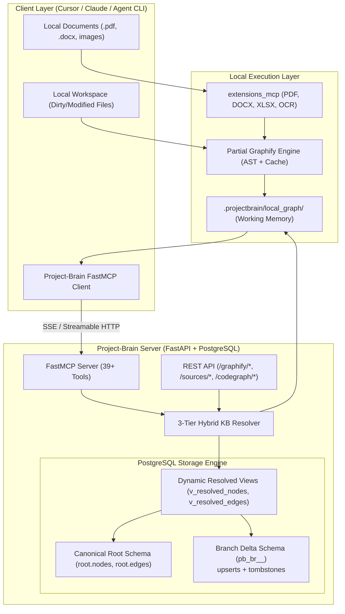
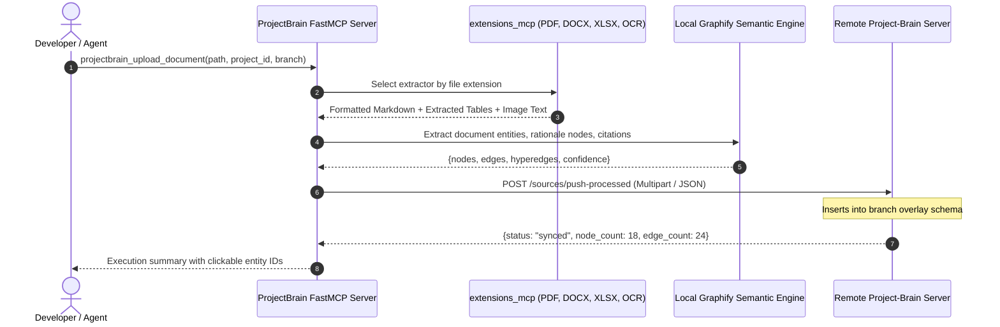
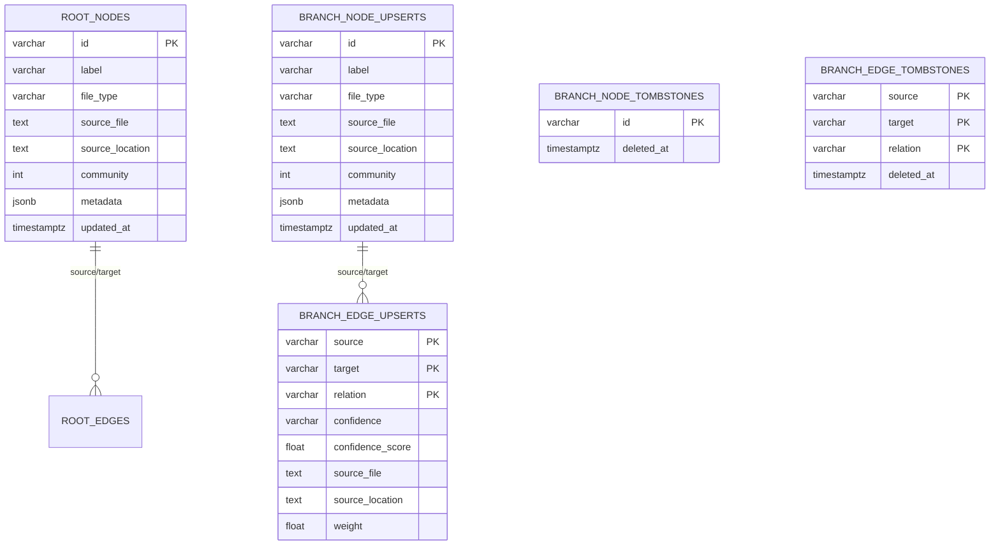
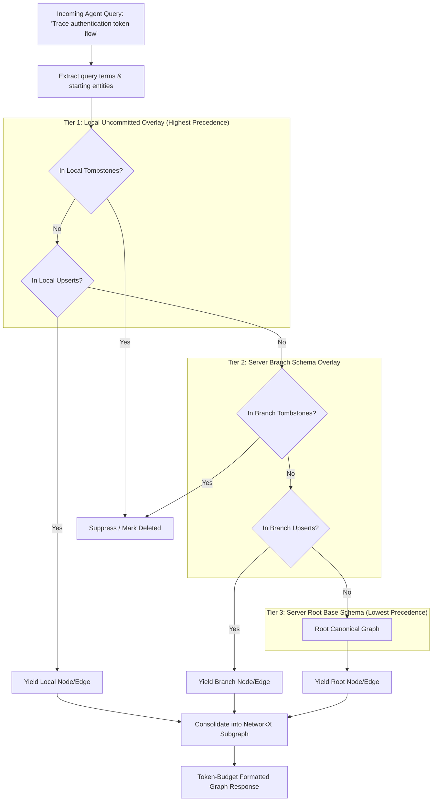

# Specification: Hybrid Graphify Cognitive Engine & Multi-Schema Knowledge Base

> **Specification ID**: `SPEC-HYBRID-GRAPHIFY-01`  
> **Target Release**: Project-Brain v1.4.0  
> **Status**: APPROVED & READY FOR ARCHITECTURE (Stage 2)  
> **Author**: Product & Specification Specialist (`spec-engineer`)  
> **Target Workspace**: `/Users/macbbook/SourceCodes/Project-Brain`  
> **Artifact Path**: `docs/specs/hybrid-graphify-brain.spec.md`

---

## 1. Executive Overview & Problem Statement

### 1.1 The Legacy Bottleneck
Project-Brain currently relies on an external, SQLite-bound `codegraph` engine (`.codegraph/codegraph.db`). While effective for basic AST symbol lookups in individual projects, this architecture imposes four critical limitations:
1. **Blind to Multimodal Artifacts**: `codegraph` only understands AST symbols from code files. It cannot parse, connect, or reason across Markdown documentation, architectural RFCs, API specifications, PDF papers, Excel financial tables, or system UI diagrams.
2. **Monolithic Project Duplication**: Syncing branch snapshots currently wipes and recreates whole database tables (`DELETE FROM project_nodes WHERE project_id = %s`), or requires duplicating whole repositories under synthetic IDs (`project:branch-a`, `project:branch-b`), incurring $O(N)$ storage and breaking relational continuity.
3. **Disconnected Document Processing**: Project-Brain contains high-performance local extraction engines in `extensions_mcp/` (`convert_pdf`, `convert_docx`, `convert_excel`, `convert_pptx`, `ocr_local`), but extracted content is dumped as raw markdown text into generic memory without extracting graph nodes, relations, or architectural citations.
4. **Lack of Local-vs-Server Awareness**: AI coding agents modifying code locally are forced to choose between querying stale server graphs or paying heavy token/compute penalties to index entire multi-million line codebases locally.

### 1.2 The Hybrid Graphify Vision
This specification defines the transformation of Project-Brain into a **Hybrid Multimodal Knowledge Engine**:
- **Graphify Unified Memory Core**: Replaces `.codegraph` with `graphifyy` (v0.3.28+), delivering zero-token Tree-sitter AST extraction across 22 programming languages combined with an epistemologically honest semantic pass (`EXTRACTED`, `INFERRED`, `AMBIGUOUS`), Leiden community clustering, god nodes, and hyperedges.
- **MCP Document Upload & Graph Entity Push**: Links local document extractors with Graphify to transform uploaded PDFs, DOCXs, and diagrams into first-class graph entities and push them directly to server branch schemas.
- **PostgreSQL Multi-Schema Overlay Engine**: Establishes a canonical `root` base schema alongside dynamic per-branch delta schemas (`pb_br_<slug>_<hash8>`) storing only upserts and tombstones. Dynamic SQL views and functions achieve $O(\Delta)$ branch diffing and instant atomic promotion.
- **3-Tier Hybrid KB Resolver**: Integrates uncommitted local working memory, server branch deltas, and the server root graph into a single unified query interface for coding agents.



---

## 2. User Stories & Persona Workflows

### US-01: AI Coding Agent Working on Feature Branches
* **As an** AI Coding Agent (e.g., Cursor, Claude Code, Antigravity Orchestrator),  
* **I want to** run a sub-second partial `graphify` extraction on only my 3 modified files and query how they connect to the rest of the 500,000-line codebase on the server,  
* **So that** I understand the downstream blast radius and interface contracts without having to index the entire repository locally or commit broken code.

### US-02: Lead Architect Auditing Branch Diffs
* **As a** Lead Software Architect,  
* **I want to** execute a branch-to-root or branch-to-branch graph diff that returns exact structural changes (new classes, modified call signatures, dropped dependencies, new hyperedges) in $< 50\text{ ms}$,  
* **So that** I can review architectural drift and verify compliance before merging a pull request.

### US-03: Product & Engineering Team Ingesting Multimodal Specs
* **As a** Product Manager or Developer,  
* **I want to** upload a 40-page Architecture PDF or a UI screenshot via MCP,  
* **So that** its text, tables, and architectural rationale are parsed into graph nodes and semantic edges connected directly to the implementing code symbols.

### US-04: Legacy Dashboard Compatibility
* **As a** Developer using the Project-Brain Glassmorphic Web Dashboard,  
* **I want** the Vis.js network visualization to render seamlessly from the new Graphify backend without changing API payloads or breaking existing `/codegraph/*` endpoints.

---

## 3. Pillar 1: Replace `codegraph` with `graphify` Engine

### 3.1 Architectural Transition
The external dependency on `.codegraph/codegraph.db` is deprecated and replaced by the integrated `graphifyy` engine:
- **Zero-Token AST Code Extraction**: Uses Tree-sitter parsers for 22 languages: Python, JavaScript, TypeScript, JSX, TSX, C, C++, C#, Java, Go, Rust, Ruby, PHP, Kotlin, Swift, Scala, Elixir, Lua, Julia, Zig, PowerShell, Objective-C.
- **Multimodal Semantic Pass**: Documents, Markdown, PDFs, and OCR texts generate semantic nodes (`file_type="document"`) and edges (`rationale_for`, `cites`, `conceptually_related_to`, `semantically_similar_to`).
- **Graph Clustering & Metrics**:
  - Community detection via Leiden (`graspologic.partition.leiden`) with fallback to Louvain (`nx.community.louvain_communities`).
  - Cohesion score: $E_{actual} / E_{possible} = \frac{2 \cdot E_{intra}}{N \cdot (N - 1)}$.
  - Automated oversized community splitting (>25% graph size, min 10 nodes).
  - Degree centrality analysis to isolate `god_nodes` (core architectural hubs).
  - Identification of `surprising_connections` (cross-community bridge edges).
- **Epistemological Confidence Scoring**:
  - `EXTRACTED` ($1.0$): Verified syntactic/structural facts (AST imports, explicit calls, direct document citations).
  - `INFERRED` ($0.40 - 0.95$): Plausible architectural relationships, shared data schemas, latent couplings.
  - `AMBIGUOUS` ($0.10 - 0.30$): Speculative links, noisy OCR extractions, flagged for human review.

### 3.2 Dual-Mode REST API & Backward Compatibility
To prevent breaking existing frontend dashboards (`Vis.js`) and legacy integrations, the server implements parallel routing:

```
[Incoming Request]
       │
       ├──► /graphify/*  ──────► Native Graphify Handler (Returns Leiden communities,
       │                         confidence scores, hyperedges, God nodes)
       │
       └──► /codegraph/* ──────► Legacy Compatibility Adapter (Translates Graphify
                                 nodes/links into legacy {project_nodes, project_edges})
```

#### Legacy Vis.js Translation Mapping:
| Graphify Node/Edge Field | Legacy Codegraph Field | Transformation Rule |
| :--- | :--- | :--- |
| `node.id` | `project_nodes.id` | Retained verbatim (`filestem_entityname`). |
| `node.label` | `project_nodes.name` | Retained verbatim. |
| `node.file_type` | `project_nodes.kind` | Mapped (`code` -> AST kind, `document` -> `"doc"`). |
| `node.source_file` | `project_nodes.file_path` | Normalized workspace-relative path. |
| `node.source_location` | `start_line` / `end_line` | Parsed from `"path:line"`. |
| `link.relation` | `project_edges.kind` | Direct translation (`calls`, `imports`, `implements`). |
| `link.confidence` | `project_edges.metadata` | Injected into JSON metadata: `{"confidence": ..., "score": ...}`. |

---

## 4. Pillar 2: MCP Document Upload, Processing & Server Push

### 4.1 End-to-End Processing Flow
Local document ingestion integrates Project-Brain's `extensions_mcp` converters with Graphify's semantic parser before streaming deltas to the server:



### 4.2 Endpoint Specifications

#### `POST /sources/push-processed`
Ingests pre-processed document text chunks and graph entity deltas:
- **Headers**: `Authorization: Bearer <token>`, `Content-Type: application/json`
- **Request Body**:
  ```json
  {
    "project_id": "ecommerce-backend",
    "branch": "feature/auth-redesign",
    "document": {
      "filename": "docs/architecture/auth_flow.pdf",
      "sha256": "8f4a1c...",
      "author": "lead-architect",
      "file_type": "paper",
      "markdown_content": "# Authentication Architecture\n\n...",
      "chunks": [
        {
          "chunk_id": "auth_flow_p1",
          "content": "...",
          "sector": "engineering",
          "tags": ["auth", "security", "jwt"]
        }
      ]
    },
    "graph_delta": {
      "nodes": [
        {
          "id": "doc_auth_flow_jwt_spec",
          "label": "JWT Specification §3.1",
          "file_type": "document",
          "source_file": "docs/architecture/auth_flow.pdf",
          "source_location": "page:3",
          "metadata": {"author": "lead-architect"}
        }
      ],
      "edges": [
        {
          "source": "doc_auth_flow_jwt_spec",
          "target": "auth_service_validate_token",
          "relation": "rationale_for",
          "confidence": "EXTRACTED",
          "confidence_score": 1.0,
          "source_file": "docs/architecture/auth_flow.pdf"
        }
      ],
      "hyperedges": []
    }
  }
  ```
- **Response (`200 OK`)**:
  ```json
  {
    "status": "success",
    "project_id": "ecommerce-backend",
    "branch": "feature/auth-redesign",
    "schema_used": "pb_br_feature_auth_redesign_a1b2c3d4",
    "nodes_upserted": 1,
    "edges_upserted": 1,
    "memories_created": 1
  }
  ```

---

## 5. Pillar 3: PostgreSQL Multi-Schema Partial Branch Diff Engine

### 5.1 Storage Model: Canonical Root + Overlay Delta Schemas
Rather than duplicating hundreds of thousands of unchanged nodes per branch, Project-Brain adopts an **Overlay Delta Schema Architecture**:
- **Root Schema (`root` or `pb_root`)**: Stores the canonical knowledge graph of the base branch (default: `"main"`).
- **Branch Schema (`pb_br_<slug>_<hash8>`)**: An isolated PostgreSQL schema created on-demand for each branch. It contains **only mutations** (upserts and tombstones) relative to the root.
- **Dynamic Resolved Views**: Dynamic SQL views in the branch schema reconstruct the full virtual graph on the fly in sub-milliseconds without data duplication.



### 5.2 Deterministic Schema Naming & PostgreSQL 63-Byte Limit
PostgreSQL strictly limits identifier names to 63 bytes (`NAMEDATALEN = 64`). Branch names in Git can be arbitrarily long (e.g., `feature/user-authentication-oauth2-migration-with-pkce-support-v2`).

#### Sanitization Algorithm:
1. Normalize: Lowercase and replace non-alphanumeric characters with underscores.
2. Hash: Compute an 8-character hex hash: `hash8 = sha256(raw_branch_name)[:8]`.
3. Truncate & Prefix:
   - Prefix: `pb_br_` (6 chars).
   - Suffix: `_` + `hash8` (9 chars).
   - Available slug budget: $63 - 6 - 9 = 48$ characters.
   - Truncated slug: `slug[:48]`.
   - Resulting Schema Name: `pb_br_{truncated_slug}_{hash8}` (guaranteed $\le 63$ bytes, unique, collision-resistant).

```python
def sanitize_branch_schema_name(branch_name: str) -> str:
    import re, hashlib
    clean_slug = re.sub(r'[^a-zA-Z0-9_]', '_', branch_name.lower()).strip('_')
    hash8 = hashlib.sha256(branch_name.encode('utf-8')).hexdigest()[:8]
    truncated_slug = clean_slug[:48].rstrip('_')
    return f"pb_br_{truncated_slug}_{hash8}"
```

### 5.3 Complete PostgreSQL DDL Specification

```sql
-- 1. Canonical Root Base Schema
CREATE SCHEMA IF NOT EXISTS pb_root;

CREATE TABLE IF NOT EXISTS pb_root.nodes (
    id VARCHAR(255) PRIMARY KEY,
    project_id VARCHAR(100) NOT NULL,
    label VARCHAR(255) NOT NULL,
    file_type VARCHAR(50) NOT NULL,
    source_file TEXT NOT NULL,
    source_location TEXT,
    community INT,
    metadata JSONB,
    created_at TIMESTAMPTZ DEFAULT NOW(),
    updated_at TIMESTAMPTZ DEFAULT NOW()
);
CREATE INDEX IF NOT EXISTS idx_pb_root_nodes_proj ON pb_root.nodes(project_id);
CREATE INDEX IF NOT EXISTS idx_pb_root_nodes_file ON pb_root.nodes(source_file);

CREATE TABLE IF NOT EXISTS pb_root.edges (
    project_id VARCHAR(100) NOT NULL,
    source VARCHAR(255) NOT NULL,
    target VARCHAR(255) NOT NULL,
    relation VARCHAR(100) NOT NULL,
    confidence VARCHAR(20) NOT NULL,
    confidence_score FLOAT NOT NULL,
    source_file TEXT,
    source_location TEXT,
    weight FLOAT DEFAULT 1.0,
    PRIMARY KEY (project_id, source, target, relation)
);
CREATE INDEX IF NOT EXISTS idx_pb_root_edges_src ON pb_root.edges(project_id, source);
CREATE INDEX IF NOT EXISTS idx_pb_root_edges_tgt ON pb_root.edges(project_id, target);

CREATE TABLE IF NOT EXISTS pb_root.hyperedges (
    id VARCHAR(255) PRIMARY KEY,
    project_id VARCHAR(100) NOT NULL,
    label VARCHAR(255) NOT NULL,
    nodes TEXT[] NOT NULL,
    relation VARCHAR(100) NOT NULL,
    confidence VARCHAR(20) NOT NULL,
    confidence_score FLOAT NOT NULL,
    source_file TEXT
);

-- Branch Registry Table (tracks active branch schemas)
CREATE TABLE IF NOT EXISTS pb_root.graph_branches (
    project_id VARCHAR(100) NOT NULL,
    branch_name VARCHAR(255) NOT NULL,
    schema_name VARCHAR(63) NOT NULL,
    base_branch VARCHAR(255) DEFAULT 'main',
    author VARCHAR(100),
    created_at TIMESTAMPTZ DEFAULT NOW(),
    updated_at TIMESTAMPTZ DEFAULT NOW(),
    PRIMARY KEY (project_id, branch_name)
);

-- 2. Per-Branch Schema Provisioning Function
CREATE OR REPLACE FUNCTION pb_create_branch_schema(
    p_project_id VARCHAR,
    p_branch_name VARCHAR,
    p_author VARCHAR DEFAULT 'system'
) RETURNS VARCHAR AS $$
DECLARE
    v_schema VARCHAR(63);
    v_clean_slug TEXT;
    v_hash8 TEXT;
BEGIN
    -- Compute sanitized 63-byte identifier
    v_clean_slug := regexp_replace(lower(p_branch_name), '[^a-z0-9_]', '_', 'g');
    v_clean_slug := trim(both '_' from v_clean_slug);
    v_clean_slug := substr(v_clean_slug, 1, 48);
    v_hash8 := substr(md5(p_branch_name), 1, 8);
    v_schema := 'pb_br_' || v_clean_slug || '_' || v_hash8;

    -- Register branch in registry
    INSERT INTO pb_root.graph_branches (project_id, branch_name, schema_name, author)
    VALUES (p_project_id, p_branch_name, v_schema, p_author)
    ON CONFLICT (project_id, branch_name) 
    DO UPDATE SET updated_at = NOW();

    -- Create schema
    EXECUTE 'CREATE SCHEMA IF NOT EXISTS ' || quote_ident(v_schema);

    -- Create overlay tables (Deltas only)
    EXECUTE 'CREATE TABLE IF NOT EXISTS ' || quote_ident(v_schema) || '.node_upserts (LIKE pb_root.nodes INCLUDING ALL)';
    EXECUTE 'CREATE TABLE IF NOT EXISTS ' || quote_ident(v_schema) || '.node_tombstones (id VARCHAR(255) PRIMARY KEY, deleted_at TIMESTAMPTZ DEFAULT NOW())';
    EXECUTE 'CREATE TABLE IF NOT EXISTS ' || quote_ident(v_schema) || '.edge_upserts (LIKE pb_root.edges INCLUDING ALL)';
    EXECUTE 'CREATE TABLE IF NOT EXISTS ' || quote_ident(v_schema) || '.edge_tombstones (project_id VARCHAR(100), source VARCHAR(255), target VARCHAR(255), relation VARCHAR(100), PRIMARY KEY(project_id, source, target, relation))';
    EXECUTE 'CREATE TABLE IF NOT EXISTS ' || quote_ident(v_schema) || '.hyperedge_upserts (LIKE pb_root.hyperedges INCLUDING ALL)';
    EXECUTE 'CREATE TABLE IF NOT EXISTS ' || quote_ident(v_schema) || '.hyperedge_tombstones (id VARCHAR(255) PRIMARY KEY, deleted_at TIMESTAMPTZ DEFAULT NOW())';
    EXECUTE 'CREATE TABLE IF NOT EXISTS ' || quote_ident(v_schema) || '.synced_files (file_path TEXT PRIMARY KEY, sha256 VARCHAR(64), synced_at TIMESTAMPTZ DEFAULT NOW())';

    -- Dynamic Resolved Views (Fast Virtual Merge)
    EXECUTE 'CREATE OR REPLACE VIEW ' || quote_ident(v_schema) || '.v_resolved_nodes AS
        SELECT * FROM ' || quote_ident(v_schema) || '.node_upserts
        UNION ALL
        SELECT r.* FROM pb_root.nodes r
        WHERE r.project_id = ' || quote_literal(p_project_id) || '
          AND r.id NOT IN (SELECT id FROM ' || quote_ident(v_schema) || '.node_tombstones)
          AND r.id NOT IN (SELECT id FROM ' || quote_ident(v_schema) || '.node_upserts)';

    EXECUTE 'CREATE OR REPLACE VIEW ' || quote_ident(v_schema) || '.v_resolved_edges AS
        SELECT * FROM ' || quote_ident(v_schema) || '.edge_upserts
        UNION ALL
        SELECT r.* FROM pb_root.edges r
        WHERE r.project_id = ' || quote_literal(p_project_id) || '
          AND (r.project_id, r.source, r.target, r.relation) NOT IN (SELECT project_id, source, target, relation FROM ' || quote_ident(v_schema) || '.edge_tombstones)
          AND (r.project_id, r.source, r.target, r.relation) NOT IN (SELECT project_id, source, target, relation FROM ' || quote_ident(v_schema) || '.edge_upserts)';

    RETURN v_schema;
END;
$$ LANGUAGE plpgsql;
```

### 5.4 $O(\Delta)$ Partial Graph Diff & Merge Algorithms

#### 1. Branch-to-Root Diff ($O(\Delta)$ Complexity)
Does **zero table scans** of the canonical root schema. It inspects solely the branch's delta tables:
```sql
CREATE OR REPLACE FUNCTION pb_diff_branch_vs_root(
    p_project_id VARCHAR,
    p_branch_name VARCHAR
) RETURNS JSONB AS $$
DECLARE
    v_schema VARCHAR(63);
    v_result JSONB;
BEGIN
    SELECT schema_name INTO v_schema 
    FROM pb_root.graph_branches 
    WHERE project_id = p_project_id AND branch_name = p_branch_name;

    IF v_schema IS NULL THEN
        RAISE EXCEPTION 'Branch % not found for project %', p_branch_name, p_project_id;
    END IF;

    EXECUTE 'SELECT json_build_object(
        ''summary'', json_build_object(
            ''new_nodes_count'', (SELECT count(*) FROM ' || quote_ident(v_schema) || '.node_upserts u WHERE u.id NOT IN (SELECT id FROM pb_root.nodes WHERE project_id = ' || quote_literal(p_project_id) || ')),
            ''modified_nodes_count'', (SELECT count(*) FROM ' || quote_ident(v_schema) || '.node_upserts u WHERE u.id IN (SELECT id FROM pb_root.nodes WHERE project_id = ' || quote_literal(p_project_id) || ')),
            ''deleted_nodes_count'', (SELECT count(*) FROM ' || quote_ident(v_schema) || '.node_tombstones),
            ''new_edges_count'', (SELECT count(*) FROM ' || quote_ident(v_schema) || '.edge_upserts e WHERE (e.project_id, e.source, e.target, e.relation) NOT IN (SELECT project_id, source, target, relation FROM pb_root.edges WHERE project_id = ' || quote_literal(p_project_id) || ')),
            ''deleted_edges_count'', (SELECT count(*) FROM ' || quote_ident(v_schema) || '.edge_tombstones)
        ),
        ''new_nodes'', COALESCE((SELECT json_agg(u) FROM ' || quote_ident(v_schema) || '.node_upserts u WHERE u.id NOT IN (SELECT id FROM pb_root.nodes WHERE project_id = ' || quote_literal(p_project_id) || ')), ''[]''::json),
        ''modified_nodes'', COALESCE((SELECT json_agg(u) FROM ' || quote_ident(v_schema) || '.node_upserts u WHERE u.id IN (SELECT id FROM pb_root.nodes WHERE project_id = ' || quote_literal(p_project_id) || ')), ''[]''::json),
        ''deleted_node_ids'', COALESCE((SELECT json_agg(id) FROM ' || quote_ident(v_schema) || '.node_tombstones), ''[]''::json),
        ''new_edges'', COALESCE((SELECT json_agg(e) FROM ' || quote_ident(v_schema) || '.edge_upserts e WHERE (e.project_id, e.source, e.target, e.relation) NOT IN (SELECT project_id, source, target, relation FROM pb_root.edges WHERE project_id = ' || quote_literal(p_project_id) || ')), ''[]''::json),
        ''deleted_edges'', COALESCE((SELECT json_agg(e) FROM ' || quote_ident(v_schema) || '.edge_tombstones e), ''[]''::json)
    )' INTO v_result;

    RETURN v_result;
END;
$$ LANGUAGE plpgsql;
```

#### 2. Branch-A vs. Branch-B Diff ($O(\Delta_A \cup \Delta_B)$ Complexity)
Compares only entities present in either branch's overlay tables. Untouched base root entities are skipped entirely.

#### 3. Atomic Promotion / Merge (`pb_promote_branch_to_root`)
Executes inside a single ACID database transaction:
1. Delete root nodes matching `node_tombstones`.
2. Upsert root nodes from `node_upserts` (`ON CONFLICT (id) DO UPDATE`).
3. Delete root edges matching `edge_tombstones`.
4. Upsert root edges from `edge_upserts` (`ON CONFLICT (project_id, source, target, relation) DO UPDATE`).
5. Upsert root hyperedges.
6. Drop the branch overlay schema `DROP SCHEMA pb_br_... CASCADE`.
7. Remove branch entry from `pb_root.graph_branches`.

### 5.5 SQLite Overlay Fallback Specification
For local developer runs and unit tests (`tests/`) where PostgreSQL is not available, Project-Brain provides a unified Python `GraphStore` interface backed by SQLite:
- Single SQLite DB file: `projectbrain.db`.
- Root tables: `root_nodes`, `root_edges`, `root_hyperedges`.
- Branch tables dynamically prefixed: `br_{hash8}_node_upserts`, `br_{hash8}_node_tombstones`, etc.
- Emulates the exact same dynamic view queries and diff outputs via SQLite Common Table Expressions (CTEs), guaranteeing 100% test suite determinism offline.

---

## 6. Pillar 4: Partial Local `graphify` + Local-vs-Server Hybrid Knowledge Base

### 6.1 Scoped Local Execution
Coding agents working on a local workspace execute partial Graphify extractions:
```bash
# Partial run on specific directory or dirty git files
python -m projectbrain.main graphify-extract --path src/auth --output .projectbrain/local_graph/
```
- **AST Pass**: Parses only files in `src/auth/` using Tree-sitter.
- **Cache Hit Optimization**: Unmodified files pull straight from `graphify-out/cache/{sha256}.json`.
- **Output Artifact**: `.projectbrain/local_graph/partial_graph.json` containing only the localized subgraph fragment $G_{local}$.

### 6.2 3-Tier Hybrid KB Query Resolver Algorithm
When an AI agent queries the knowledge base via `projectbrain_hybrid_query(query, project_id, branch)`:



#### Resolution Logic Rules:
1. **Tombstone Suppression**: If an entity ID is in local tombstones, it is completely hidden from the query response even if it exists in the server branch or root schemas.
2. **Local Precedence**: Local uncommitted node attributes (`signature`, `docstring`, `source_location`) override server branch and root definitions.
3. **Branch Precedence**: Server branch upserts take precedence over root base schemas.
4. **Transparent Traversal**: BFS/DFS hops navigate across layers seamlessly. A local uncommitted class can connect to a server root database repository over an extracted edge.

---

## 7. FastMCP & REST API Tool Contracts

### 7.1 FastMCP Tools Specification (39 Tools Total)

#### 1. `projectbrain_upload_document` (New)
* **Description**: "Upload and process a local document (.pdf, .docx, .xlsx, .pptx, .md, images), extract structured text and Graphify entities, and push to ProjectBrain server."
* **Parameters**:
  - `file_path` (string, required): Absolute or workspace-relative path to local document.
  - `project_id` (string, required): Target Project-Brain project identifier.
  - `branch` (string, optional, default `"main"`): Target branch overlay.
  - `author` (string, optional): Author identifier.
* **Return**: JSON summary with created memory ID, node count, edge count, and community assignments.

#### 2. `projectbrain_push_processed_document` (New)
* **Description**: "Push pre-extracted text chunks and Graphify graph deltas directly to the ProjectBrain server."
* **Parameters**:
  - `project_id` (string, required): Project identifier.
  - `branch` (string, required): Branch identifier.
  - `document_payload` (object, required): `{filename, sha256, chunks, author}`.
  - `graph_delta` (object, required): `{nodes, edges, hyperedges}`.
* **Return**: Server confirmation object `{status, schema_used, nodes_upserted, edges_upserted}`.

#### 3. `projectbrain_sync_graphify` (New)
* **Description**: "Execute full or partial Graphify extraction on local workspace files and synchronize nodes, edges, communities, and hyperedges to ProjectBrain."
* **Parameters**:
  - `project_id` (string, required): Project identifier.
  - `project_path` (string, optional): Path to project root (defaults to CWD).
  - `branch` (string, optional): Branch name (auto-detects git branch if omitted).
  - `scoped_paths` (array of strings, optional): Limit extraction to specific subfolders or files.
  - `author` (string, optional): Sync author.
* **Return**: Markdown summary detailing added/modified/deleted symbols, Leiden clusters, and god nodes.

#### 4. `projectbrain_query_graphify` (New)
* **Description**: "Query Graphify knowledge graph supporting BFS, DFS, community filtering, and confidence score thresholds."
* **Parameters**:
  - `project_id` (string, required): Project identifier.
  - `query` (string, required): Natural language question or symbol name.
  - `branch` (string, optional, default `"main"`): Branch scope.
  - `mode` (string, optional, enum `["bfs", "dfs"]`, default `"bfs"`): Traversal mode.
  - `min_confidence` (string, optional, enum `["EXTRACTED", "INFERRED", "AMBIGUOUS"]`, default `"INFERRED"`).
  - `budget` (integer, optional, default `2000`): Maximum token budget.
* **Return**: Formatted text subgraph with node signatures, community IDs, and citation links.

#### 5. `projectbrain_local_graphify_diff` (New)
* **Description**: "Compare local uncommitted Graphify graph against the server branch or root subgraph without pushing changes."
* **Parameters**:
  - `project_id` (string, required): Project identifier.
  - `branch` (string, optional, default `"main"`): Remote branch to diff against.
  - `local_graph_path` (string, optional, default `".projectbrain/local_graph/partial_graph.json"`).
* **Return**: Structural diff summary `{new_nodes, modified_nodes, removed_nodes, new_edges, summary}`.

#### 6. `projectbrain_hybrid_query` (New)
* **Description**: "Query the 3-tier Hybrid Knowledge Base (Local Overlay -> Server Branch -> Server Root) for unified context."
* **Parameters**:
  - `project_id` (string, required): Project identifier.
  - `query` (string, required): Question or architectural tracing task.
  - `branch` (string, optional, default `"main"`): Target server branch.
  - `local_overlay_path` (string, optional): Path to local partial graph.
  - `budget` (integer, optional, default `2500`): Token budget.
* **Return**: Synthesized graph context highlighting local uncommitted entities vs server records.

#### 7. Upgraded Backward-Compatible Tools
- `projectbrain_sync_codegraph`: Retained with identical signature. Internally forwards to `projectbrain_sync_graphify` if `.codegraph` is missing or if Graphify is enabled.
- `projectbrain_query_codegraph`: Retained with identical signature. Backed by Graphify's NetworkX engine.
- `projectbrain_diff_project_versions`: Upgraded to leverage $O(\Delta)$ PostgreSQL branch diffs when comparing branches of the same project.

---

### 7.2 REST API Routes Specification

| Route Path | Method | Purpose | Payload / Query Params |
| :--- | :--- | :--- | :--- |
| `/graphify/sync` | `POST` | Ingest Graphify JSON payload | `{project_id, branch, nodes, links, hyperedges, author}` |
| `/graphify/query` | `POST` | Query graph with BFS/DFS | `{project_id, branch, query, mode, budget, min_confidence}` |
| `/graphify/diff` | `GET` | $O(\Delta)$ branch diff | `?project_id=X&base=main&target=feature-1&filter_prefix=src/` |
| `/graphify/promote` | `POST` | Atomic merge of branch to root | `{project_id, branch, target_base="main"}` |
| `/graphify/subgraph`| `GET` | Retrieve scoped file subgraph | `?project_id=X&branch=Y&files=file1.py,file2.py` |
| `/sources/push-processed` | `POST` | Ingest doc chunks + graph delta | `{project_id, branch, document, graph_delta}` |
| `/sources/upload` | `POST` | Multipart upload + auto-graph | `file, project_id, branch, tags, author` |
| `/codegraph/sync` | `POST` | Legacy sync alias | Automatically maps to `/graphify/sync` |
| `/codegraph/data` | `GET` | Legacy Vis.js visualizer | Formats Graphify graph into `{nodes, edges}` for Vis.js |

---

## 8. CLI Command Contracts (`main.py`)

The primary CLI interface (`src/projectbrain/main.py`) exposes new subcommands:

1. **`graphify-sync`**:
   ```bash
   python -m projectbrain.main graphify-sync <project_id> [url] [project_path] [branch] [--scoped <dirs>] [--author <name>]
   ```
   Executes local Graphify extraction (AST + semantic) and streams nodes/links to `/graphify/sync`.

2. **`graphify-diff`**:
   ```bash
   python -m projectbrain.main graphify-diff <project_id> <target_branch> [base_branch] [--local]
   ```
   Displays formatted console tree diff between two branches or between local dirty files and the server.

3. **`upload-doc`**:
   ```bash
   python -m projectbrain.main upload-doc <project_id> <file_path> [branch] [--author <name>]
   ```
   Processes local file via `extensions_mcp` + Graphify and pushes to `/sources/push-processed`.

---

## 9. Edge-Case Matrix & Failure Modes

| Edge Case / Failure Mode | Risk Severity | Architectural Mitigation & Handling |
| :--- | :--- | :--- |
| **Branch name exceeds 63 bytes** | **High** | Sanitized via `pb_br_{slug[:48]}_{hash8}`. Collision-free, conforms to PG `NAMEDATALEN`. |
| **SQL Injection via branch slug** | **Critical** | All schema and table references dynamically constructed using `quote_ident()` and parameterized queries (`%s`). Zero raw string concatenation. |
| **Deleted files (Ghost Nodes)** | **Medium** | Incremental AST detects file deletion -> automatically adds deleted node IDs into `node_tombstones` and `edge_tombstones`, suppressing them from resolved views. |
| **Offline / No PostgreSQL Server** | **Medium** | Transparent fallback to SQLite CTE overlay implementation (`projectbrain.db`). Guarantees test suite determinism. |
| **Dangling Edges (External Imports)** | **Low** | External modules (e.g., `import os`, `import torch`) are retained as external references but pruned during community cohesion scoring unless explicitly resolved. |
| **Concurrent Branch Merge Conflicts** | **Medium** | Merging branch to root runs within `BEGIN ... COMMIT` with `SELECT ... FOR UPDATE` on `graph_branches`. Last write wins with timestamp auditing. |
| **Vis.js Memory Overload (>5,000 nodes)** | **Medium** | `/codegraph/data` defaults to returning top 500 nodes by degree centrality and Leiden community clusters unless `limit=all` is explicitly passed. |

---

## 10. Acceptance Criteria (AC-01 through AC-15)

- [ ] **`AC-01: Graphify Engine AST Extraction`**: Executing Graphify extraction on a repository with Python, TypeScript, and Go files produces deterministic nodes, call edges, and import edges with `confidence: "EXTRACTED"` and `confidence_score: 1.0` in $< 3\text{ seconds}$ without making LLM calls.
- [ ] **`AC-02: Incremental SHA256 Caching`**: Re-running Graphify on an unchanged workspace results in a $100\%$ cache hit rate. Modifying only YAML frontmatter on `.md` files does not trigger AST or semantic re-extraction.
- [ ] **`AC-03: Multimodal Document Extraction`**: Processing a PDF or DOCX file creates document nodes (`file_type="document"`), rationale nodes (`relation="rationale_for"`), and citation edges linked to existing code symbols.
- [ ] **`AC-04: Leiden Community Partitioning`**: Graphify partitions connected graphs into deterministic community IDs ($0$ = largest). Communities exceeding $25\%$ total graph nodes are recursively split.
- [ ] **`AC-05: MCP Document Upload Tool`**: Invoking `projectbrain_upload_document` on a local file converts the file to Markdown, extracts Graphify entities, and pushes payload to `/sources/push-processed`.
- [ ] **`AC-06: 63-Byte PostgreSQL Schema Isolation`**: Creating a branch schema for a 100-character branch name produces a valid PostgreSQL schema name $\le 63$ characters matching pattern `pb_br_*_*`.
- [ ] **`AC-07: SQL Injection Resistance`**: Branch names containing quotes or SQL syntax (e.g. `feature'; DROP TABLE users;--`) are strictly escaped without syntax errors or injection execution.
- [ ] **`AC-08: O(\Delta) Branch-to-Root Diff`**: Calling `pb_diff_branch_vs_root` on a branch with 10 modified files executes in $< 25\text{ ms}$ and does not scan untouched root records.
- [ ] **`AC-09: Branch-to-Branch Partial Diff`**: Calling `/graphify/diff?base=feature-a&target=feature-b` returns precise added/modified/deleted entities comparing only the overlay tables.
- [ ] **`AC-10: Atomic Branch Promotion`**: Calling `/graphify/promote` updates `pb_root.nodes` and `pb_root.edges`, deletes tombstones, drops the branch schema, and deregisters the branch in a single transaction.
- [ ] **`AC-11: SQLite Overlay Fallback`**: Running all branch diff and overlay operations under `OM_METADATA_BACKEND=sqlite` passes $100\%$ of test assertions without requiring PostgreSQL.
- [ ] **`AC-12: Local Partial Graphify Run`**: Running partial Graphify extraction on a single directory generates `.projectbrain/local_graph/partial_graph.json` containing only scoped entities.
- [ ] **`AC-13: 3-Tier Hybrid KB Resolution`**: Calling `projectbrain_hybrid_query` returns context where local uncommitted modifications override server branch records, which in turn override root base records.
- [ ] **`AC-14: Tombstone Suppression`**: Deleting an entity locally or in a branch schema ensures that entity is omitted from hybrid query traversal results even if present in the canonical root schema.
- [ ] **`AC-15: Web Dashboard Vis.js Compatibility`**: Accessing `/codegraph/data` returns valid JSON consumed by the existing Vis.js Glassmorphic UI without console errors or layout crashes.

---

*Authored by Product / Spec Specialist (`spec-engineer`)*  
*Approved for Architecture Stage (TASK-03)*
