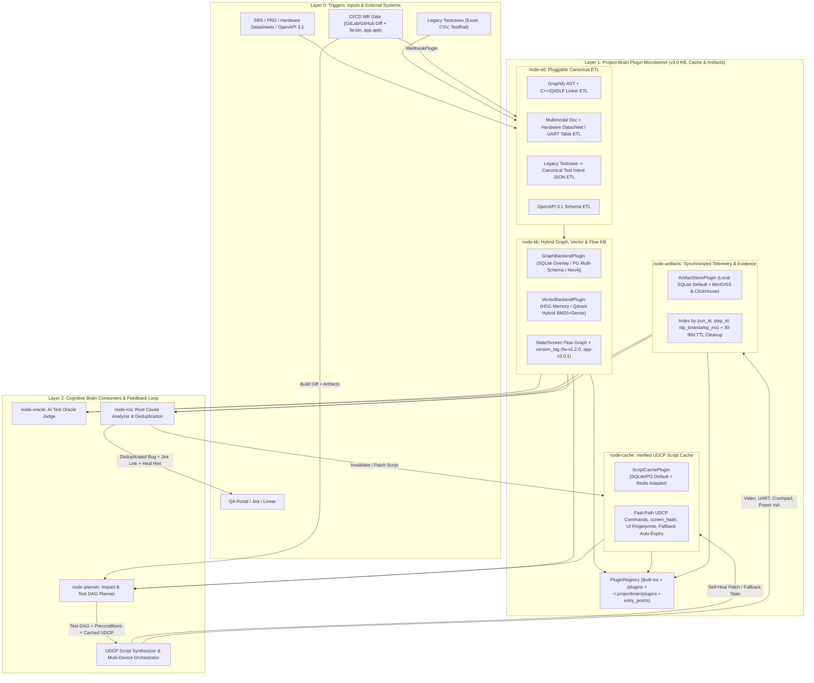

# Specification: Project-Brain v3.0 Testing Knowledge Base Gap Audit & 100% Plugin Architecture

> **Specification ID**: `SPEC-V3-TESTING-KB-AUDIT-01`  
> **Target Release**: Project-Brain v3.0.0  
> **Baseline Audited**: Project-Brain v1.5 (`pyproject.toml` v1.4.0 / Server `1.2.2` + Unified Code-Doc KB & Branch Delta / Doc Versioning)  
> **Status**: APPROVED FOR ARCHITECTURE & IMPLEMENTATION (Stage 2)  
> **Author**: Fleet Architecture & Specification Specialist (`task-planner`)  
> **Workspace Root**: `/Users/macbbook/SourceCodes/Project-Brain`  
> **Artifact Path**: `docs/specs/v3-testing-kb-gap-audit.spec.md`

---

## 1. Executive Summary & Architectural Mandate

This specification audits **Project-Brain** against the **v3.0 Unified System Architecture — AI Multi-Device & Embedded Testing** blueprint, where Project-Brain serves as **Layer 1 (Knowledge Base, Verified UDCP Script Cache & Telemetry/Artifact Store)** bridging **Layer 0** (SRS/PRD/Datasheets/Legacy Testcases, CI/CD MR Quality Gate, QA Portal, Jira) and **Layer 2** (Impact & Test DAG Planner, Multi-Device Orchestrator, UDCP Script Synthesizer, AI Test Oracle Judge, Root Cause Analyzer RCA).

Two explicit mandates govern this v3.0 evolution:
1. **Complete Testing Knowledge Base Coverage**: Audit and close every structural, ingestion, caching, telemetry, and reasoning gap required for Project-Brain to power multi-device (Android, iOS, Web, Desktop/Qt) and embedded hardware/firmware (STM32/ESP32/C++/RTOS/UART/Power) automated testing end-to-end.
2. **100% Plugin-Driven Microkernel ("Mọi thứ đều là plugin thay vì cố định cứng")**: Eliminate hardcoded `if/else` factories, monolithic extractors, fixed storage backends, and static source maps. Transform every storage engine, vector database, ETL parser, code-doc-flow linker, exporter, script cache, artifact/telemetry store, Layer 2 brain consumer, and Layer 0 webhook into a dynamically discovered, hot-swappable, per-project configurable plugin while preserving 100% backward compatibility with all existing APIs and the 228 collected baseline tests.

---

## 2. Current Codebase Inspection Findings (Project-Brain v1.5 Baseline)

Direct inspection of `src/` and `extensions_mcp/` reveals strong foundations (hybrid AST/document graphify engine, branch delta overlay schemas, pre-OCR document unit versioning, HSG cognitive memory, FastMCP server, and 228 collected pytest tests), alongside critical hardcoded wiring and missing Layer 1/Layer 2 subsystems:

| File Inspected | Current Implementation Reality | Architectural Constraint / Hardcoding |
| :--- | :--- | :--- |
| [`src/projectbrain/graphify_engine/store.py`](file:///Users/macbbook/SourceCodes/Project-Brain/src/projectbrain/graphify_engine/store.py#L3673-L3714) | `get_graph_store()` switches strictly between `PostgresSchemaGraphStore` and `SqliteOverlayGraphStore`. | Hardcoded `if backend_val in ("postgres", "postgresql") ... else ...`; no plugin lookup, no Neo4j adapter, no `version_tag` query axis. |
| [`src/projectbrain/graphify_engine/models.py`](file:///Users/macbbook/SourceCodes/Project-Brain/src/projectbrain/graphify_engine/models.py#L33-L96) | `GraphNode`, `GraphEdge`, `GraphHyperedge`, `GraphDelta` capture `project_id`, `branch`, `file_type`. | Missing `version_tag` (`fw-v1.2.0`, `app-v3.0.1`), `STATE_NODE`/`SCREEN_NODE`/`TRANSITION_EDGE` flow schemas, and canonical test intent models. |
| [`src/projectbrain/core/vector_store.py`](file:///Users/macbbook/SourceCodes/Project-Brain/src/projectbrain/core/vector_store.py#L110-L128) | `get_vector_store()` returns `SQLiteVectorStore`, `PostgresVectorStore`, or `ValkeyVectorStore`. | Hardcoded `if/elif` switch on `PROJECTBRAIN_VECTOR_STORE`; no Qdrant hybrid (BM25 + Dense) plugin, no generic `VectorBackendPlugin` registry. |
| [`src/projectbrain/memory/embed.py`](file:///Users/macbbook/SourceCodes/Project-Brain/src/projectbrain/memory/embed.py#L24-L43) | `emb_dispatch()` dispatches `synthetic`, `openai`, `ollama`, `gemini`, `aws`, `minimax`. | Hardcoded `if` ladder on provider string; adding an embedding model requires editing core module code. |
| [`src/projectbrain/graphify_engine/extractor.py`](file:///Users/macbbook/SourceCodes/Project-Brain/src/projectbrain/graphify_engine/extractor.py#L104-L324) | `GraphifyExtractor` runs `graphify.extract` (with Python `ast` fallback) and Markdown section/backtick/table extraction. | Fixed `CODE_EXTENSIONS` / `DOC_EXTENSIONS`; lacks embedded C/C++/Qt/ELF linker rules, UART/AT error tables, OpenAPI 3.1, and state flow extraction. |
| [`src/projectbrain/graphify_engine/doc_pipeline.py`](file:///Users/macbbook/SourceCodes/Project-Brain/src/projectbrain/graphify_engine/doc_pipeline.py#L145-L216) | `DocumentPipeline` routes `.md`/`.csv`/images/Office/PDF through `doc_parser` and `GraphifyExtractor`. | Monolithic pipeline directly instantiates `GraphifyExtractor()`; CSVs become generic Markdown tables instead of structured Canonical Test Intent JSON or Error Code rules. |
| [`src/projectbrain/graphify_engine/kb_linker.py`](file:///Users/macbbook/SourceCodes/Project-Brain/src/projectbrain/graphify_engine/kb_linker.py#L148-L1603) | `CodeDocLinker` & `UnifiedKBBuilder` link Python AST symbols (`ast.parse` in symbol index) to Markdown chunks and pytest files. | Hardcodes `GraphifyExtractor`, `DocumentPipeline`, `ProjectDocSynthesizer`, `add_hsg_memory`, and SQLite/PG `waypoints`; symbol indexer parses only Python `.py` ASTs. |
| [`src/projectbrain/graphify_engine/doc_synthesizer.py`](file:///Users/macbbook/SourceCodes/Project-Brain/src/projectbrain/graphify_engine/doc_synthesizer.py#L136-L520) | `WorkspaceASTIntrospector` scans `.py` AST + `.sql` migrations; `ProjectDocSynthesizer` writes Wiki, DOCX, XLSX, PPTX. | Exporters are hardcoded methods on one class rather than pluggable `DocExporterPlugin` strategies. |
| [`src/projectbrain/graphify_engine/hybrid_resolver.py`](file:///Users/macbbook/SourceCodes/Project-Brain/src/projectbrain/graphify_engine/hybrid_resolver.py#L153-L280) | 3-tier merge (local dirty, branch overlay, root) via `get_graph_store()`. | No `version_tag` scoping, no state-transition blast radius traversal, no test DAG planning support. |
| [`extensions_mcp/loader.py`](file:///Users/macbbook/SourceCodes/Project-Brain/extensions_mcp/loader.py#L12-L102) | Scans sibling directories under `extensions_mcp/` for `extension.json` + FastMCP `mcp` object. | Only loads FastMCP tools at startup; no storage/ETL/cache/artifact/brain contracts, no `entry_points`, no `~/.projectbrain/plugins`, no per-project config or hot-reload. |
| [`src/projectbrain/core/config.py`](file:///Users/macbbook/SourceCodes/Project-Brain/src/projectbrain/core/config.py#L92-L201) | `EnvConfig` loads `.env` and `projectbrain.toml` with fixed DB/AI/decay fields. | No `[plugins]` config section, no enable/disable lists, no external plugin paths. |
| [`src/projectbrain/core/db.py`](file:///Users/macbbook/SourceCodes/Project-Brain/src/projectbrain/core/db.py#L15-L160) | `DB` executes SQLite/PostgreSQL queries; `translate_query()` rewrites `?` and `INSERT OR REPLACE` for a fixed whitelist of 8 tables. | New plugin tables must use standard ANSI `INSERT ... ON CONFLICT ... DO UPDATE` SQL (or dedicated backend plugins) rather than relying on the legacy `translate_query()` whitelist. |
| [`src/projectbrain/server/routes/sources.py`](file:///Users/macbbook/SourceCodes/Project-Brain/src/projectbrain/server/routes/sources.py#L379-L482) | Lists 7 fixed connectors and handles `/webhook/github` + `/webhook/notion`. | Hardcoded `source_map` dictionary and ad-hoc webhook routes; missing CI/CD MR + `.bin`/`.apk` build webhooks and TestRail/Jira sync webhooks. |
| [`src/projectbrain/server/api.py`](file:///Users/macbbook/SourceCodes/Project-Brain/src/projectbrain/server/api.py#L19-L73) & [`ai/mcp.py`](file:///Users/macbbook/SourceCodes/Project-Brain/src/projectbrain/ai/mcp.py#L2271-L2284) & [`main.py`](file:///Users/macbbook/SourceCodes/Project-Brain/src/projectbrain/main.py#L853-L1015) | Static router mounts, RBAC keyword lists, static `@mcp_server.tool` functions, static CLI `if/elif` dispatcher. | Requires plugin routes (`/plugins/*`, `/v3/*`), RBAC read/write rules, FastMCP v3 tools, and CLI subcommands. |

---

## 3. v3.0 Gap Matrix (Current v1.5 vs 5-Layer Target Architecture)

| Gap ID | Blueprint Node / Layer | Current Project-Brain (v1.5) | Target v3.0 Requirement | Severity | Target Plugin Abstraction |
| :--- | :--- | :--- | :--- | :--- | :--- |
| **`GAP-01`** | **Cross-Cutting Microkernel** | Hardcoded `if/else` factories (`get_graph_store`, `get_vector_store`, `emb_dispatch`), monolithic `UnifiedKBBuilder`/`ProjectDocSynthesizer`, MCP-only `extensions_mcp/loader.py`. | 100% plugin-driven `PluginRegistry` supporting built-ins, `./plugins`, `~/.projectbrain/plugins`, `entry_points`, YAML/TOML/env config, per-project enable/disable, hot-reload, health checks. | **Critical** | `BasePlugin`, `PluginManifest`, `PluginRegistry` |
| **`GAP-02`** | **Layer 1 `node-etl`** | Parses source ASTs (primarily Python + graphify) and generic Markdown/Office text chunks (`doc_pipeline.py`). | Canonical ETL for Legacy Excel/CSV/TestRail testcases -> Device-Independent Canonical Test Intent JSON; Hardware Datasheets / UART & AT Error Code Tables; OpenAPI 3.1; C++ Embedded `.h`/`.hpp`/`.cpp`/Qt `.ui`/ELF `.ld`/`.map`. | **Critical** | `ETLParserPlugin` (`etl.legacy_testcase`, `etl.hardware_datasheet`, `etl.openapi31`, `etl.cpp_embedded`, etc.) |
| **`GAP-03`** | **Layer 1 `node-kb` (Flow & Versioning)** | Graph models scoped only by `(project_id, branch)`; no screen/state flow graph primitives. | Explicit `STATE_NODE`, `SCREEN_NODE`, `TRANSITION_EDGE` (`trigger_action`, `guard_condition`, `expected_signals` like `BOOT_OK` -> `PAIRED_EVENT`) + multi-dimensional `version_tag` (`fw-v1.2.0`, `app-v3.0.1`). | **Critical** | `KnowledgeLinkerPlugin` (`linker.state_flow`, `linker.code_doc`) |
| **`GAP-04`** | **Layer 1 `node-kb` (External Stores)** | Only SQLite overlay, PG multi-schema, PGVector, Valkey/SQLite vectors via fixed branches. | First-class pluggable `GraphBackendPlugin` & `VectorBackendPlugin` preserving built-in defaults (`sqlite_overlay`, `postgres_schema`, `hsg_memory`) while adding drop-in `neo4j_graph` & `qdrant_vector` (Hybrid BM25+Dense) adapters with offline-safe mockable transports. | **High** | `GraphBackendPlugin`, `VectorBackendPlugin` |
| **`GAP-05`** | **Layer 1 `node-cache`** | **Completely absent.** | Verified UDCP Script Cache & UI Fingerprint Store storing compiled fast-path UDCP command sequences, `screen_hash`, UI/OpenCV template fingerprints, `build_version`, hit/fallback telemetry, auto-invalidation when `fallback_rate > threshold`, and self-heal history. | **Critical** | `ScriptCachePlugin` (`cache.sqlite_pg`, `cache.redis`) |
| **`GAP-06`** | **Layer 1 `node-artifacts`** | **Completely absent.** | Synchronized Telemetry & Evidence Index Store indexing H.264 video, HAR/Pcap, C++ Crashpad `.dmp`, GDB/ARM HardFault stacktraces, UART boot logs, and Power traces (mA) by `(run_id, step_id, ntp_timestamp_ms)` with 30–90 day TTL purge. | **Critical** | `ArtifactStorePlugin` (`artifacts.local_sqlite`, `artifacts.minio_clickhouse`) |
| **`GAP-07`** | **Layer 1 <-> Layer 2 Brain Contracts** | **Completely absent.** Only generic RAG `hsg_query`, `hybrid_query`, and `trace_code_and_docs`. | Pluggable Brain Consumer engines: (1) `node-planner` Impact & Multi-Device Test DAG Planner (with precondition injection like `flash_firmware`), (2) `node-oracle` Test Oracle Criteria & Error Rule Judge, (3) `node-rca` Crash/HardFault deduplication, Jira linking & self-heal feedback. | **Critical** | `BrainConsumerPlugin` (`brain.planner`, `brain.oracle`, `brain.rca`) |
| **`GAP-08`** | **Layer 0 Connectors & Webhooks** | Hardcoded 7-item `source_map`, `/webhook/github` (text dump), `/webhook/notion`. | Pluggable `WebhookPlugin` & `SourceConnectorPlugin` handling GitLab/GitHub MR Diff + `.bin`/`.apk` build metadata webhooks, TestRail/Jira spec change webhooks, plus wrapped legacy connectors. | **High** | `WebhookPlugin`, `SourceConnectorPlugin` |

---

## 4. Deep-Dive Audit by Gap Dimension

### 4.1 `GAP-01`: Hardcoded Monolithic Wiring vs True Plugin Microkernel
- **Current Deficit**: Capabilities are tightly bound inside factory functions and orchestrator constructors. For example, [`UnifiedKBBuilder.build_unified_kb()`](file:///Users/macbbook/SourceCodes/Project-Brain/src/projectbrain/graphify_engine/kb_linker.py#L1245-L1372) instantiates `GraphifyExtractor()`, `ProjectDocSynthesizer()`, `DocumentPipeline()`, and `add_hsg_memory()` directly. [`extensions_mcp/loader.py`](file:///Users/macbbook/SourceCodes/Project-Brain/extensions_mcp/loader.py#L12-L102) only attaches FastMCP tool decorators from `extensions_mcp/*`.
- **Target v3.0 Design**:
  - Introduce `src/projectbrain/plugins/` microkernel with `PluginManifest`, `PluginMetadata`, `BasePlugin`, and `PluginRegistry`.
  - **Multi-Source Discovery**:
    1. Built-in plugins (`src/projectbrain/plugins/builtins/`) covering 100% of existing capabilities plus new v3.0 plugins.
    2. Local & user plugin directories (`./plugins`, `~/.projectbrain/plugins`, or `PB_PLUGINS_DIR`) with `plugin.json`/`plugin.yaml` manifests and `register_plugins()` entrypoints.
    3. Python packaging entrypoints (`importlib.metadata.entry_points(group="projectbrain.plugins")`).
  - **Configuration & Isolation**: Support `projectbrain.toml` (`[plugins]`), `plugins.yaml`, environment variables (`PB_ENABLED_PLUGINS`, `PB_DISABLED_PLUGINS`, `PB_PLUGIN_CONFIG_*`), and per-project overrides (`project_id` scoped enable/disable, priority, and custom config JSON).
  - **Runtime Lifecycle**: `on_load`, `initialize`, `health_check`, `shutdown`, runtime enable/disable, and `reload_directory()` without restarting the FastAPI/MCP server.

### 4.2 `GAP-02`: `node-etl` — Legacy Testcase & Hardware/Embedded Datasheet Canonical ETL
- **Current Deficit**: Uploading an Excel/CSV test suite via `DocumentPipeline` converts rows into flat Markdown tables (`_format_csv_to_markdown`) with no structured test steps, preconditions, or oracle assertions. Hardware datasheets, UART/AT error tables, OpenAPI specs, and C++/Qt/ELF linker maps are not parsed into structured rules or embedded AST symbols (`CodeDocLinker.build_symbol_index()` parses only Python `.py` ASTs).
- **Target v3.0 Design**:
  1. **`etl.legacy_testcase` (`LegacyTestcaseETLPlugin`)**: Parses `.xlsx`, `.csv`, and TestRail JSON/XML exports into **Device-Independent Canonical Test Intent JSON**:
     - `intent_id`, `title`, `priority` (`P0` | `P1` | `P2` | `P3`), `target_platforms` (`["android", "ios", "web", "qt", "stm32", "esp32", "linux_embedded"]`)
     - `preconditions`: structured items such as `{"type": "flash_firmware", "target": "mcu"}`, `{"type": "power_cycle", "voltage_mv": 3300}`, `{"type": "seed_db"}`, `{"type": "pair_ble"}`
     - `steps`: ordered list of `{"step_index", "action", "target_intent", "parameters", "timeout_ms"}`
     - `expected_oracle_assertions`: list of `{"assertion_type": "ui_state"|"uart_pattern"|"api_status"|"log_regex"|"power_budget_ma", "expected_value", "tolerance"}`
     - Emits `GraphNode` (`file_type="test_intent"`) and `GraphEdge` (`verifies_requirement`, `targets_screen`, `requires_precondition`).
  2. **`etl.hardware_datasheet` (`HardwareDatasheetETLPlugin`)**: Extracts Markdown/CSV/datasheet tables for **UART & AT Command Error Codes** (e.g., `AT+ERR=0x04` -> `BLE_CONN_TIMEOUT`, `UART_ERR_CRC`, Cortex-M `CFSR` fault bits) and electrical/timing constraints (`max_current_ma`, `boot_timeout_ms`) into structured `ErrorCodeRule` nodes (`file_type="hardware_rule"`) linked to firmware/state nodes.
  3. **`etl.openapi31` (`OpenAPI31ETLPlugin`)**: Parses OpenAPI 3.0/3.1 JSON/YAML into `API_ENDPOINT_NODE`s, schema models, HTTP status assertion rules (`2xx`/`4xx`/`5xx`), and `specifies_endpoint` edges.
  4. **`etl.cpp_embedded` (`CppEmbeddedETLPlugin`)**: Parses `.c`, `.h`, `.hpp`, `.cpp`, `.cc`, Qt `.ui` XML, and ELF `.ld`/`.map` linker files to extract C++ classes/structs, `#define`/enum error constants, AT command handler tables, `Q_OBJECT` `signals`/`slots`, ISR/IRQ vectors, and RAM/FLASH memory sections (`GraphNode`s + `emits_signal`, `handles_at_cmd`, `allocates_section` edges).
  5. **Legacy Wrappers**: `etl.graphify_ast` (wraps `GraphifyExtractor`) and `etl.multimodal_doc` (wraps `DocumentPipeline`).

### 4.3 `GAP-03`: `node-kb` — Screen/State Transition Flow Graph & Multi-Dimensional Versioning
- **Current Deficit**: `GraphNode` and `GraphEdge` lack first-class representations for UI screens, firmware state machines, and transitions. `GraphStore` scopes graphs strictly by `(project_id, branch)`, making it impossible to query or diff across firmware/app release matrices (`fw-v1.2.0` + `app-v3.0.1`).
- **Target v3.0 Design**:
  - **Flow Graph Node & Edge Primitives**:
    - `STATE_NODE` (`file_type="state"`, `metadata.domain` in `{"firmware", "app", "backend"}`, `state_name`, `entry_signals`, `power_profile_ma`)
    - `SCREEN_NODE` (`file_type="screen"`, `metadata.platform`, `screen_id`, `route_or_activity`, `screen_hash`, `ui_fingerprint`)
    - `TRANSITION_EDGE` (`relation="transitions_to"`, `metadata.trigger_action`, `guard_condition`, `expected_signals` e.g. `["UART:BOOT_OK", "BLE:PAIRED_EVENT"]`, `timeout_ms`, `version_tag`)
  - **Multi-Dimensional Versioning (`version_tag`)**:
    - All v3 ETL nodes, flow transitions, script cache entries, and telemetry artifacts carry optional `version_tag` (e.g., `fw-v1.2.0`, `app-v3.0.1`, `api-v2.4.0`).
    - `StateFlowGraphPlugin` (`linker.state_flow`) parses Mermaid `stateDiagram-v2`, markdown state tables, Qt UI transitions, and firmware boot sequences into `STATE_NODE`/`SCREEN_NODE`/`TRANSITION_EDGE` deltas and supports cross-version flow diffing (`version_a` vs `version_b`).

### 4.4 `GAP-04`: `node-kb` — Pluggable External Graph & Vector Providers (Qdrant & Neo4j)
- **Current Deficit**: Layer 1 specifies Neo4j (for deep multi-hop flow & impact traversal) and Qdrant (for hybrid BM25 sparse + dense vector retrieval), while Project-Brain currently hardcodes SQLite/PostgreSQL overlays and SQLite/PG/Valkey vectors.
- **Target v3.0 Design**:
  - `GraphBackendPlugin` wraps built-in `graph.sqlite_overlay` and `graph.postgres_schema` (default zero-install backends) AND provides `graph.neo4j` (`Neo4jGraphPlugin`), communicating via Neo4j HTTP Query/Transaction API (`httpx` with injectable mock transport) or optional `neo4j` driver. Supports `version_tag` property indexing and Cypher multi-hop blast-radius traversal.
  - `VectorBackendPlugin` wraps built-in `vector.hsg_memory` (default zero-install HSG hybrid store) AND provides `vector.qdrant` (`QdrantVectorPlugin`), supporting Dense + Sparse BM25 hybrid search and payload filtering (`project_id`, `branch`, `version_tag`, `sector`) via Qdrant REST API (`httpx` with injectable mock transport / in-memory test mode).
  - **Zero-Install Offline Guarantee**: Neither `neo4j` nor `qdrant-client` pip packages are required at import or test time; offline unit tests inject deterministic mock transports cleanly.

### 4.5 `GAP-05`: `node-cache` — Verified UDCP Script Cache & UI Fingerprint Store
- **Current Deficit**: No script caching exists in Project-Brain. Layer 2 (`UDCP Script Synthesizer`) would have to re-synthesize scripts via LLM on every run, lacking deterministic fast-path reuse, UI fingerprint drift detection, or self-healing history.
- **Target v3.0 Design**:
  - `ScriptCachePlugin` interface with two built-in implementations:
    1. `cache.sqlite_pg` (`SqlitePgScriptCachePlugin`, default zero-install DB backend)
    2. `cache.redis` (`RedisScriptCachePlugin`, Redis/Valkey high-speed cache adapter with injectable client/in-memory fallback)
  - **Core Data Model (`UDCPScriptCacheEntry`)**:
    - `cache_id`, `project_id`, `intent_id`, `platform`, `build_version` (`version_tag`)
    - `screen_hash` (SHA256/perceptual hash of target screen), `ui_fingerprint` (accessibility/DOM selector signature or OpenCV template hashes)
    - `udcp_commands` (compiled deterministic UDCP command list)
    - Telemetry & invalidation: `hit_count`, `fallback_count`, `fallback_rate`, `invalidated`, `invalidation_reason`, `fallback_threshold` (default `0.25`), `min_samples` (default `4`)
    - `self_heal_history`: audit trail of patches written by `UDCP Script Synthesizer` and `RCA`.
  - **Auto-Invalidation Policy**: On `record_execution(..., success=False)`, recompute `fallback_rate = fallback_count / max(1, hit_count + fallback_count)`. When sample count $\ge \text{min\_samples}$ and `fallback_rate > fallback_threshold`, automatically set `invalidated = True` so subsequent runs bypass stale cache and trigger re-synthesis.

### 4.6 `GAP-06`: `node-artifacts` — Synchronized Telemetry & Evidence Index Store
- **Current Deficit**: Project-Brain stores text/memory chunks and graph nodes, with zero indexing of multi-stream hardware/OS execution evidence or time-aligned retrieval.
- **Target v3.0 Design**:
  - `ArtifactStorePlugin` interface with two built-in implementations:
    1. `artifacts.local_sqlite` (`LocalSqliteArtifactStorePlugin`, default zero-install index)
    2. `artifacts.minio_clickhouse` (`MinioClickHouseArtifactStorePlugin`, distributed S3/MinIO object metadata + ClickHouse HTTP telemetry stream adapter with mockable transport)
  - **Supported Evidence Streams**: `video_h264`, `har`, `pcap`, `crashpad_dmp`, `gdb_hardfault`, `uart_log`, `power_trace_ma`, `screenshot_png`.
  - **NTP Synchronization & Window Query**: Every artifact is indexed with `(run_id, step_id, ntp_timestamp_ms, duration_ms, build_version, device_id, sha256, uri, summary_metrics, retention_days, expires_at)`. `query_evidence_window(run_id, center_ts_ms, window_ms)` returns all synchronized streams within $\pm\text{window\_ms}$ including calculated `video_offset_ms` relative to the H.264 stream start.
  - **TTL Retention Enforcement**: Configurable `retention_days` (default `30`, supported `30–90` days) with deterministic `purge_expired(now_ms)` cleanup.

### 4.7 `GAP-07`: Layer 1 <-> Layer 2 Brain Contracts (`node-planner`, `node-oracle`, `node-rca`)
- **Current Deficit**: Layer 2 agents (Impact & Test DAG Planner, AI Test Oracle Judge, Root Cause Analyzer) have no standardized Layer 1 brain query or feedback contracts.
- **Target v3.0 Design** (`BrainConsumerPlugin` family):
  1. **`brain.planner` (`ImpactTestDAGPlannerPlugin`)**:
     - **Input**: `project_id`, `branch`, `base_branch`, `version_tag`, `srs_diff`, `code_diff_files`, `artifacts` (e.g., `["fw.bin", "app.apk"]`), `target_devices`.
     - **Behavior**: Resolves changed files/symbols against Graphify AST + `STATE_NODE`/`TRANSITION_EDGE` Flow Graph -> computes multi-hop blast radius -> selects impacted `P0`/`P1` Canonical Test Intents -> injects mandatory device precondition nodes (`flash_firmware` when `.bin`/`.elf` or firmware C/C++ files change; `install_app` when `.apk`/`.ipa` present; `power_cycle`, `seed_db`, `pair_ble`) -> binds valid cached UDCP scripts from `ScriptCachePlugin` -> outputs a validated acyclic **Multi-Device Test DAG** (`nodes`, `edges`, `preconditions`, `cache_hits`, `cache_misses`).
  2. **`brain.oracle` (`OracleKnowledgeJudgePlugin`)**:
     - **Input**: `project_id`, `branch`, `version_tag`, `test_intent_id` / `screen_id` / `symbols`, `telemetry_summary` (UART lines, HTTP statuses, peak mA, crash/HardFault flags, observed UI state).
     - **Behavior**: Retrieves SRS Acceptance Criteria, expected `TRANSITION_EDGE` signals, `ErrorCodeRule` entries (UART/AT/HardFault/HTTP), and power/timing budgets -> evaluates deterministic assertions -> returns `OracleEvaluationResult` (`verdict`: `PASS` | `FAIL` | `INCONCLUSIVE`, `violated_rules`, `matched_criteria`, `confidence`, `evidence_refs`).
  3. **`brain.rca` (`RCATriageMemoryPlugin`)**:
     - **Input**: `project_id`, `run_id`, `failure_artifacts`, `stacktrace_or_log`, `test_intent_id`, `screen_hash`, `cache_id`.
     - **Behavior**: Normalizes stacktraces/logs (stripping volatile hex pointers `0x...`, timestamps, PIDs) across C++ Crashpad `.dmp` summaries, ARM Cortex-M GDB HardFaults (`CFSR`/`HFSR`/`PC`/`LR`), UART panics, and HTTP 500 tracebacks -> computes deterministic `signature_hash` -> deduplicates against `v3_rca_incidents` -> links matching Jira/Linear/GitHub ticket IDs -> classifies `fault_domain` (`Backend` | `App` | `Firmware` | `Hardware/Power` | `FlakyScript`) -> emits `self_heal_hint` and feeds invalidation/healing metadata back to `ScriptCachePlugin` and episodic memory.

### 4.8 `GAP-08`: Layer 0 Webhook & Sync Connectors
- **Current Deficit**: `sources.py` hardcodes 7 connectors and only `/webhook/github` (raw JSON/commit message dump) and `/webhook/notion`. CI/CD Merge Request diffs with `.bin`/`.apk` build artifacts and QA TestRail/Jira events are unsupported.
- **Target v3.0 Design**:
  - `WebhookPlugin` (`webhook.cicd_mr` supporting GitLab & GitHub MR events with HMAC-SHA256 / token verification and build artifact metadata extraction; `webhook.qa_tracker` for TestRail/Jira spec changes; plus wrappers for existing `github` and `notion` webhooks) and `SourceConnectorPlugin` wrapping existing `connectors/*` dynamically in `PluginRegistry`.

---

## 5. Acceptance Criteria (`AC-PLG-01` through `AC-PLG-12`)

| ID | Criterion | Verification Requirement |
| :--- | :--- | :--- |
| **`AC-PLG-01`** | **Plugin Microkernel & Multi-Source Discovery** | `PluginRegistry` discovers built-in plugins, local directory plugins (`plugin.json`/`plugin.yaml` + `plugin.py`), and `entry_points(group="projectbrain.plugins")`; supports priority resolution, per-project enable/disable/config, `health_check()`, and `reload_directory()`. |
| **`AC-PLG-02`** | **Zero-Regression Backward Compatibility** | All 228 existing baseline tests in `tests/` continue to pass unchanged; `get_graph_store()` and `UnifiedKBBuilder` work seamlessly with zero extra configuration via default built-in plugins. |
| **`AC-PLG-03`** | **Pluggable Graph & Vector Backends** | `GraphBackendPlugin` (`graph.sqlite_overlay`, `graph.postgres_schema`, `graph.neo4j`) and `VectorBackendPlugin` (`vector.hsg_memory`, `vector.qdrant` Hybrid BM25+Dense) implement unified contracts and pass unit tests offline with mockable HTTP transports. |
| **`AC-PLG-04`** | **Legacy Testcase Canonical ETL** | `etl.legacy_testcase` parses CSV, `.xlsx`, and TestRail JSON/XML into valid Device-Independent Canonical Test Intent JSON (`intent_id`, `preconditions`, `steps`, `expected_oracle_assertions`, `priority`, `target_platforms`). |
| **`AC-PLG-05`** | **Hardware Datasheet, OpenAPI & C++/Qt/ELF ETL** | `etl.hardware_datasheet`, `etl.openapi31`, and `etl.cpp_embedded` extract UART/AT error code rules, OpenAPI 3.1 endpoints, C++/Qt signals & slots, and `.ld`/`.map` memory sections into structured `GraphDelta` nodes/edges. |
| **`AC-PLG-06`** | **State/Screen Flow Graph & `version_tag`** | `linker.state_flow` constructs `STATE_NODE`, `SCREEN_NODE`, and `TRANSITION_EDGE` graphs (`BOOT_OK` -> `PAIRED_EVENT`) and scopes/diffs across `(project_id, branch, version_tag)` matrices (`fw-v1.2.0`, `app-v3.0.1`). |
| **`AC-PLG-07`** | **Verified UDCP Script Cache & Auto-Invalidation** | `ScriptCachePlugin` (`cache.sqlite_pg`, `cache.redis`) stores compiled UDCP commands, `screen_hash`, UI fingerprints, and self-heal history; automatically marks entries `invalidated=True` when `fallback_rate > threshold` after `min_samples`. |
| **`AC-PLG-08`** | **Synchronized Telemetry & Evidence Index** | `ArtifactStorePlugin` (`artifacts.local_sqlite`, `artifacts.minio_clickhouse`) indexes multi-stream evidence by `(run_id, step_id, ntp_timestamp_ms)`, correlates time windows with `video_offset_ms`, and purges entries past 30–90 day TTL. |
| **`AC-PLG-09`** | **Impact & Multi-Device Test DAG Planner** | `brain.planner` accepts `(srs_diff, code_diff_files, artifacts=[fw.bin, app.apk])`, computes blast radius across AST + Flow Graph, injects `flash_firmware`/`install_app`/`power_cycle` precondition nodes, binds cached UDCP scripts, and emits a valid acyclic DAG. |
| **`AC-PLG-10`** | **AI Test Oracle Criteria & Error Rule Judge** | `brain.oracle` retrieves SRS Acceptance Criteria, expected state transitions, and UART/HardFault/HTTP error rules to produce deterministic `PASS`/`FAIL`/`INCONCLUSIVE` judgments with violated rule references. |
| **`AC-PLG-11`** | **RCA Triage, Deduplication & Self-Heal Loop** | `brain.rca` normalizes C++ Crashpad / ARM HardFault / UART panic / HTTP 500 signatures into deterministic `signature_hash` values, deduplicates recurring incidents, classifies `fault_domain`, links Jira/Linear IDs, and feeds self-heal updates to `ScriptCachePlugin`. |
| **`AC-PLG-12`** | **REST API, RBAC, FastMCP & CLI Exposure** | Exposes `/plugins/*` and `/v3/*` routes in FastAPI with `PB_REQUIRE_REST_AUTH` RBAC + `_validate_safe_path` traversal protection, registers FastMCP v3/plugin tools with `_is_write_tool` reader blocking, and provides `plugins` / `v3-*` CLI subcommands. |
